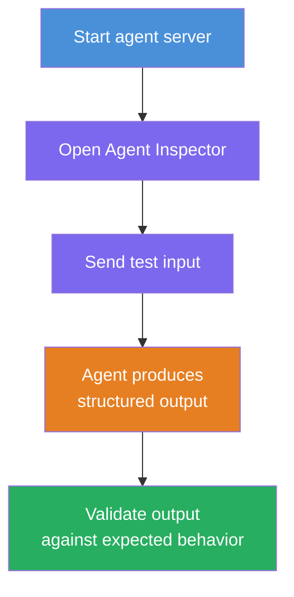
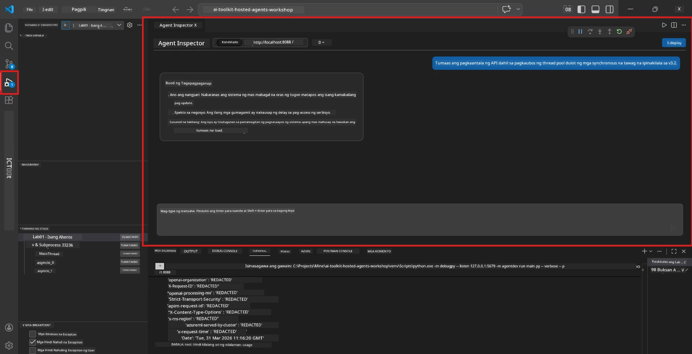
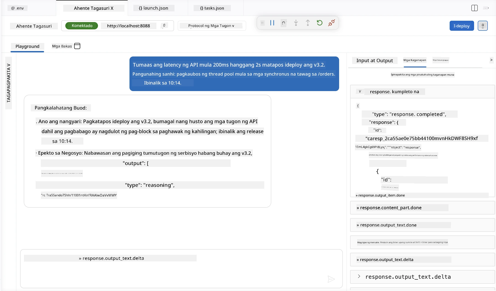

# Module 4 - Subukan Nang Lokal

⏱️ ~10 min

Sa module na ito, patakbuhin mo ang iyong ahente nang lokal at patunayan na ito ay gumagana nang maayos gamit ang **happy-path functional tests**. Gagamitin mo ang Agent Inspector (visual UI) o direktang mga tawag sa HTTP upang kumpirmahin na ang ahente ay gumagawa ng nakaayos at tumpak na mga tugon.

### Daloy ng lokal na pagsusuri



---

## Opsyon 1: Pindutin ang F5 - I-debug gamit ang Agent Inspector (inirerekomenda)

### Simulan ang debugger

1. Buksan ang **executive-summary-agent/** folder nang direkta sa VS Code (`File → Open Folder`).
2. Buksan ang **Run and Debug** panel (`Ctrl+Shift+D`).
3. Piliin ang **Debug Local Agent HTTP Server** mula sa dropdown.
4. Pindutin ang **F5** (o i-click ang ▶ Start Debugging).

> ⚠️ **Mahalaga: Piliin ang iyong Python Interpreter**
> Kung makakatanggap ka ng "ModuleNotFoundError" o hindi magsimula ang debugger, kailangan mong sabihin sa VS Code na gamitin ang iyong virtual environment:
  > 1. Pindutin ang `Ctrl+Shift+P` $\rightarrow$ i-type ang **Python: Select Interpreter**.
  > 2. Piliin ang interpreter na nasa `.venv` folder ng iyong proyekto (hal., `.\.venv\Scripts\python.exe` sa Windows).
  > 3. I-restart ang debug session.
> Kung patuloy pa rin ang mga error, manu-manong i-update ang iyong file `tasks.json` gaya ng sumusunod:
  > 1. Pumunta sa `.vscode/tasks.json` file
  > 2. Hanapin ang gawain na may label na: `Run Agent HTTP Server`
  > 3. I-update ang command value gaya ng sumusunod:
  >    - **Windows:** `"value": "${workspaceFolder}/.venv/Scripts/python.exe",`
  >    - **macOS/Linux:** `"value": "${workspaceFolder}/.venv/bin/python",`

### Ano ang nangyayari

1. Nagsisimula ang HTTP server sa `http://localhost:8088/responses`.
2. Awtomatikong bumubukas ang **Agent Inspector** panel - isang visual chat interface para sa pagsusuri.
3. Ang mga breakpoints ay pinapagana sa `main.py`.

Bantayan ang Terminal para sa:
```
Starting executive summary hosted agent
Executive agent server running on http://localhost:8088
```

> **Kung hindi bumukas ang Agent Inspector:** Pindutin ang `Ctrl+Shift+P` → **Foundry Toolkit: Open Agent Inspector**.



> *Ang screenshot ay maaaring magpakita ng mas lumang 'AI TOOLKIT' branding mula sa mas maagang bersyon ng extension.*

---

## Opsyon 2: Subukan sa Terminal (alternatibo)

Simulan ang ahente sa isang terminal, magpadala ng mga kahilingan mula sa isa pa:

```bash
# Terminal 1: Start agent
cd executive-summary-agent/
source .venv/bin/activate
python main.py
```

```bash
# Terminal 2: Send test (curl)
curl -sS -X POST http://localhost:8088/responses \
  -H "Content-Type: application/json" \
  -d '{"input": "The API latency increased due to thread pool exhaustion caused by sync calls in v3.2.", "stream": false}'
```

---

## Mga scenario test: Happy-path functional validation

Patakbuhin ang **lahat ng tatlong** scenario sa ibaba. Pinapatunayan nito na ang ahente mo ay gumagawa ng tamang nakaayos na output para sa makatotohanang input.



### Scenario 1: IT Incident - API latency spike

**Input:**
```
The API latency increased from 200ms to 2s after deploying v3.2.
Root cause: thread pool starvation from synchronous calls in /orders.
Rolled back at 10:14.
```

**Inaasahang kilos:**
- ✅ Sinusunod ang estruktura ng "Executive Summary" (Ano ang nangyari / Epekto sa negosyo / Susunod na hakbang)
- ✅ Walang teknikal na jargon (walang "thread pool", walang "/orders", walang "v3.2")
- ✅ Malinaw na inilalahad ang epekto sa negosyo (hal., nagkaroon ng delay ang mga gumagamit)
- ✅ May kasama na susunod na hakbang (hal., naisagawa na ang pag-aayos, may monitoring na)

---

### Scenario 2: Data Pipeline - ETL failure

**Input:**
```
The nightly ETL job failed because the upstream schema changed. APAC dashboards show missing data.
```

**Inaasahang kilos:**
- ✅ Binubuod ang failure ng data refresh sa payak na salita
- ✅ Binanggit ang epekto sa APAC dashboard
- ✅ May kasama na susunod na remedial na hakbang
- ✅ HINDI binabanggit ang "ETL", "schema", o iba pang teknikal na termino

---

### Scenario 3: Seguridad - Nailantad na credential

**Input:**
```
Static analysis flagged a hardcoded secret in the repository.
The secret may have been exposed in commit history.
```

**Inaasahang kilos:**
- ✅ Inilalarawan ang isyu sa credential/seguridad gamit ang lengguwaheng friendly sa executive
- ✅ Itinuro ang potensyal na panganib (walang pahintulot na access)
- ✅ Inilalahad ang remedial na aksyon (pag-ikot ng credential, audit)
- ✅ HINDI kasama ang mga terminong tulad ng "static analysis", "commit history", o "hardcoded"

---

## Mga pamantayan sa pagsusuri

Para sa bawat scenario, tingnan ang:

| # | Pamantayan | Kondisyon ng pagpasa |
|---|------------|---------------------|
| 1 | **Estruktura** | Ang tugon ay gumagamit ng "Executive Summary" na format na may tatlong bullets |
| 2 | **Payak na lengguwahe** | Walang teknikal na jargon na hindi mauunawaan ng isang executive |
| 3 | **Katumpakan** | Ang buod ay tumutugma sa input - walang pinagdududahang detalye |
| 4 | **Pagiging maigsi** | Ang tugon ay hindi lalampas sa 100 salita |
| 5 | **Susunod na hakbang** | Malinaw na aksyon o mitigasyon ang nakasaad |

---

## Mga tip sa pag-debug

| Isyu | Solusyon |
|-------|----------|
| Hindi nagsisimula ang ahente | Suriin ang mga halaga ng `.env`, tiyaking naka-activate ang venv, patakbuhin ang `pip install -r requirements.txt` |
| Walang laman o pangkalahatang tugon | Balikan ang mga tagubilin sa `main.py` - siguraduhing tinukoy ang format ng output |
| May jargon sa tugon | Palakasin ang mga patakaran na "tanggalin ang mga teknikal na termino" sa mga tagubilin |
| Hindi bumubukas ang Agent Inspector | `Ctrl+Shift+P` → **Foundry Toolkit: Open Agent Inspector** |
| Mga error ng modelo sa Terminal | Tiyaking tugma ang `AZURE_AI_MODEL_DEPLOYMENT_NAME` nang eksakto (case-sensitive) |

---

### ✅ Checkpoint

- [ ] Nagsisimula ang ahente nang lokal nang walang error
- [ ] Bumubukas ang Agent Inspector at nagpapakita ng chat interface (kung gamit ang F5)
- [ ] **Scenario 1** (IT incident) - nakaayos na Executive Summary, walang jargon
- [ ] **Scenario 2** (data pipeline) - may kaugnayang buod na may epekto sa negosyo
- [ ] **Scenario 3** (security alert) - angkop na komunikasyon ng panganib
- [ ] Lahat ng mga tugon ay sumusunod sa itinakdang estruktura ng output

> **I-save ang iyong mga tugon** (kopyahin o kunan ng screenshot) - ihahambing mo ito sa mga resulta sa cloud sa Module 06.

---

**Nakaraan:** [03 - Configure & Code](03-configure-and-code.md) · **Susunod:** [05 - Deploy to Foundry →](05-deploy-to-foundry.md)

---

<!-- CO-OP TRANSLATOR DISCLAIMER START -->
**Pagtatanggi**:
Ang dokumentong ito ay isinalin gamit ang serbisyo ng AI translation na [Co-op Translator](https://github.com/Azure/co-op-translator). Bagama't nagsusumikap kami para sa katumpakan, pakatandaan na ang awtomatikong pagsasalin ay maaaring maglaman ng mga pagkakamali o hindi pagkakatugma. Ang orihinal na dokumento sa orihinal nitong wika ang dapat ituring na pangunahing sanggunian. Para sa mahahalagang impormasyon, inirerekomenda ang propesyonal na pagsasalin ng tao. Hindi kami mananagot sa anumang maling pagkakaintindi o maling interpretasyon na nagmula sa paggamit ng pagsasaling ito.
<!-- CO-OP TRANSLATOR DISCLAIMER END -->