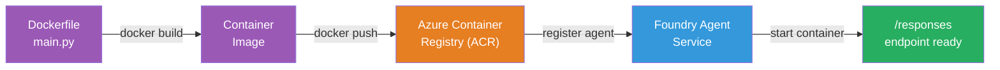
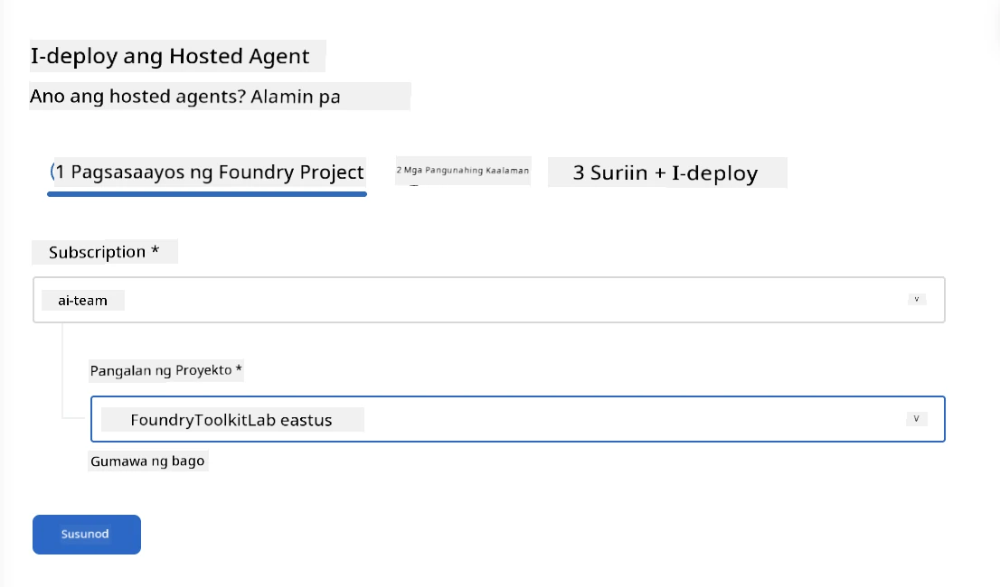
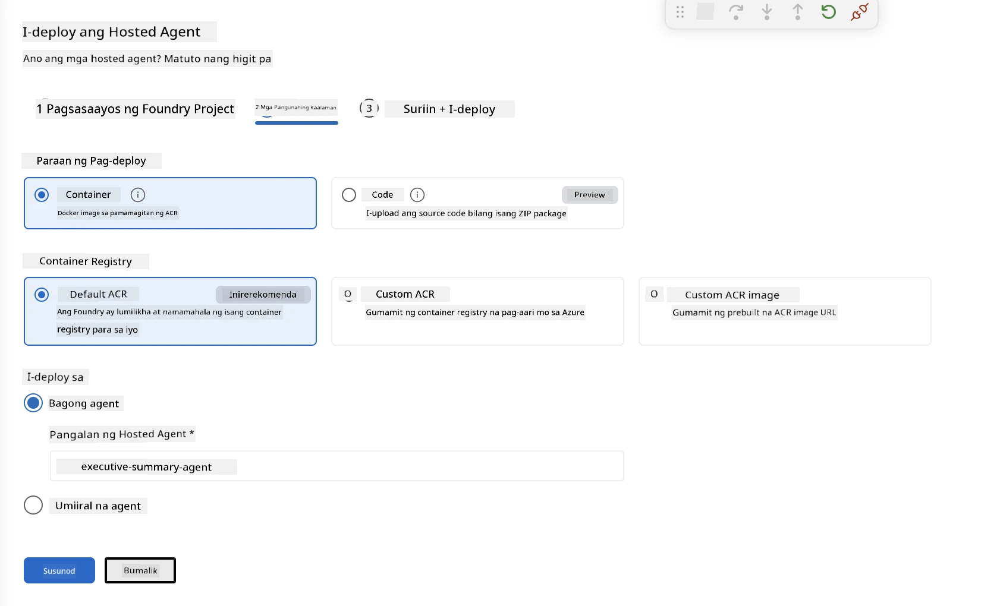
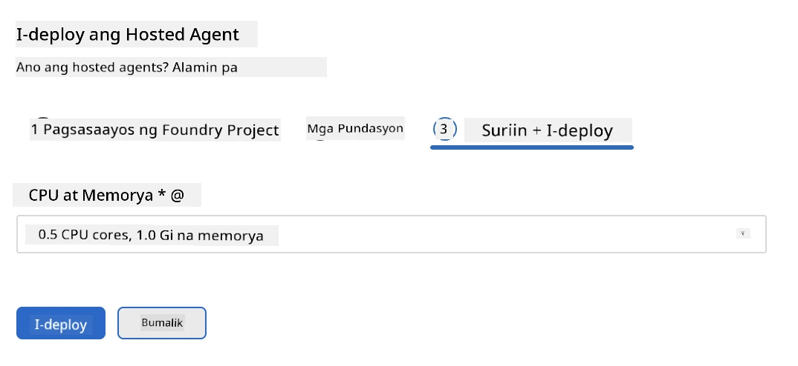
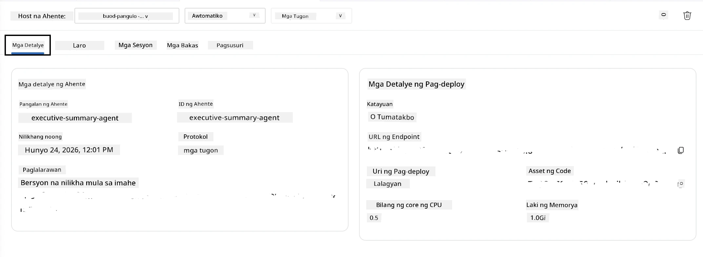

# Module 5 - Mag-deploy sa Foundry Agent Service

⏱️ ~10 min

> ⚠️ **Mga gumagamit ng Path B:** Nangangailangan ng Foundry subscription ang module na ito. Kung gumagamit ka ng Foundry Local, laktawan ito at pumunta sa [Module 07 - Summary](07-summary.md). Matagumpay mong natapos ang lokal na workflow ng pag-develop!

Sa module na ito, i-de-deploy mo ang iyong lokal na nasubok na agent sa Microsoft Foundry bilang isang **Hosted Agent**. Ang deployment ay bumubuo ng container image, itinutulak ito sa Azure Container Registry, at sinisimulan ang agent sa pinamamahalaang imprastraktura ng Foundry.

### Deployment pipeline

---

## Pagsusuri ng mga Kinakailangan

Bago mag-deploy, siguraduhing:

- [ ] Nakapasa ang Agent sa lahat ng 3 lokal na scenarios mula sa [Module 04](04-test-locally.md)
- [ ] May hawak kang **Azure AI User** role sa antas ng proyekto ([Module 01, Mag-assign ng RBAC](01-setup.md#deploy-a-model--assign-rbac))
- [ ] Nakalog-in ka sa Azure sa VS Code (Ipinapakita ng icon ng Accounts ang iyong pangalan)

---

## Hakbang 1: Simulan ang deployment

### Opsyon A: Mag-deploy mula sa Agent Inspector (inirerekomenda)

Kung bukas ang Agent Inspector (mula sa testing):
1. Pindutin ang **Deploy** na button sa itaas-kanan (icon ng ulap ↑).

### Opsyon B: Mag-deploy mula sa Command Palette

1. Pindutin ang `Ctrl+Shift+P` → **Foundry Toolkit: Deploy Hosted Agent**.

---

## Hakbang 2: I-configure ang deployment

Hihingin sa iyo ng wizard ang mga sumusunod:

| Prompt | Pinili |
|--------|---------|
| **Subscription** | Ang iyong Azure Subscription |
| **Target project** | Ang iyong Foundry project (hal. `workshop-agents`) |

Pindutin ang **next** upang i-configure ang iyong agent.

| Prompt | Pinili |
|--------|---------|
| **Deployment Method** | Container |
| **Container registry** | **Default ACR** (Ginagawa at pinamamahalaan ito ng Microsoft Foundry para sa iyo) |
| **Deploy to** | New Agent (pangalan, `executive-summary-agent`) |

Pindutin ang **next** upang repasuhin at i-deploy ang iyong agent.

| Prompt | Pinili |
|--------|---------|
| **CPU and memory** | **0.5 CPU cores, 1.0 Gi memory** (default - sapat para sa workshop) |

---

## Hakbang 3: I-deploy at i-monitor

1. Pindutin ang **Deploy**.
2. Tignan ang **Output** panel (pumili ng **Microsoft Foundry** mula sa dropdown).
3. Ang deployment ay dumadaan sa mga sumusunod na yugto:
   - **Docker build** - binubuo ang container mula sa iyong Dockerfile
   - **Docker push** - itinutulak ang image sa ACR (1–3 minuto sa unang deployment)
   - **Agent registration** - lumilikha ng hosted agent sa Foundry
   - **Container start** - sinisimulan gamit ang system-managed identity

4. Kapag tapos na, may lalabas na notification:
   > **executive-summary-agent ay matagumpay na na-deploy.** `View logs` `Run agent`

5. Pindutin ang **Run agent** upang buksan ang Agent Playground.

### Mga kahulugan ng status ng deployment

| Status | Kahulugan |
|--------|----------|
| **Running** | Handa na ang container, tumutugon ang agent |
| **Pending** | Nagsisimula pa ang container - maghintay ng 30–60 segundo |
| **Failed** | Tingnan ang mga logs (tingnan ang troubleshooting sa ibaba) |

---

## Mga Karaniwang Error sa Deployment

| Error | Ugat ng problema | Solusyon |
|-------|-----------------|---------|
| `agents/write` permission denied | Wala ang **Azure AI User** role sa antas ng proyekto | [Module 01, Mag-assign ng RBAC](01-setup.md#deploy-a-model--assign-rbac) |
| Docker hindi tumatakbo | Hindi pa nasisimulan ang Docker Desktop | Simulan ang Docker Desktop → tingnan ang `docker info` |
| ACR authorization | Hindi makapag-pull ng image ang managed identity | Tingnan ang [Module 08 - Troubleshooting](08-troubleshooting.md) |

---

### ✅ Checkpoint

- [ ] Natapos ang deployment nang walang error
- [ ] Lumabas ang Agent sa tab na **Hosted Agent** kapag pinindot mo ang **Agents** sa ilalim ng iyong proyekto sa Foundry Toolkit sidebar
- [ ] Ipinapakita ng status ng container ang **Running**
- [ ] Nabuksan ang Agent Playground tab na nagpapakita ng detalye ng agent at URL ng endpoint

---

**Nauna:** [04 - Test Locally](04-test-locally.md) · **Susunod:** [06 - Verify in Playground →](06-verify-in-playground.md)

---

<!-- CO-OP TRANSLATOR DISCLAIMER START -->
**Pagtatanggi**:
Ang dokumentong ito ay isinalin gamit ang serbisyo ng AI translation na [Co-op Translator](https://github.com/Azure/co-op-translator). Bagama't nagsusumikap kami para sa katumpakan, pakatandaan na ang awtomatikong pagsasalin ay maaaring maglaman ng mga pagkakamali o hindi pagkakatugma. Ang orihinal na dokumento sa orihinal nitong wika ang dapat ituring na pangunahing sanggunian. Para sa mahahalagang impormasyon, inirerekomenda ang propesyonal na pagsasalin ng tao. Hindi kami mananagot sa anumang maling pagkakaintindi o maling interpretasyon na nagmula sa paggamit ng pagsasaling ito.
<!-- CO-OP TRANSLATOR DISCLAIMER END -->