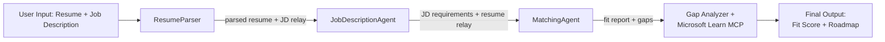

# PersonalCareerCopilot - Resume → Tagapagsuri ng Pagkakatugma sa Trabaho

Isang workflow-first na multi-agent na app na sumusuri kung gaano kahusay nagtatapat ang resume sa job description, pagkatapos ay bumubuo ng personalisadong learning roadmap upang punan ang mga kakulangan.

---

## Mga Ahente

| Ahente | Papel | Mga Kasangkapan |
|-------|------|-------|
| **ResumeParser** | Kumukuha ng istrakturadong mga kasanayan, karanasan, sertipikasyon mula sa teksto ng resume | - |
| **JobDescriptionAgent** | Kumukuha ng kinakailangang/preperadong mga kasanayan, karanasan, sertipikasyon mula sa JD | - |
| **MatchingAgent** | Inihahambing ang profile vs mga kinakailangan → iskor ng pagkakatugma (0-100) + tugmang/missing na mga kasanayan | - |
| **GapAnalyzer** | Gumagawa ng personalisadong learning roadmap gamit ang mga Microsoft Learn na mapagkukunan | `search_microsoft_learn_for_plan` (MCP) |

## Daloy ng Trabaho



---

## Mabilis na Pagsisimula

### 1. I-set up ang kapaligiran

Ang folder na ito ang reference implementation para sa workflow-based Lab 02 scaffold. Ang `main.py` nito ay gumagamit ng umiiral na mga prompt blocks kasama ang `WorkflowBuilder` upang pagdugtungin ang apat na ahente.

```powershell
cd workshop\lab02-multi-agent\PersonalCareerCopilot
python -m venv .venv
.\.venv\Scripts\Activate.ps1          # Windows PowerShell
# source .venv/bin/activate            # macOS / Linux
pip install -r requirements.txt
```

### 2. I-configure ang mga kredensyal

Lumikha ng isang `.env` file sa folder na ito:

```powershell
copy .env .env.bak 2>$null; echo $null > .env
```

I-edit ang `.env`:

```env
FOUNDRY_PROJECT_ENDPOINT=https://<your-account>.services.ai.azure.com/api/projects/<your-project>
AZURE_AI_MODEL_DEPLOYMENT_NAME=gpt-4.1-mini
```

| Halaga | Saan ito mahahanap |
|-------|------------------|
| `FOUNDRY_PROJECT_ENDPOINT` | Sidebar ng Foundry Toolkit → right-click ang iyong proyekto → **Copy Project Endpoint** |
| `AZURE_AI_MODEL_DEPLOYMENT_NAME` | Sidebar ng Foundry → palawakin ang proyekto → **Models + endpoints** → pangalan ng deployment |

### 3. Patakbuhin nang lokal

```powershell
python -m debugpy --listen 127.0.0.1:5679 main.py --port 8088
```

O gamitin ang task sa VS Code: `Ctrl+Shift+P` → **Tasks: Run Task** → **Run Agent HTTP Server**.

Para sa F5 debugging, gamitin ang **Debug Local Agent HTTP Server**.

### 4. Subukan gamit ang Agent Inspector

Buksan ang Agent Inspector: `Ctrl+Shift+P` → **Foundry Toolkit: Open Agent Inspector**.

I-paste ang test prompt na ito:

```
Resume:
Jane Doe
Senior Software Engineer with 5 years of experience in Python, Django, and AWS.
Built microservices handling 10K+ requests/second. Led a team of 4 developers.
Certifications: AWS Solutions Architect Associate.
Education: B.S. Computer Science, State University.

Job Description:
Senior Cloud Engineer at Contoso Ltd.
Required: Python, Azure, Kubernetes, Terraform, CI/CD pipelines.
Preferred: Go, monitoring (Prometheus/Grafana), cost optimization.
Experience: 5+ years in cloud infrastructure.
Certifications: Azure Solutions Architect Expert preferred.
```

**Inaasahan:** Isang iskor ng pagkakatugma (0-100), mga tugmang/missing na kasanayan, at isang personalisadong learning roadmap gamit ang mga URL ng Microsoft Learn.

### 5. I-deploy sa Foundry

`Ctrl+Shift+P` → **Foundry Toolkit: Deploy Hosted Agent** → piliin ang iyong proyekto → kumpirmahin.

---

## Istruktura ng Proyekto

```
PersonalCareerCopilot/
├── .env                ← Your credentials (git-ignored)
├── agent.yaml          ← Hosted agent definition (name, resources, env vars)
├── Dockerfile          ← Container image for Foundry deployment
├── main.py             ← 4-agent workflow (instructions, MCP tool, WorkflowBuilder)
└── requirements.txt    ← Python dependencies
```

## Mga Pangunahing file

### `agent.yaml`

Nagdedeklara ng hosted agent para sa Foundry Agent Service:
- `kind: hosted` - tumatakbo bilang isang managed container
- `protocols` - `responses` protocol kasama ang `version: 2.0.0`, na nagpapakita ng `/responses` HTTP endpoint
- `environment_variables` - Dito dineklara ang `AZURE_AI_MODEL_DEPLOYMENT_NAME`; awtomatikong ini-inject ang `FOUNDRY_PROJECT_ENDPOINT` sa oras ng deploy

### `main.py`

Naglalaman ng:
- **Tagubilin para sa Ahente** - apat na `*_INSTRUCTIONS` constants, isa bawat ahente
- **MCP tool** - `search_microsoft_learn_for_plan()` tumatawag sa `https://learn.microsoft.com/api/mcp` sa pamamagitan ng Streamable HTTP
- **Paglikha ng Ahente** - apat na `Agent()` + `AgentExecutor()` instances na nagbabahagi ng isang `FoundryChatClient`
- **Workflow graph** - `WorkflowBuilder` nag-uugnay sa mga ahente bilang magkakasunod na pipeline: ResumeParser → JD Agent → MatchingAgent → GapAnalyzer
- **Pagpatakbo ng Server** - `ResponsesHostServer` tumatakbo sa port 8088

### `requirements.txt`

| Package | Layunin |
|---------|----------|
| `agent-framework-foundry` | Core runtime: `Agent`, `AgentExecutor`, `WorkflowBuilder`, `@tool`, `FoundryChatClient` |
| `agent-framework-foundry-hosting` | `ResponsesHostServer` + integrasyon ng Foundry hosting |
| `mcp<2,>=1.24.0` | MCP client para sa GapAnalyzer (`streamable_http_client`) |
| `debugpy` | Python debugging (F5 sa VS Code) |

---

## Pag-aayos ng Problema

| Isyu | Ayusin |
|-------|-----|
| `KeyError: 'FOUNDRY_PROJECT_ENDPOINT'` o `KeyError: 'AZURE_AI_MODEL_DEPLOYMENT_NAME'` | Lumikha ng `.env` na may parehong naka-set na `FOUNDRY_PROJECT_ENDPOINT` at `AZURE_AI_MODEL_DEPLOYMENT_NAME` |
| `ModuleNotFoundError: No module named 'agent_framework'` | I-activate ang venv at patakbuhin ang `pip install -r requirements.txt` |
| Walang Microsoft Learn URL sa output | Suriin ang koneksyon sa internet papuntang `https://learn.microsoft.com/api/mcp` |
| Isang gap card lamang (naputol) | Suriin ang `GAP_ANALYZER_INSTRUCTIONS` kung kasama ang `CRITICAL:` block |
| Port 8088 ay ginagamit na | Itigil ang ibang mga server: `netstat -ano \| findstr :8088` |

Para sa mas detalyadong pag-aayos ng problema, tingnan ang [Module 8 - Troubleshooting](../docs/08-troubleshooting.md).

---

**Buong gabay:** [Lab 02 Docs](../docs/README.md) · **Bumalik sa:** [Lab 02 README](../README.md) · [Tahanan ng Workshop](../../../README.md)

---

<!-- CO-OP TRANSLATOR DISCLAIMER START -->
**Pagtatanggi**:
Ang dokumentong ito ay isinalin gamit ang serbisyo ng AI translation na [Co-op Translator](https://github.com/Azure/co-op-translator). Bagama't nagsusumikap kami para sa katumpakan, pakatandaan na ang awtomatikong pagsasalin ay maaaring maglaman ng mga pagkakamali o hindi pagkakatugma. Ang orihinal na dokumento sa orihinal nitong wika ang dapat ituring na pangunahing sanggunian. Para sa mahahalagang impormasyon, inirerekomenda ang propesyonal na pagsasalin ng tao. Hindi kami mananagot sa anumang maling pagkakaintindi o maling interpretasyon na nagmula sa paggamit ng pagsasaling ito.
<!-- CO-OP TRANSLATOR DISCLAIMER END -->