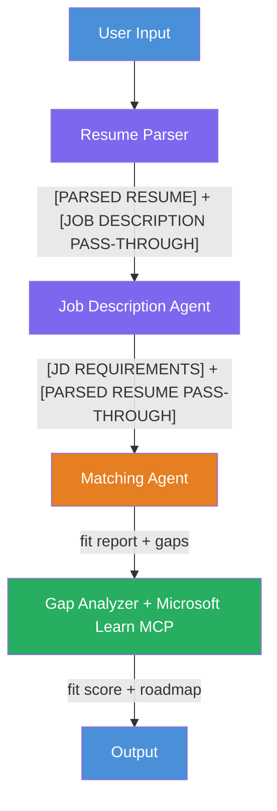

# Lab 02 - Multi-Agent Workflow: Resume → Tagatasa ng Pagkakatugma sa Trabaho

## Pangkalahatang-ideya

Sa hands-on na lab na ito, bubuo ka ng isang **workflow-first multi-agent app** gamit ang Foundry Toolkit sa VS Code at ide-deploy ito sa Microsoft Foundry Agent Service.

**Ang bubuuin mo:** isang Resume → Tagatasa ng Pagkakatugma sa Trabaho na naghahati ng resume at job description, nagbibigay ng iskor sa pagkakatugma, at lumilikha ng personalized na learning roadmap gamit ang mga resource ng Microsoft Learn.

---

## Arkitektura

**Paano ito gumagana:**
1. Ang user ay nag-paste ng resume at job description.
2. **ResumeParser** naghahati ng resume at kinokopya ang JD nang verbatim sa isang `[JOB DESCRIPTION PASS-THROUGH]` na seksyon.
3. **JD Agent** kumukuha ng istrukturadong mga pangangailangan mula sa pass-through, pagkatapos ay ipinapasa ang `[PARSED RESUME]` bilang `[PARSED RESUME PASS-THROUGH]`.
4. **MatchingAgent** ikinukumpara ang `[PARSED RESUME PASS-THROUGH]` vs `[JD REQUIREMENTS]` at gumagawa ng iskor ng pagkakatugma.
5. **GapAnalyzer** ginagawang praktikal na roadmap ang mga puwang at kumukuha ng totoong mga link ng Microsoft Learn sa pamamagitan ng MCP.

---

## Mga Kinakailangan

Kumpletuhin muna ang Lab 01:

- [Lab 01 - Single Agent](../lab01-single-agent/README.md)

---

## Bahagi 1: Basahin ang mga module nang sunod-sunod

Tingnan ang buong landas ng pagkatuto sa:

- [Lab 2 Docs - Prerequisites](docs/00-prerequisites.md)
- [Lab 2 Docs - Full Learning Path](docs/README.md)
- [PersonalCareerCopilot run guide](PersonalCareerCopilot/README.md)

---

## Bahagi 2: Bumuo at subukan ang workflow

1. Gamitin ang Foundry Toolkit wizard upang i-scaffold ang proyekto batay sa workflow.
2. Kopyahin ang mga prompt blocks at workflow graph mula sa `PersonalCareerCopilot/main.py` papunta sa iyong workspace.
3. Patakbuhin nang lokal gamit ang Agent Inspector at suriin ang lahat ng apat na ahente pati na ang tool na MCP.
4. I-deploy ang hosted agent sa Foundry kapag pumasa ang lokal na pagsubok.

---

## Mga pattern ng orkestrasyon

Gumagamit ang Lab 02 ng **sunod-sunod na pipeline**: ang output ng bawat ahente ay ipinapasok sa kasunod, at ang workflow ay nagbabalik ng huling tugon ng ahente. Dalawang pattern ang nagpapagana nito:

- **Sunod-sunod na chain** - `WorkflowBuilder` ang nag-uugnay sa ResumeParser → JD Agent → MatchingAgent → GapAnalyzer na may isang `add_edge()` na tawag sa bawat hakbang
- **Content relay** - dahil nakikita ng bawat ahente ang output lang ng direktang nauna sa kanya, kinokopya ng ResumeParser at JD Agent ang data na kailangan ng downstream agents sa mga naka-label na pass-through sections

Ipinaliwanag din sa docs kung bakit hindi gumagamit ang lab ng fan-out/fan-in, at kung paano palawakin ang graph gamit ang isa pang ahente.

Tingnan ang [docs/04-orchestration-patterns.md](docs/04-orchestration-patterns.md).

---

**Nakaraan:** [Lab 01 - Single Agent](../lab01-single-agent/README.md) · **Bumalik sa:** [Workshop Home](../../README.md)

---

<!-- CO-OP TRANSLATOR DISCLAIMER START -->
**Pagtatanggi**:
Ang dokumentong ito ay isinalin gamit ang serbisyo ng AI translation na [Co-op Translator](https://github.com/Azure/co-op-translator). Bagama't nagsusumikap kami para sa katumpakan, pakatandaan na ang awtomatikong pagsasalin ay maaaring maglaman ng mga pagkakamali o hindi pagkakatugma. Ang orihinal na dokumento sa orihinal nitong wika ang dapat ituring na pangunahing sanggunian. Para sa mahahalagang impormasyon, inirerekomenda ang propesyonal na pagsasalin ng tao. Hindi kami mananagot sa anumang maling pagkakaintindi o maling interpretasyon na nagmula sa paggamit ng pagsasaling ito.
<!-- CO-OP TRANSLATOR DISCLAIMER END -->