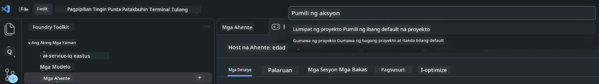

# Module 0 - Panimula

⏱️ ~10 min

> [!WARNING]
> **Preview & Limitations:** [Hosted Agents](https://learn.microsoft.com/azure/foundry/agents/concepts/hosted-agents) ay kasalukuyang nasa **pampublikong preview** - hindi inirerekomenda para sa mga production workloads. Ang ilang mga tampok na ipinakita sa workshop na ito ay maaaring magbago habang ang serbisyo ay papalapit sa GA.

## Ano ang iyong gagawin

Sa lab na ito, palalawakin mo ang mga kasanayan ng single-agent mula sa Lab 01 upang bumuo ng isang **multi-agent workflow** - ang Resume → Job Fit Evaluator.

I-paste mo ang isang **resume** at isang **job description**. Apat na specialized agents ang ipoproseso ang input nang sunud-sunod, pagkatapos ay ibabalik:
- Isang fit score (0–100 na may pagsusuri ng puntos)
- Isang listahan ng kakulangan sa kasanayan at sertipikasyon
- Isang personalized learning roadmap na may mga totoong link sa Microsoft Learn para sa bawat kakulangan

**Ginagamit ng workflow:**
- **Microsoft Agent Framework** - `WorkflowBuilder` para sa sunod-sunod na pipeline orchestration
- **Foundry Toolkit for VS Code** - mag-scaffold, subukan nang lokal, i-deploy
- **Isang AI model** (hal. `gpt-4.1-mini`) - ginagamit ng apat na agents
- **Microsoft Learn MCP server** - nagbibigay ng totoong learning resource links para sa bawat skill gap

---

## Piliin ang iyong landas

> ⚠️ **Magpatuloy gamit ang parehong landas na ginamit mo sa Lab 01.**

<details open>
<summary><strong>🅰️ Landas A - Azure cloud (kailangan ng Azure subscription)</strong></summary>

| | Mga Detalye |
|---|---|
| **Para kanino ito?** | Natapos mo ang Lab 01 gamit ang isang Azure subscription |
| **Modelo** | Azure OpenAI sa pamamagitan ng Foundry (hal. `gpt-4.1-mini`) |
| **Mga saklaw na modules** | Lahat ng modules (00–09) |
| **I-deploy ba sa cloud?** | ✅ Oo - buong end-to-end na deployment |

</details>

<details open>
<summary><strong>🅱️ Daan B - Foundry Local (hindi kailangan ng Azure subscription)</strong></summary>

| | Mga Detalye |
|---|---|
| **Para kanino ito?** | Natapos mo ang Lab 01 gamit ang Foundry Local |
| **Modelo** | Foundry Local (libre, tumatakbo sa iyong makina) |
| **Mga sakop na module** | Mga Module 00–05 (huwag pansinin ang 06–07 - deploy at cloud verify) |
| **I-deploy ba sa cloud?** | ❌ Hindi - lokal na pagsubok lang gamit ang Agent Inspector |

</details>

---

## Suriin ang Lab 01

Direktang nakabatay ang Lab 02 sa Lab 01. Tapusin muna ang Lab 01 bago magsimula dito.

Hindi mo pa nagagawa ang Lab 01? Magsimula dito: [Lab 01 - Panimula](../../lab01-single-agent/docs/00-prerequisites.md)

<details open>
<summary><strong>🅰️ Daan A - Azure cloud</strong></summary>

```powershell
az account show --query "{name:name, id:id}" --output table
```

Kung mabigo ito, patakbuhin ang `az login`. Pagkatapos suriin sa VS Code:

1. `Ctrl+Shift+P` → i-type ang **Foundry Toolkit** → kumpirmahin na lumitaw ang mga utos.
2. I-click ang icon ng **Foundry Toolkit** → ipapakita ang iyong proyekto at deployed model na **Napanalunan**.



> **RBAC:** Inilaan mo ang **Foundry User** sa Lab 01. Kung kailangan mo itong muling italaga, tingnan ang [Lab 01, Module 1](../../lab01-single-agent/docs/01-setup.md#deploy-a-model--assign-rbac). Ang papel ay dating tinawag na **Azure AI User** - pareho ang mga permiso.

</details>

<details open>
<summary><strong>🅱️ Path B - Foundry Local</strong></summary>

```powershell
Invoke-WebRequest -Uri "http://localhost:5273/v1/health" -UseBasicParsing | Select-Object StatusCode
```

Inaasahan: `StatusCode: 200`. Kung hindi, i-restart ang Foundry Local mula sa Foundry Toolkit sidebar.

> Lahat ng inference ay tumatakbo sa iyong makina. Ang tanging outbound call ay ang MCP tool sa `https://learn.microsoft.com/api/mcp`.

</details>

---

## Ano ang bago sa Lab 02

| | Lab 01 | Lab 02 |
|--|--------|--------|
| Mga Ahente | 1 | 4 (naka-chain sa WorkflowBuilder) |
| Template ng Scaffold | Basic - Agent Framework | Workflows - Agent Framework |
| Bagong package | - | `mcp` |
| Orkestrasyon | Isang conversational agent | Sunud-sunod na pipeline (WorkflowBuilder) |
| Bagong tool | - | `search_microsoft_learn_for_plan` (MCP) |

---

**Susunod:** [01 - Unawain ang Arkitektura →](01-understand-multi-agent.md)

---

<!-- CO-OP TRANSLATOR DISCLAIMER START -->
**Pagtatanggi**:
Ang dokumentong ito ay isinalin gamit ang serbisyo ng AI translation na [Co-op Translator](https://github.com/Azure/co-op-translator). Bagama't nagsusumikap kami para sa katumpakan, pakatandaan na ang awtomatikong pagsasalin ay maaaring maglaman ng mga pagkakamali o hindi pagkakatugma. Ang orihinal na dokumento sa orihinal nitong wika ang dapat ituring na pangunahing sanggunian. Para sa mahahalagang impormasyon, inirerekomenda ang propesyonal na pagsasalin ng tao. Hindi kami mananagot sa anumang maling pagkakaintindi o maling interpretasyon na nagmula sa paggamit ng pagsasaling ito.
<!-- CO-OP TRANSLATOR DISCLAIMER END -->