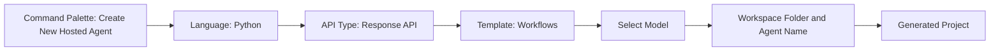
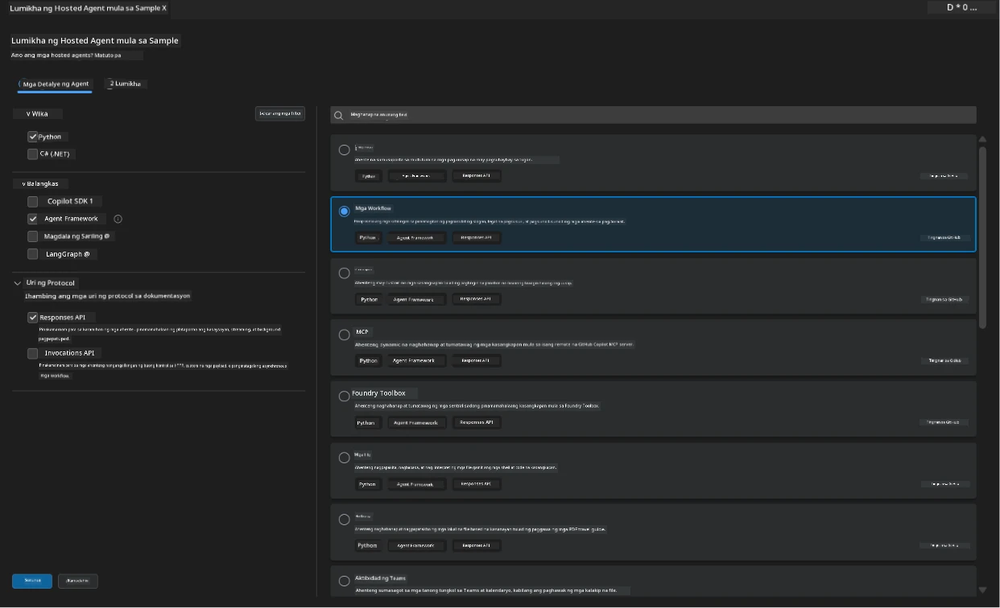
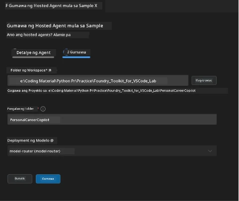

# Module 2 - Itayo ang Scaffold ng Multi-Agent na Proyekto

⏱️ ~5 min

Sa modyul na ito, gagamitin mo ang [Foundry Toolkit for VS Code](https://aka.ms/foundrytk) para **mag-scaffold ng multi-agent na proyekto**. Ang wizard ay gumagawa ng `agent.yaml`, `main.py`, `Dockerfile`, `requirements.txt`, `.env`, at VS Code debug configuration - upang makapagpokus ka sa pag-wire ng 4-agent na workflow sa Module 3.

> **Pangunahing konsepto:** Ang scaffold ay isang gumaganang stub na may isang agent. Papalitan mo ang placeholder na lohika gamit ang `WorkflowBuilder` na grap sa Module 3. Hindi mo kailangang isulat ang boilerplate mula sa simula.

> **Reference implementation:** [`PersonalCareerCopilot/`](../../../../../workshop/lab02-multi-agent/PersonalCareerCopilot) ay isang kumpletong gumaganang halimbawa. Gamitin ito upang ihambing ang iyong trabaho habang nagpapatuloy ka.

### Daloy ng wizard ng scaffold



---

## Hakbang 1: Buksan ang Create Hosted Agent wizard

1. Pindutin ang `Ctrl+Shift+P` upang buksan ang **Command Palette**.
2. I-type: **Foundry Toolkit: Create new Hosted Agent** at piliin ito.
3. Bubukas ang wizard sa tab na **Agent Details**.

> **Alternatibo:** I-click ang icon ng **Foundry Toolkit** sa Activity Bar → i-click ang icon na **+** sa tabi ng **Hosted Agents** → **Create New Hosted Agent**.

---

## Hakbang 2: Pumili ng mga setting



1. Sa kaliwang nabigasyon/opsyon na seksyon piliin ang mga sumusunod:

| Menu | Pinili | Tala |
|--------|-----------|-------|
| **Language** | Python | Sinusuportahan din ang C# (.NET) |
| **Framework** | Agent Framework | Nagbibigay ng `Agent`, `AgentExecutor`, `WorkflowBuilder` |
| **API type** | Response API | `POST /responses` - pamamahala ng platform sa kasaysayan, suporta sa streaming |
| **Template** | **Workflows** | Pinoproseso ang mga request sa pamamagitan ng maraming ahente ng sunod-sunod |

2. Kapag napili na, i-click ang **Next**



3. Sa susunod na window, piliin ang mga sumusunod:

| Menu | Pinili | Tala |
|--------|-----------|-------|
| **Workspace folder** | Mag-browse sa target na folder | e.g., `workshop/lab02-multi-agent/` sa repo na ito |
| **Agent name** | `PersonalCareerCopilot` | Ito ang magiging pangalan ng direktoryo ng proyekto |
| **Model Deployment** | Piliin ang na-deploy mong modelo | e.g., `gpt-4.1-mini` mula sa Lab 01 |

4. I-click ang **Create** upang simulan ang proyekto. Gumagawa ang VS Code ng mga file at binubuksan ang folder.

> **Tip:** [`gpt-4.1-mini`](https://learn.microsoft.com/azure/foundry/foundry-models/concepts/models-sold-directly-by-azure#gpt-41-series) ay balanseng mahusay sa bilis at kalidad para sa pag-develop ng multi-agent.

---

## Hakbang 3: Suriin ang nagawang proyekto

Pagkatapos makumpleto ang scaffold, tiyakin na makita mo ang mga file na ito sa Explorer (`Ctrl+Shift+E`):

```
📂 <your-agent-name>/
├── .azdignore          ← Files excluded from Azure Developer CLI deployments
├── .dockerignore       ← Files excluded from Docker builds
├── .env                ← Environment variables (placeholders - fill in Module 3)
├── .vscode/
│   ├── launch.json     ← Debug config (F5 → run + Agent Inspector)
│   └── tasks.json      ← VS Code task definitions
├── agent.yaml          ← Agent definition (kind: hosted, protocol: responses)
├── Dockerfile          ← Container config for deployment
├── main.py             ← Stub agent entry point (replace with WorkflowBuilder in Module 3)
└── requirements.txt    ← Python dependencies
```

> **Mahalaga:** Buksan ang scaffolded folder na ito nang direkta sa VS Code upang ang `.vscode/launch.json` at `tasks.json` ay gumana nang tama para sa F5 debugging.

### Mga pangunahing file na ipinaliwanag

| File | Layunin |
|------|---------|
| `agent.yaml` | Nagdedeklara ng `kind: hosted`, nagmamapa ng env vars, nagdedeklara ng `/responses` protocol |
| `main.py` | Stub: isang `FoundryChatClient` → `Agent` → `ResponsesHostServer`. Papalitan mo ito ng 4 na ahente + `WorkflowBuilder` sa Module 3 |
| `Dockerfile` | `python:3.12-slim`, nag-iinstall ng `requirements.txt`, nag-eexpose ng port 8088, nagpapatakbo ng `python main.py` |
| `requirements.txt` | `agent-framework-foundry`, `agent-framework-foundry-hosting`, `mcp<2,>=1.24.0`, `debugpy` |

> **Sanggunian:** Tingnan ang [`PersonalCareerCopilot/agent.yaml`](../../../../../workshop/lab02-multi-agent/PersonalCareerCopilot/agent.yaml) at [`PersonalCareerCopilot/requirements.txt`](../../../../../workshop/lab02-multi-agent/PersonalCareerCopilot/requirements.txt) para sa kumpletong nilalamang ginawa.

---

### ✅ Checkpoint

- [ ] Natapos ang scaffold wizard - bagong folder ng proyekto ay nakikita sa Explorer
- [ ] Lahat ng inaasahang file ay naroroon: `agent.yaml`, `main.py`, `Dockerfile`, `requirements.txt`, `.env`
- [ ] Ipinapakita ng `agent.yaml` ang `kind: hosted` at `protocol: responses`
- [ ] Nag-iimport ang `main.py` ng `Agent`, `FoundryChatClient`, `ResponsesHostServer`
- [ ] Ang scaffolded folder ay bukas bilang root ng workspace sa VS Code
- [ ] Naiintindihan mong ang `main.py` ay isang stub - ang `WorkflowBuilder` ay idadagdag sa Module 3

---

**Previous:** [01 - Understand Multi-Agent Architecture](01-understand-multi-agent.md) · **Next:** [03 - Configure Agents & Environment →](03-configure-agents.md)

---

<!-- CO-OP TRANSLATOR DISCLAIMER START -->
**Pagtatanggi**:
Ang dokumentong ito ay isinalin gamit ang serbisyo ng AI translation na [Co-op Translator](https://github.com/Azure/co-op-translator). Bagama't nagsusumikap kami para sa katumpakan, pakatandaan na ang awtomatikong pagsasalin ay maaaring maglaman ng mga pagkakamali o hindi pagkakatugma. Ang orihinal na dokumento sa orihinal nitong wika ang dapat ituring na pangunahing sanggunian. Para sa mahahalagang impormasyon, inirerekomenda ang propesyonal na pagsasalin ng tao. Hindi kami mananagot sa anumang maling pagkakaintindi o maling interpretasyon na nagmula sa paggamit ng pagsasaling ito.
<!-- CO-OP TRANSLATOR DISCLAIMER END -->