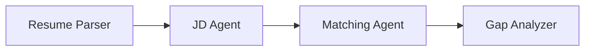
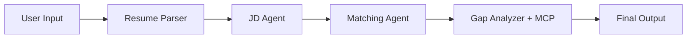

# Module 4 - Mga Pattern ng Orkestrasyon

⏱️ ~10 min

Sa module na ito, susuriin mo ang mga pattern ng orkestrasyon na ginamit sa Resume Job Fit Evaluator at matututuhan kung paano basahin, baguhin, at palawakin ang workflow graph. Mahalagang maunawaan ang mga pattern na ito para sa pag-debug ng mga isyu sa daloy ng datos at sa paggawa ng iyong sariling [multi-agent workflows](https://learn.microsoft.com/agent-framework/workflows/).

---

## Pattern 1: Sunud-sunod na kadena

Ang pangunahing pattern sa workflow ay ang **sunud-sunod na kadena** - ang output ng bawat ahente ay direktang ipinapasa sa susunod.



Sa code, bawat tawag na `add_edge()` ay lumilikha ng isang hakbang sa kadena:

```python
.add_edge(resume_executor, jd_executor)       # ResumeParser output → JD Agent
.add_edge(jd_executor, matching_executor)     # JD Agent output → MatchingAgent
.add_edge(matching_executor, gap_executor)    # MatchingAgent output → GapAnalyzer
```

> **Bakit sunud-sunod, hindi fan-out/fan-in?** Ginagamit ng `WorkflowBuilder` ang **OR-semantics** para sa mga papasok na gilid: ang isang executor sa ibaba ay tumatakbo sa oras na matapos **anumang** naunang executor. Kung magkakaroon ng dalawang papasok na gilid ang `matching_executor` (mula sa parehong `resume_executor` at `jd_executor`), tatakbo ito ng dalawang beses - isang beses kapag natapos ang ResumeParser at muli kapag natapos ang JD Agent - na magpapagana rin ng GapAnalyzer ng dalawang beses at lalabas ang output nang doble. Naiiwasan ito ng sunud-sunod na pipeline.

## Pattern 2: Paghahatid ng Nilalaman

Dahil ang `context_mode="last_agent"` ay nangangahulugang nakikita ng bawat executor ang output lamang ng **direktang naunang executor**, kailangang ipasa ng mga ahente sa sunud-sunod na kadena nang tahasan ang anumang datos na kailangan ng mga ahenteng nasa ibaba.

Sa workflow na ito:
- **ResumeParser** ay kinokopya ang verbatim na JD papunta sa `[JOB DESCRIPTION PASS-THROUGH]` (para makita ito ng JD Agent).
- **JD Agent** ay kinokopya ang verbatim na `[PARSED RESUME]` papunta sa `[PARSED RESUME PASS-THROUGH]` (para maikumpara ni MatchingAgent ang parehong mga profile).

```
ResumeParser output
└─ [PARSED RESUME]               ← extracted by JD Agent
└─ [JOB DESCRIPTION PASS-THROUGH] ← extracted by JD Agent

JD Agent output
└─ [JD REQUIREMENTS]             ← extracted by MatchingAgent
└─ [PARSED RESUME PASS-THROUGH]  ← extracted by MatchingAgent
```

Kailangang kopyahin nang **verbatim** ang bawat relay section - ang pagsasama ng buod o pagpapaliwanag ay sisira sa downstream na ahenteng umaasa dito.

---

## Ang kumpletong graph

Ang pinagsamang sunud-sunod na kadena at mga pattern ng paghahatid ng nilalaman ay bumubuo ng buong workflow:



Ipinapakita ng Agent Inspector ang parehong istruktura ng graph kapag tumatakbo ang ahente nang lokal. Tingnan ang [Module 5 - Test Locally](05-test-locally.md) para sa mga screenshot.

---

## Pagbabasa sa WorkflowBuilder code

Ang workflow graph ay binuo sa function na `main()` sa [`PersonalCareerCopilot/main.py`](../../../../../workshop/lab02-multi-agent/PersonalCareerCopilot/main.py). Ang tatlong tawag na `add_edge()` ay bumubuo ng sunud-sunod na pipeline:

| # | Gilid | Epekto |
|---|--------|---------|
| 1 | `resume_executor → jd_executor` | Natatanggap ng JD Agent ang `[PARSED RESUME]` + `[JOB DESCRIPTION PASS-THROUGH]` |
| 2 | `jd_executor → matching_executor` | Natatanggap ng MatchingAgent ang `[JD REQUIREMENTS]` + `[PARSED RESUME PASS-THROUGH]` |
| 3 | `matching_executor → gap_executor` | Natatanggap ng GapAnalyzer ang fit report + listahan ng gap |

---

## Pagbabago ng graph

### Pagsasama ng bagong ahente

Para magdagdag ng ikalimang ahente (halimbawa, isang **InterviewPrepAgent** pagkatapos ng GapAnalyzer):

1. Magdeklara ng isang constant na `INTERVIEW_PREP_INSTRUCTIONS`.
2. Gumawa ng mga object na `Agent` + `AgentExecutor` (parehong pattern ng kasalukuyang apat).
3. Magdagdag ng `.add_edge(gap_executor, interview_exec)` sa `WorkflowBuilder`.
4. I-update ang `output_executors=[interview_exec]`.

> **Mahalaga:** Ang `start_executor` lang ang ahenteng tumatanggap ng raw na input ng user. Lahat ng iba pang mga ahente ay tumatanggap ng output mula sa kanilang upstream na gilid.

---

## Mga karaniwang pagkakamali sa graph

| Pagkakamali | Sintomas | Ayusin |
|------------|----------|--------|
| Nawawalang gilid papunta sa `output_executors` | Tumatakbo ang ahente pero walang output | Siguraduhin na may daan mula `start_executor` papunta sa bawat ahente sa `output_executors` |
| Circular dependency | Walang katapusang loop o timeout | Suriing walang anumang ahente na nagpapasa pabalik sa upstream na ahente |
| Ahente sa `output_executors` na walang papasok na gilid | Walang laman ang output | Magdagdag ng kahit isang `add_edge(source, that_agent)` |
| Maraming `output_executors` nang walang fan-in | Nilalaman ng output ay sagot lang ng isang ahente | Gumamit ng isang output agent na nag-aaggrigate, o tanggapin ang maramihang mga output |
| Nawawalang `start_executor` | `ValueError` sa panahon ng build | Laging tukuyin ang `start_executor` sa `WorkflowBuilder()` |

---

## Pag-debug ng graph

### Paggamit ng Agent Inspector

1. Simulan ang ahente nang lokal gamit ang F5.
2. Buksan ang Agent Inspector (`Ctrl+Shift+P` → **Foundry Toolkit: Buksan ang Agent Inspector**).
3. Magpadala ng test message.
4. Sa response panel ng Inspector, hanapin ang **streaming output** - ipinapakita nito ang kontribusyon ng bawat ahente nang sunud-sunod.


### Paggamit ng logging

Magdagdag ng logging sa `main.py` upang masubaybayan ang daloy ng datos:

```python
import logging
logger = logging.getLogger("resume-job-fit")

# In main(), after building the workflow:
logger.info("Workflow graph built with edges: RP→JD, JD→MA, MA→GA")
```

Ipinapakita ng server logs ang pagkakasunod ng pagpapatakbo ng ahente at mga tawag sa MCP tool:

```
INFO:agent_framework:Executing agent: ResumeParser
INFO:agent_framework:Executing agent: JobDescriptionAgent
INFO:agent_framework:Executing agent: MatchingAgent
INFO:agent_framework:Executing agent: GapAnalyzer
INFO:agent_framework:Tool call: search_microsoft_learn_for_plan(skill="Kubernetes")
POST https://learn.microsoft.com/api/mcp → 200
INFO:agent_framework:Tool call: search_microsoft_learn_for_plan(skill="Terraform")
POST https://learn.microsoft.com/api/mcp → 200
```

---

### Checkpoint

- [ ] Kaya mong tukuyin ang dalawang pattern ng orkestrasyon sa workflow: sunud-sunod na kadena at paghahatid ng nilalaman
- [ ] Naiintindihan mo kung bakit nangangailangan ang `context_mode="last_agent"` ng tahasang paghahatid ng datos sa pagitan ng mga ahente
- [ ] Kaya mong basahin ang `WorkflowBuilder` na code at i-map ang bawat tawag na `add_edge()` sa visual graph
- [ ] Alam mo kung paano magdagdag ng bagong ahente sa dulo ng pipeline
- [ ] Kayang tukuyin ang mga karaniwang pagkakamali sa graph at ang kanilang mga sintomas

---

**Nakaraan:** [03 - I-configure ang mga Ahente at Kapaligiran](03-configure-agents.md) · **Susunod:** [05 - Subukan Nang Lokal →](05-test-locally.md)

---

<!-- CO-OP TRANSLATOR DISCLAIMER START -->
**Pagtatanggi**:
Ang dokumentong ito ay isinalin gamit ang serbisyo ng AI translation na [Co-op Translator](https://github.com/Azure/co-op-translator). Bagama't nagsusumikap kami para sa katumpakan, pakatandaan na ang awtomatikong pagsasalin ay maaaring maglaman ng mga pagkakamali o hindi pagkakatugma. Ang orihinal na dokumento sa orihinal nitong wika ang dapat ituring na pangunahing sanggunian. Para sa mahahalagang impormasyon, inirerekomenda ang propesyonal na pagsasalin ng tao. Hindi kami mananagot sa anumang maling pagkakaintindi o maling interpretasyon na nagmula sa paggamit ng pagsasaling ito.
<!-- CO-OP TRANSLATOR DISCLAIMER END -->