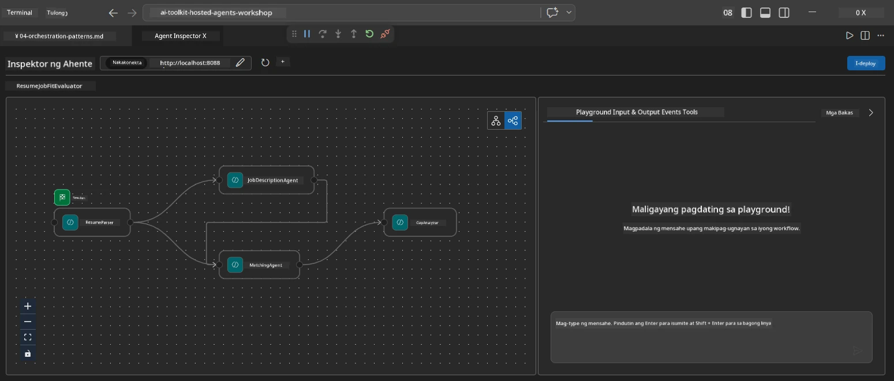
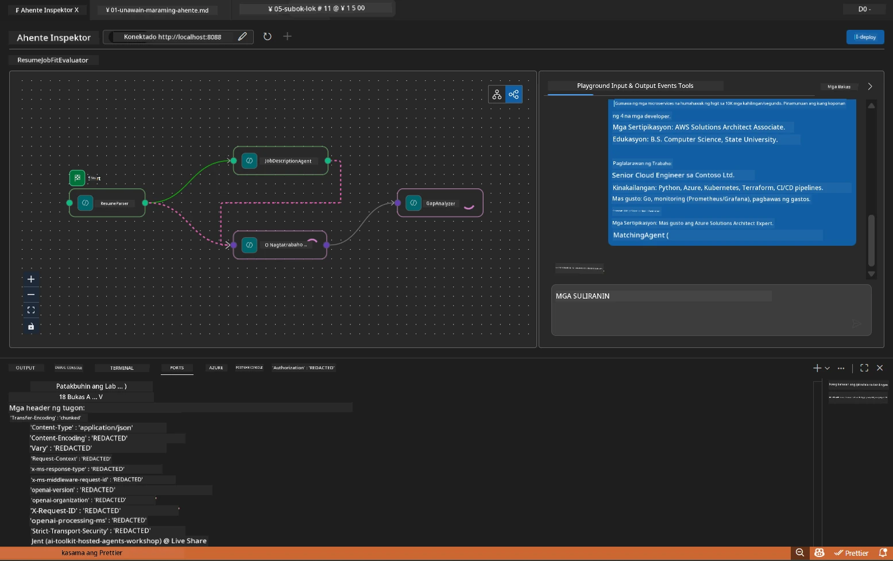
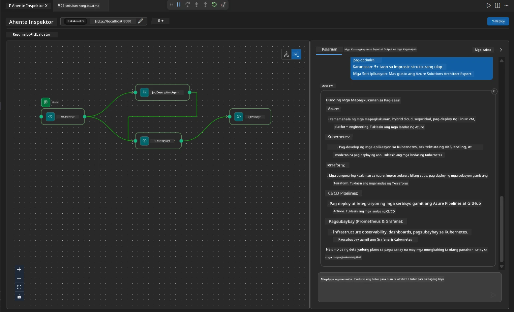

# Module 5 - Subukan Nang Lokal

⏱️ ~15 min

Sa module na ito, patakbuhin mo ang multi-agent workflow nang lokal, subukan ito gamit ang Agent Inspector, at tiyakin na ang lahat ng apat na ahente at ang tool na MCP ay gumagana nang tama bago i-deploy.

---

## Hakbang 1: Simulan ang server ng ahente

### Opsyon A: Gamit ang VS Code task (inirerekomenda)

1. Buksan ang `workshop/lab02-multi-agent/PersonalCareerCopilot/` bilang iyong VS Code folder.
2. Pindutin ang `Ctrl+Shift+P` → i-type ang **Tasks: Run Task** → piliin ang **Run Agent HTTP Server**.
3. Sinisimulan ng task ang server na may debugpy na nakakabit sa port `5679` at ang ahente sa port `8088`.
4. Maghintay hanggang lumabas ang startup message, kasunod ang sariling ready message ng server (may mga ibang log na linya sa pagitan):

```
INFO:resume-job-fit:Starting Resume -> Job Fit Evaluator HTTP server...
...
INFO:hypercorn.error:Running on http://0.0.0.0:8088 (CTRL + C to quit)
```

### Opsyon B: Gamit ang F5 (debug mode)

1. Pindutin ang `F5` → piliin ang **Debug Local Agent HTTP Server**.
2. Nagsisimula ang server na may full breakpoint support - kapaki-pakinabang para sa pag-inspeksyon ng MCP responses o outputs ng ahente.

---

## Hakbang 2: Buksan ang Agent Inspector

1. Pindutin ang `Ctrl+Shift+P` → i-type ang **Foundry Toolkit: Open Agent Inspector**.
2. Nagbubukas ang Agent Inspector bilang isang VS Code panel na nakakonekta sa `http://localhost:8088`.
3. Dapat mong makita ang interface ng ahente na handang tumanggap ng mga mensahe.



> **Kung hindi bumukas ang Agent Inspector:** Siguraduhing ganap nang nagsimula ang server (makikita mo ang `Running on http://0.0.0.0:8088` log). Kung abala ang port 5679, tingnan ang [Module 8 - Troubleshooting](08-troubleshooting.md).

---

## Hakbang 2b: (Opsyonal) Buksan ang Workflow Visualizer

Kasama sa Foundry Toolkit ang isang real-time na **Workflow Visualizer** na nagpapakita kung paano nag-iinteract ang mga ahente habang isinasagawa ang graph. Ito ay lalo na kapaki-pakinabang sa pag-debug ng multi-agent.

1. Pindutin ang `Ctrl+Shift+P` → i-type ang **Foundry Toolkit: Open Visualizer for Hosted Agents**.
2. Magbubukas ang isang bagong tab sa VS Code na nagpapakita ng live execution graph.
3. Habang nagpapadala ka ng mga mensahe sa Agent Inspector, awtomatikong nag-a-update ang visualizer - ang mga berdeng node ay nagpapahiwatig ng mga natapos na ahente, at ang mga animated na edges ay nagpapakita ng daloy ng data sa pagitan nila.

> **Port conflict:** Kung ang port ng visualizer ay ginagamit na, palitan ito sa VS Code Settings → **Extensions** → **Microsoft Foundry Configuration** → **Hosted Agents: Visualizer Port**.

---

## Hakbang 3: Patakbuhin ang mga smoke test

Patakbuhin ang dalawang test na ito nang magkakasunod. Ang bawat isa ay sumusubok ng mas maraming bahagi ng workflow.

### Test 1: Basic resume + job description

I-paste ang mga sumusunod sa Agent Inspector:

```
Resume:
Jane Doe
Senior Software Engineer with 5 years of experience in Python, Django, and AWS.
Built microservices handling 10K+ requests/second. Led a team of 4 developers.
Certifications: AWS Solutions Architect Associate.
Education: B.S. Computer Science, State University.

Job Description:
Senior Cloud Engineer at Contoso Ltd.
Required: Python, Azure, Kubernetes, Terraform, CI/CD pipelines.
Preferred: Go, monitoring (Prometheus/Grafana), cost optimization.
Experience: 5+ years in cloud infrastructure.
Certifications: Azure Solutions Architect Expert preferred.
```

**Inaasahang istruktura ng output:**

Dapat naglalaman ang tugon ng output mula sa lahat ng apat na ahente nang sunud-sunod:

1. **Output ng Resume Parser** - Dalawang section na may label: `[PARSED RESUME]` (profile ng kandidato na may naka-grupong kasanayan) at `[JOB DESCRIPTION PASS-THROUGH]` (tamang teksto ng JD na pinapasok sa JD Agent)
2. **Output ng JD Agent** - Structured na mga kailangan na haligi at pinaghiwalay ang required at preferred skills
3. **Output ng Matching Agent** - Fit score (0-100) na may breakdown, mga na-match na kasanayan, mga nawawalang kasanayan, mga puwang
4. **Output ng Gap Analyzer** - Mga indibidwal na gap card para sa bawat nawawalang kasanayan, bawat isa ay may Microsoft Learn URLs





### Ano ang dapat i-verify sa Test 1

| Suriin | Inaasahan | Pass? |
|-------|----------|-------|
| Naglalaman ng fit score ang tugon | Numero mula 0-100 na may breakdown | |
| Nakalista ang mga na-match na kasanayan | Python, CI/CD (bahagya), atbp. | |
| Nakalista ang mga nawawalang kasanayan | Azure, Kubernetes, Terraform, atbp. | |
| May gap cards para sa bawat nawawalang kasanayan | Isang card bawat kasanayan | |
| Naroroon ang Microsoft Learn URLs | Totoong `learn.microsoft.com` links | |
| Walang error messages sa tugon | Malinis at structured na output | |

### Test 2: Edge case - kandidatong mataas ang fit

I-paste ang resume na malapit na tumutugma sa JD upang tiyakin na kaya ng GapAnalyzer ang mga high-fit na kaso:

```
Resume:
Alex Chen
Senior Cloud Engineer with 7 years of experience.
Skills: Python, Azure (AKS, Functions, DevOps), Kubernetes, Terraform, CI/CD (GitHub Actions, Azure Pipelines), Go, Prometheus, Grafana, cost optimization.
Certifications: Azure Solutions Architect Expert, Azure DevOps Engineer Expert.
Led infrastructure migration to Azure for 3 enterprise clients.
Education: M.S. Computer Science, Tech University.

Job Description:
Senior Cloud Engineer at Contoso Ltd.
Required: Python, Azure, Kubernetes, Terraform, CI/CD pipelines.
Preferred: Go, monitoring (Prometheus/Grafana), cost optimization.
Experience: 5+ years in cloud infrastructure.
Certifications: Azure Solutions Architect Expert preferred.
```

**Inaasahang gawi:**
- Dapat ang fit score ay **80+** (kadalasang tumutugma ang mga kasanayan)
- Ang mga gap card ay dapat nakatuon sa polish/interview readiness kaysa sa pundasyong pag-aaral
- Sinasabi ng mga instruksiyon ng GapAnalyzer: "Kung fit >= 80, magpokus sa polish/interview readiness"

---

## Hakbang 4: Subukan gamit ang sarili mong data (opsyonal)

Subukan ang pag-paste ng sarili mong resume at totoong job description. Nakakatulong ito upang matiyak:

- Kaya ng mga ahente na hawakan ang iba't ibang format ng resume (chronological, functional, hybrid)
- Kaya ng JD Agent na hawakan ang iba't ibang estilo ng JD (bullet points, parapo, structured)
- Nagbabalik ang tool na MCP ng mga relevant na resources para sa totoong kasanayan
- Ang mga gap card ay naayon sa iyong partikular na background

> **Privacy - Path A (Foundry cloud):** Ang resume at teksto ng JD ay ipinapadala sa iyong Azure OpenAI deployment para sa inference. Hindi ito nilalagyan ng log o iniimbak ng workshop infrastructure. Gumamit ng placeholder na mga pangalan (hal., "Jane Doe") kung nais mo.
>
> **Privacy - Path B (Foundry Local):** Lahat ng apat na inference ng ahente ay tumatakbo nang buo sa iyong device. Ang resume at job description na teksto mo **ay hindi lumalabas ng iyong makina**. Ang tanging outbound na tawag ay ang tool na MCP na kumukuha ng mga resource mula sa `https://learn.microsoft.com/api/mcp`; ang query na iyon ay naglalaman lamang ng pangalan ng kasanayan, hindi ang iyong personal na data.

---

### Checkpoint

- [ ] Nagsimula nang matagumpay ang server sa port `8088` (may log na nagpapakita ng `Running on http://0.0.0.0:8088`)
- [ ] Nabuksan ang Agent Inspector at nakakonekta sa ahente
- [ ] Test 1: Kumpletong tugon na may fit score, matched/missing skills, gap cards, at Microsoft Learn URLs
- [ ] Test 2: Kandidatong mataas ang fit ay nakakuha ng score na 80+ na may mga rekomendasyong nakatuon sa polish
- [ ] Lahat ng gap cards ay naroon (isa bawat nawawalang kasanayan, walang putol)
- [ ] Walang error o stack traces sa server terminal

---

**Nakaraan:** [04 - Orchestration Patterns](04-orchestration-patterns.md) · **Sunod:** [06 - Deploy to Foundry →](06-deploy-to-foundry.md)

---

<!-- CO-OP TRANSLATOR DISCLAIMER START -->
**Pagtatanggi**:
Ang dokumentong ito ay isinalin gamit ang serbisyo ng AI translation na [Co-op Translator](https://github.com/Azure/co-op-translator). Bagama't nagsusumikap kami para sa katumpakan, pakatandaan na ang awtomatikong pagsasalin ay maaaring maglaman ng mga pagkakamali o hindi pagkakatugma. Ang orihinal na dokumento sa orihinal nitong wika ang dapat ituring na pangunahing sanggunian. Para sa mahahalagang impormasyon, inirerekomenda ang propesyonal na pagsasalin ng tao. Hindi kami mananagot sa anumang maling pagkakaintindi o maling interpretasyon na nagmula sa paggamit ng pagsasaling ito.
<!-- CO-OP TRANSLATOR DISCLAIMER END -->