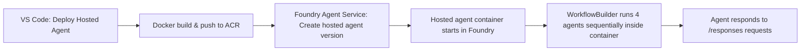
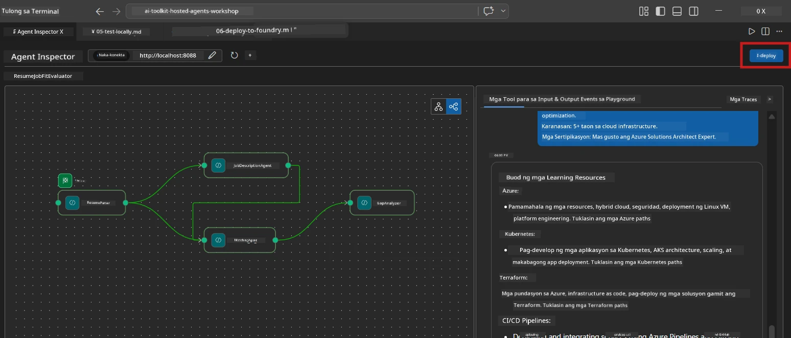
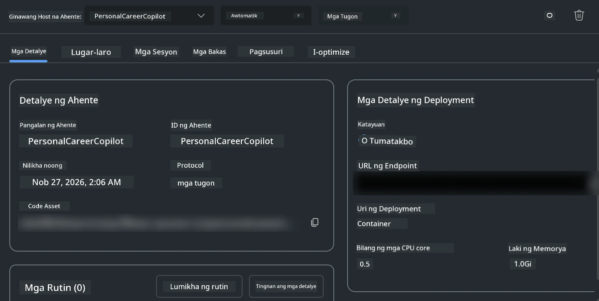

# Module 6 - Mag-deploy sa Foundry Agent Service

⏱️ ~10 min

Sa module na ito, ide-deploy mo ang iyong locally-tested multi-agent workflow sa [Microsoft Foundry](https://learn.microsoft.com/azure/foundry/agents/concepts/hosted-agents) bilang isang **Hosted Agent**. Ang proseso ng deployment ay bumubuo ng Docker container image, ito ay ipinapasa sa [Azure Container Registry (ACR)](https://learn.microsoft.com/azure/container-registry/container-registry-intro), at lumilikha ng hosted agent na bersyon sa [Foundry Agent Service](https://learn.microsoft.com/azure/foundry/agents/how-to/publish-agent).

> **Pangunahing pagkakaiba mula sa Lab 01:** Magkapareho ang proseso ng deployment. Tinitingnan ng Foundry ang iyong multi-agent workflow bilang isang solong hosted agent - ang kumplikasyon ay nasa loob ng container, ngunit ang surface ng deployment ay pareho `/responses` endpoint.

### Deployment pipeline



---

## Pagsusuri ng mga kinakailangan

Bago mag-deploy, tiyakin ang bawat item sa ibaba:

1. **Pumasa ang agent sa local smoke tests:**
   - Natapos mo ang parehong smoke tests sa [Module 5](05-test-locally.md) at ang workflow ay nagbigay ng kumpletong output na may mga gap card at Microsoft Learn URLs.

2. **Mayroon kang [Foundry User](https://learn.microsoft.com/azure/foundry/concepts/rbac-foundry) na papel** (para mag-deploy, kailangan mo ng mino-minimum na **Foundry Project Manager** sa saklaw ng proyekto):

   > **Tandaan:** Kamakailan lang na-rename ang Foundry RBAC roles - ang **Foundry User**, **Foundry Owner**, at **Foundry Project Manager** ay dating tinawag na Azure AI User, Azure AI Owner, at Azure AI Project Manager. Hindi nagbago ang Role IDs at mga pahintulot.

   - Tiyakin ito sa [Azure Portal](https://portal.azure.com) → iyong Foundry **project** resource → **Access control (IAM)** → **Role assignments** → kumpirmahin na ang **Foundry User** (o mas mataas) ay naka-lista para sa iyong account.

3. **Nakalog-in ka sa Azure sa VS Code:**
   - Tingnan ang Accounts icon sa ibabang kaliwang bahagi ng VS Code. Dapat makita ang pangalan ng iyong account.

4. **May tamang mga halaga ang `agent.yaml`:**
   - Buksan ang `PersonalCareerCopilot/agent.yaml` at tiyakin:
     ```yaml
     environment_variables:
       - name: AZURE_AI_MODEL_DEPLOYMENT_NAME
         value: ${AZURE_AI_MODEL_DEPLOYMENT_NAME}
     ```
   - Ang `FOUNDRY_PROJECT_ENDPOINT` ay **hindi** nakalista dito - iniinjek nito ang Foundry sa runtime. Tanging `AZURE_AI_MODEL_DEPLOYMENT_NAME` lang ang kailangang ideklara.

5. **May tamang mga bersyon ang `requirements.txt`:**
   ```
   agent-framework-foundry
   agent-framework-foundry-hosting
   mcp<2,>=1.24.0
   debugpy
   ```

---

## Hakbang 1: Simulan ang deployment

### Opsyon A: Mag-deploy mula sa Agent Inspector (inirerekomenda)

Kung tumatakbo ang agent gamit ang F5 na naka-open ang Agent Inspector:

1. Tingnan ang **kanang itaas na sulok** ng Agent Inspector panel.
2. I-click ang **Deploy** button (cloud icon na may up arrow ↑).
3. Lalabas ang deployment wizard.



### Opsyon B: Mag-deploy mula sa Command Palette

1. Pindutin ang `Ctrl+Shift+P` para buksan ang **Command Palette**.
2. I-type: **Foundry Toolkit: Deploy Hosted Agent** at piliin ito.
3. Lalabas ang deployment wizard.

---

## Hakbang 2: I-configure ang deployment

### 2.1 Piliin ang target na proyekto

1. May dropdown na nagpapakita ng iyong mga Foundry projects.
2. Piliin ang proyekto na ginamit mo sa buong workshop (hal., `workshop-agents`).

### 2.2 Piliin ang container agent file

1. Hihilingan kang pumili ng agent entry point.
2. Pumunta sa `workshop/lab02-multi-agent/PersonalCareerCopilot/` at piliin ang **`main.py`**.

### 2.3 I-configure ang mga resources

| Setting | Inirerekomendang halaga | Mga Tala |
|---------|-------------------------|----------|
| **Deployment Method** | **Container** (inirerekomenda) o **Code** | Nagbuo ang Container ng Docker image; Ina-upload ng Code ang source bilang ZIP (preview) |
| **Container Registry** | **Default ACR** | Gumagawa at nag-aalaga ng isa ang Foundry para sa iyo |
| **CPU** | `0.5` | Default. Hindi kailangan ng mas maraming CPU ang Multi-agent workflows dahil I/O-bound ang model calls |
| **Memory** | `1.0Gi` | Default. Itaas kung magdadagdag ka ng malalaking data processing tools |

---

## Hakbang 3: Kumpirmahin at mag-deploy

1. Ipinapakita ng wizard ang buod ng deployment.
2. Suriin at i-click ang **Confirm and Deploy**.
3. Panoorin ang progreso sa VS Code.

### Ano ang nangyayari habang nagde-deploy

Panoorin ang VS Code **Output** panel (piliin ang "Microsoft Foundry" dropdown):

1. **Docker build** - Bumubuo ng container mula sa iyong `Dockerfile`
   ```
   Step 1/6 : FROM python:3.12-slim
   Step 2/6 : WORKDIR /app
   ...
   Successfully built abc123def456
   ```

2. **Docker push** - Itinutulak ang image sa ACR (1-3 minuto sa unang deploy).

3. **Agent registration** - Gumagawa ang Foundry ng hosted agent gamit ang `agent.yaml` metadata. Ang pangalan ng agent ay `PersonalCareerCopilot`.

4. **Container start** - Nagsisimula ang container sa pinamamahalaang imprastruktura ng Foundry gamit ang system-managed identity.

> **Mas mabagal ang unang deployment** (imina-push ng Docker ang lahat ng layers). Ginagamit muli ang cached layers sa mga sumunod na deployment kaya mas mabilis ang mga ito.

### Mga tala na tiyak para sa multi-agent

- **Lahat ng apat na agent ay nasa loob ng isang container.** Nakikita ng Foundry ang isang single hosted agent. Tumatakbo ang WorkflowBuilder graph sa loob.
- **Lumalabas ang mga MCP call.** Kailangan ng container ng internet access para maabot ang `https://learn.microsoft.com/api/mcp`. Ang pinamamahalaang imprastruktura ng Foundry ay nagbibigay nito bilang default.
- **[Managed Identity](https://learn.microsoft.com/azure/foundry/agents/concepts/agent-identity).** Awtomatikong gumagawa ang Foundry ng **dedikadong per-agent Entra identity** para sa bawat Hosted agent sa oras ng deployment. Sa hosted environment, ang `DefaultAzureCredential` ay awtomatikong tumutukoy sa identity ng agent na ito - hindi kailangan ng manu-manong managed identity configuration.

---

## Hakbang 4: Beripikahin ang status ng deployment

1. Buksan ang **Foundry Toolkit** sidebar (i-click ang Foundry Toolkit icon sa Activity Bar).
2. Sa ilalim ng iyong proyekto sa **My Resources**, i-click ang **Agents**, at piliin ang tab na **Hosted Agent**.
3. I-click ang **PersonalCareerCopilot** (o ang pangalan ng iyong agent).
4. Bubukas ang **Hosted agent playground** sa tab na **Details**. Tingnan ang **Deployment Details** → **Status**:



| Status | Kahulugan |
|--------|-----------|
| **active** | Nakatakbo ang agent at handa nang tumanggap ng mga kahilingan |
| **creating** | Nagsisimula ang container (maghintay ng 30–60 segundo) |
| **failed** | Nabigo ang pagsisimula ng container (tingnan ang mga log - tingnan sa ibaba) |

> **Tandaan:** Maaaring magpakita ang tab na **Details** ng mga label tulad ng "Running" o "Started" habang ang ilalim na API status ay gumagamit ng `active`/`creating`. Parehong nagpapahiwatig ng parehong estado ang mga display na ito.

> **Mas matagal ang multi-agent startup** kaysa sa single-agent dahil naglilikha ang container ng 4 na instance ng agent sa pagsisimula. Ang `creating` nang hanggang 2 minuto ay normal.

---

## Karaniwang mga error sa deployment at mga solusyon

### Error 1: Permission denied - `agents/write`

```
Error: lacks the required data action 
Microsoft.CognitiveServices/accounts/AIServices/agents/write
```

**Ayusin:** I-assign ang **[Foundry User](https://learn.microsoft.com/azure/foundry/concepts/rbac-foundry)** na papel (dati **Azure AI User**) sa antas ng **proyekto**. Tingnan ang [Module 8 - Troubleshooting](08-troubleshooting.md) para sa hakbang-hakbang na gabay.

### Error 2: Hindi tumatakbo ang Docker

```
Error: Docker build failed / Cannot connect to Docker daemon
```

**Ayusin:**
1. Simulan ang Docker Desktop.
2. Maghintay hanggang lumabas ang "Docker Desktop is running".
3. Tiyakin: `docker info`
4. **Windows:** Siguraduhin na naka-enable ang WSL 2 backend sa Docker Desktop settings.
5. Subukang muli.

### Error 3: pumapalya ang pip install sa Docker build

```
Error: Could not find a version that satisfies the requirement agent-framework-foundry
```

**Ayusin:** Tingnan kung tugma ang `requirements.txt` sa:
```
agent-framework-foundry
agent-framework-foundry-hosting
mcp<2,>=1.24.0
debugpy
```

Kung pumapalya pa rin ang build, maaaring hinaharangan ng iyong Docker network ang PyPI. Tingnan ang `docker info` para sa mga setting ng proxy.

### Error 4: pumapalya ang MCP tool sa hosted agent

Kung hihinto ang Gap Analyzer sa paggawa ng Microsoft Learn URLs pagkatapos ng deployment:

**Sanhi:** Maaaring hinaharangan ng network policy ang outbound HTTPS mula sa container.

**Ayusin:**
1. Karaniwan, walang isyu ito sa default na configuration ng Foundry.
2. Kung mangyari, tingnan kung may NSG ang virtual network ng Foundry project na humaharang sa outbound HTTPS.
3. May mga built-in fallback URL ang MCP tool kaya patuloy pa rin ang output ng agent (kahit walang live URLs).

---

### Checkpoint

- [ ] Naitapos ang deployment command na walang error sa VS Code
- [ ] Lumitaw ang agent sa tab na **Hosted Agent** kapag kinlik mo ang **Agents** sa ilalim ng proyekto sa Foundry Toolkit sidebar
- [ ] Ang pangalan ng agent ay `PersonalCareerCopilot` (o ang iyong napiling pangalan)
- [ ] Ipinapakita ng status ng container ang **Started** o **Running**
- [ ] (Kung may mga error) Natukoy mo ang error, inapply ang ayos, at matagumpay na na-redploy

---

**Previous:** [05 - Test Lokally](05-test-locally.md) · **Next:** [07 - Verify in Playground →](07-verify-in-playground.md)

---

<!-- CO-OP TRANSLATOR DISCLAIMER START -->
**Pagtatanggi**:
Ang dokumentong ito ay isinalin gamit ang serbisyo ng AI translation na [Co-op Translator](https://github.com/Azure/co-op-translator). Bagama't nagsusumikap kami para sa katumpakan, pakatandaan na ang awtomatikong pagsasalin ay maaaring maglaman ng mga pagkakamali o hindi pagkakatugma. Ang orihinal na dokumento sa orihinal nitong wika ang dapat ituring na pangunahing sanggunian. Para sa mahahalagang impormasyon, inirerekomenda ang propesyonal na pagsasalin ng tao. Hindi kami mananagot sa anumang maling pagkakaintindi o maling interpretasyon na nagmula sa paggamit ng pagsasaling ito.
<!-- CO-OP TRANSLATOR DISCLAIMER END -->