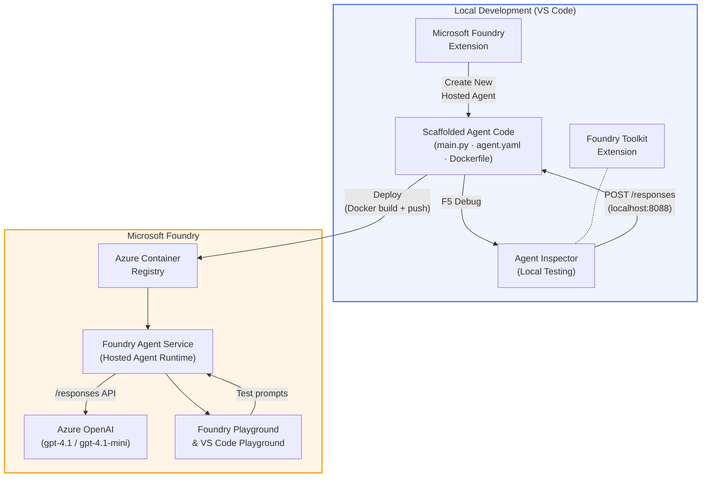

# Foundry Araç Kiti + Foundry Barındırılan Ajanlar Atölyesi

[](https://www.python.org/)
[](https://github.com/microsoft/agents)
[](https://learn.microsoft.com/azure/foundry/agents/concepts/hosted-agents)
[](https://ai.azure.com/)
[](https://learn.microsoft.com/azure/ai-services/openai/)
[](https://learn.microsoft.com/cli/azure/install-azure-cli)
[](https://learn.microsoft.com/azure/developer/azure-developer-cli/install-azd)
[](https://www.docker.com/)
[](https://marketplace.visualstudio.com/items?itemName=ms-windows-ai-studio.windows-ai-studio)
[](../../LICENSE)

Yapay zeka ajanlarını **Microsoft Foundry Agent Service**'e **Barındırılan Ajanlar** olarak oluşturun, test edin ve dağıtın - tamamen VS Code'dan **Microsoft Foundry uzantısı** ve **Foundry Araç Kiti** kullanarak.

> **Barındırılan Ajanlar şu anda önizlemededir.** Desteklenen bölgeler sınırlıdır - bkz. [bölge kullanılabilirliği](https://learn.microsoft.com/azure/foundry/agents/concepts/hosted-agents#region-availability).

> Her lab içindeki `agent/` klasörü Foundry uzantısı tarafından **otomatik olarak oluşturulur** - ardından kodu özelleştirir, yerel olarak test eder ve dağıtırsınız.

### 🌐 Çok Dilli Destek

#### GitHub Action ile desteklenir (Otomatik & Her Zaman Güncel)

<!-- CO-OP TRANSLATOR LANGUAGES TABLE START -->
[Arapça](../ar/README.md) | [Bengalce](../bn/README.md) | [Bulgarca](../bg/README.md) | [Burmaca (Myanmar)](../my/README.md) | [Çince (Basitleştirilmiş)](../zh-CN/README.md) | [Çince (Geleneksel, Hong Kong)](../zh-HK/README.md) | [Çince (Geleneksel, Makao)](../zh-MO/README.md) | [Çince (Geleneksel, Tayvan)](../zh-TW/README.md) | [Hırvatça](../hr/README.md) | [Çekçe](../cs/README.md) | [Danca](../da/README.md) | [Hollandaca](../nl/README.md) | [Estonca](../et/README.md) | [Fince](../fi/README.md) | [Fransızca](../fr/README.md) | [Almanca](../de/README.md) | [Yunanca](../el/README.md) | [İbranice](../he/README.md) | [Hintçe](../hi/README.md) | [Macarca](../hu/README.md) | [Endonezyaca](../id/README.md) | [İtalyanca](../it/README.md) | [Japonca](../ja/README.md) | [Kannada](../kn/README.md) | [Khmerce](../km/README.md) | [Korece](../ko/README.md) | [Litvanca](../lt/README.md) | [Malayca](../ms/README.md) | [Malayalamca](../ml/README.md) | [Marathi](../mr/README.md) | [Nepalice](../ne/README.md) | [Nijerya Pidgin](../pcm/README.md) | [Norveççe](../no/README.md) | [Farsça (Farsi)](../fa/README.md) | [Lehçe](../pl/README.md) | [Portekizce (Brezilya)](../pt-BR/README.md) | [Portekizce (Portekiz)](../pt-PT/README.md) | [Pencapça (Gurmukhi)](../pa/README.md) | [Romence](../ro/README.md) | [Rusça](../ru/README.md) | [Sırpça (Kiril)](../sr/README.md) | [Slovakça](../sk/README.md) | [Slovence](../sl/README.md) | [İspanyolca](../es/README.md) | [Svahili](../sw/README.md) | [İsveççe](../sv/README.md) | [Tagalog (Filipince)](../tl/README.md) | [Tamilce](../ta/README.md) | [Telugu](../te/README.md) | [Tayca](../th/README.md) | [Türkçe](./README.md) | [Ukraynaca](../uk/README.md) | [Urduca](../ur/README.md) | [Vietnamca](../vi/README.md)

> **Yerelde Kopyalamayı mı Tercih Ediyorsunuz?**
>
> Bu depo 50+ dil çevirisi içerir ve bu, indirme boyutunu önemli ölçüde artırır. Çeviriler olmadan kopyalamak için sparse checkout kullanın:
>
> **Bash / macOS / Linux:**
> ```bash
> git clone --filter=blob:none --sparse https://github.com/microsoft-foundry/Foundry_Toolkit_for_VSCode_Lab.git
> cd Foundry_Toolkit_for_VSCode_Lab
> git sparse-checkout set --no-cone '/*' '!translations' '!translated_images'
> ```
>
> **CMD (Windows):**
> ```cmd
> git clone --filter=blob:none --sparse https://github.com/microsoft-foundry/Foundry_Toolkit_for_VSCode_Lab.git
> cd Foundry_Toolkit_for_VSCode_Lab
> git sparse-checkout set --no-cone "/*" "!translations" "!translated_images"
> ```
>
> Bu, kursu tamamlamak için ihtiyacınız olan her şeyi çok daha hızlı bir indirme ile sağlar.
<!-- CO-OP TRANSLATOR LANGUAGES TABLE END -->

---

## Mimari



**Akış:** Foundry uzantısı ajan iskeletini oluşturur → kodu ve talimatları özelleştirirsiniz → Agent Inspector ile yerel olarak test edin → Foundry'ye dağıtın (Docker görüntüsü ACR'ye gönderilir) → Playground'da doğrulayın.

---

## Ne İnşa Edeceksiniz

| Lab | Açıklama | Durum |
|-----|-------------|--------|
| **Lab 01 - Tek Ajan** | **"Yöneticiye Göre Açıkla" Ajanını** oluşturun, yerel olarak test edin ve Foundry'ye dağıtın | ✅ Mevcut |
| **Lab 02 - Çoklu Ajan İş Akışı** | **"Özgeçmiş → İş Uyumu Değerlendiricisi"** oluşturun - 4 ajan, özgeçmiş uyumunu puanlamak ve bir öğrenme yol haritası oluşturmak için iş birliği yapar | ✅ Mevcut |

---

## Yönetici Ajanla Tanışın

Bu atölyede **"Yöneticiye Göre Açıkla" Ajanını** inşa edeceksiniz - karmaşık teknik jargonu alıp sakin, yönetim kurulu toplantısına uygun özetlere çeviren bir yapay zeka ajanı. Çünkü dürüst olalım, C-seviyesindekiler kimse "v3.2'de tanıtılan eşzamanlı çağrıların neden olduğu iş parçacığı havuzu tükenmesi" gibi şeyleri duymak istemez.

Bu ajanı, mükemmel hazırlanmış post-mortem raporumun yanıtının *"Yani... site kapalı mı, değil mi?"* olduğu yeterince çok olaydan sonra yaptım.

### Nasıl çalışır

Teknik bir güncelleme verirsiniz. O size bir yönetici özeti sunar - üç madde, jargon yok, yığın izleri yok, varoluşsal endişe yok. Sadece **ne oldu**, **iş etkisi** ve **bir sonraki adım**.

### Uygulamada görün

**Siz söylersiniz:**
> "API gecikmesi, v3.2'de tanıtılan eşzamanlı çağrıların neden olduğu iş parçacığı havuzu tükenmesi nedeniyle arttı."

**Ajan şöyle cevap verir:**

> **Yönetici Özeti:**
> - **Ne oldu:** Son sürümden sonra sistem yavaşladı.
> - **İş etkisi:** Bazı kullanıcılar hizmeti kullanırken gecikme yaşadı.
> - **Bir sonraki adım:** Değişiklik geri alındı ve yeniden dağıtımdan önce bir düzeltme hazırlanıyor.

### Neden bu ajan?

Bu, tek amaçlı, son derece basit bir ajan - karmaşık araç zincirlerine takılmadan barındırılan ajan iş akışını baştan sona öğrenmek için mükemmel. Ve dürüst olmak gerekirse? Her mühendislik ekibinin böyle bir ajana ihtiyacı olabilir.

---

## Atölye yapısı

```
📂 Foundry_Toolkit_for_VSCode_Lab/
├── 📄 README.md                      ← You are here
└── 📂 workshop/
    ├── 📂 lab01-single-agent/        ← Full lab: docs + agent code
    │   ├── README.md                 ← Hands-on lab instructions
    │   ├── 📂 docs/                  ← Step-by-step tutorial modules
    │   │   ├── 00-prerequisites.md
    │   │   ├── 01-setup.md
    │   │   ├── 02-create-hosted-agent.md
    │   │   ├── 03-configure-and-code.md
    │   │   ├── 04-test-locally.md
    │   │   ├── 05-deploy-to-foundry.md
    │   │   ├── 06-verify-in-playground.md
    │   │   ├── 07-summary.md
    │   │   └── 08-troubleshooting.md
    │   └── 📂 agent/                 ← Reference solution (auto-scaffolded by Foundry extension)
    │       ├── agent.yaml
    │       ├── Dockerfile
    │       ├── main.py
    │       └── requirements.txt
    └── 📂 lab02-multi-agent/         ← Resume → Job Fit Evaluator
        ├── README.md                 ← Hands-on lab instructions (end-to-end)
        ├── 📂 docs/                  ← Step-by-step tutorial modules
        │   ├── 00-prerequisites.md
        │   ├── 01-understand-multi-agent.md
        │   ├── 02-scaffold-multi-agent.md
        │   ├── 03-configure-agents.md
        │   ├── 04-orchestration-patterns.md
        │   ├── 05-test-locally.md
        │   ├── 06-deploy-to-foundry.md
        │   ├── 07-verify-in-playground.md
        │   └── 08-troubleshooting.md
        └── 📂 PersonalCareerCopilot/ ← Reference solution (multi-agent workflow)
            ├── agent.yaml
            ├── Dockerfile
            ├── main.py
            └── requirements.txt
```

> **Not:** Her laboratuvar içindeki `agent/` klasörü, **Microsoft Foundry extension**'ın Command Palette üzerinden `Microsoft Foundry: Create a New Hosted Agent` çalıştırdığınızda oluşturduğu şeydir. Dosyalar daha sonra ajanınızın talimatları, araçları ve yapılandırmasıyla özelleştirilir. Laboratuvar 01 bunu baştan oluşturmayı adım adım gösterir.

---

## Başlarken

### 1. Depoyu klonlayın

```bash
git clone https://github.com/microsoft-foundry/Foundry_Toolkit_for_VSCode_Lab.git
cd Foundry_Toolkit_for_VSCode_Lab
```

### 2. Bir Python sanal ortamı oluşturun

```bash
python -m venv venv
```

Etkinleştirin:

- **Windows (PowerShell):**
  ```powershell
  .\venv\Scripts\Activate.ps1
  ```
- **macOS / Linux:**
  ```bash
  source venv/bin/activate
  ```

### 3. Bağımlılıkları yükleyin

```bash
pip install -r workshop/lab01-single-agent/agent/requirements.txt
```

### 4. Ortam değişkenlerini yapılandırın

Agent klasörü içindeki örnek `.env` dosyasını kopyalayın ve değerlerinizi doldurun:

```bash
cp workshop/lab01-single-agent/agent/.env.example workshop/lab01-single-agent/agent/.env
```

Düzenleyin `workshop/lab01-single-agent/agent/.env`:

```env
AZURE_AI_PROJECT_ENDPOINT=https://<your-account>.services.ai.azure.com/api/projects/<your-project>
AZURE_AI_MODEL_DEPLOYMENT_NAME=<your-model-deployment-name>
```

### 5. Atölye laboratuvarlarını takip edin

Her laboratuvar kendi modülleriyle bağımsızdır. Temelleri öğrenmek için **Lab 01** ile başlayın, ardından çok ajanlı iş akışları için **Lab 02**'ye geçin.

#### Lab 01 - Tek Ajan ([tam talimatlar](workshop/lab01-single-agent/README.md))

| # | Modül | Bağlantı |
|---|--------|------|
| 1 | Önkoşulları okuyun | [00-prerequisites.md](workshop/lab01-single-agent/docs/00-prerequisites.md) |
| 2 | Foundry Toolkit & Foundry extension'ı yükleyin | [01-setup.md](workshop/lab01-single-agent/docs/01-setup.md) |
| 3 | Foundry projesi oluşturun | [01-setup.md](workshop/lab01-single-agent/docs/01-setup.md) |
| 4 | Barındırılan bir ajan oluşturun | [02-create-hosted-agent.md](workshop/lab01-single-agent/docs/02-create-hosted-agent.md) |
| 5 | Talimatları ve ortamı yapılandırın | [03-configure-and-code.md](workshop/lab01-single-agent/docs/03-configure-and-code.md) |
| 6 | Yerel olarak test edin | [04-test-locally.md](workshop/lab01-single-agent/docs/04-test-locally.md) |
| 7 | Foundry'ye dağıtın | [05-deploy-to-foundry.md](workshop/lab01-single-agent/docs/05-deploy-to-foundry.md) |
| 8 | playground'da doğrulayın | [06-verify-in-playground.md](workshop/lab01-single-agent/docs/06-verify-in-playground.md) |
| 9 | Sorun giderme | [08-troubleshooting.md](workshop/lab01-single-agent/docs/08-troubleshooting.md) |

#### Lab 02 - Çok Ajanlı İş Akışı ([tam talimatlar](workshop/lab02-multi-agent/README.md))

| # | Modül | Bağlantı |
|---|--------|------|
| 1 | Ön koşullar (Lab 02) | [00-prerequisites.md](workshop/lab02-multi-agent/docs/00-prerequisites.md) |
| 2 | Çok ajanlı mimariyi anlayın | [01-understand-multi-agent.md](workshop/lab02-multi-agent/docs/01-understand-multi-agent.md) |
| 3 | Çok ajanlı proje iskeletini oluşturun | [02-scaffold-multi-agent.md](workshop/lab02-multi-agent/docs/02-scaffold-multi-agent.md) |
| 4 | Ajanları ve ortamı yapılandırın | [03-configure-agents.md](workshop/lab02-multi-agent/docs/03-configure-agents.md) |
| 5 | Orkestrasyon desenleri | [04-orchestration-patterns.md](workshop/lab02-multi-agent/docs/04-orchestration-patterns.md) |
| 6 | Yerelde test et (çok ajanlı) | [05-test-locally.md](workshop/lab02-multi-agent/docs/05-test-locally.md) |
| 7 | Foundry'ye dağıt | [06-deploy-to-foundry.md](workshop/lab02-multi-agent/docs/06-deploy-to-foundry.md) |
| 8 | Playground'da doğrula | [07-verify-in-playground.md](workshop/lab02-multi-agent/docs/07-verify-in-playground.md) |
| 9 | Sorun giderme (çok ajanlı) | [08-troubleshooting.md](workshop/lab02-multi-agent/docs/08-troubleshooting.md) |

---

## Bakım Sorumlusu

<table>
<tr>
    <td align="center"><a href="https://github.com/ShivamGoyal03">
        <br />
        <sub><b>Shivam Goyal</b></sub>
    </a><br />
    </td>
</tr>
</table>

---

## Gerekli izinler (hızlı başvuru)

| Senaryo | Gerekli roller |
|----------|---------------|
| Yeni Foundry projesi oluştur | **Azure AI Owner** Foundry kaynağında |
| Mevcut projeye dağıt (yeni kaynaklar) | **Azure AI Owner** + **Contributor** abonelikte |
| Tam yapılandırılmış projeye dağıt | **Reader** hesapta + **Azure AI User** projede |

> **Önemli:** Azure `Owner` ve `Contributor` rolleri yalnızca *yönetim* izinlerini içerir, *geliştirme* (veri eylemi) izinlerini değil. Ajanları oluşturmak ve dağıtmak için **Azure AI User** veya **Azure AI Owner** gerekir.

---

## Referanslar

- [Hızlı Başlangıç: İlk barındırılan ajanınızı dağıtın (VS Code)](https://learn.microsoft.com/azure/foundry/agents/quickstarts/quickstart-hosted-agent)
- [Barındırılan ajanlar nedir?](https://learn.microsoft.com/azure/foundry/agents/concepts/hosted-agents)
- [VS Code'da barındırılan ajan iş akışları oluşturun](https://learn.microsoft.com/azure/foundry/agents/how-to/vs-code-agents-workflow-pro-code)
- [Barındırılan bir ajan dağıtın](https://learn.microsoft.com/azure/foundry/agents/how-to/deploy-hosted-agent)
- [Microsoft Foundry için RBAC](https://learn.microsoft.com/azure/foundry/concepts/rbac-foundry)
- [Mimari İnceleme Ajanı Örneği](https://github.com/Azure-Samples/agent-architecture-review-sample) - MCP araçları, Excalidraw diyagramları ve çift dağıtım içeren gerçek dünya barındırılan ajan

---


## Lisans

[MIT](../../LICENSE)

---

<!-- CO-OP TRANSLATOR DISCLAIMER START -->
**Feragatname**:
Bu belge, AI çeviri hizmeti [Co-op Translator](https://github.com/Azure/co-op-translator) kullanılarak çevrilmiştir. Doğruluk için çaba sarf etsek de, otomatik çevirilerin hata veya yanlışlık içerebileceğini lütfen unutmayınız. Orijinal belge, kendi dilinde yetkili kaynak olarak kabul edilmelidir. Kritik bilgiler için profesyonel insan çevirisi önerilir. Bu çevirinin kullanımı sonucu ortaya çıkabilecek yanlış anlamalardan veya yanlış yorumlamalardan sorumlu değiliz.
<!-- CO-OP TRANSLATOR DISCLAIMER END -->
