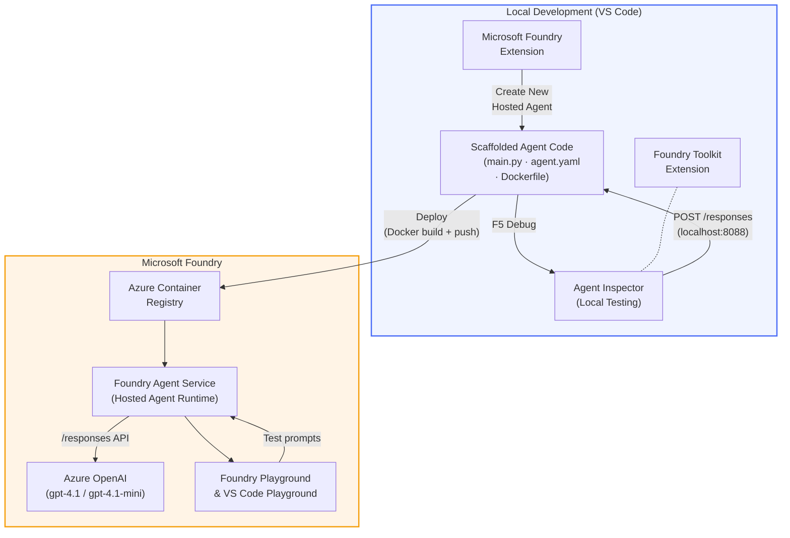

# Foundry Araç Seti + Foundry Barındırılan Ajanlar Atölyesi

[](https://www.python.org/)
[](https://learn.microsoft.com/agent-framework/)
[](https://learn.microsoft.com/azure/foundry/agents/concepts/hosted-agents)
[](https://ai.azure.com/)
[](https://learn.microsoft.com/azure/ai-services/openai/)
[](https://learn.microsoft.com/cli/azure/install-azure-cli)
[](https://learn.microsoft.com/azure/developer/azure-developer-cli/install-azd)
[](https://www.docker.com/)
[](https://marketplace.visualstudio.com/items?itemName=ms-windows-ai-studio.windows-ai-studio)
[](LICENSE)

AI ajanlarını **Microsoft Foundry Agent Service**'e **Barındırılan Ajanlar** olarak oluşturun, test edin ve dağıtın - tamamen VS Code üzerinden **Microsoft Foundry uzantısı** ve **Foundry Araç Seti** kullanarak.

> **Barındırılan Ajanlar şu anda önizlemededir.** Desteklenen bölgeler sınırlıdır - bkz. [bölge kullanılabilirliği](https://learn.microsoft.com/azure/foundry/agents/concepts/hosted-agents#region-availability).

> Her laboratuvar içindeki `agent/` klasörü **Foundry uzantısı tarafından otomatik olarak oluşturulur** - ardından kodu özelleştirir, yerel olarak test eder ve dağıtırsınız.

### 🌐 Çok Dilli Destek

#### GitHub Action ile Desteklenir (Otomatik ve Her Zaman Güncel)

<!-- CO-OP TRANSLATOR LANGUAGES TABLE START -->
[Arapça](../ar/README.md) | [Bengalce](../bn/README.md) | [Bulgarca](../bg/README.md) | [Birmanca (Myanmar)](../my/README.md) | [Çince (Basitleştirilmiş)](../zh-CN/README.md) | [Çince (Geleneksel, Hong Kong)](../zh-HK/README.md) | [Çince (Geleneksel, Makao)](../zh-MO/README.md) | [Çince (Geleneksel, Tayvan)](../zh-TW/README.md) | [Hırvatça](../hr/README.md) | [Çekçe](../cs/README.md) | [Danca](../da/README.md) | [Flemenkçe](../nl/README.md) | [Estonca](../et/README.md) | [Fince](../fi/README.md) | [Fransızca](../fr/README.md) | [Almanca](../de/README.md) | [Yunanca](../el/README.md) | [İbranice](../he/README.md) | [Hintçe](../hi/README.md) | [Macarca](../hu/README.md) | [Endonezce](../id/README.md) | [İtalyanca](../it/README.md) | [Japonca](../ja/README.md) | [Kannada](../kn/README.md) | [Khmer](../km/README.md) | [Korece](../ko/README.md) | [Litvanca](../lt/README.md) | [Malayca](../ms/README.md) | [Malayalamca](../ml/README.md) | [Marathi](../mr/README.md) | [Nepalce](../ne/README.md) | [Nijerya Pidgin](../pcm/README.md) | [Norveççe](../no/README.md) | [Farsça (Farsi)](../fa/README.md) | [Lehçe](../pl/README.md) | [Portekizce (Brezilya)](../pt-BR/README.md) | [Portekizce (Portekiz)](../pt-PT/README.md) | [Pencapça (Gurmukhi)](../pa/README.md) | [Rumence](../ro/README.md) | [Rusça](../ru/README.md) | [Sırpça (Sirilik)](../sr/README.md) | [Slovakça](../sk/README.md) | [Slovence](../sl/README.md) | [İspanyolca](../es/README.md) | [Svahili](../sw/README.md) | [İsveççe](../sv/README.md) | [Tagalogca (Filipince)](../tl/README.md) | [Tamilce](../ta/README.md) | [Telugu](../te/README.md) | [Tayca](../th/README.md) | [Türkçe](./README.md) | [Ukraynaca](../uk/README.md) | [Urduca](../ur/README.md) | [Vietnamca](../vi/README.md)

> **Yerel Klonlamayı mı Tercih Ediyorsunuz?**
>
> Bu depo 50'den fazla dil çevirisi içerir ve bu da indirme boyutunu önemli ölçüde artırır. Çeviriler olmadan klonlamak için seyrek kontrol (sparse checkout) kullanın:
>
> **Bash / macOS / Linux:**
> ```bash
> git clone --filter=blob:none --sparse https://github.com/microsoft-foundry/Foundry_Toolkit_for_VSCode_Lab.git
> cd Foundry_Toolkit_for_VSCode_Lab
> git sparse-checkout set --no-cone '/*' '!translations' '!translated_images'
> ```
>
> **CMD (Windows):**
> ```cmd
> git clone --filter=blob:none --sparse https://github.com/microsoft-foundry/Foundry_Toolkit_for_VSCode_Lab.git
> cd Foundry_Toolkit_for_VSCode_Lab
> git sparse-checkout set --no-cone "/*" "!translations" "!translated_images"
> ```
>
> Bu, kursu tamamlamak için gereken her şeyi çok daha hızlı bir indirme ile sağlar.
<!-- CO-OP TRANSLATOR LANGUAGES TABLE END -->

---

## Mimari



**Akış:** Foundry uzantısı ajanı oluşturur → siz kod ve talimatları özelleştirirsiniz → Agent Inspector ile yerel test yaparsınız → Foundry'e dağıtırsınız (Docker imajı ACR'ye gönderilir) → Playground'da doğrulama yaparsınız.

---

## Neyi inşa edeceksiniz

| Laboratuvar | Açıklama | Durum |
|-----|-------------|--------|
| **Laboratuvar 01 - Tek Ajan** | **"Yönetici Gibi Açıkla" Ajanı** oluşturun, yerelde test edin ve Foundry'e dağıtım yapın | ✅ Mevcut |
| **Laboratuvar 02 - Çoklu Ajan İş Akışı** | **"Özgeçmiş → İş Uyumluluk Değerlendiricisi"** oluşturun - 4 ajan bir arada çalışarak özgeçmiş uyumunu puanlayıp öğrenme yol haritası oluşturur | ✅ Mevcut |

---

## Yönetici Ajanla Tanışın

Bu atölyede **"Yönetici Gibi Açıkla" Ajanı**nı inşa edeceksiniz - karmaşık teknik terimleri sakin, yönetim kurulu dostu özetlere çeviren bir AI ajanı. Çünkü dürüst olalım, yönetim kademesindeki hiç kimse “v3.2’de tanıtılan eşzamanlı çağrılar nedeniyle oluşan iş parçacığı havuzu tükenmesi” hakkında dinlemek istemez.

Bu ajanı, kusursuzca hazırlanmış analiz raporuma aldığım yanıtın “Yani... site kapalı mı, kapalı değil mi?” olduğu birkaç olaydan sonra geliştirdim.

### Nasıl çalışır

Size teknik bir güncelleme verir. O da yönetici özeti ile karşılık verir - üç madde, jargon yok, yığın izleri yok, varoluşsal endişe yok. Sadece **ne oldu**, **iş etkisi** ve **sonraki adım**.

### Canlı görünün

**Siz söylersiniz:**
> "API gecikmesi, v3.2'de tanıtılan eşzamanlı çağrılar nedeniyle iş parçacığı havuzu tükenmesinden dolayı arttı."

**Ajan yanıt verir:**

> **Yönetici Özeti:**
> - **Ne oldu:** Son sürümden sonra sistem yavaşladı.
> - **İş etkisi:** Bazı kullanıcılar hizmeti kullanırken gecikmeler yaşadı.
> - **Sonraki adım:** Değişiklik geri alındı ve yeniden dağıtımdan önce bir düzeltme hazırlanıyor.

### Neden bu ajan?

Son derece basit, tek amaçlı bir ajan - barındırılan ajan iş akışını baştan sona karmaşık araç zincirlerine takılmadan öğrenmek için mükemmel. Ve dürüst olmak gerekirse? Her mühendislik ekibinin böyle birine ihtiyacı olabilir.

---

## Atölye yapısı

```
📂 Foundry_Toolkit_for_VSCode_Lab/
├── 📄 README.md                      ← You are here
└── 📂 workshop/
    ├── 📂 lab01-single-agent/        ← Full lab: docs + agent code
    │   ├── README.md                 ← Hands-on lab instructions
    │   ├── 📂 docs/                  ← Step-by-step tutorial modules
    │   │   ├── 00-prerequisites.md
    │   │   ├── 01-setup.md
    │   │   ├── 02-create-hosted-agent.md
    │   │   ├── 03-configure-and-code.md
    │   │   ├── 04-test-locally.md
    │   │   ├── 05-deploy-to-foundry.md
    │   │   ├── 06-verify-in-playground.md
    │   │   ├── 07-summary.md
    │   │   └── 08-troubleshooting.md
    │   └── 📂 agent/                 ← Reference solution (auto-scaffolded by Foundry extension)
    │       ├── agent.yaml
    │       ├── Dockerfile
    │       ├── main.py
    │       └── requirements.txt
    └── 📂 lab02-multi-agent/         ← Resume → Job Fit Evaluator
        ├── README.md                 ← Hands-on lab instructions (end-to-end)
        ├── 📂 docs/                  ← Step-by-step tutorial modules
        │   ├── 00-prerequisites.md
        │   ├── 01-understand-multi-agent.md
        │   ├── 02-scaffold-multi-agent.md
        │   ├── 03-configure-agents.md
        │   ├── 04-orchestration-patterns.md
        │   ├── 05-test-locally.md
        │   ├── 06-deploy-to-foundry.md
        │   ├── 07-verify-in-playground.md
        │   ├── 08-troubleshooting.md
        │   └── 09-summary.md
        └── 📂 PersonalCareerCopilot/ ← Reference solution (multi-agent workflow)
            ├── agent.yaml
            ├── Dockerfile
            ├── main.py
            └── requirements.txt
```

> **Not:** Her lab içindeki `agent/` klasörü, **Microsoft Foundry uzantısı**nın Komut Paleti'nden `Microsoft Foundry: Create a New Hosted Agent` çalıştırıldığında oluşturduğu klasördür. Dosyalar daha sonra ajanınızın talimatları, araçları ve yapılandırması ile özelleştirilir. Lab 01, bunu baştan oluşturma sürecini size adım adım gösterir.

---

## Başlarken

### 1. Depoyu klonlayın

```bash
git clone https://github.com/microsoft-foundry/Foundry_Toolkit_for_VSCode_Lab.git
cd Foundry_Toolkit_for_VSCode_Lab
```

### 2. Bir Python sanal ortamı kurun

```bash
python -m venv venv
```

Etkinleştirin:

- **Windows (PowerShell):**
  ```powershell
  .\venv\Scripts\Activate.ps1
  ```
- **macOS / Linux:**
  ```bash
  source venv/bin/activate
  ```

### 3. Bağımlılıkları yükleyin

```bash
pip install -r workshop/lab01-single-agent/agent/requirements.txt
```

### 4. Ortam değişkenlerini yapılandırın

Ajan klasöründeki örnek `.env` dosyasını kopyalayın ve kendi değerlerinizi doldurun:

```bash
cp workshop/lab01-single-agent/agent/.env.example workshop/lab01-single-agent/agent/.env
```

`workshop/lab01-single-agent/agent/.env` dosyasını düzenleyin:

```env
FOUNDRY_PROJECT_ENDPOINT=https://<your-account>.services.ai.azure.com/api/projects/<your-project>
AZURE_AI_MODEL_DEPLOYMENT_NAME=<your-model-deployment-name>
```

### 5. Atölye lablarını takip edin

Her lab, kendi modülleriyle kendi içinde tamamdır. Temelleri öğrenmek için **Lab 01** ile başlayın, ardından çoklu ajan iş akışları için **Lab 02**'ye geçin.

#### Lab 01 - Tek Ajan ([tam talimatlar](workshop/lab01-single-agent/README.md))

| # | Modül | Bağlantı |
|---|--------|------|
| 1 | Önkoşulları okuyun | [00-prerequisites.md](workshop/lab01-single-agent/docs/00-prerequisites.md) |
| 2 | Foundry Toolkit ve Foundry uzantısını yükleyin | [01-setup.md](workshop/lab01-single-agent/docs/01-setup.md) |
| 3 | Bir Foundry projesi oluşturun | [01-setup.md](workshop/lab01-single-agent/docs/01-setup.md) |
| 4 | Barındırılan bir ajan oluşturun | [02-create-hosted-agent.md](workshop/lab01-single-agent/docs/02-create-hosted-agent.md) |
| 5 | Talimatları ve ortamı yapılandırın | [03-configure-and-code.md](workshop/lab01-single-agent/docs/03-configure-and-code.md) |
| 6 | Yerelde test edin | [04-test-locally.md](workshop/lab01-single-agent/docs/04-test-locally.md) |
| 7 | Foundry’ye dağıtın | [05-deploy-to-foundry.md](workshop/lab01-single-agent/docs/05-deploy-to-foundry.md) |
| 8 | Playground’da doğrulayın | [06-verify-in-playground.md](workshop/lab01-single-agent/docs/06-verify-in-playground.md) |
| 9 | Özet ve sonraki adımlar | [07-summary.md](workshop/lab01-single-agent/docs/07-summary.md) |
| 10 | Sorun giderme | [08-troubleshooting.md](workshop/lab01-single-agent/docs/08-troubleshooting.md) |

#### Lab 02 - Çoklu Ajan İş Akışı ([tam talimatlar](workshop/lab02-multi-agent/README.md))

| # | Modül | Bağlantı |
|---|--------|------|
| 1 | Önkoşullar (Lab 02) | [00-prerequisites.md](workshop/lab02-multi-agent/docs/00-prerequisites.md) |
| 2 | Çoklu ajan mimarisini anlayın | [01-understand-multi-agent.md](workshop/lab02-multi-agent/docs/01-understand-multi-agent.md) |
| 3 | Çoklu ajan projesini iskeletleyin | [02-scaffold-multi-agent.md](workshop/lab02-multi-agent/docs/02-scaffold-multi-agent.md) |
| 4 | Ajanları ve ortamı yapılandırın | [03-configure-agents.md](workshop/lab02-multi-agent/docs/03-configure-agents.md) |
| 5 | Orkestrasyon kalıpları | [04-orchestration-patterns.md](workshop/lab02-multi-agent/docs/04-orchestration-patterns.md) |
| 6 | Yerelde test edin (çoklu ajan) | [05-test-locally.md](workshop/lab02-multi-agent/docs/05-test-locally.md) |
| 7 | Foundry’ye dağıtın | [06-deploy-to-foundry.md](workshop/lab02-multi-agent/docs/06-deploy-to-foundry.md) |
| 8 | Playground’da doğrulayın | [07-verify-in-playground.md](workshop/lab02-multi-agent/docs/07-verify-in-playground.md) |
| 9 | Sorun giderme (çoklu ajan) | [08-troubleshooting.md](workshop/lab02-multi-agent/docs/08-troubleshooting.md) |
| 10 | Özet ve sonraki adımlar | [09-summary.md](workshop/lab02-multi-agent/docs/09-summary.md) |

---

## Bakımcı

<table>
<tr>
    <td align="center"><a href="https://github.com/ShivamGoyal03">
        <br />
        <sub><b>Shivam Goyal</b></sub>
    </a><br />
    </td>
</tr>
</table>

---

## Gerekli izinler (hızlı referans)

| Senaryo | Gerekli roller |
|----------|---------------|
| Yeni bir Foundry projesi oluştur | Foundry kaynağında **Azure AI Sahibi** |
| Mevcut projeye dağıtım (yeni kaynaklar) | Abonelikte **Azure AI Sahibi** + **Katkıda Bulunan** |
| Tam yapılandırılmış projeye dağıtım | Hesapta **Okuyucu** + projede **Azure AI Kullanıcısı** |

> **Önemli:** Azure `Owner` ve `Contributor` rolleri yalnızca *yönetim* izinlerini içerir, *geliştirme* (veri aksiyonu) izinlerini içermez. Ajanlar oluşturmak ve dağıtmak için **Azure AI User** veya **Azure AI Owner** olmanız gerekir.

---

## Referanslar

- [Hızlı başlangıç: İlk barındırılan ajanınızı dağıtın (VS Code)](https://learn.microsoft.com/azure/foundry/agents/quickstarts/quickstart-hosted-agent)
- [Barındırılan ajanlar nedir?](https://learn.microsoft.com/azure/foundry/agents/concepts/hosted-agents)
- [VS Code'da barındırılan ajan iş akışları oluşturun](https://learn.microsoft.com/azure/foundry/agents/how-to/vs-code-agents-workflow-pro-code)
- [Barındırılan ajan dağıtın](https://learn.microsoft.com/azure/foundry/agents/how-to/deploy-hosted-agent)
- [Microsoft Foundry için RBAC](https://learn.microsoft.com/azure/foundry/concepts/rbac-foundry)
- [Mimari İnceleme Ajan Örneği](https://github.com/Azure-Samples/agent-architecture-review-sample) - MCP araçları, Excalidraw diyagramları ve çift dağıtımlı gerçek dünya barındırılan ajanı

---


## Lisans

[MIT](../../LICENSE)

---

<!-- CO-OP TRANSLATOR DISCLAIMER START -->
**Feragatname**:
Bu belge, AI çeviri hizmeti [Co-op Translator](https://github.com/Azure/co-op-translator) kullanılarak çevrilmiştir. Doğruluk için çaba sarf etsek de, otomatik çevirilerin hata veya yanlışlık içerebileceğini lütfen unutmayınız. Orijinal belge, kendi dilinde yetkili kaynak olarak kabul edilmelidir. Kritik bilgiler için profesyonel insan çevirisi önerilir. Bu çevirinin kullanımı sonucu ortaya çıkabilecek yanlış anlamalardan veya yanlış yorumlamalardan sorumlu değiliz.
<!-- CO-OP TRANSLATOR DISCLAIMER END -->