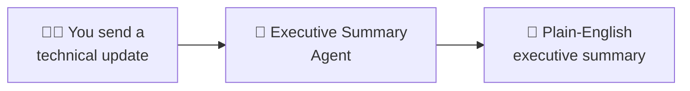

# Modül 0 - Giriş

⏱️ ~10 dk

> [!WARNING]
> **Önizleme ve Sınırlamalar:** [Barındırılan Ajanlar](https://learn.microsoft.com/azure/foundry/agents/concepts/hosted-agents) şu anda **herkese açık önizlemededir** - üretim iş yükleri için önerilmez. Aşağıdakilere dikkat edin:
> - **Desteklenen bölgeler sınırlıdır** - kaynak oluşturmadan önce [bölge uygunluğunu](https://learn.microsoft.com/azure/foundry/agents/concepts/hosted-agents#region-availability) kontrol edin. Desteklenmeyen bir bölge seçerseniz, dağıtım başarısız olur.
> - `agent-framework-foundry-hosting` paketi ön sürümdür - API'ler sürümler arasında değişebilir.
> - Ölçeklendirme sınırları: barındırılan ajanlar 0–5 kopya (ölçek sıfıra kadar dahil) destekler.
> - Bu atölyede gösterilen bazı özellikler, hizmet genel kullanıma ilerledikçe değişebilir.

## Ne inşa edeceksiniz

Bu atölyede, karmaşık teknik güncellemeleri alıp onları sade İngilizce yönetici özetleri olarak yeniden yazan **"Beni Yönetici Gibi Açıkla"** adlı barındırılan bir yapay zeka ajanı oluşturacaksınız.

**Ajan şunları kullanır:**
- **Microsoft Agent Framework** - ajan mantığı ve yapısı için
- **VS Code için Foundry Araç Takımı** - iskele kurmak, yerelde test etmek ve dağıtmak için
- **Bir Yapay Zeka modeli** (örneğin `gpt-4.1-mini/gpt-5-mini`) - özetleri oluşturmak için

Bu laboratuvarın sonunda, yerelde Agent Inspector ile test edebileceğiniz çalışan bir ajana sahip olacaksınız ve isteğe bağlı olarak buluta dağıtabilirsiniz.

---

## Barındırılan ajanlar nedir?

**Barındırılan ajan**, Microsoft Foundry'de yönetilen bir hizmet olarak çalışan yapay zeka ajanıdır. Kendi altyapınızı yönetmek yerine, ajan kodunuzu bir konteynere paketlersiniz ve Foundry ölçeklendirme, barındırma ve standart bir HTTP uç noktası aracılığıyla erişime açmayı üstlenir.

| Kavram | Anlamı |
|---------|--------------|
| **Ajan** | Kullanıcı mesajı alan, bir yapay zeka modeli çağıran ve yapılandırılmış yanıt döndüren Python kodunuz |
| **Barındırılan** | Foundry sizin için konteynerinizi çalıştırır - VM, Kubernetes veya yönetilecek altyapı yok |
| **Yanıt protokolü** | Herhangi bir istemcinin çağırabileceği standart bir HTTP API (`POST /responses`) ajanınla etkileşim için |
| **Agent Inspector** | Foundry Araç Takımına entegre yerel bir test kullanıcı arayüzü, dağıtımdan önce ajanınızla sohbet etmenizi sağlar |

Bu atölyede, sıfırdan tam barındırılan bir ajana geçecek ya da isterseniz yerel testte duracaksınız.

---

## Yolunuzu seçin

> ⚠️ **Devam etmeden önce bir yol seçin.** Seçiminiz hangi araçları yükleyeceğinizi ve hangi modüllerin geçerli olduğunu belirler. Sonradan Abonelik alırsanız Yol B → Yol A geçebilirsiniz.

<strong>🅰️ Yol A - Azure bulut (Azure aboneliği gerektirir)</strong>

| | Detaylar |
|---|---|
| **Kimler için?** | Aktif Azure aboneliğiniz var ve Foundry kaynakları oluşturabilirsiniz |
| **Model** | Foundry üzerinden Azure OpenAI (örneğin `gpt-4.1-mini/gpt-5-mini`) |
| **Kapsanan modüller** | Tüm modüller (00–07) |
| **Buluta dağıtım?** | ✅ Evet - tam uçtan uca dağıtım |

<strong>🅱️ Yol B - Yerel / ücretsiz katman (Azure aboneliği gerekmez)</strong>

| | Detaylar |
|---|---|
| **Kimler için?** | MVP'ler, öğrenciler veya Azure erişimi olmayanlar |
| **Model** | **Foundry Yerel** (ücretsiz, kendi makinenizde çalışır) |
| **Kapsanan modüller** | Modüller 00–04 (dağıtım ve bulut doğrulama atlanır) |
| **Buluta dağıtım?** | ❌ Hayır - sadece Agent Inspector ile yerel test |

---

## Tüm yollar için: Gerekli araçlar

Aşağıdaki her aracı yükleyin. Yükledikten sonra, kontrol komutu ile çalıştığını doğrulayın.

| # | Araç | Sürüm | Yükle | Doğrula (Beklenen Çıktı) |
|---|------|---------|---------|---------------------------|
| 1 | **Visual Studio Code** | En son | [code.visualstudio.com](https://code.visualstudio.com/) | Hatasız açılır |
| 2 | **Python** | 3.12 veya daha yüksek| [python.org/downloads](https://www.python.org/downloads/) | `python --version` $\rightarrow$ `Python 3.12.x` |
| 3 | **VS Code için Foundry Araç Takımı** | En son | Uzantı ID: `ms-windows-ai-studio.windows-ai-studio` | Aktivite Çubuğunda Foundry simgesi |
| 4 | **VS Code için Python uzantısı** | En son | Uzantı ID: `ms-python.python` | Uzantılar panelinde kurulu |

> [!TIP]
> **Kurulum için ipuçları:**
> - **Python PATH (Windows):** Python yükleyicisinin ilk ekranında her zaman **"Python'u PATH'e ekle"** seçeneğini işaretleyin. Bunu yapmazsanız `python` terminalinizde tanınmaz.
> - **Birden fazla Python sürümü:** Python 3.10 ve 3.12 yüklüyse, sanal ortamınızda doğru sürümün kullanıldığından emin olmak için `python3.12 -m venv .venv` kullanın.
> - **Docker WSL 2 (Windows):** Docker Desktop kurulumu sırasında **WSL 2 backend** seçeneğinin işaretli olduğundan emin olun. Hyper-V ile Docker daha yavaştır ve Foundry konteyner derlemelerinde sorun çıkarabilir.
> - **Docker başlamıyor mu?** Docker Desktop başlatıldıktan sonra 30–60 saniye bekleyin. Eğer `docker info` komutunu çalıştırdığınızda "Docker daemon'una bağlanılamıyor" görürseniz, Docker hala başlatılıyor demektir.
> - **VS Code uzantıları yüklenmiyor mu?** Uzantıları yükledikten sonra pencereyi yeniden yükleyin: `Ctrl+Shift+P` → `Developer: Reload Window`.

> **Windows kullanıcıları:** Python yüklerken **"Python'u PATH'e ekle"** seçeneğini işaretleyin.

**Sonraki:** [01 - Kurulum →](01-setup.md)

---

<!-- CO-OP TRANSLATOR DISCLAIMER START -->
**Feragatname**:
Bu belge, AI çeviri hizmeti [Co-op Translator](https://github.com/Azure/co-op-translator) kullanılarak çevrilmiştir. Doğruluk için çaba sarf etsek de, otomatik çevirilerin hata veya yanlışlık içerebileceğini lütfen unutmayınız. Orijinal belge, kendi dilinde yetkili kaynak olarak kabul edilmelidir. Kritik bilgiler için profesyonel insan çevirisi önerilir. Bu çevirinin kullanımı sonucu ortaya çıkabilecek yanlış anlamalardan veya yanlış yorumlamalardan sorumlu değiliz.
<!-- CO-OP TRANSLATOR DISCLAIMER END -->