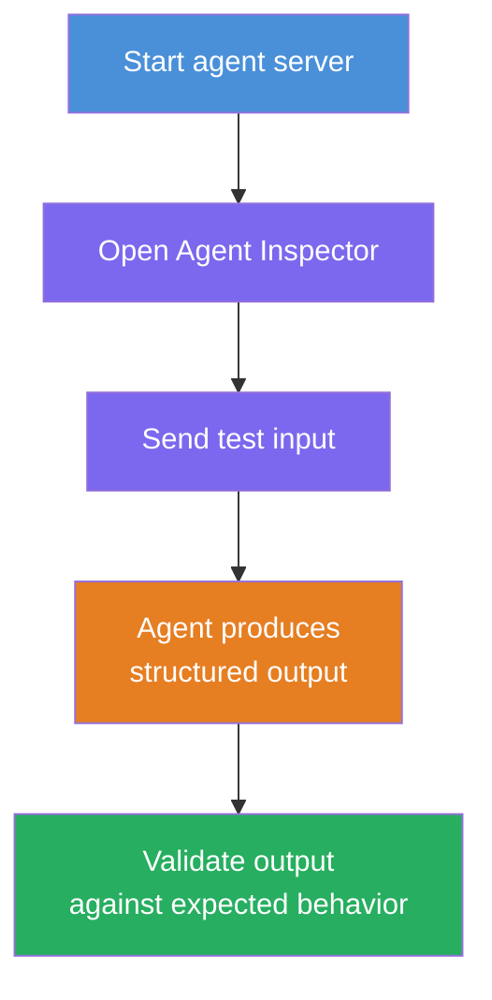
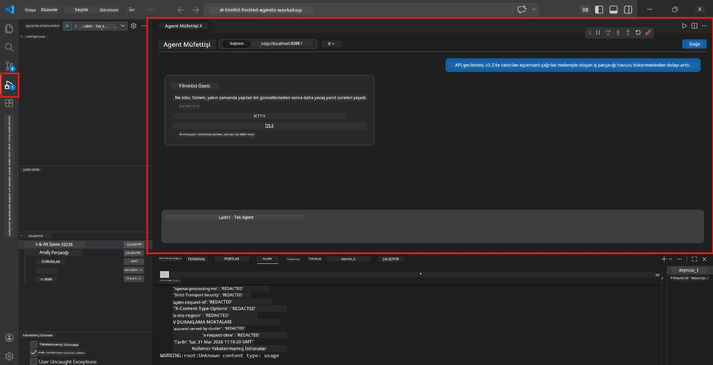
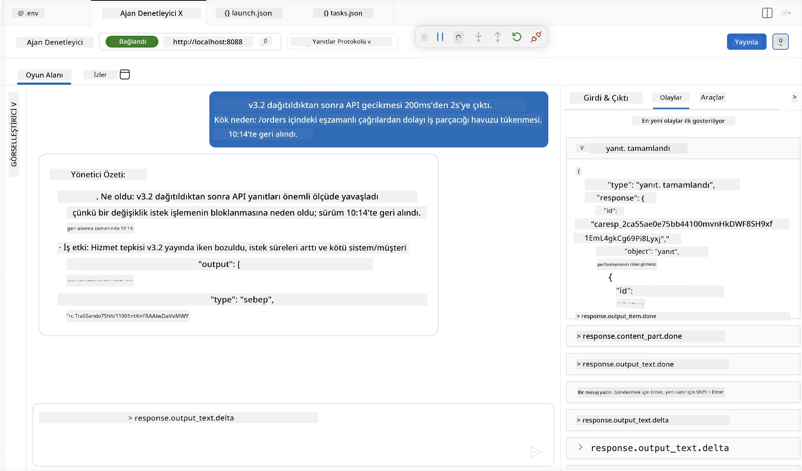

# Modül 4 - Yerel Olarak Test Etme

⏱️ ~10 dakika

Bu modülde, ajanınızı yerel olarak çalıştırır ve **mutlu yol fonksiyonel testleri** kullanarak doğru çalıştığını doğrularsınız. Ajanın yapılandırılmış, doğru yanıtlar ürettiğini onaylamak için Agent Inspector (görsel UI) veya doğrudan HTTP çağrılarını kullanacaksınız.

### Yerel test akışı



---

## Seçenek 1: F5'e basın - Agent Inspector ile hata ayıklama (önerilir)

### Hata ayıklayıcıyı başlatın

1. **executive-summary-agent/** klasörünü doğrudan VS Code'da (`File → Open Folder`) açın.
2. **Çalıştır ve Hata Ayıkla** panelini açın (`Ctrl+Shift+D`).
3. Açılır menüden **Yerel Agent HTTP Sunucusunu Hata Ayıkla** seçin.
4. **F5** tuşuna basın (veya ▶ Hata Ayıklamayı Başlat'a tıklayın).

> ⚠️ **Önemli: Python Yorumlayıcınızı seçin**
> "ModuleNotFoundError" alırsanız veya hata ayıklayıcı başlamazsa, VS Code'a sanal ortamınızı kullanmasını söylemelisiniz:
  > 1. Basın `Ctrl+Shift+P` $\rightarrow$ yazın **Python: Select Interpreter**.
  > 2. Projenizin `.venv` klasöründe bulunan yorumlayıcıyı seçin (örneğin, Windows üzerinde `.\.venv\Scripts\python.exe`).
  > 3. Hata ayıklama oturumunu yeniden başlatın.
> Hâlâ hatalar alıyorsanız, dosyanızı `tasks.json` elle aşağıdaki şekilde güncelleyin:
  > 1. `.vscode/tasks.json` dosyasına gidin
  > 2. `Run Agent HTTP Server` etiketli göreve gidin
  > 3. Komut değerini aşağıdaki gibi güncelleyin:
  >    - **Windows:** `"value": "${workspaceFolder}/.venv/Scripts/python.exe",`
  >    - **macOS/Linux:** `"value": "${workspaceFolder}/.venv/bin/python",`

### Ne olur

1. HTTP sunucusu `http://localhost:8088/responses` üzerinde başlatılır.
2. **Agent Inspector** paneli otomatik olarak açılır - test için görsel bir sohbet arayüzü.
3. Kesmeler `main.py` içinde etkinleştirilir.

Terminali İzleyin:
```
Starting executive summary hosted agent
Executive agent server running on http://localhost:8088
```

> **Agent Inspector açılmazsa:** `Ctrl+Shift+P` tuşuna basın → **Foundry Toolkit: Open Agent Inspector**.



> *Ekran görüntüsü, daha önceki bir uzantı sürümünden 'AI TOOLKIT' markasını gösterebilir.*

---

## Seçenek 2: Terminal üzerinden test (alternatif)

Ajansı bir terminalde başlatın, diğerinden istek gönderin:

```bash
# Terminal 1: Start agent
cd executive-summary-agent/
source .venv/bin/activate
python main.py
```

```bash
# Terminal 2: Send test (curl)
curl -sS -X POST http://localhost:8088/responses \
  -H "Content-Type: application/json" \
  -d '{"input": "The API latency increased due to thread pool exhaustion caused by sync calls in v3.2.", "stream": false}'
```

---

## Senaryo testleri: Doğru yol işlevsel doğrulama

Aşağıdaki **üç senaryonun tamamını** çalıştırın. Bunlar, temsilcinizin gerçekçi girdiler için doğru, yapılandırılmış çıktı ürettiğini doğrular.



### Senaryo 1: BT Olayı - API gecikme artışı

**Girdi:**
```
The API latency increased from 200ms to 2s after deploying v3.2.
Root cause: thread pool starvation from synchronous calls in /orders.
Rolled back at 10:14.
```

**Beklenen davranış:**
- ✅ "Yönetici Özeti" yapısını takip eder (Ne oldu / İş etkisi / Sonraki adım)
- ✅ Teknik terim kullanmaz ("thread pool" yok, "/orders" yok, "v3.2" yok)
- ✅ İş etkisini açıkça belirtir (örneğin, kullanıcılar gecikmeler yaşadı)
- ✅ Bir sonraki adımı içerir (örneğin, düzeltme uygulandı, izleme var)

---

### Senaryo 2: Veri Hattı - ETL başarısızlığı

**Girdi:**
```
The nightly ETL job failed because the upstream schema changed. APAC dashboards show missing data.
```

**Beklenen davranış:**
- ✅ Veri yenileme başarısızlığını sade bir dille özetler
- ✅ APAC gösterge tablosu etkisini belirtir
- ✅ Bir iyileştirme sonraki adımı içerir
- ✅ "ETL", "şema" veya diğer teknik terimleri içermez

---

### Senaryo 3: Güvenlik - Açığa çıkan kimlik bilgisi

**Girdi:**
```
Static analysis flagged a hardcoded secret in the repository.
The secret may have been exposed in commit history.
```

**Beklenen davranış:**
- ✅ Yönetici dostu dilde bir kimlik bilgisi/güvenlik sorununu açıklar
- ✅ Olası riski (yetkisiz erişim) belirtir
- ✅ İyileştirme eylemini belirtir (kimlik bilgisi yenileme, denetim)
- ✅ "statik analiz", "commit geçmişi" veya "hardcoded" gibi terimleri içermez

---

## Doğrulama kriterleri

Her senaryo için kontrol edin:

| # | Kriter | Geçme koşulu |
|---|----------|---------------|
| 1 | **Yapı** | Yanıt, tüm üç madde işareti ile "Yönetici Özeti" formatını kullanır |
| 2 | **Açık dil** | Bir yönetici tarafından anlaşılmayacak teknik terimler yok |
| 3 | **Doğruluk** | Özet, girdiyi yansıtıyor - uydurma detay yok |
| 4 | **Kısalık** | Yanıt 100 kelimenin altında |
| 5 | **Sonraki adım** | Belirgin bir eylem veya çözüm belirtilmiş |

---

## Hata ayıklama ipuçları

| Sorun | Çözüm |
|-------|-----|
| Ajan başlamıyor | `.env` değerlerini kontrol edin, venv'in aktif olduğunu doğrulayın, `pip install -r requirements.txt` çalıştırın |
| Boş veya genel yanıt | `main.py` içindeki talimatları gözden geçirin - çıktı formatının belirtildiğinden emin olun |
| Yanıt jargon içeriyor | Talimatlarda "teknik terimleri kaldır" kurallarını güçlendirin |
| Agent Inspector açılmıyor | `Ctrl+Shift+P` → **Foundry Toolkit: Agent Inspector'ı Aç** |
| Terminalde model hataları | `AZURE_AI_MODEL_DEPLOYMENT_NAME` ile tam eşleştiğinden emin olun (büyük/küçük harf duyarlı) |

---

### ✅ Kontrol Noktası

- [ ] Ajan yerel olarak hatasız başlıyor
- [ ] Agent Inspector açılıyor ve bir sohbet arayüzü gösteriyor (F5 kullanılıyorsa)
- [ ] **Senaryo 1** (BT olayı) - yapısal Yönetici Özeti, jargon yok
- [ ] **Senaryo 2** (veri hattı) - iş etkisini içeren ilgili özet
- [ ] **Senaryo 3** (güvenlik uyarısı) - uygun risk iletişimi
- [ ] Tüm yanıtlar tanımlı çıktı yapısını takip ediyor

> **Yanıtlarınızı kaydedin** (kopyalayın veya ekran görüntüsü alın) - Modül 06'da bulut sonuçlarıyla karşılaştıracaksınız.

---

**Önceki:** [03 - Yapılandır & Kod](03-configure-and-code.md) · **Sonraki:** [05 - Foundry'ye Dağıt →](05-deploy-to-foundry.md)

---

<!-- CO-OP TRANSLATOR DISCLAIMER START -->
**Feragatname**:
Bu belge, AI çeviri hizmeti [Co-op Translator](https://github.com/Azure/co-op-translator) kullanılarak çevrilmiştir. Doğruluk için çaba sarf etsek de, otomatik çevirilerin hata veya yanlışlık içerebileceğini lütfen unutmayınız. Orijinal belge, kendi dilinde yetkili kaynak olarak kabul edilmelidir. Kritik bilgiler için profesyonel insan çevirisi önerilir. Bu çevirinin kullanımı sonucu ortaya çıkabilecek yanlış anlamalardan veya yanlış yorumlamalardan sorumlu değiliz.
<!-- CO-OP TRANSLATOR DISCLAIMER END -->