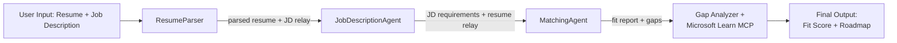

# PersonalCareerCopilot - Özgeçmiş → İş Uygunluk Değerlendiricisi

Bir iş akışı öncelikli çoklu ajan uygulaması, bir özgeçmişin iş tanımıyla ne kadar iyi eşleştiğini değerlendirir ve ardından boşlukları kapatmak için kişiselleştirilmiş bir öğrenme yol haritası oluşturur.

---

## Ajanlar

| Ajan | Rol | Araçlar |
|-------|------|-------|
| **ResumeParser** | Özgeçmiş metninden yapılandırılmış beceriler, deneyim, sertifikalar çıkarır | - |
| **JobDescriptionAgent** | JD'den gerekli/tercih edilen beceriler, deneyim, sertifikalar çıkarır | - |
| **MatchingAgent** | Profil ile gereksinimleri karşılaştırır → uygunluk puanı (0-100) + eşleşen/kayıp beceriler | - |
| **GapAnalyzer** | Microsoft Learn kaynakları ile kişiselleştirilmiş öğrenme yol haritası oluşturur | `search_microsoft_learn_for_plan` (MCP) |

## İş Akışı



---

## Hızlı başlangıç

### 1. Ortamı kurun

Bu klasör iş akışına dayalı Lab 02 iskeletinin referans uygulamasıdır. `main.py` mevcut prompt bloklarını ve dört ajanı birbirine bağlamak için `WorkflowBuilder` kullanır.

```powershell
cd workshop\lab02-multi-agent\PersonalCareerCopilot
python -m venv .venv
.\.venv\Scripts\Activate.ps1          # Windows PowerShell
# source .venv/bin/activate            # macOS / Linux
pip install -r requirements.txt
```

### 2. Kimlik bilgilerini yapılandırın

Bu klasöre bir `.env` dosyası oluşturun:

```powershell
copy .env .env.bak 2>$null; echo $null > .env
```

`.env` düzenleyin:

```env
FOUNDRY_PROJECT_ENDPOINT=https://<your-account>.services.ai.azure.com/api/projects/<your-project>
AZURE_AI_MODEL_DEPLOYMENT_NAME=gpt-4.1-mini
```

| Değer | Nerede bulunur |
|-------|------------------|
| `FOUNDRY_PROJECT_ENDPOINT` | Foundry Toolkit kenar çubuğu → projenize sağ tıklayın → **Kopyala Proje Uç Noktası** |
| `AZURE_AI_MODEL_DEPLOYMENT_NAME` | Foundry kenar çubuğu → projeyi genişletin → **Modeller + uç noktalar** → dağıtım adı |

### 3. Yerelde çalıştırın

```powershell
python -m debugpy --listen 127.0.0.1:5679 main.py --port 8088
```

Veya VS Code görevini kullanın: `Ctrl+Shift+P` → **Görevler: Görev Çalıştır** → **Ajan HTTP Sunucusunu Çalıştır**.

F5 hata ayıklaması için **Yerel Ajan HTTP Sunucusunu Hata Ayıkla** kullanın.

### 4. Agent Inspector ile test edin

Agent Inspector’ı açın: `Ctrl+Shift+P` → **Foundry Toolkit: Agent Inspector’ı Aç**.

Bu test prompt'unu yapıştırın:

```
Resume:
Jane Doe
Senior Software Engineer with 5 years of experience in Python, Django, and AWS.
Built microservices handling 10K+ requests/second. Led a team of 4 developers.
Certifications: AWS Solutions Architect Associate.
Education: B.S. Computer Science, State University.

Job Description:
Senior Cloud Engineer at Contoso Ltd.
Required: Python, Azure, Kubernetes, Terraform, CI/CD pipelines.
Preferred: Go, monitoring (Prometheus/Grafana), cost optimization.
Experience: 5+ years in cloud infrastructure.
Certifications: Azure Solutions Architect Expert preferred.
```

**Beklenen:** Bir uygunluk puanı (0-100), eşleşen/kayıp beceriler ve Microsoft Learn URL'leri içeren kişiselleştirilmiş bir öğrenme yol haritası.

### 5. Foundry'ye dağıtın

`Ctrl+Shift+P` → **Foundry Toolkit: Barındırılan Ajanı Dağıt** → projenizi seçin → onaylayın.

---

## Proje yapısı

```
PersonalCareerCopilot/
├── .env                ← Your credentials (git-ignored)
├── agent.yaml          ← Hosted agent definition (name, resources, env vars)
├── Dockerfile          ← Container image for Foundry deployment
├── main.py             ← 4-agent workflow (instructions, MCP tool, WorkflowBuilder)
└── requirements.txt    ← Python dependencies
```

## Ana dosyalar

### `agent.yaml`

Foundry Agent Servisi için barındırılan ajanı tanımlar:
- `kind: hosted` - yönetilen bir konteyner olarak çalışır
- `protocols` - `responses` protokolü ile `version: 2.0.0`, `/responses` HTTP uç noktasını açar
- `environment_variables` - `AZURE_AI_MODEL_DEPLOYMENT_NAME` burada beyan edilir; `FOUNDRY_PROJECT_ENDPOINT` dağıtım zamanında otomatik enjekte edilir

### `main.py`

İçerir:
- **Ajan talimatları** - her ajan için dört `*_INSTRUCTIONS` sabiti
- **MCP aracı** - `search_microsoft_learn_for_plan()` `https://learn.microsoft.com/api/mcp`'yi Streamable HTTP üzerinden çağırır
- **Ajan oluşturma** - dört `Agent()` + `AgentExecutor()` örneği, bir `FoundryChatClient`'i paylaşır
- **İş akışı grafiği** - `WorkflowBuilder` ajanları sıralı bir boru hattı olarak bağlar: ResumeParser → JD Agent → MatchingAgent → GapAnalyzer
- **Sunucu başlatma** - `ResponsesHostServer` 8088 portunda çalışır

### `requirements.txt`

| Paket | Amaç |
|---------|----------|
| `agent-framework-foundry` | Çekirdek çalışma zamanı: `Agent`, `AgentExecutor`, `WorkflowBuilder`, `@tool`, `FoundryChatClient` |
| `agent-framework-foundry-hosting` | `ResponsesHostServer` + Foundry barındırma entegrasyonu |
| `mcp<2,>=1.24.0` | GapAnalyzer için MCP istemcisi (`streamable_http_client`) |
| `debugpy` | Python hata ayıklama (VS Code’da F5) |

---

## Sorun Giderme

| Sorun | Çözüm |
|-------|-----|
| `KeyError: 'FOUNDRY_PROJECT_ENDPOINT'` veya `KeyError: 'AZURE_AI_MODEL_DEPLOYMENT_NAME'` | Her iki taraf için ayarlanmış `.env` oluşturun: `FOUNDRY_PROJECT_ENDPOINT` ve `AZURE_AI_MODEL_DEPLOYMENT_NAME` |
| `ModuleNotFoundError: No module named 'agent_framework'` | venv'i aktifleştirin ve `pip install -r requirements.txt` çalıştırın |
| Çıktıda Microsoft Learn URL’leri yok | İnternet bağlantısını `https://learn.microsoft.com/api/mcp` için kontrol edin |
| Sadece 1 gap kartı (kısaltılmış) | `GAP_ANALYZER_INSTRUCTIONS` bloğun `CRITICAL:` içerdiğini doğrulayın |
| 8088 portu kullanımda | Diğer sunucuları durdurun: `netstat -ano \| findstr :8088` |

Ayrıntılı sorun giderme için bkz. [Modül 8 - Sorun Giderme](../docs/08-troubleshooting.md).

---

**Tam rehber:** [Lab 02 Dokümanları](../docs/README.md) · **Geri Dön:** [Lab 02 README](../README.md) · [Çalıştay Ana Sayfası](../../../README.md)

---

<!-- CO-OP TRANSLATOR DISCLAIMER START -->
**Feragatname**:
Bu belge, AI çeviri hizmeti [Co-op Translator](https://github.com/Azure/co-op-translator) kullanılarak çevrilmiştir. Doğruluk için çaba sarf etsek de, otomatik çevirilerin hata veya yanlışlık içerebileceğini lütfen unutmayınız. Orijinal belge, kendi dilinde yetkili kaynak olarak kabul edilmelidir. Kritik bilgiler için profesyonel insan çevirisi önerilir. Bu çevirinin kullanımı sonucu ortaya çıkabilecek yanlış anlamalardan veya yanlış yorumlamalardan sorumlu değiliz.
<!-- CO-OP TRANSLATOR DISCLAIMER END -->