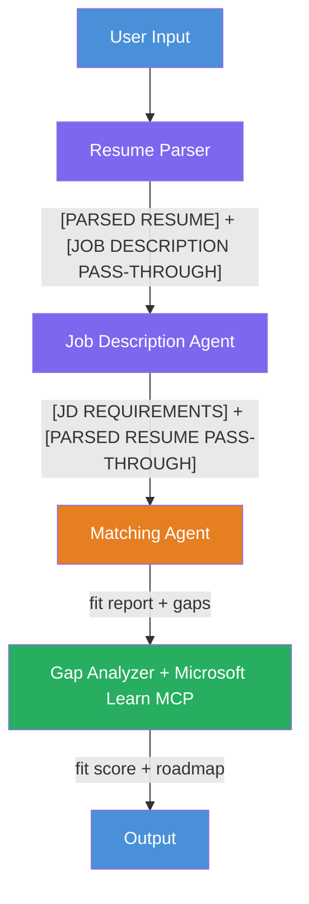

# Laboratuvar 02 - Çoklu Ajan İş Akışı: Özgeçmiş → İş Uyumu Değerlendirici

## Genel Bakış

Bu uygulamalı laboratuvarda, VS Code'da Foundry Toolkit kullanarak **iş akışı öncelikli çoklu ajan uygulaması** oluşturacak ve Microsoft Foundry Agent Service'e dağıtacaksınız.

**Oluşturacaklarınız:** bir Özgeçmiş → İş Uyumu Değerlendirici, özgeçmiş ve iş tanımını ayrıştırır, eşleşme skorunu hesaplar ve Microsoft Learn kaynakları kullanarak kişiselleştirilmiş bir öğrenme yol haritası üretir.

---

## Mimari

**Nasıl çalışır:**
1. Kullanıcı bir özgeçmiş ve iş tanımı yapıştırır.
2. **ResumeParser**, özgeçmişi ayrıştırır ve iş tanımını `[JOB DESCRIPTION PASS-THROUGH]` bölümüne birebir kopyalar.
3. **JD Agent** geçişten yapılandırılmış gereksinimleri çıkarır, ardından `[PARSED RESUME]`’i `[PARSED RESUME PASS-THROUGH]` olarak iletir.
4. **MatchingAgent**, `[PARSED RESUME PASS-THROUGH]` ile `[JD REQUIREMENTS]`'ü karşılaştırır ve bir uygunluk puanı üretir.
5. **GapAnalyzer**, boşlukları pratik bir yol haritasına dönüştürür ve MCP aracılığıyla gerçek Microsoft Learn bağlantıları alır.

---

## Önkoşullar

Öncelikle Laboratuvar 01'i tamamlayın:

- [Laboratuvar 01 - Tek Ajan](../lab01-single-agent/README.md)

---

## Bölüm 1: Modülleri sırasıyla okuyun

Tam öğrenme yolunu şu adreste görün:

- [Laboratuvar 2 Belgeleri - Önkoşullar](docs/00-prerequisites.md)
- [Laboratuvar 2 Belgeleri - Tam Öğrenme Yolu](docs/README.md)
- [PersonalCareerCopilot çalışma kılavuzu](PersonalCareerCopilot/README.md)

---

## Bölüm 2: İş akışını oluşturun ve test edin

1. Foundry Toolkit sihirbazını kullanarak iş akışı tabanlı projeyi iskeletleyin.
2. İpucu bloklarını ve iş akışı grafiğini `PersonalCareerCopilot/main.py`'ten çalışma alanınıza kopyalayın.
3. Agent Inspector ile yerel olarak çalıştırın ve tüm dört ajan ile MCP aracını doğrulayın.
4. Yerel testler geçtiğinde barındırılan ajanı Foundry'e dağıtın.

---

## Orkestrasyon desenleri

Laboratuvar 02, **ardışık bir boru hattı** kullanır: her ajanın çıktısı bir sonraki ajana beslenir ve iş akışı son ajanın yanıtını döner. İki desen bunu sağlar:

- **Ardışık zincir** - `WorkflowBuilder`, ResumeParser → JD Agent → MatchingAgent → GapAnalyzer ajanlarını adım başına bir `add_edge()` çağrısı ile birbirine bağlar
- **İçerik iletimi** - her ajan sadece doğrudan öncekinin çıktısını gördüğü için, ResumeParser ve JD Agent, aşağı akış ajanlarının ihtiyaç duyduğu veriyi etiketlenmiş geçiş bölümlerine kopyalar

Belgeler ayrıca laboratuvarda fan-out/fan-in kullanılmama nedenini ve başka bir ajan ekleyerek grafiğin nasıl genişletileceğini açıklar.

Bakınız [docs/04-orchestration-patterns.md](docs/04-orchestration-patterns.md).

---

**Önceki:** [Laboratuvar 01 - Tek Ajan](../lab01-single-agent/README.md) · **Geri Dön:** [Atölye Ana Sayfası](../../README.md)

---

<!-- CO-OP TRANSLATOR DISCLAIMER START -->
**Feragatname**:
Bu belge, AI çeviri hizmeti [Co-op Translator](https://github.com/Azure/co-op-translator) kullanılarak çevrilmiştir. Doğruluk için çaba sarf etsek de, otomatik çevirilerin hata veya yanlışlık içerebileceğini lütfen unutmayınız. Orijinal belge, kendi dilinde yetkili kaynak olarak kabul edilmelidir. Kritik bilgiler için profesyonel insan çevirisi önerilir. Bu çevirinin kullanımı sonucu ortaya çıkabilecek yanlış anlamalardan veya yanlış yorumlamalardan sorumlu değiliz.
<!-- CO-OP TRANSLATOR DISCLAIMER END -->