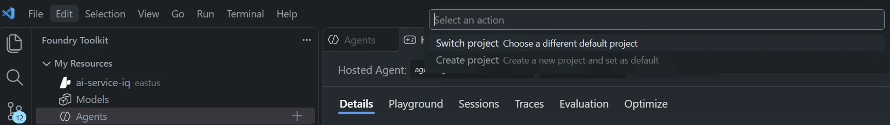

# Modül 0 - Giriş

⏱️ ~10 dakika

> [!WARNING]
> **Önizleme ve Sınırlamalar:** [Barındırılan Ajanlar](https://learn.microsoft.com/azure/foundry/agents/concepts/hosted-agents) şu anda **genel önizlemededir** - üretim görevleri için önerilmez. Bu atölyede gösterilen bazı özellikler, servis GA'ya doğru ilerledikçe değişebilir.

## Oluşturacaklarınız

Bu laboratuvarda, Lab 01'deki tek ajan becerilerini genişleterek bir **çok ajanlı iş akışı** oluşturacaksınız - Özgeçmiş → İş Uygunluk Değerlendiricisi.

Bir **özgeçmiş** ve bir **iş tanımı** yapıştırırsınız. Dört uzman ajan girdiyi sırasıyla işler ve ardından döner:
- Bir uygunluk puanı (0–100 arası ve puanlama dökümü)
- Bir beceri ve sertifika eksikliği listesi
- Her eksiklik için gerçek Microsoft Learn bağlantılarıyla kişiselleştirilmiş bir öğrenme yolu haritası

**İş akışı şunları kullanır:**
- **Microsoft Agent Framework** - sıralı boru hattı düzenleme için `WorkflowBuilder`
- **Foundry Toolkit for VS Code** - iskele oluşturma, yerel test, dağıtım
- **Bir yapay zeka modeli** (örneğin, `gpt-4.1-mini`) - tüm dört ajan tarafından kullanılır
- **Microsoft Learn MCP sunucusu** - her beceri eksikliği için gerçek öğrenme kaynak bağlantıları sağlar

---

## Yolunuzu seçin

> ⚠️ **Lab 01'de kullandığınız aynı yol ile devam edin.**

<details open>
<summary><strong>🅰️ Yol A - Azure bulutu (Azure aboneliği gerektirir)</strong></summary>

| | Detaylar |
|---|---|
| **Kimler için?** | Azure aboneliği kullanarak Lab 01’i tamamladınız |
| **Model** | Foundry aracılığıyla Azure OpenAI (örneğin, `gpt-4.1-mini`) |
| **Kapsanan modüller** | Tüm modüller (00–09) |
| **Buluta dağıtım?** | ✅ Evet - tam uçtan uca dağıtım |

</details>

<details open>
<summary><strong>🅱️ Yol B - Foundry Yerel (Azure aboneliği gerekmez)</strong></summary>

| | Detaylar |
|---|---|
| **Kimler için?** | Foundry Yerel kullanarak Lab 01’i tamamladınız |
| **Model** | Foundry Yerel (ücretsiz, makinenizde çalışır) |
| **Kapsanan modüller** | Modüller 00–05 (06–07 atlanacak - dağıtım ve bulut doğrulama) |
| **Buluta dağıtım?** | ❌ Hayır - sadece Ajan Denetleyicisi ile yerel test |

</details>

---

## Lab 01 kontrolü

Lab 02 doğrudan Lab 01 üzerine inşa edilmiştir. Buraya başlamadan önce Lab 01’i tamamlayın.

Lab 01’i henüz yapmadınız mı? Buradan başlayın: [Lab 01 - Giriş](../../lab01-single-agent/docs/00-prerequisites.md)

<details open>
<summary><strong>🅰️ Yol A - Azure bulutu</strong></summary>

```powershell
az account show --query "{name:name, id:id}" --output table
```

Eğer başarısız olursa, `az login` çalıştırın. Sonra VS Code’da doğrulayın:

1. `Ctrl+Shift+P` → **Foundry Toolkit** yazın → komutların göründüğünü onaylayın.
2. **Foundry Toolkit** simgesine tıklayın → projeniz ve dağıtılan model **Başarılı** olarak görünür.



> **RBAC:** Lab 01’de **Foundry Kullanıcısı** atadınız. Yeniden atamanız gerekirse, bkz. [Lab 01, Modül 1](../../lab01-single-agent/docs/01-setup.md#deploy-a-model--assign-rbac). Rol önceden **Azure AI Kullanıcısı** olarak adlandırılıyordu - aynı izinler.

</details>

<details open>
<summary><strong>🅱️ Yol B - Foundry Yerel</strong></summary>

```powershell
Invoke-WebRequest -Uri "http://localhost:5273/v1/health" -UseBasicParsing | Select-Object StatusCode
```

Beklenen: `StatusCode: 200`. Değilse, Foundry Toolkit kenar çubuğundan Foundry Yerel’i yeniden başlatın.

> Tüm çıkarımlar makinenizde çalışır. Tek dış arama MCP aracına `https://learn.microsoft.com/api/mcp` yöneliktir.

</details>

---

## Lab 02’de yenilikler

| | Lab 01 | Lab 02 |
|--|--------|--------|
| Ajanlar | 1 | 4 (WorkflowBuilder ile zincirlenmiş) |
| İskele şablonu | Temel - Agent Framework | İş akışları - Agent Framework |
| Yeni paket | - | `mcp` |
| Düzenleme | Tek sohbet ajanı | Sıralı boru hattı (WorkflowBuilder) |
| Yeni araç | - | `search_microsoft_learn_for_plan` (MCP) |

---

**Sonraki:** [01 - Mimarinin Anlaşılması →](01-understand-multi-agent.md)

---

<!-- CO-OP TRANSLATOR DISCLAIMER START -->
**Feragatname**:
Bu belge, AI çeviri hizmeti [Co-op Translator](https://github.com/Azure/co-op-translator) kullanılarak çevrilmiştir. Doğruluk için çaba sarf etsek de, otomatik çevirilerin hata veya yanlışlık içerebileceğini lütfen unutmayınız. Orijinal belge, kendi dilinde yetkili kaynak olarak kabul edilmelidir. Kritik bilgiler için profesyonel insan çevirisi önerilir. Bu çevirinin kullanımı sonucu ortaya çıkabilecek yanlış anlamalardan veya yanlış yorumlamalardan sorumlu değiliz.
<!-- CO-OP TRANSLATOR DISCLAIMER END -->