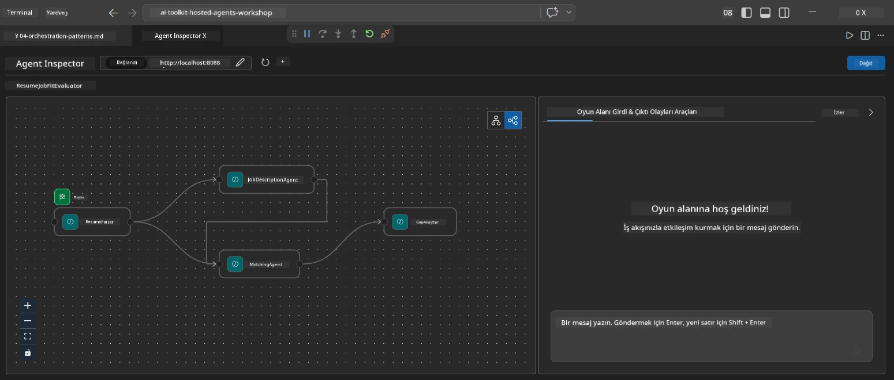
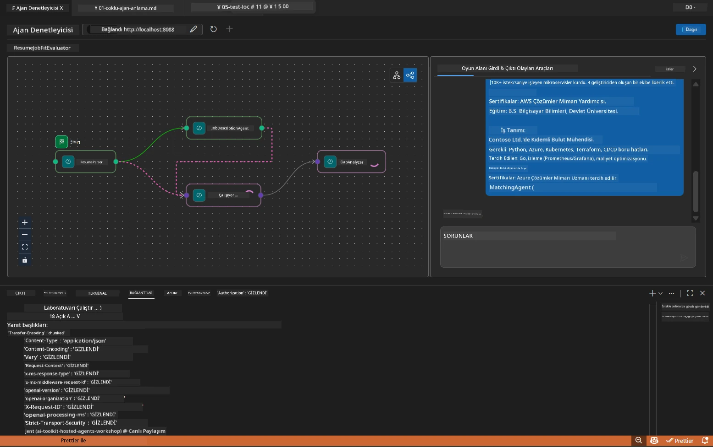
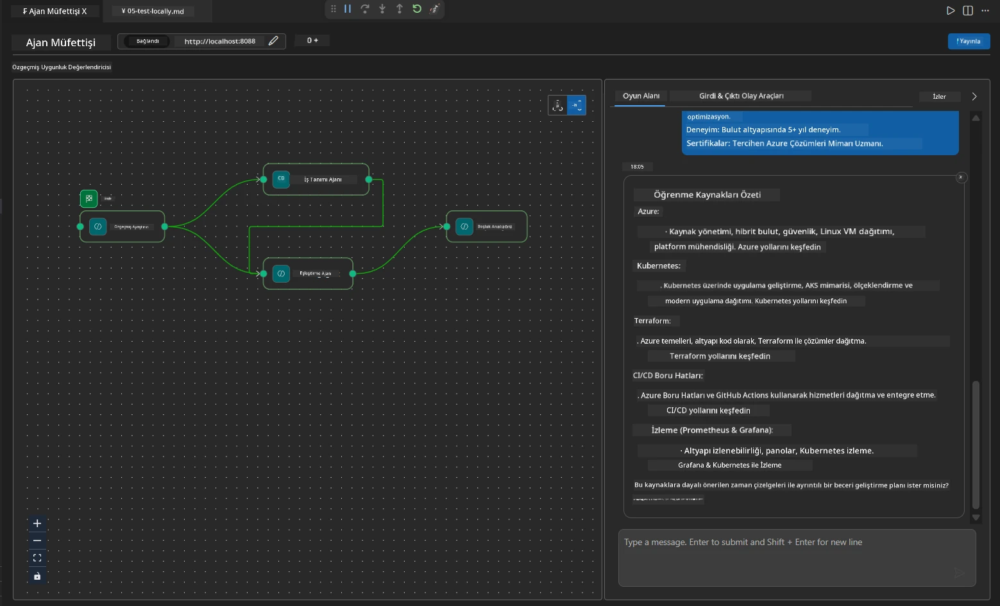

# Modül 5 - Yerel Test

⏱️ ~15 dakika

Bu modülde, çoklu ajan iş akışını yerelde çalıştıracak, Agent Inspector ile test edecek ve dağıtımdan önce tüm dört ajanın ve MCP aracının doğru çalıştığını doğrulayacaksınız.

---

## Adım 1: Ajan sunucusunu başlatın

### Seçenek A: VS Code görevi kullanma (önerilir)

1. `workshop/lab02-multi-agent/PersonalCareerCopilot/`'ı VS Code klasörünüz olarak açın.
2. `Ctrl+Shift+P` tuşuna basın → **Görevler: Görev Çalıştır** yazın → **Agent HTTP Sunucusunu Çalıştır** seçin.
3. Görev, `5679` portunda debugpy ile bağlı olarak sunucuyu ve `8088` portunda ajanı başlatır.
4. Başlatma mesajının ve ardından sunucunun kendi hazır mesajının görünmesini bekleyin (diğer günlük satırları arada görünür):

```
INFO:resume-job-fit:Starting Resume -> Job Fit Evaluator HTTP server...
...
INFO:hypercorn.error:Running on http://0.0.0.0:8088 (CTRL + C to quit)
```

### Seçenek B: F5 kullanarak (hata ayıklama modu)

1. `F5` tuşuna basın → **Yerel Agent HTTP Sunucusunu Hata Ayıkla** seçin.
2. Sunucu, tam kesme noktası desteği ile başlar - MCP yanıtlarını veya ajan çıktılarının incelenmesi için faydalıdır.

---

## Adım 2: Agent Inspector'u açın

1. `Ctrl+Shift+P` tuşuna basın → **Foundry Toolkit: Agent Inspector'ı Aç** yazın.
2. Agent Inspector, `http://localhost:8088` ile bağlı olarak bir VS Code paneli olarak açılır.
3. Mesaj kabul etmeye hazır ajan arayüzünü görmelisiniz.



> **Agent Inspector açılmıyorsa:** Sunucunun tamamen başlatıldığından emin olun (görüntülediğiniz `Running on http://0.0.0.0:8088` kaydını görüyorsunuz). 5679 numaralı bağlantı noktası meşgulse, bkz. [Modül 8 - Sorun Giderme](08-troubleshooting.md).

---

## Adım 2b: (İsteğe Bağlı) İş Akışı Görselleştiricisini Açın

Foundry Toolkit, grafik çalışırken ajanların nasıl etkileşimde bulunduğunu gösteren gerçek zamanlı bir **İş Akışı Görselleştiricisi** içerir. Bu, çoklu ajan hata ayıklama için özellikle kullanışlıdır.

1. `Ctrl+Shift+P` tuşuna basın → **Foundry Toolkit: Open Visualizer for Hosted Agents** yazın.
2. Canlı yürütme grafiğini gösteren yeni bir VS Code sekmesi açılır.
3. Agent Inspector'da mesaj gönderirken, görselleştirici otomatik olarak güncellenir - yeşil düğümler tamamlanmış ajanları gösterir ve animasyonlu kenarlar aralarındaki veri akışını gösterir.

> **Port çakışması:** Görselleştirici portu zaten kullanımdayken, bunu VS Code Ayarları → **Extensions** → **Microsoft Foundry Configuration** → **Hosted Agents: Visualizer Port** bölümünden değiştirin.

---

## Adım 3: Temel testleri çalıştırın

Bu iki testi sırayla çalıştırın. Her biri iş akışının daha fazlasını kademeli olarak test eder.

### Test 1: Temel özgeçmiş + iş tanımı

Aşağıdakileri Agent Inspector'a yapıştırın:

```
Resume:
Jane Doe
Senior Software Engineer with 5 years of experience in Python, Django, and AWS.
Built microservices handling 10K+ requests/second. Led a team of 4 developers.
Certifications: AWS Solutions Architect Associate.
Education: B.S. Computer Science, State University.

Job Description:
Senior Cloud Engineer at Contoso Ltd.
Required: Python, Azure, Kubernetes, Terraform, CI/CD pipelines.
Preferred: Go, monitoring (Prometheus/Grafana), cost optimization.
Experience: 5+ years in cloud infrastructure.
Certifications: Azure Solutions Architect Expert preferred.
```

**Beklenen çıktı yapısı:**

Yanıt, sırasıyla tüm dört ajandan gelen çıktıyı içermelidir:

1. **Özgeçmiş Ayrıştırıcı çıktısı** - İki etiketli bölüm: `[PARSED RESUME]` (gruplandırılmış becerilere sahip aday profili) ve `[JOB DESCRIPTION PASS-THROUGH]` (JD Ajanına besleme yapan kelimesi kelimesine JD metni)
2. **JD Ajanı çıktısı** - Gereken ve tercih edilen becerilerin ayrıldığı yapılandırılmış gereksinimler
3. **Eşleşen Aracı çıktısı** - Fit puanı (0-100) ve dökümü, eşleşen beceriler, eksik beceriler, boşluklar
4. **Boşluk Analizörü çıktısı** - Her eksik beceri için Microsoft Learn URL'leri ile bireysel boşluk kartları





### Test 1'de doğrulanacaklar

| Kontrol | Beklenen | Geçti mi? |
|-------|----------|-------|
| Yanıt bir fit puanı içeriyor | 0-100 arasında dökümüyle sayı | |
| Eşleşen beceriler listelenmiş | Python, CI/CD (kısmi), vb. | |
| Eksik beceriler listelenmiş | Azure, Kubernetes, Terraform, vb. | |
| Her eksik beceri için boşluk kartları var | Beceri başına bir kart | |
| Microsoft Learn URL'leri mevcut | Gerçek `learn.microsoft.com` bağlantılar | |
| Yanıt içinde hata mesajı yok | Temiz yapılandırılmış çıktı | |

### Test 2: Kenar durumu - yüksek fit adayı

BoşlukAnalizörü'nün yüksek fit durumlarını nasıl ele aldığını doğrulamak için işi tanımına yakın bir özgeçmiş yapıştırın:

```
Resume:
Alex Chen
Senior Cloud Engineer with 7 years of experience.
Skills: Python, Azure (AKS, Functions, DevOps), Kubernetes, Terraform, CI/CD (GitHub Actions, Azure Pipelines), Go, Prometheus, Grafana, cost optimization.
Certifications: Azure Solutions Architect Expert, Azure DevOps Engineer Expert.
Led infrastructure migration to Azure for 3 enterprise clients.
Education: M.S. Computer Science, Tech University.

Job Description:
Senior Cloud Engineer at Contoso Ltd.
Required: Python, Azure, Kubernetes, Terraform, CI/CD pipelines.
Preferred: Go, monitoring (Prometheus/Grafana), cost optimization.
Experience: 5+ years in cloud infrastructure.
Certifications: Azure Solutions Architect Expert preferred.
```

**Beklenen davranış:**
- Fit puanı **80+** olmalı (çoğu beceri eşleşir)
- Boşluk kartları temel öğrenmeden ziyade cilalama/mülakat hazırlığına odaklanmalı
- BoşlukAnalizörü talimatları diyor ki: "Fit >= 80 ise, cilalama/mülakat hazırlığına odaklan"

---

## Adım 4: Kendi verilerinizle test edin (isteğe bağlı)

Kendi özgeçmişinizi ve gerçek bir iş tanımını yapıştırmayı deneyin. Bu şunların doğrulanmasına yardımcı olur:

- Temsilciler, farklı özgeçmiş formatlarını (kronolojik, fonksiyonel, hibrit) işler
- JD Ajanı farklı JD stillerini (madde işaretleri, paragraflar, yapılandırılmış) işler
- MCP aracı gerçek beceriler için ilgili kaynakları döndürür
- Boşluk kartları belirli geçmişinize özelleştirilmiştir

> **Gizlilik - Yol A (Foundry bulut):** Özgeçmiş ve JD metni çıkarım için Azure OpenAI dağıtımınıza gönderilir. Atölye altyapısı tarafından kaydedilmez veya saklanmaz. Tercih ederseniz yer tutucu isimler (ör., "Jane Doe") kullanın.
>
> **Gizlilik - Yol B (Foundry Yerel):** Dört ajan çıkarımının tamamı tamamen cihazınızda çalışır. Özgeçmişiniz ve iş tanımı metniniz **asla makinenizi terk etmez**. Tek dışa giden çağrı, MCP aracının `https://learn.microsoft.com/api/mcp`’den kaynak çekmesidir; bu sorgu sadece beceri adını içerir, kişisel verilerinizi değil.

---

### Kontrol Noktası

- [ ] Sunucu `8088` portunda başarıyla başlatıldı (günlükte `Running on http://0.0.0.0:8088` gösteriliyor)
- [ ] Ajan Denetleyici açıldı ve ajana bağlandı
- [ ] Test 1: Uyum puanı, eşleşen/eksik beceriler, boşluk kartları ve Microsoft Learn URL'leri ile tam yanıt
- [ ] Test 2: Yüksek uyumlu aday, cilaya odaklı önerilerle 80+ puan alıyor
- [ ] Tüm boşluk kartları mevcut (eksik her beceri için bir, kırpma yok)
- [ ] Sunucu terminalinde hata veya yığın izleri yok

---

**Önceki:** [04 - Orkestrasyon Desenleri](04-orchestration-patterns.md) · **Sonraki:** [06 - Foundry’e Dağıt →](06-deploy-to-foundry.md)

---

<!-- CO-OP TRANSLATOR DISCLAIMER START -->
**Feragatname**:
Bu belge, AI çeviri hizmeti [Co-op Translator](https://github.com/Azure/co-op-translator) kullanılarak çevrilmiştir. Doğruluk için çaba sarf etsek de, otomatik çevirilerin hata veya yanlışlık içerebileceğini lütfen unutmayınız. Orijinal belge, kendi dilinde yetkili kaynak olarak kabul edilmelidir. Kritik bilgiler için profesyonel insan çevirisi önerilir. Bu çevirinin kullanımı sonucu ortaya çıkabilecek yanlış anlamalardan veya yanlış yorumlamalardan sorumlu değiliz.
<!-- CO-OP TRANSLATOR DISCLAIMER END -->