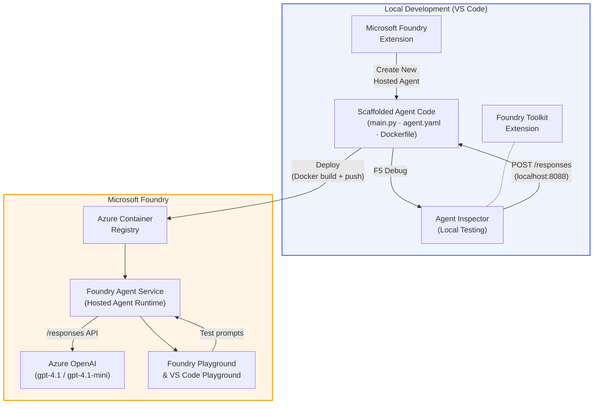

# Foundry Toolkit + Воркшоп Foundry Hosted Agents

[](https://www.python.org/)
[](https://github.com/microsoft/agents)
[](https://learn.microsoft.com/azure/foundry/agents/concepts/hosted-agents)
[](https://ai.azure.com/)
[](https://learn.microsoft.com/azure/ai-services/openai/)
[](https://learn.microsoft.com/cli/azure/install-azure-cli)
[](https://learn.microsoft.com/azure/developer/azure-developer-cli/install-azd)
[](https://www.docker.com/)
[](https://marketplace.visualstudio.com/items?itemName=ms-windows-ai-studio.windows-ai-studio)
[](../../LICENSE)

Створюйте, тестуйте та розгортайте AI-агентів у **Microsoft Foundry Agent Service** як **хостовані агенти** - повністю з VS Code за допомогою **Microsoft Foundry extension** та **Foundry Toolkit**.

> **Хостовані агенти наразі в прев'ю.** Підтримувані регіони обмежені - див. [доступність регіонів](https://learn.microsoft.com/azure/foundry/agents/concepts/hosted-agents#region-availability).

> The `agent/` folder inside each lab is **automatically scaffolded** by the Foundry extension - you then customize the code, test locally, and deploy.

### 🌐 Підтримка кількох мов

#### Підтримується через GitHub Action (Автоматично і завжди в актуальному стані)

<!-- CO-OP TRANSLATOR LANGUAGES TABLE START -->
[Арабська](../ar/README.md) | [Бенгальська](../bn/README.md) | [Болгарська](../bg/README.md) | [Бірманська (М'янма)](../my/README.md) | [Китайська (спрощена)](../zh-CN/README.md) | [Китайська (традиційна, Гонконг)](../zh-HK/README.md) | [Китайська (традиційна, Макао)](../zh-MO/README.md) | [Китайська (традиційна, Тайвань)](../zh-TW/README.md) | [Хорватська](../hr/README.md) | [Чеська](../cs/README.md) | [Данська](../da/README.md) | [Нідерландська](../nl/README.md) | [Естонська](../et/README.md) | [Фінська](../fi/README.md) | [Французька](../fr/README.md) | [Німецька](../de/README.md) | [Грецька](../el/README.md) | [Іврит](../he/README.md) | [Хінді](../hi/README.md) | [Угорська](../hu/README.md) | [Індонезійська](../id/README.md) | [Італійська](../it/README.md) | [Японська](../ja/README.md) | [Каннада](../kn/README.md) | [Кхмерська](../km/README.md) | [Корейська](../ko/README.md) | [Литовська](../lt/README.md) | [Малайська](../ms/README.md) | [Малаялам](../ml/README.md) | [Маратхі](../mr/README.md) | [Непальська](../ne/README.md) | [Нігерійський пиджин](../pcm/README.md) | [Норвезька](../no/README.md) | [Перська (фарсі)](../fa/README.md) | [Польська](../pl/README.md) | [Португальська (Бразилія)](../pt-BR/README.md) | [Португальська (Португалія)](../pt-PT/README.md) | [Пенджабі (Gurmukhi)](../pa/README.md) | [Румунська](../ro/README.md) | [Російська](../ru/README.md) | [Сербська (кирилиця)](../sr/README.md) | [Словацька](../sk/README.md) | [Словенська](../sl/README.md) | [Іспанська](../es/README.md) | [Суахілі](../sw/README.md) | [Шведська](../sv/README.md) | [Тагалог (філіппінська)](../tl/README.md) | [Тамільська](../ta/README.md) | [Телугу](../te/README.md) | [Тайська](../th/README.md) | [Турецька](../tr/README.md) | [Українська](./README.md) | [Урду](../ur/README.md) | [В'єтнамська](../vi/README.md)

> **Віддаєте перевагу клонуванню локально?**
>
> This repository includes 50+ language translations which significantly increases the download size. To clone without translations, use sparse checkout:
>
> **Bash / macOS / Linux:**
> ```bash
> git clone --filter=blob:none --sparse https://github.com/microsoft-foundry/Foundry_Toolkit_for_VSCode_Lab.git
> cd Foundry_Toolkit_for_VSCode_Lab
> git sparse-checkout set --no-cone '/*' '!translations' '!translated_images'
> ```
>
> **CMD (Windows):**
> ```cmd
> git clone --filter=blob:none --sparse https://github.com/microsoft-foundry/Foundry_Toolkit_for_VSCode_Lab.git
> cd Foundry_Toolkit_for_VSCode_Lab
> git sparse-checkout set --no-cone "/*" "!translations" "!translated_images"
> ```
>
> Це дає вам усе необхідне для проходження курсу з набагато швидшим завантаженням.
<!-- CO-OP TRANSLATOR LANGUAGES TABLE END -->

---

## Архітектура



**Потік:** Розширення Foundry створює каркас агента → ви налаштовуєте код & інструкції → тестуєте локально за допомогою Agent Inspector → розгортаєте у Foundry (Docker image pushed to ACR) → перевіряєте в Playground.

---

## Що ви створите

| Лабораторія | Опис | Статус |
|-----|-------------|--------|
| **Лабораторія 01 - Одиночний агент** | Створіть агента **"Поясни, ніби я керівник"**, протестуйте його локально та розгорніть у Foundry | ✅ Доступно |
| **Лабораторія 02 - Багатоагентний робочий процес** | Створіть **"Оцінювач відповідності резюме до вакансії"** - 4 агенти співпрацюють, щоб оцінити відповідність резюме та згенерувати дорожню карту навчання | ✅ Доступно |

---

## Знайомство з агентом для керівництва

У цьому воркшопі ви створите агента **"Поясни, ніби я керівник"** - AI-агента, який перетворює складний технічний жаргон на спокійні, готові для засідання правління резюме. Бо чесно кажучи, ніхто в керівництві не хоче чути про "виснаження пулу потоків, спричинене синхронними викликами, введеними у v3.2."

Я створив цього агента після ще одного надто великого числа інцидентів, коли мій ідеально складений розбір події отримував відповідь: *"Отже... сайт впав чи ні?"*

### Як це працює

Ви подаєте йому технічне оновлення. Він повертає виконавче резюме - три маркери, без жаргону, без трасувань, без екзистенційного жаху. Лише **що сталося**, **вплив на бізнес** і **наступний крок**.

### Побачити в дії

**Ви кажете:**
> "Затримка API збільшилася через виснаження пулу потоків, спричинене синхронними викликами, введеними у v3.2."

**Агент відповідає:**

> **Виконавче резюме:**
> - **Що сталося:** Після останнього релізу система сповільнилася.
> - **Вплив на бізнес:** Деякі користувачі зазнали затримок під час користування сервісом.
> - **Наступний крок:** Зміни відкотили, і готується виправлення перед повторним розгортанням.

### Навіщо цей агент?

Це надзвичайно простий, одноцільовий агент - ідеально підходить для вивчення робочого процесу хостованого агента від початку до кінця без заглиблення в складні ланцюжки інструментів. І чесно? Кожна інженерна команда могла б мати такого.

---

## Структура воркшопу

```
📂 Foundry_Toolkit_for_VSCode_Lab/
├── 📄 README.md                      ← You are here
└── 📂 workshop/
    ├── 📂 lab01-single-agent/        ← Full lab: docs + agent code
    │   ├── README.md                 ← Hands-on lab instructions
    │   ├── 📂 docs/                  ← Step-by-step tutorial modules
    │   │   ├── 00-prerequisites.md
    │   │   ├── 01-setup.md
    │   │   ├── 02-create-hosted-agent.md
    │   │   ├── 03-configure-and-code.md
    │   │   ├── 04-test-locally.md
    │   │   ├── 05-deploy-to-foundry.md
    │   │   ├── 06-verify-in-playground.md
    │   │   ├── 07-summary.md
    │   │   └── 08-troubleshooting.md
    │   └── 📂 agent/                 ← Reference solution (auto-scaffolded by Foundry extension)
    │       ├── agent.yaml
    │       ├── Dockerfile
    │       ├── main.py
    │       └── requirements.txt
    └── 📂 lab02-multi-agent/         ← Resume → Job Fit Evaluator
        ├── README.md                 ← Hands-on lab instructions (end-to-end)
        ├── 📂 docs/                  ← Step-by-step tutorial modules
        │   ├── 00-prerequisites.md
        │   ├── 01-understand-multi-agent.md
        │   ├── 02-scaffold-multi-agent.md
        │   ├── 03-configure-agents.md
        │   ├── 04-orchestration-patterns.md
        │   ├── 05-test-locally.md
        │   ├── 06-deploy-to-foundry.md
        │   ├── 07-verify-in-playground.md
        │   └── 08-troubleshooting.md
        └── 📂 PersonalCareerCopilot/ ← Reference solution (multi-agent workflow)
            ├── agent.yaml
            ├── Dockerfile
            ├── main.py
            └── requirements.txt
```

> **Примітка:** Папка `agent/` у кожній лабораторії — це те, що генерує **Microsoft Foundry extension**, коли ви запускаєте `Microsoft Foundry: Create a New Hosted Agent` з Command Palette. Файли потім налаштовуються з інструкціями, інструментами та конфігурацією вашого агента. Лаб 01 проводить вас через відтворення цього з нуля.

---

## Початок роботи

### 1. Клонуйте репозиторій

```bash
git clone https://github.com/microsoft-foundry/Foundry_Toolkit_for_VSCode_Lab.git
cd Foundry_Toolkit_for_VSCode_Lab
```

### 2. Налаштуйте віртуальне середовище Python

```bash
python -m venv venv
```

Активуйте його:

- **Windows (PowerShell):**
  ```powershell
  .\venv\Scripts\Activate.ps1
  ```
- **macOS / Linux:**
  ```bash
  source venv/bin/activate
  ```

### 3. Встановіть залежності

```bash
pip install -r workshop/lab01-single-agent/agent/requirements.txt
```

### 4. Налаштуйте змінні оточення

Скопіюйте приклад файлу `.env` у папку агента та заповніть свої значення:

```bash
cp workshop/lab01-single-agent/agent/.env.example workshop/lab01-single-agent/agent/.env
```

Відредагуйте `workshop/lab01-single-agent/agent/.env`:

```env
AZURE_AI_PROJECT_ENDPOINT=https://<your-account>.services.ai.azure.com/api/projects/<your-project>
AZURE_AI_MODEL_DEPLOYMENT_NAME=<your-model-deployment-name>
```

### 5. Виконуйте лабораторні роботи воркшопу

Кожна лабораторія автономна та має власні модулі. Почніть з **Лабораторії 01**, щоб вивчити основи, потім переходьте до **Лабораторії 02** для багатоагентних робочих процесів.

#### Лабораторія 01 - Одиночний агент ([повні інструкції](workshop/lab01-single-agent/README.md))

| # | Модуль | Посилання |
|---|--------|------|
| 1 | Ознайомтеся з передумовами | [00-prerequisites.md](workshop/lab01-single-agent/docs/00-prerequisites.md) |
| 2 | Встановіть Foundry Toolkit & Foundry extension | [01-setup.md](workshop/lab01-single-agent/docs/01-setup.md) |
| 3 | Створіть проект Foundry | [01-setup.md](workshop/lab01-single-agent/docs/01-setup.md) |
| 4 | Створіть хостованого агента | [02-create-hosted-agent.md](workshop/lab01-single-agent/docs/02-create-hosted-agent.md) |
| 5 | Налаштуйте інструкції & оточення | [03-configure-and-code.md](workshop/lab01-single-agent/docs/03-configure-and-code.md) |
| 6 | Тестуйте локально | [04-test-locally.md](workshop/lab01-single-agent/docs/04-test-locally.md) |
| 7 | Розгорніть у Foundry | [05-deploy-to-foundry.md](workshop/lab01-single-agent/docs/05-deploy-to-foundry.md) |
| 8 | Перевірте в playground | [06-verify-in-playground.md](workshop/lab01-single-agent/docs/06-verify-in-playground.md) |
| 9 | Усунення несправностей | [08-troubleshooting.md](workshop/lab01-single-agent/docs/08-troubleshooting.md) |

#### Лабораторія 02 - Багатоагентний робочий процес ([повні інструкції](workshop/lab02-multi-agent/README.md))

| # | Модуль | Посилання |
|---|--------|------|
| 1 | Передумови (Лаб 02) | [00-prerequisites.md](workshop/lab02-multi-agent/docs/00-prerequisites.md) |
| 2 | Зрозумійте архітектуру багатоагентної системи | [01-understand-multi-agent.md](workshop/lab02-multi-agent/docs/01-understand-multi-agent.md) |
| 3 | Створіть каркас проекту для багатоагентної системи | [02-scaffold-multi-agent.md](workshop/lab02-multi-agent/docs/02-scaffold-multi-agent.md) |
| 4 | Налаштуйте агентів & оточення | [03-configure-agents.md](workshop/lab02-multi-agent/docs/03-configure-agents.md) |
| 5 | Патерни оркестрації | [04-orchestration-patterns.md](workshop/lab02-multi-agent/docs/04-orchestration-patterns.md) |
| 6 | Тестуйте локально (багатоагентне) | [05-test-locally.md](workshop/lab02-multi-agent/docs/05-test-locally.md) |
| 7 | Розгорніть у Foundry | [06-deploy-to-foundry.md](workshop/lab02-multi-agent/docs/06-deploy-to-foundry.md) |
| 8 | Перевірте в playground | [07-verify-in-playground.md](workshop/lab02-multi-agent/docs/07-verify-in-playground.md) |
| 9 | Усунення несправностей (багатоагентне) | [08-troubleshooting.md](workshop/lab02-multi-agent/docs/08-troubleshooting.md) |

---

## Підтримувач

<table>
<tr>
    <td align="center"><a href="https://github.com/ShivamGoyal03">
        <br />
        <sub><b>Shivam Goyal</b></sub>
    </a><br />
    </td>
</tr>
</table>

---

## Необхідні дозволи (коротка довідка)

| Сценарій | Необхідні ролі |
|----------|---------------|
| Створити новий проект Foundry | **Azure AI Owner** на ресурсі Foundry |
| Розгорнути в існуючий проект (нові ресурси) | **Azure AI Owner** + **Contributor** на підписці |
| Розгорнути в повністю налаштований проект | **Reader** на акаунті + **Azure AI User** на проекті |

> **Важливо:** Azure `Owner` and `Contributor` roles only include *management* permissions, not *development* (data action) permissions. You need **Azure AI User** or **Azure AI Owner** to build and deploy agents.

---

## Посилання

- [Швидкий старт: Розгорніть вашого першого хостованого агента (VS Code)](https://learn.microsoft.com/azure/foundry/agents/quickstarts/quickstart-hosted-agent)
- [Що таке хостовані агенти?](https://learn.microsoft.com/azure/foundry/agents/concepts/hosted-agents)
- [Створіть робочі процеси хостованих агентів у VS Code](https://learn.microsoft.com/azure/foundry/agents/how-to/vs-code-agents-workflow-pro-code)
- [Розгорніть хостованого агента](https://learn.microsoft.com/azure/foundry/agents/how-to/deploy-hosted-agent)
- [RBAC для Microsoft Foundry](https://learn.microsoft.com/azure/foundry/concepts/rbac-foundry)
- [Зразок агента для огляду архітектури](https://github.com/Azure-Samples/agent-architecture-review-sample) - Реальний хостований агент з інструментами MCP, діаграмами Excalidraw та подвійним розгортанням

---


## Ліцензія

[MIT](../../LICENSE)

---

<!-- CO-OP TRANSLATOR DISCLAIMER START -->
**Відмова від відповідальності**:
Цей документ було перекладено за допомогою сервісу штучного інтелекту для перекладу [Co-op Translator](https://github.com/Azure/co-op-translator). Хоча ми прагнемо до точності, будь ласка, майте на увазі, що автоматичні переклади можуть містити помилки або неточності. Оригінальний документ рідною мовою слід вважати авторитетним джерелом. Для критично важливої інформації рекомендується професійний людський переклад. Ми не несемо відповідальності за будь-які непорозуміння або неправильні тлумачення, що виникли внаслідок використання цього перекладу.
<!-- CO-OP TRANSLATOR DISCLAIMER END -->
