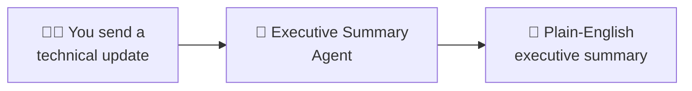

# Модуль 0 - Вступ

⏱️ ~10 хв

> [!WARNING]
> **Перегляд і обмеження:** [Хостовані агенти](https://learn.microsoft.com/azure/foundry/agents/concepts/hosted-agents) наразі знаходяться в **публічному перегляді** - їх не рекомендують використовувати для продуктивних навантажень. Зверніть увагу на наступне:
> - **Підтримувані регіони обмежені** - перевірте [доступність регіону](https://learn.microsoft.com/azure/foundry/agents/concepts/hosted-agents#region-availability) перед створенням ресурсів. Якщо ви виберете непідтримуваний регіон, розгортання не вдасться.
> - Пакет `agent-framework-foundry-hosting` є передрелізним — API може змінюватися між версіями.
> - Межі масштабу: хостовані агенти підтримують від 0 до 5 реплік (включно з масштабуванням до нуля).
> - Деякі функції, продемонстровані в цьому воркшопі, можуть змінитися з наближенням сервісу до GA.

## Що ви створите

У цьому воркшопі ви створите агента **«Поясни, ніби я керівник»** — хостованого AI-агента, який перетворює складні технічні оновлення на прості резюме для керівництва англійською мовою.

**Агент використовує:**
- **Microsoft Agent Framework** — для логіки та структури агента
- **Foundry Toolkit for VS Code** — для створення каркасу, локального тестування та розгортання
- **Модель штучного інтелекту** (наприклад, `gpt-4.1-mini/gpt-5-mini`) — для генерації резюме

До кінця цього лабораторного завдання у вас буде робочий агент, який ви зможете локально тестувати за допомогою Agent Inspector, а за бажанням розгорнути в хмарі.

---

## Що таке хостовані агенти?

**Хостований агент** – це AI-агент, що працює як керована служба у Microsoft Foundry. Замість керування власною інфраструктурою ви пакуєте код агента у контейнер, а Foundry займається масштабуванням, хостингом і надає доступ через стандартну HTTP-точку доступу.

| Концепція | Що це означає |
|---------|--------------|
| **Агент** | Ваш код на Python, який отримує повідомлення від користувача, викликає модель ШІ та повертає структуровану відповідь |
| **Хостований** | Foundry запускає ваш контейнер — жодних віртуальних машин, Kubernetes або власної інфраструктури для керування |
| **Протокол відповідей** | Стандартний HTTP API (`POST /responses`), який може викликати будь-який клієнт для взаємодії з вашим агентом |
| **Agent Inspector** | Локальний інтерфейс тестування (вбудований у Foundry Toolkit), який дозволяє спілкуватися з агентом до розгортання |

У цьому воркшопі ви пройдете шлях від нуля до повністю хостованого агента — або зупинитеся на локальному тестуванні, якщо забажаєте.

---

## Оберіть ваш шлях

> ⚠️ **Оберіть один шлях перед продовженням.** Ваш вибір визначить, які інструменти встановлювати та які модулі опрацьовуватимуться. Ви можете переключитися з Шляху B на Шлях A пізніше, якщо отримаєте підписку.

<strong>🅰️ Шлях A — Azure cloud (потребує підписки Azure)</strong>

| | Деталі |
|---|---|
| **Для кого?** | У вас є активна підписка Azure і ви можете створювати ресурси Foundry |
| **Модель** | Azure OpenAI через Foundry (наприклад, `gpt-4.1-mini/gpt-5-mini`) |
| **Опрацьовані модулі** | Всі модулі (00–07) |
| **Розгортати в хмарі?** | ✅ Так — повне розгортання від початку до кінця |

<strong>🅱️ Шлях B — Локальний / безкоштовний рівень (підписка Azure не потрібна)</strong>

| | Деталі |
|---|---|
| **Для кого?** | MVP, студенти або будь-хто без доступу до Azure |
| **Модель** | **Foundry Local** (безкоштовно, працює на вашій машині) |
| **Опрацьовані модулі** | Модулі 00–04 (без розгортання та перевірки в хмарі) |
| **Розгортати в хмарі?** | ❌ Ні — тільки локальне тестування через Agent Inspector |

---

## Усі шляхи: Необхідні інструменти

Встановіть кожен інструмент нижче. Після встановлення переконайтеся, що він працює, виконавши команду перевірки.

| № | Інструмент | Версія | Встановлення | Перевірка (очікуваний результат) |
|---|------|---------|---------|---------------------------|
| 1 | **Visual Studio Code** | Остання | [code.visualstudio.com](https://code.visualstudio.com/) | Відкривається без помилок |
| 2 | **Python** | 3.12 або новіша | [python.org/downloads](https://www.python.org/downloads/) | `python --version` $\rightarrow$ `Python 3.12.x` |
| 3 | **Foundry Toolkit for VS Code** | Остання | Ідентифікатор розширення: `ms-windows-ai-studio.windows-ai-studio` | Іконка Foundry в Activity Bar |
| 4 | **Розширення Python для VS Code** | Остання | Ідентифікатор розширення: `ms-python.python` | Встановлено в панелі розширень |

> [!TIP]
> **Поради щодо встановлення:**
> - **Python PATH (Windows):** Завжди вибирайте **"Add Python to PATH"** на першому екрані інсталятора Python. Без цього `python` не буде розпізнаватись у терміналі.
> - **Декілька версій Python:** Якщо у вас встановлені Python 3.10 і 3.12, використовуйте `python3.12 -m venv .venv`, щоб переконатися, що для віртуального середовища використовується правильна версія.
> - **Docker WSL 2 (Windows):** Під час встановлення Docker Desktop переконайтеся, що вибрано **WSL 2 backend**. Docker із Hyper-V працює повільніше і може викликати проблеми з побудовою контейнерів Foundry.
> - **Docker не запускається?** Зачекайте 30–60 секунд після запуску Docker Desktop. Виконайте `docker info` - якщо побачите повідомлення «Cannot connect to the Docker daemon», Docker ще ініціалізується.
> - **Розширення VS Code не завантажуються?** Після установки розширень перезавантажте вікно: `Ctrl+Shift+P` → `Developer: Reload Window`.

> **Користувачі Windows:** Обов’язково виберіть **"Add Python to PATH"** під час інсталяції Python.

**Далі:** [01 - Налаштування →](01-setup.md)

---

<!-- CO-OP TRANSLATOR DISCLAIMER START -->
**Відмова від відповідальності**:
Цей документ було перекладено за допомогою сервісу штучного інтелекту для перекладу [Co-op Translator](https://github.com/Azure/co-op-translator). Хоча ми прагнемо до точності, будь ласка, майте на увазі, що автоматичні переклади можуть містити помилки або неточності. Оригінальний документ рідною мовою слід вважати авторитетним джерелом. Для критично важливої інформації рекомендується професійний людський переклад. Ми не несемо відповідальності за будь-які непорозуміння або неправильні тлумачення, що виникли внаслідок використання цього перекладу.
<!-- CO-OP TRANSLATOR DISCLAIMER END -->