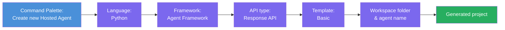
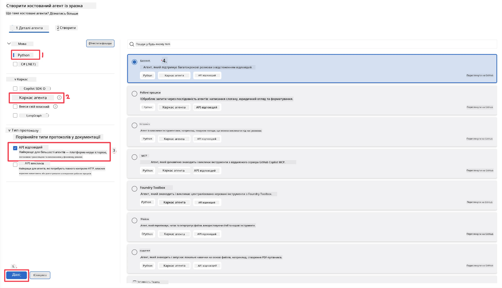
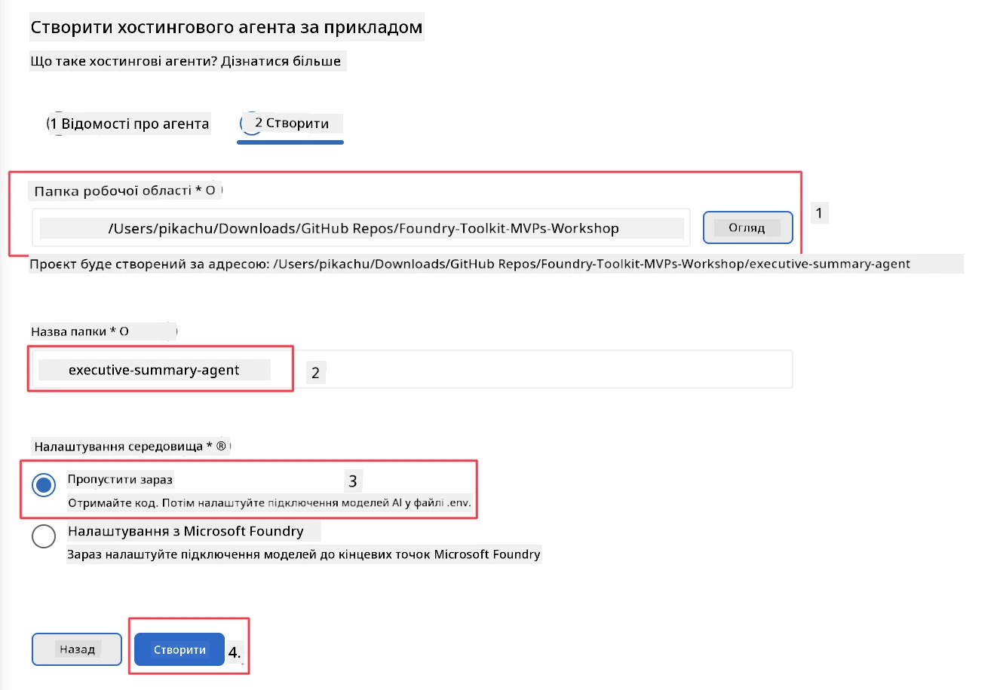

# Модуль 2 - Створення нового хостованого агента

⏱️ ~5 хв

У цьому модулі ви використовуєте Foundry Toolkit, щоб **створити каркас проекту хостованого агента**. Каркас генерує повну структуру проекту - `agent.yaml`, `main.py`, `Dockerfile`, `requirements.txt`, а також конфігурацію налагодження для VS Code - щоб ви могли зосередитися на налаштуванні поведінки агента.

> **Ключова ідея:** Папка `agent/` у цій лабораторній роботі є прикладом того, що генерує Foundry Toolkit. Ви не пишете ці файли з нуля.

### Протяг послідовності роботи майстра створення каркасу



---

## Крок 1: Відкрийте майстер створення хостованого агента

1. Натисніть `Ctrl+Shift+P`, щоб відкрити **Палету команд**.
2. Введіть: **Foundry Toolkit: Create new Hosted Agent** і виберіть цей пункт.

> **Альтернатива: створення через Foundry Portal**
> Якщо вам зручніше використовувати браузер, ви можете створити свій проект на [https://ai.azure.com](https://ai.azure.com). Після створення проекту поверніться до VS Code і скористайтеся бічною панеллю **Foundry Toolkit**, щоб підключитися до нього.

> **Альтернатива:** У бічній панелі Foundry Toolkit наведіть курсор на **Agents** під вашим проєктом, натисніть іконку **+**, а потім виберіть **Create in Code With Template**.

## Крок 2: Вибір налаштувань



1. В лівій навігаційній/опційній секції виберіть наступне:

| Меню | Вибір | Примітки |
|--------|-----------|-------|
| **Language** | Python | Також підтримується C# |
| **Framework** | Agent Framework | Простий стартовий пункт із використанням Agent Framework SDK |
| **API type** | Response API | `POST /responses` - розмовний, з історією, керованою платформою |
| **Template** | Basic | Простий стартовий пункт із використанням Agent Framework SDK |

2. Після вибору натисніть **Next**



3. У наступному вікні виберіть наступне:

| Меню | Вибір | Примітки |
|--------|-----------|-------|
| **Workspace folder** | Виберіть цільову папку | наприклад, `/workspace/Foundry_Toolkit_for_VSCode_Lab/` або підпапка в цьому репозиторії |
| **Agent name** | Введіть ім’я | наприклад, `executive-summary-agent` |
| **Environment Setup** | пропустіть налаштування поки що |  |

Натисніть **create**, щоб створити агента. Буде створена нова папка з ім'ям хостованого агента.

## Крок 3: Перевірте згенерований проект

Після завершення створення каркасу переконайтеся, що в Провіднику (`Ctrl+Shift+E`) ви бачите ці файли:

```
📂 executive-summary-agent/
├── .env                ← Environment variables (placeholders)
├── .vscode/
│   ├── launch.json     ← Debug config (F5 → run + Agent Inspector)
│   └── tasks.json      ← VS Code task definitions
├── agent.yaml          ← Agent definition (kind: hosted)
├── Dockerfile          ← Container config for deployment
├── main.py             ← Agent entry point (your main code)
└── requirements.txt    ← Python dependencies
```

### Пояснення ключових файлів

| Файл | Призначення |
|------|---------|
| `agent.yaml` | Оголошує агента як `kind: hosted`, відображає змінні середовища, визначає протокол `/responses` |
| `main.py` | Створює `FoundryChatClient` → обгортка у `Agent` з інструкціями → обслуговується через `ResponsesHostServer` на порті 8088 |
| `Dockerfile` | Використовує `python:3.12-slim`, встановлює залежності, відкриває порт 8088, виконує `main.py` |
| `requirements.txt` | `agent-framework-foundry`, `agent-framework-foundry-hosting`, `mcp`, `debugpy` |

> **Важливо:** Відкривайте папку з каркасом агента безпосередньо у VS Code (саму папку `agent/`), щоб `.vscode/launch.json` та `tasks.json` працювали коректно при налагодженні з F5.

---

### ✅ Контрольна точка

- [ ] Проект із каркасом створений з усіма очікуваними файлами
- [ ] `agent.yaml` показує `kind: hosted` і `protocol: responses`
- [ ] `main.py` імпортує `Agent`, `FoundryChatClient`, `ResponsesHostServer`
- [ ] Папка агента відкрита у VS Code як корінь робочого простору

---

**Попередня:** [01 - Налаштування](01-setup.md) · **Наступна:** [03 - Налаштування та кодування →](03-configure-and-code.md)

---

<!-- CO-OP TRANSLATOR DISCLAIMER START -->
**Відмова від відповідальності**:
Цей документ було перекладено за допомогою сервісу штучного інтелекту для перекладу [Co-op Translator](https://github.com/Azure/co-op-translator). Хоча ми прагнемо до точності, будь ласка, майте на увазі, що автоматичні переклади можуть містити помилки або неточності. Оригінальний документ рідною мовою слід вважати авторитетним джерелом. Для критично важливої інформації рекомендується професійний людський переклад. Ми не несемо відповідальності за будь-які непорозуміння або неправильні тлумачення, що виникли внаслідок використання цього перекладу.
<!-- CO-OP TRANSLATOR DISCLAIMER END -->