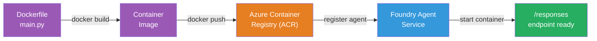
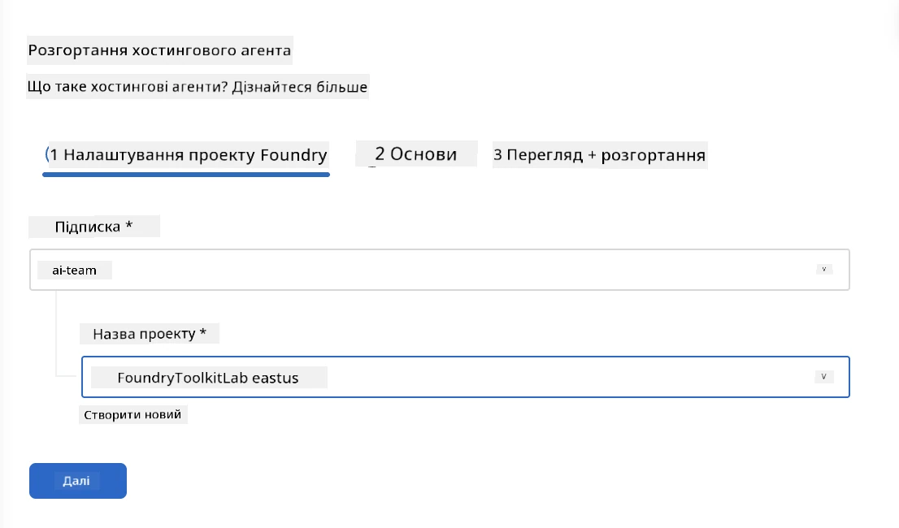
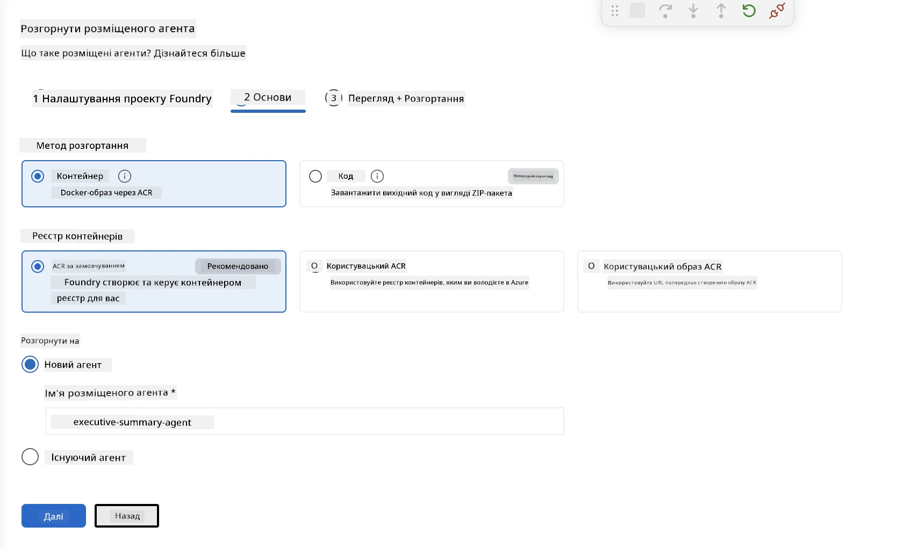
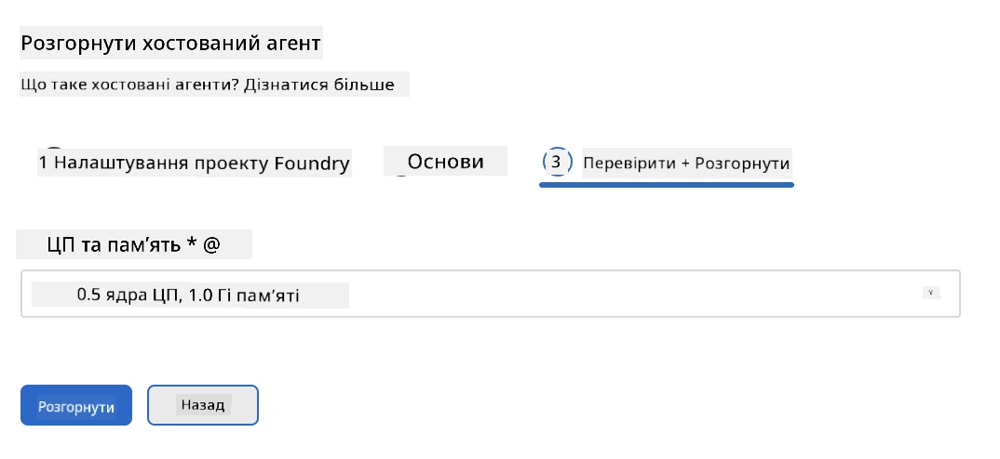
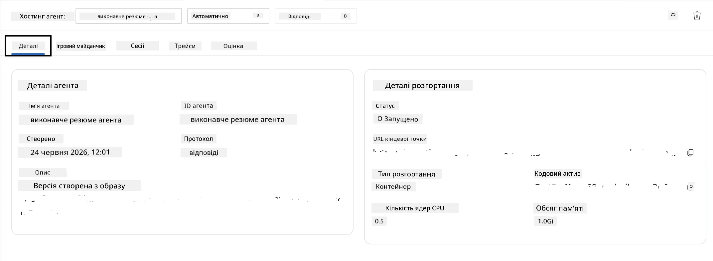

# Модуль 5 - Розгортання в службу агента Foundry

⏱️ ~10 хв

> ⚠️ **Користувачі шляху B:** Цей модуль вимагає підписки Foundry. Якщо ви користуєтеся Foundry Local, перейдіть до [Модуль 07 - Підсумок](07-summary.md). Ви успішно завершили локальний робочий процес розробки!

У цьому модулі ви розгортаєте ваш локально протестований агент у Microsoft Foundry як **хостинговий агент**. Розгортання створює образ контейнера, відправляє його у Azure Container Registry і запускає агента в керованій інфраструктурі Foundry.

### Конвеєр розгортання

---

## Перевірка передумов

Перед розгортанням переконайтеся:

- [ ] Агент проходить всі 3 локальні сценарії з [Модуля 04](04-test-locally.md)
- [ ] У вас є роль **Azure AI User** на рівні проекту ([Модуль 01, Призначення RBAC](01-setup.md#deploy-a-model--assign-rbac))
- [ ] Ви увійшли в Azure у VS Code (на значку облікового запису відображається ваше ім’я)

---

## Крок 1: Початок розгортання

### Варіант А: Розгортання з Agent Inspector (рекомендовано)

Якщо Agent Inspector відкритий (після тестування):
1. Натисніть кнопку **Deploy** у верхньому правому куті (значок хмари ↑).

### Варіант B: Розгортання з командної палітри

1. Натисніть `Ctrl+Shift+P` → **Foundry Toolkit: Deploy Hosted Agent**.

---

## Крок 2: Налаштування розгортання

Майстер запитає у вас:

| Запит | Вибір |
|--------|-----------|
| **Підписка** | Ваша підписка Azure |
| **Цільовий проект** | Ваш проект Foundry (наприклад, `workshop-agents`) |

Натисніть **next** для налаштування агента.

| Запит | Вибір |
|--------|-----------|
| **Метод розгортання** | Контейнер |
| **Реєстр контейнерів** | **Стандартний ACR** (Microsoft Foundry створює і управляє ним для вас) |
| **Розгорнути в** | Новий агент (ім'я, `executive-summary-agent`) |

Натисніть **next** для перегляду та розгортання агента.

| Запит | Вибір |
|--------|-----------|
| **ЦПУ і пам’ять** | **0.5 ядра ЦПУ, 1.0 ГіБ пам’яті** (типово - достатньо для воркшопу) |

---

## Крок 3: Розгортання та моніторинг

1. Натисніть **Deploy**.
2. Слідкуйте за панеллю **Output** (виберіть **Microsoft Foundry** у спадному списку).
3. Розгортання проходить такі етапи:
   - **Створення Docker-образу** — створення контейнера з вашого Dockerfile
   - **Відправка Docker-образу** — відправка образу до ACR (1–3 хв при першому розгортанні)
   - **Реєстрація агента** — створення хостингового агента в Foundry
   - **Запуск контейнера** — запуск із системною керованою ідентичністю

4. По завершенню з’явиться повідомлення:
   > **executive-summary-agent успішно розгорнуто.** `View logs` `Run agent`

5. Натисніть **Run agent** для відкриття Agent Playground.

### Значення статусів розгортання

| Статус | Значення |
|--------|---------|
| **Running** | Контейнер готовий, агент відповідає |
| **Pending** | Контейнер запускається - зачекайте 30–60 секунд |
| **Failed** | Перевірте логи (див. розділ усунення несправностей нижче) |

---

## Типові помилки розгортання

| Помилка | Основна причина | Вирішення |
|-------|-----------|-----|
| `agents/write` permission denied | Відсутня роль **Azure AI User** на рівні проекту | [Модуль 01, Призначення RBAC](01-setup.md#deploy-a-model--assign-rbac) |
| Docker не запущено | Docker Desktop не стартував | Запустіть Docker Desktop → перевірте `docker info` |
| Авторизація ACR | Системна керована ідентичність не може завантажити образ | Див. [Модуль 08 - Усунення несправностей](08-troubleshooting.md) |

---

### ✅ Контрольна точка

- [ ] Розгортання завершено без помилок
- [ ] Агент відображається на вкладці **Hosted Agent** при натисканні **Agents** у боковій панелі Foundry Toolkit вашого проекту
- [ ] Статус контейнера показує **Running**
- [ ] Відкрито вкладку Agent Playground з деталями агента та URL кінцевої точки

---

**Попередній:** [04 - Локальне тестування](04-test-locally.md) · **Наступний:** [06 - Перевірка в Playground →](06-verify-in-playground.md)

---

<!-- CO-OP TRANSLATOR DISCLAIMER START -->
**Відмова від відповідальності**:
Цей документ було перекладено за допомогою сервісу штучного інтелекту для перекладу [Co-op Translator](https://github.com/Azure/co-op-translator). Хоча ми прагнемо до точності, будь ласка, майте на увазі, що автоматичні переклади можуть містити помилки або неточності. Оригінальний документ рідною мовою слід вважати авторитетним джерелом. Для критично важливої інформації рекомендується професійний людський переклад. Ми не несемо відповідальності за будь-які непорозуміння або неправильні тлумачення, що виникли внаслідок використання цього перекладу.
<!-- CO-OP TRANSLATOR DISCLAIMER END -->