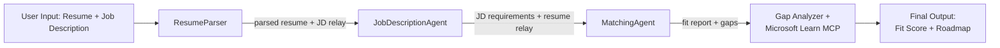

# PersonalCareerCopilot - Оцінювач відповідності резюме вакансії

Програма з кількома агентами, орієнтована на робочий процес, яка оцінює, наскільки резюме відповідає опису вакансії, а потім генерує персоналізовану навчальну дорожню карту для усунення прогалин.

---

## Агенти

| Агент | Роль | Інструменти |
|-------|------|-------|
| **ResumeParser** | Витягує структуровані навички, досвід, сертифікати з тексту резюме | - |
| **JobDescriptionAgent** | Витягує необхідні/бажані навички, досвід, сертифікати з опису вакансії | - |
| **MatchingAgent** | Порівнює профіль із вимогами → оцінка відповідності (0-100) + співпадаючі/відсутні навички | - |
| **GapAnalyzer** | Створює персоналізовану навчальну дорожню карту з ресурсами Microsoft Learn | `search_microsoft_learn_for_plan` (MCP) |

## Робочий процес



---

## Швидкий старт

### 1. Налаштування середовища

Ця папка є еталонною реалізацією для конструкції лабораторної роботи 02 на основі робочого процесу. Її `main.py` використовує наявні блоки підказок та `WorkflowBuilder` для з'єднання чотирьох агентів.

```powershell
cd workshop\lab02-multi-agent\PersonalCareerCopilot
python -m venv .venv
.\.venv\Scripts\Activate.ps1          # Windows PowerShell
# source .venv/bin/activate            # macOS / Linux
pip install -r requirements.txt
```

### 2. Налаштування облікових даних

Створіть файл `.env` у цій папці:

```powershell
copy .env .env.bak 2>$null; echo $null > .env
```

Відредагуйте `.env`:

```env
FOUNDRY_PROJECT_ENDPOINT=https://<your-account>.services.ai.azure.com/api/projects/<your-project>
AZURE_AI_MODEL_DEPLOYMENT_NAME=gpt-4.1-mini
```

| Значення | Де знайти |
|-------|------------------|
| `FOUNDRY_PROJECT_ENDPOINT` | Бічна панель Foundry Toolkit → клік правою кнопкою на проєкт → **Copy Project Endpoint** |
| `AZURE_AI_MODEL_DEPLOYMENT_NAME` | Бічна панель Foundry → розгорнути проєкт → **Models + endpoints** → назва розгортання |

### 3. Запуск локально

```powershell
python -m debugpy --listen 127.0.0.1:5679 main.py --port 8088
```

Або використовуйте завдання VS Code: `Ctrl+Shift+P` → **Tasks: Run Task** → **Run Agent HTTP Server**.

Для налагодження F5 використовуйте **Debug Local Agent HTTP Server**.

### 4. Тестування з Agent Inspector

Відкрийте Agent Inspector: `Ctrl+Shift+P` → **Foundry Toolkit: Open Agent Inspector**.

Вставте цей тестовий запит:

```
Resume:
Jane Doe
Senior Software Engineer with 5 years of experience in Python, Django, and AWS.
Built microservices handling 10K+ requests/second. Led a team of 4 developers.
Certifications: AWS Solutions Architect Associate.
Education: B.S. Computer Science, State University.

Job Description:
Senior Cloud Engineer at Contoso Ltd.
Required: Python, Azure, Kubernetes, Terraform, CI/CD pipelines.
Preferred: Go, monitoring (Prometheus/Grafana), cost optimization.
Experience: 5+ years in cloud infrastructure.
Certifications: Azure Solutions Architect Expert preferred.
```

**Очікувано:** Оцінка відповідності (0-100), співпадаючі/відсутні навички та персоналізована навчальна дорожня карта з посиланнями Microsoft Learn.

### 5. Розгортання на Foundry

`Ctrl+Shift+P` → **Foundry Toolkit: Deploy Hosted Agent** → виберіть ваш проєкт → підтвердьте.

---

## Структура проєкту

```
PersonalCareerCopilot/
├── .env                ← Your credentials (git-ignored)
├── agent.yaml          ← Hosted agent definition (name, resources, env vars)
├── Dockerfile          ← Container image for Foundry deployment
├── main.py             ← 4-agent workflow (instructions, MCP tool, WorkflowBuilder)
└── requirements.txt    ← Python dependencies
```

## Ключові файли

### `agent.yaml`

Визначає хостингового агента для Foundry Agent Service:
- `kind: hosted` - виконується як керований контейнер
- `protocols` - протокол `responses` з `version: 2.0.0`, відкриваючи HTTP endpoint `/responses`
- `environment_variables` - тут оголошено `AZURE_AI_MODEL_DEPLOYMENT_NAME`; `FOUNDRY_PROJECT_ENDPOINT` автоматично впроваджується під час розгортання

### `main.py`

Містить:
- **Інструкції для агентів** - чотири константи `*_INSTRUCTIONS`, по одній на агента
- **Інструмент MCP** - `search_microsoft_learn_for_plan()` викликає `https://learn.microsoft.com/api/mcp` через Streamable HTTP
- **Створення агентів** - чотири екземпляри `Agent()` + `AgentExecutor()`, що використовують один `FoundryChatClient`
- **Граф робочого процесу** - `WorkflowBuilder` з'єднує агентів у послідовний конвеєр: ResumeParser → JD Agent → MatchingAgent → GapAnalyzer
- **Запуск сервера** - `ResponsesHostServer` працює на порту 8088

### `requirements.txt`

| Пакет | Призначення |
|---------|----------|
| `agent-framework-foundry` | Основне середовище виконання: `Agent`, `AgentExecutor`, `WorkflowBuilder`, `@tool`, `FoundryChatClient` |
| `agent-framework-foundry-hosting` | Інтеграція розміщення Foundry + `ResponsesHostServer` |
| `mcp<2,>=1.24.0` | MCP клієнт для GapAnalyzer (`streamable_http_client`) |
| `debugpy` | Налагодження Python (F5 у VS Code) |

---

## Усунення несправностей

| Проблема | Вирішення |
|-------|-----|
| `KeyError: 'FOUNDRY_PROJECT_ENDPOINT'` або `KeyError: 'AZURE_AI_MODEL_DEPLOYMENT_NAME'` | Створіть `.env` з обома встановленими `FOUNDRY_PROJECT_ENDPOINT` та `AZURE_AI_MODEL_DEPLOYMENT_NAME` |
| `ModuleNotFoundError: No module named 'agent_framework'` | Активуйте venv і запустіть `pip install -r requirements.txt` |
| Відсутні посилання Microsoft Learn у виводі | Перевірте підключення до інтернету до `https://learn.microsoft.com/api/mcp` |
| Лише 1 картка прогалини (обрізана) | Перевірте, що `GAP_ANALYZER_INSTRUCTIONS` містить блок `CRITICAL:` |
| Порт 8088 зайнятий | Зупиніть інші сервери: `netstat -ano \| findstr :8088` |

Для детального усунення несправностей див. [Модуль 8 - Усунення несправностей](../docs/08-troubleshooting.md).

---

**Повний посібник:** [Документація лабораторної роботи 02](../docs/README.md) · **Повернутися до:** [README лабораторної роботи 02](../README.md) · [Домашня сторінка майстер-класу](../../../README.md)

---

<!-- CO-OP TRANSLATOR DISCLAIMER START -->
**Відмова від відповідальності**:
Цей документ було перекладено за допомогою сервісу штучного інтелекту для перекладу [Co-op Translator](https://github.com/Azure/co-op-translator). Хоча ми прагнемо до точності, будь ласка, майте на увазі, що автоматичні переклади можуть містити помилки або неточності. Оригінальний документ рідною мовою слід вважати авторитетним джерелом. Для критично важливої інформації рекомендується професійний людський переклад. Ми не несемо відповідальності за будь-які непорозуміння або неправильні тлумачення, що виникли внаслідок використання цього перекладу.
<!-- CO-OP TRANSLATOR DISCLAIMER END -->