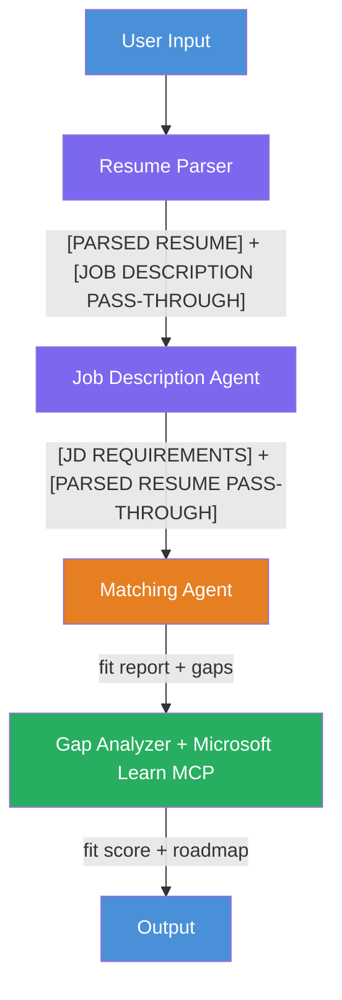

# Лабораторна робота 02 - Багатоагентний робочий процес: Оцінювач відповідності резюме до роботи

## Огляд

У цій практичній лабораторній роботі ви створите **багатоагентний додаток, орієнтований на робочий процес**, використовуючи Foundry Toolkit у VS Code та розгорнете його в службі Microsoft Foundry Agent Service.

**Що ви побудуєте:** Оцінювач відповідності резюме до роботи, який аналізує резюме та опис роботи, оцінює співпадіння і створює персоналізований навчальний план за допомогою ресурсів Microsoft Learn.

---

## Архітектура

**Як це працює:**
1. Користувач вставляє резюме та опис роботи.
2. **ResumeParser** аналізує резюме та копіює опис роботи буквально у розділ `[JOB DESCRIPTION PASS-THROUGH]`.
3. **JD Agent** витягує структуровані вимоги з переданих даних, після чого передає `[PARSED RESUME]` далі як `[PARSED RESUME PASS-THROUGH]`.
4. **MatchingAgent** порівнює `[PARSED RESUME PASS-THROUGH]` та `[JD REQUIREMENTS]` і виробляє оцінку відповідності.
5. **GapAnalyzer** перетворює прогалини на практичний план і отримує реальні посилання на Microsoft Learn через MCP.

---

## Вимоги до підготовки

Спочатку завершіть лабораторну роботу 01:

- [Лабораторна робота 01 - Один агент](../lab01-single-agent/README.md)

---

## Частина 1: Читайте модулі послідовно

Повний навчальний шлях дивіться у:

- [Документація Лаб 2 - Вимоги](docs/00-prerequisites.md)
- [Документація Лаб 2 - Повний навчальний шлях](docs/README.md)
- [Посібник із запуску PersonalCareerCopilot](PersonalCareerCopilot/README.md)

---

## Частина 2: Побудуйте і протестуйте робочий процес

1. Використайте майстер Foundry Toolkit для створення проекту на основі робочого процесу.
2. Скопіюйте блоки команд і граф робочого процесу з `PersonalCareerCopilot/main.py` у ваше робоче середовище.
3. Запустіть локально за допомогою Agent Inspector і переконайтеся, що працюють усі чотири агенти плюс інструмент MCP.
4. Опублікуйте хостингового агента у Foundry після проходження локального тестування.

---

## Шаблони оркестрації

Лабораторна робота 02 використовує **послідовний конвеєр**: результат кожного агента передається наступному, а робочий процес повертає відповідь останнього агента. Для цього використовуються два шаблони:

- **Послідовний ланцюг** - `WorkflowBuilder` з'єднує ResumeParser → JD Agent → MatchingAgent → GapAnalyzer одним викликом `add_edge()` на кожному кроці
- **Передача вмісту** - оскільки кожен агент бачить тільки вихідні дані свого прямого попередника, ResumeParser і JD Agent копіюють для наступних агентів потрібні дані у позначені розділи

Документація також пояснює, чому лабораторна робота не використовує розгалуження/об'єднання і як розширити граф іншим агентом.

Дивіться [docs/04-orchestration-patterns.md](docs/04-orchestration-patterns.md).

---

**Попередня:** [Лабораторна робота 01 - Один агент](../lab01-single-agent/README.md) · **Назад до:** [Головна сторінка воркшопу](../../README.md)

---

<!-- CO-OP TRANSLATOR DISCLAIMER START -->
**Відмова від відповідальності**:
Цей документ було перекладено за допомогою сервісу штучного інтелекту для перекладу [Co-op Translator](https://github.com/Azure/co-op-translator). Хоча ми прагнемо до точності, будь ласка, майте на увазі, що автоматичні переклади можуть містити помилки або неточності. Оригінальний документ рідною мовою слід вважати авторитетним джерелом. Для критично важливої інформації рекомендується професійний людський переклад. Ми не несемо відповідальності за будь-які непорозуміння або неправильні тлумачення, що виникли внаслідок використання цього перекладу.
<!-- CO-OP TRANSLATOR DISCLAIMER END -->