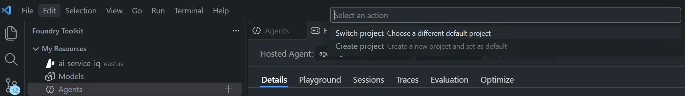

# Модуль 0 - Вступ

⏱️ ~10 хв

> [!WARNING]
> **Попередній перегляд і обмеження:** [Хмарні агенти](https://learn.microsoft.com/azure/foundry/agents/concepts/hosted-agents) наразі знаходяться у **публічному попередньому перегляді** – не рекомендуються для виробничих навантажень. Деякі функції, показані в цьому майстер-класі, можуть змінитися в міру наближення сервісу до GA.

## Що ви створите

У цій лабораторній роботі ви розширите навички одного агента з Лабораторної 01, щоб створити **багатоагентний робочий процес** – Оцінка резюме → відповідність вакансії.

Ви вставляєте **резюме** та **опис вакансії**. Чотири спеціалізовані агенти обробляють вхідні дані послідовно, а потім повертають:
- Бал відповідності (0–100 з розбивкою оцінки)
- Список прогалин у навичках та сертифікаціях
- Персоналізовану навчальну дорожню карту з реальними посиланнями Microsoft Learn для кожної прогалини

**Робочий процес використовує:**
- **Microsoft Agent Framework** - `WorkflowBuilder` для послідовної організації конвеєра
- **Foundry Toolkit для VS Code** - створення заготовок, локальне тестування, розгортання
- **Модель ШІ** (наприклад, `gpt-4.1-mini`) - використовується всіма чотирма агентами
- **Microsoft Learn MCP сервер** - забезпечує реальні посилання на навчальні ресурси для кожної прогалини у навичках

---

## Оберіть свій шлях

> ⚠️ **Продовжуйте з тим самим шляхом, який ви використовували у Лабораторній 01.**

<details open>
<summary><strong>🅰️ Шлях A - Azure хмара (потрібна підписка Azure)</strong></summary>

| | Деталі |
|---|---|
| **Для кого це?** | Ви завершили Лабораторну 01, використовуючи підписку Azure |
| **Модель** | Azure OpenAI через Foundry (наприклад, `gpt-4.1-mini`) |
| **Охоплені модулі** | Всі модулі (00–09) |
| **Розгортання в хмарі?** | ✅ Так – повне розгортання від початку до кінця |

</details>

<details open>
<summary><strong>🅱️ Шлях B - Foundry Local (підписка Azure не потрібна)</strong></summary>

| | Деталі |
|---|---|
| **Для кого це?** | Ви завершили Лабораторну 01, використовуючи Foundry Local |
| **Модель** | Foundry Local (безкоштовна, працює на вашому комп’ютері) |
| **Охоплені модулі** | Модулі 00–05 (пропустіть 06–07 – розгортання та перевірка хмари) |
| **Розгортання в хмарі?** | ❌ Ні – лише локальне тестування через Agent Inspector |

</details>

---

## Перевірка Лабораторної 01

Лабораторна 02 ґрунтується безпосередньо на Лабораторній 01. Спершу завершіть Лабораторну 01, перш ніж починати тут.

Ще не виконували Лабораторну 01? Почніть тут: [Лабораторна 01 - Вступ](../../lab01-single-agent/docs/00-prerequisites.md)

<details open>
<summary><strong>🅰️ Шлях A - Azure хмара</strong></summary>

```powershell
az account show --query "{name:name, id:id}" --output table
```

Якщо це не вдається, виконайте `az login`. Потім перевірте у VS Code:

1. `Ctrl+Shift+P` → введіть **Foundry Toolkit** → переконайтеся, що з’явилися команди.
2. Клікніть на іконку **Foundry Toolkit** → ваш проект і розгорнута модель показують **Succeeded**.



> **RBAC:** Ви призначили роль **Foundry User** у Лабораторній 01. Якщо потрібно призначити знову, див. [Лабораторна 01, Модуль 1](../../lab01-single-agent/docs/01-setup.md#deploy-a-model--assign-rbac). Роль раніше називалась **Azure AI User** – ті ж дозволи.

</details>

<details open>
<summary><strong>🅱️ Шлях B - Foundry Local</strong></summary>

```powershell
Invoke-WebRequest -Uri "http://localhost:5273/v1/health" -UseBasicParsing | Select-Object StatusCode
```

Очікувано: `StatusCode: 200`. Якщо ні, перезапустіть Foundry Local з бокової панелі Foundry Toolkit.

> Усі виконання висновків відбуваються на вашому комп’ютері. Єдиний вихідний виклик – інструмент MCP до `https://learn.microsoft.com/api/mcp`.

</details>

---

## Що нового в Лабораторній 02

| | Лабораторна 01 | Лабораторна 02 |
|--|--------|--------|
| Агенти | 1 | 4 (послідовно з WorkflowBuilder) |
| Шаблон заготовки | Базовий - Agent Framework | Робочі процеси - Agent Framework |
| Новий пакет | - | `mcp` |
| Оркестрація | Одиночний агент для діалогу | Послідовний конвеєр (WorkflowBuilder) |
| Новий інструмент | - | `search_microsoft_learn_for_plan` (MCP) |

---

**Далі:** [01 - Розуміння архітектури →](01-understand-multi-agent.md)

---

<!-- CO-OP TRANSLATOR DISCLAIMER START -->
**Відмова від відповідальності**:
Цей документ було перекладено за допомогою сервісу штучного інтелекту для перекладу [Co-op Translator](https://github.com/Azure/co-op-translator). Хоча ми прагнемо до точності, будь ласка, майте на увазі, що автоматичні переклади можуть містити помилки або неточності. Оригінальний документ рідною мовою слід вважати авторитетним джерелом. Для критично важливої інформації рекомендується професійний людський переклад. Ми не несемо відповідальності за будь-які непорозуміння або неправильні тлумачення, що виникли внаслідок використання цього перекладу.
<!-- CO-OP TRANSLATOR DISCLAIMER END -->