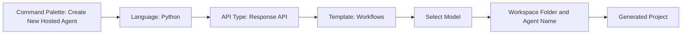

# Модуль 2 - Створення каркасу мультіагентного проєкту

⏱️ ~5 хв

У цьому модулі ви використовуєте [Foundry Toolkit for VS Code](https://aka.ms/foundrytk) щоб **створити каркас мультіагентного проєкту**. Майстер генерує `agent.yaml`, `main.py`, `Dockerfile`, `requirements.txt`, `.env` і конфігурацію налагодження VS Code — щоб ви могли зосередитися на зв'язуванні робочого процесу з 4 агентами в Модулі 3.

> **Ключова ідея:** Каркас — це робоча заглушка з одним агентом. Ви заміните тимчасову логіку графом `WorkflowBuilder` у Модулі 3. Ви не пишете шаблонний код з нуля.

> **Зразкова реалізація:** [`PersonalCareerCopilot/`](../../../../../workshop/lab02-multi-agent/PersonalCareerCopilot) — це повний робочий приклад. Використовуйте його, щоб порівнювати свою роботу під час виконання.

### Послідовність роботи майстра створення каркасу



---

## Крок 1: Відкрийте майстер «Create Hosted Agent»

1. Натисніть `Ctrl+Shift+P`, щоб відкрити **Палітру команд**.
2. Type: **Foundry Toolkit: Create a New Hosted Agent** and select it.
3. Майстер відкриється на вкладці **Agent Details**.

> **Альтернативно:** Натисніть іконку **Foundry Toolkit** на Панелі активностей → натисніть іконку **+** поруч із **Hosted Agents** → **Create New Hosted Agent**.

---

## Крок 2: Виберіть налаштування


1. У лівій частині навігації/опцій виберіть наступне:

| Меню | Вибір | Примітки |
|--------|-----------|-------|
| **Мова** | Python | Також підтримується C# (.NET) |
| **Фреймворк** | Agent Framework | Надає `Agent`, `AgentExecutor`, `WorkflowBuilder` |
| **Тип API** | Response API | `POST /responses` - історія, керована платформою, підтримка потокової передачі |
| **Шаблон** | **Workflows** | Обробляє запити послідовно через кілька агентів |

2. Після вибору натисніть **Next**


3. У наступному вікні виберіть наступне:

| Меню | Вибір | Примітки |
|--------|-----------|-------|
| **Папка робочого простору** | Browse to target folder | наприклад, `workshop/lab02-multi-agent/` у цьому репозиторії |
| **Ім'я агента** | `PersonalCareerCopilot` | Це стане назвою каталогу проєкту |
| **Розгортання моделі** | Select your deployed model | наприклад, `gpt-4.1-mini` з Lab 01 |

4. Натисніть **Create**, щоб створити каркас проєкту. VS Code згенерує файли та відкриє папку.

> **Порада:** [`gpt-4.1-mini`](https://learn.microsoft.com/azure/foundry/foundry-models/concepts/models-sold-directly-by-azure#gpt-41-series) добре балансує швидкість і якість для розробки мультиагентних систем.

---

## Крок 3: Перевірте згенерований проєкт

Після завершення створення каркасу переконайтеся, що ви бачите ці файли в Провіднику (`Ctrl+Shift+E`):

```
📂 <your-agent-name>/
├── .azdignore          ← Files excluded from Azure Developer CLI deployments
├── .dockerignore       ← Files excluded from Docker builds
├── .env                ← Environment variables (placeholders - fill in Module 3)
├── .vscode/
│   ├── launch.json     ← Debug config (F5 → run + Agent Inspector)
│   └── tasks.json      ← VS Code task definitions
├── agent.yaml          ← Agent definition (kind: hosted, protocol: responses)
├── Dockerfile          ← Container config for deployment
├── main.py             ← Stub agent entry point (replace with WorkflowBuilder in Module 3)
└── requirements.txt    ← Python dependencies
```

> **Важливо:** Відкрийте цю заготовлену папку безпосередньо у VS Code, щоб `.vscode/launch.json` і `tasks.json` коректно застосовувалися для налагодження через F5.

### Пояснення ключових файлів

| Файл | Призначення |
|------|---------|
| `agent.yaml` | Оголошує `kind: hosted`, відображає змінні середовища, визначає протокол `/responses` |
| `main.py` | Заглушка: один `FoundryChatClient` → `Agent` → `ResponsesHostServer`. Ви заміните це на 4 агентів + `WorkflowBuilder` у Модулі 3 |
| `Dockerfile` | `python:3.12-slim`, встановлює `requirements.txt`, відкриває порт 8088, запускає `python main.py` |
| `requirements.txt` | `agent-framework-foundry`, `agent-framework-foundry-hosting`, `mcp<2,>=1.24.0`, `debugpy` |

> **Довідка:** Див. [`PersonalCareerCopilot/agent.yaml`](../../../../../workshop/lab02-multi-agent/PersonalCareerCopilot/agent.yaml) та [`PersonalCareerCopilot/requirements.txt`](../../../../../workshop/lab02-multi-agent/PersonalCareerCopilot/requirements.txt) для повного згенерованого вмісту.

---

### ✅ Контрольний пункт

- [ ] Майстер створення каркасу завершено - нова папка проєкту видима в Провіднику
- [ ] Всі очікувані файли присутні: `agent.yaml`, `main.py`, `Dockerfile`, `requirements.txt`, `.env`
- [ ] `agent.yaml` показує `kind: hosted` та `protocol: responses`
- [ ] `main.py` імпортує `Agent`, `FoundryChatClient`, `ResponsesHostServer`
- [ ] Папку з каркасом відкрито як корінь робочого простору VS Code
- [ ] Ви розумієте, що `main.py` є заглушкою - `WorkflowBuilder` буде додано в Модулі 3

---

**Попереднє:** [01 - Зрозуміти архітектуру мультіагентної системи](01-understand-multi-agent.md) · **Наступне:** [03 - Налаштувати агентів та середовище →](03-configure-agents.md)

---

<!-- CO-OP TRANSLATOR DISCLAIMER START -->
**Відмова від відповідальності**:
Цей документ було перекладено за допомогою сервісу штучного інтелекту для перекладу [Co-op Translator](https://github.com/Azure/co-op-translator). Хоча ми прагнемо до точності, будь ласка, майте на увазі, що автоматичні переклади можуть містити помилки або неточності. Оригінальний документ рідною мовою слід вважати авторитетним джерелом. Для критично важливої інформації рекомендується професійний людський переклад. Ми не несемо відповідальності за будь-які непорозуміння або неправильні тлумачення, що виникли внаслідок використання цього перекладу.
<!-- CO-OP TRANSLATOR DISCLAIMER END -->