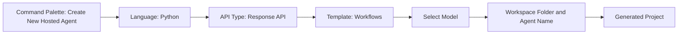
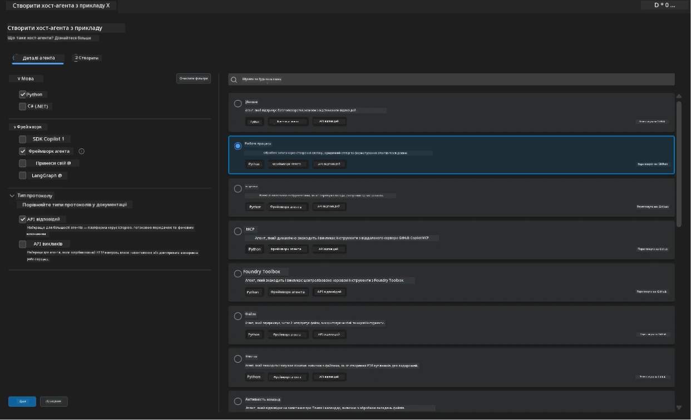
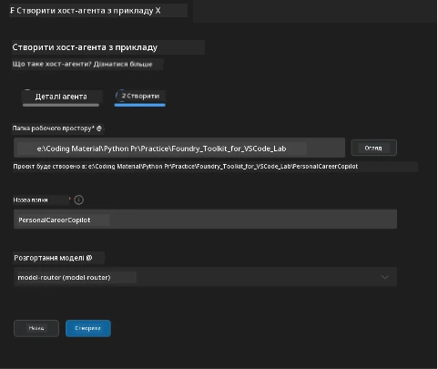

# Модуль 2 - Створення каркасу багатозадачного проєкту

⏱️ ~5 хв

У цьому модулі ви використовуєте [Foundry Toolkit for VS Code](https://aka.ms/foundrytk), щоб **створити каркас багатозадачного проєкту**. Майстер генерує `agent.yaml`, `main.py`, `Dockerfile`, `requirements.txt`, `.env` і конфігурацію налагодження VS Code — щоб ви могли зосередитись на налаштуванні робочого процесу 4 агентів у Модулі 3.

> **Ключова ідея:** Каркас — це працездатний заготовка з одним агентом. Ви замінюєте логіку-заповнювач на граф `WorkflowBuilder` у Модулі 3. Ви не пишете шаблон із нуля.

> **Приклад для довідки:** [`PersonalCareerCopilot/`](../../../../../workshop/lab02-multi-agent/PersonalCareerCopilot) — це повноцінний робочий приклад. Використовуйте його, щоб порівнювати свою роботу в процесі.

### Потік роботи майстра створення каркасу



---

## Крок 1: Відкрийте майстер Create Hosted Agent

1. Натисніть `Ctrl+Shift+P`, щоб відкрити **Палітру команд**.
2. Введіть: **Foundry Toolkit: Create new Hosted Agent** і виберіть цей пункт.
3. Майстер відкриється на вкладці **Agent Details**.

> **Альтернатива:** Клацніть іконку **Foundry Toolkit** на панелі активності → натисніть іконку **+** біля **Hosted Agents** → **Create New Hosted Agent**.

---

## Крок 2: Оберіть налаштування



1. У лівому розділі навігації/налаштувань оберіть:

| Меню | Вибір | Примітки |
|--------|-----------|-------|
| **Мова** | Python | Також підтримується C# (.NET) |
| **Фреймворк** | Agent Framework | Забезпечує `Agent`, `AgentExecutor`, `WorkflowBuilder` |
| **Тип API** | Response API | `POST /responses` — історія керована платформою, підтримка потоків |
| **Шаблон** | **Workflows** | Обробляє запити через кілька агентів послідовно |

2. Після вибору натисніть **Next**



3. У наступному вікні оберіть:

| Меню | Вибір | Примітки |
|--------|-----------|-------|
| **Папка робочого простору** | Виберіть цільову папку | Наприклад, `workshop/lab02-multi-agent/` у цьому репозиторії |
| **Ім'я агента** | `PersonalCareerCopilot` | Стане назвою директорії проєкту |
| **Розгортання моделі** | Виберіть розгорнуту модель | Наприклад, `gpt-4.1-mini` з Лабораторної роботи 01 |

4. Натисніть **Create**, щоб створити каркас проєкту. VS Code згенерує файли та відкриє папку.

> **Підказка:** [`gpt-4.1-mini`](https://learn.microsoft.com/azure/foundry/foundry-models/concepts/models-sold-directly-by-azure#gpt-41-series) добре балансує швидкість і якість для розробки багатозадачних агентів.

---

## Крок 3: Перевірте створений проєкт

Після завершення створення каркасу переконайтеся, що бачите ці файли у Провіднику (`Ctrl+Shift+E`):

```
📂 <your-agent-name>/
├── .azdignore          ← Files excluded from Azure Developer CLI deployments
├── .dockerignore       ← Files excluded from Docker builds
├── .env                ← Environment variables (placeholders - fill in Module 3)
├── .vscode/
│   ├── launch.json     ← Debug config (F5 → run + Agent Inspector)
│   └── tasks.json      ← VS Code task definitions
├── agent.yaml          ← Agent definition (kind: hosted, protocol: responses)
├── Dockerfile          ← Container config for deployment
├── main.py             ← Stub agent entry point (replace with WorkflowBuilder in Module 3)
└── requirements.txt    ← Python dependencies
```

> **Важливо:** Відкривайте цю створену папку безпосередньо у VS Code, щоб `.vscode/launch.json` і `tasks.json` працювали правильно під час налагодження F5.

### Пояснення ключових файлів

| Файл | Призначення |
|------|---------|
| `agent.yaml` | Оголошує `kind: hosted`, відображає змінні оточення, визначає протокол `/responses` |
| `main.py` | Заготовка: один `FoundryChatClient` → `Agent` → `ResponsesHostServer`. Ви заміните це чотирма агентами + `WorkflowBuilder` у Модулі 3 |
| `Dockerfile` | `python:3.12-slim`, встановлює `requirements.txt`, відкриває порт 8088, запускає `python main.py` |
| `requirements.txt` | `agent-framework-foundry`, `agent-framework-foundry-hosting`, `mcp<2,>=1.24.0`, `debugpy` |

> **Довідка:** Дивіться [`PersonalCareerCopilot/agent.yaml`](../../../../../workshop/lab02-multi-agent/PersonalCareerCopilot/agent.yaml) та [`PersonalCareerCopilot/requirements.txt`](../../../../../workshop/lab02-multi-agent/PersonalCareerCopilot/requirements.txt) для повного згенерованого вмісту.

---

### ✅ Контрольний пункт

- [ ] Майстер створення каркасу завершено — нова папка проєкту відображається у Провіднику
- [ ] Всі очікувані файли присутні: `agent.yaml`, `main.py`, `Dockerfile`, `requirements.txt`, `.env`
- [ ] `agent.yaml` показує `kind: hosted` і `protocol: responses`
- [ ] `main.py` імпортує `Agent`, `FoundryChatClient`, `ResponsesHostServer`
- [ ] Створена папка відкрита як корінь робочого простору VS Code
- [ ] Ви розумієте, що `main.py` — це заготовка — `WorkflowBuilder` додається в Модулі 3

---

**Попередній:** [01 - Розуміння багатозадачної архітектури](01-understand-multi-agent.md) · **Наступний:** [03 - Налаштування агентів і оточення →](03-configure-agents.md)

---

<!-- CO-OP TRANSLATOR DISCLAIMER START -->
**Відмова від відповідальності**:
Цей документ було перекладено за допомогою сервісу штучного інтелекту для перекладу [Co-op Translator](https://github.com/Azure/co-op-translator). Хоча ми прагнемо до точності, будь ласка, майте на увазі, що автоматичні переклади можуть містити помилки або неточності. Оригінальний документ рідною мовою слід вважати авторитетним джерелом. Для критично важливої інформації рекомендується професійний людський переклад. Ми не несемо відповідальності за будь-які непорозуміння або неправильні тлумачення, що виникли внаслідок використання цього перекладу.
<!-- CO-OP TRANSLATOR DISCLAIMER END -->