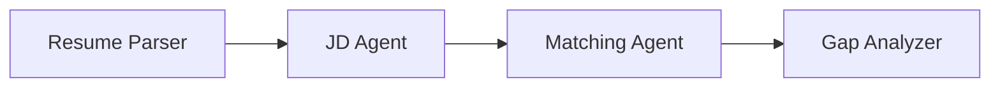
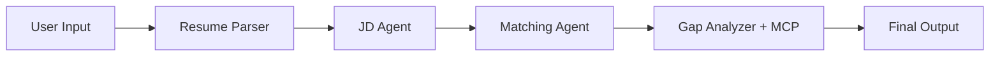

# Модуль 4 - Шаблони оркестрації

⏱️ ~10 хв

У цьому модулі ви досліджуєте шаблони оркестрації, які використовуються в Resume Job Fit Evaluator, і навчаєтесь читати, змінювати та розширювати граф робочого процесу. Розуміння цих шаблонів є ключовим для налагодження проблем з потоком даних і створення власних [багатоагентних робочих процесів](https://learn.microsoft.com/agent-framework/workflows/).

---

## Шаблон 1: Послідовний ланцюг

Основним шаблоном у робочому процесі є **послідовний ланцюг** - вихід кожного агента подається безпосередньо на вхід наступного.



У коді кожен виклик `add_edge()` створює один крок у ланцюгу:

```python
.add_edge(resume_executor, jd_executor)       # ResumeParser output → JD Agent
.add_edge(jd_executor, matching_executor)     # JD Agent output → MatchingAgent
.add_edge(matching_executor, gap_executor)    # MatchingAgent output → GapAnalyzer
```

> **Чому послідовний, а не fan-out/fan-in?** `WorkflowBuilder` використовує **OR-семантику** для вхідних ребер: виконавець у нижчому рівні запускається, щойно **будь-який** попередник завершується. Якщо б у `matching_executor` було два вхідні ребра (від `resume_executor` і `jd_executor`), він спрацював би двічі - один раз, коли ResumeParser закінчить, і ще раз, коли JD Agent закінчить - це змусило б GapAnalyzer також виконуватися двічі, а вихід відобразився б двічі. Послідовний конвеєр уникає цього повністю.

## Шаблон 2: Передача вмісту

Оскільки `context_mode="last_agent"` означає, що кожен виконавець бачить лише **вихід свого безпосереднього попередника**, агенти у послідовному ланцюгу повинні явно передавати вперед будь-які дані, потрібні нижчим агентам.

У цьому робочому процесі:
- **ResumeParser** копіює JD буквальним текстом у `[JOB DESCRIPTION PASS-THROUGH]` (щоб JD Agent міг його знайти).
- **JD Agent** копіює `[PARSED RESUME]` буквальним текстом у `[PARSED RESUME PASS-THROUGH]` (щоб MatchingAgent міг порівняти обидва профілі).

```
ResumeParser output
└─ [PARSED RESUME]               ← extracted by JD Agent
└─ [JOB DESCRIPTION PASS-THROUGH] ← extracted by JD Agent

JD Agent output
└─ [JD REQUIREMENTS]             ← extracted by MatchingAgent
└─ [PARSED RESUME PASS-THROUGH]  ← extracted by MatchingAgent
```

Кожен розділ передачі має копіюватися **буквально** - узагальнення або перефразування порушує нижчий агент, який від нього залежить.

---

## Повний граф

Поєднання послідовного ланцюга і передачі вмісту створює повний робочий процес:



Агент Інспектор показує ту ж структуру графа, коли агент працює локально. Дивіться [Модуль 5 - Тестування локально](05-test-locally.md) для скріншотів.

---

## Читання коду WorkflowBuilder

Граф робочого процесу будується в функції `main()` у [`PersonalCareerCopilot/main.py`](../../../../../workshop/lab02-multi-agent/PersonalCareerCopilot/main.py). Три виклики `add_edge()` будують послідовний конвеєр:

| # | Ребро | Ефект |
|---|-------|--------|
| 1 | `resume_executor → jd_executor` | JD Agent отримує `[PARSED RESUME]` + `[JOB DESCRIPTION PASS-THROUGH]` |
| 2 | `jd_executor → matching_executor` | MatchingAgent отримує `[JD REQUIREMENTS]` + `[PARSED RESUME PASS-THROUGH]` |
| 3 | `matching_executor → gap_executor` | GapAnalyzer отримує звіт про відповідність + список розривів |

---

## Зміна графа

### Додавання нового агента

Щоб додати п’ятий агент (наприклад, **InterviewPrepAgent** після GapAnalyzer):

1. Визначте константу `INTERVIEW_PREP_INSTRUCTIONS`.
2. Створіть об’єкти `Agent` + `AgentExecutor` (за тим самим шаблоном, що й існуючі чотири).
3. Додайте `.add_edge(gap_executor, interview_exec)` у `WorkflowBuilder`.
4. Оновіть `output_executors=[interview_exec]`.

> **Важливо:** `start_executor` є єдиним агентом, який отримує необроблений ввід користувача. Всі інші агенти отримують вихід зі свого верхнього ребра.

---

## Поширені помилки в графі

| Помилка | Симптом | Виправлення |
|---------|---------|------------|
| Відсутнє ребро до `output_executors` | Агент запускається, але вихід пустий | Переконайтесь, що існує шлях від `start_executor` до кожного агента у `output_executors` |
| Циклічна залежність | Нескінченний цикл або тайм-аут | Перевірте, що жоден агент не передає дані назад в агент верхнього рівня |
| Агент у `output_executors` без вхідних ребер | Порожній вихід | Додайте принаймні одне `add_edge(source, that_agent)` |
| Кілька `output_executors` без fan-in | Вихід містить лише відповідь одного агента | Використовуйте одного вихідного агента для агрегування або приймайте кілька виходів |
| Відсутній `start_executor` | `ValueError` під час побудови | Завжди вказуйте `start_executor` у `WorkflowBuilder()` |

---

## Налагодження графа

### Використання Agent Inspector

1. Запустіть агента локально натисненням F5.
2. Відкрийте Agent Inspector (`Ctrl+Shift+P` → **Foundry Toolkit: Відкрити Agent Inspector**).
3. Надішліть тестове повідомлення.
4. У панелі відповідей інспектора шукайте **потоковий вихід** - він показує вклад кожного агента послідовно.


### Використання логування

Додайте логування у `main.py` для відстеження потоку даних:

```python
import logging
logger = logging.getLogger("resume-job-fit")

# In main(), after building the workflow:
logger.info("Workflow graph built with edges: RP→JD, JD→MA, MA→GA")
```

Логи сервера показують порядок виконання агентів і виклики MCP інструментів:

```
INFO:agent_framework:Executing agent: ResumeParser
INFO:agent_framework:Executing agent: JobDescriptionAgent
INFO:agent_framework:Executing agent: MatchingAgent
INFO:agent_framework:Executing agent: GapAnalyzer
INFO:agent_framework:Tool call: search_microsoft_learn_for_plan(skill="Kubernetes")
POST https://learn.microsoft.com/api/mcp → 200
INFO:agent_framework:Tool call: search_microsoft_learn_for_plan(skill="Terraform")
POST https://learn.microsoft.com/api/mcp → 200
```

---

### Контрольна точка

- [ ] Ви можете визначити два шаблони оркестрації у робочому процесі: послідовний ланцюг і передачу вмісту
- [ ] Ви розумієте, чому `context_mode="last_agent"` вимагає явної передачі даних між агентами
- [ ] Ви можете читати код `WorkflowBuilder` і зіставляти кожен виклик `add_edge()` з візуальним графом
- [ ] Ви знаєте, як додати нового агента в кінець конвеєра
- [ ] Ви можете визначити поширені помилки графа і їхні симптоми

---

**Попередній:** [03 - Налаштування агентів та середовища](03-configure-agents.md) · **Наступний:** [05 - Тестування локально →](05-test-locally.md)

---

<!-- CO-OP TRANSLATOR DISCLAIMER START -->
**Відмова від відповідальності**:
Цей документ було перекладено за допомогою сервісу штучного інтелекту для перекладу [Co-op Translator](https://github.com/Azure/co-op-translator). Хоча ми прагнемо до точності, будь ласка, майте на увазі, що автоматичні переклади можуть містити помилки або неточності. Оригінальний документ рідною мовою слід вважати авторитетним джерелом. Для критично важливої інформації рекомендується професійний людський переклад. Ми не несемо відповідальності за будь-які непорозуміння або неправильні тлумачення, що виникли внаслідок використання цього перекладу.
<!-- CO-OP TRANSLATOR DISCLAIMER END -->