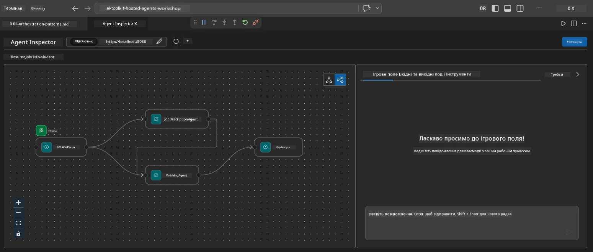
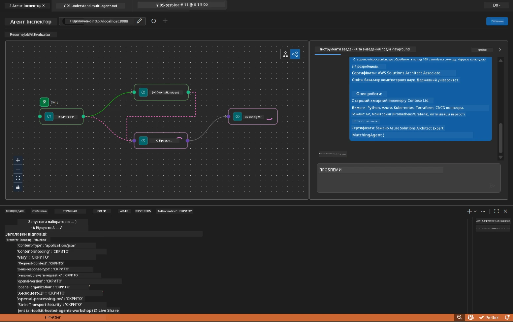
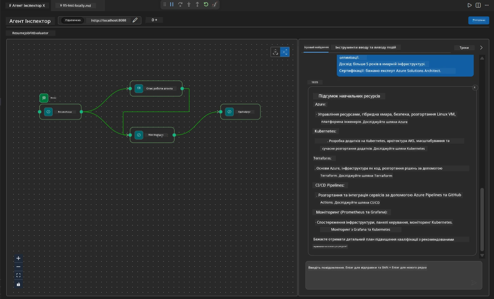

# Модуль 5 - Тестування локально

⏱️ ~15 хв

У цьому модулі ви запустите багаток агентний робочий процес локально, протестуєте його за допомогою Agent Inspector і перевірите, що всі чотири агенти та інструмент MCP працюють правильно перед розгортанням.

---

## Крок 1: Запустіть сервер агента

### Варіант A: Використання завдання VS Code (рекомендовано)

1. Відкрийте `workshop/lab02-multi-agent/PersonalCareerCopilot/` як папку у VS Code.
2. Натисніть `Ctrl+Shift+P` → введіть **Tasks: Run Task** → оберіть **Run Agent HTTP Server**.
3. Завдання запускає сервер з приєднаним debugpy на порту `5679` і агента на порту `8088`.
4. Чекайте, поки вивід покаже повідомлення про запуск, а потім повідомлення про готовність сервера (між ними з’являтимуться інші рядки журналу):

```
INFO:resume-job-fit:Starting Resume -> Job Fit Evaluator HTTP server...
...
INFO:hypercorn.error:Running on http://0.0.0.0:8088 (CTRL + C to quit)
```

### Варіант B: Використання F5 (режим налагодження)

1. Натисніть `F5` → оберіть **Debug Local Agent HTTP Server**.
2. Сервер запускається з повною підтримкою точок зупину — це корисно для інспекції відповідей MCP або виводу агента.

---

## Крок 2: Відкрийте Agent Inspector

1. Натисніть `Ctrl+Shift+P` → введіть **Foundry Toolkit: Open Agent Inspector**.
2. Agent Inspector відкривається як панель VS Code, підключена до `http://localhost:8088`.
3. Ви повинні побачити інтерфейс агента, готовий приймати повідомлення.



> **Якщо Agent Inspector не відкривається:** Переконайтеся, що сервер повністю запущений (ви бачите `Running on http://0.0.0.0:8088` лог). Якщо порт 5679 зайнятий, дивіться [Розділ 8 - Вирішення проблем](08-troubleshooting.md).

---

## Крок 2b: (Необов’язково) Відкрийте Workflow Visualizer

Foundry Toolkit включає в себе візуалізатор робочого процесу в реальному часі (**Workflow Visualizer**), який показує, як агенти взаємодіють під час виконання графа. Це особливо корисно для налагодження кількох агентів.

1. Натисніть `Ctrl+Shift+P` → введіть **Foundry Toolkit: Open Visualizer for Hosted Agents**.
2. Відкриється нова вкладка VS Code із живим графом виконання.
3. Коли ви надсилаєте повідомлення в Agent Inspector, візуалізатор оновлюється автоматично — зелені вузли означають завершені агенти, а анімовані ребра показують потік даних між ними.

> **Конфлікт портів:** Якщо порт візуалізатора вже зайнятий, змініть його у Налаштуваннях VS Code → **Extensions** → **Microsoft Foundry Configuration** → **Hosted Agents: Visualizer Port**.

---

## Крок 3: Запустіть базові тести

Запустіть ці два тести по черзі. Кожен тест поступово перевіряє більше частин робочого процесу.

### Тест 1: Базове резюме + опис вакансії

Вставте наступне у Agent Inspector:

```
Resume:
Jane Doe
Senior Software Engineer with 5 years of experience in Python, Django, and AWS.
Built microservices handling 10K+ requests/second. Led a team of 4 developers.
Certifications: AWS Solutions Architect Associate.
Education: B.S. Computer Science, State University.

Job Description:
Senior Cloud Engineer at Contoso Ltd.
Required: Python, Azure, Kubernetes, Terraform, CI/CD pipelines.
Preferred: Go, monitoring (Prometheus/Grafana), cost optimization.
Experience: 5+ years in cloud infrastructure.
Certifications: Azure Solutions Architect Expert preferred.
```

**Очікувана структура виводу:**

Відповідь має містити вивід усіх чотирьох агентів послідовно:

1. **Вивід Resume Parser** — два позначених розділи: `[PARSED RESUME]` (профіль кандидата з групованими навичками) та `[JOB DESCRIPTION PASS-THROUGH]` (текст JD дослівно, що передається JD Агенту)
2. **Вивід JD Agent** — структуровані вимоги з розділенням обов’язкових та бажаних навичок
3. **Вивід Matching Agent** — оцінка відповідності (0-100) з деталізацією, відповідні навички, відсутні навички, прогалини
4. **Вивід Gap Analyzer** — індивідуальні картки прогалин для кожної відсутньої навички, кожна з посиланнями Microsoft Learn





### Що перевірити у Тесті 1

| Перевірка | Очікуване | Пройшов? |
|----------|-----------|---------|
| Відповідь містить оцінку відповідності | Число від 0 до 100 з деталізацією | |
| Перелічені співпадаючі навички | Python, CI/CD (частково) тощо | |
| Перелічені відсутні навички | Azure, Kubernetes, Terraform тощо | |
| Існують картки прогалин для кожної відсутньої навички | Одна картка на навичку | |
| Присутні посилання Microsoft Learn | Реальні `learn.microsoft.com` посилання | |
| Відсутні повідомлення про помилки у відповіді | Чистий структурований вивід | |

### Тест 2: Граничний випадок — кандидат з високою відповідністю

Вставте резюме, яке дуже добре відповідає JD, щоб перевірити, як GapAnalyzer обробляє ситуації з високою відповідністю:

```
Resume:
Alex Chen
Senior Cloud Engineer with 7 years of experience.
Skills: Python, Azure (AKS, Functions, DevOps), Kubernetes, Terraform, CI/CD (GitHub Actions, Azure Pipelines), Go, Prometheus, Grafana, cost optimization.
Certifications: Azure Solutions Architect Expert, Azure DevOps Engineer Expert.
Led infrastructure migration to Azure for 3 enterprise clients.
Education: M.S. Computer Science, Tech University.

Job Description:
Senior Cloud Engineer at Contoso Ltd.
Required: Python, Azure, Kubernetes, Terraform, CI/CD pipelines.
Preferred: Go, monitoring (Prometheus/Grafana), cost optimization.
Experience: 5+ years in cloud infrastructure.
Certifications: Azure Solutions Architect Expert preferred.
```

**Очікувана поведінка:**
- Оцінка відповідності має бути **80+** (більшість навичок співпадають)
- Картки прогалин мають зосереджуватися на «шліфуванні» / підготовці до співбесіди, а не на базовому навчанні
- Інструкції GapAnalyzer кажуть: "Якщо відповідність >= 80, зосередьтесь на шліфуванні/підготовці до співбесіди"

---

## Крок 4: Тестуйте зі своїми даними (необов’язково)

Спробуйте вставити своє резюме та реальний опис вакансії. Це допоможе переконатися, що:

- Агенти працюють з різними форматами резюме (хронологічний, функціональний, гібридний)
- JD Agent працює з різними стилями опису вакансії (маркерні списки, параграфи, структуровані)
- MCP інструмент повертає релевантні ресурси для реальних навичок
- Картки прогалин персоналізовані під ваш конкретний досвід

> **Конфіденційність - шлях A (Foundry cloud):** Текст резюме та опису вакансії надсилається до вашого розгортання Azure OpenAI для інференсу. Він не записується і не зберігається інфраструктурою воркшопу. Використовуйте замінні імена (наприклад, «Jane Doe»), якщо бажаєте.
>
> **Конфіденційність - шлях B (Foundry Local):** Всі чотири агенти виконують інференс повністю на вашому пристрої. Ваше резюме та опис вакансії **ніколи не покидають вашому машину**. Єдиний вихідний виклик — це MCP інструмент, який отримує ресурси з `https://learn.microsoft.com/api/mcp`; запит містить лише назву навички, а не ваші персональні дані.

---

### Контрольний список

- [ ] Сервер успішно запущено на порті `8088` (лог показує `Running on http://0.0.0.0:8088`)
- [ ] Agent Inspector відкритий та підключений до агента
- [ ] Тест 1: Повна відповідь з оцінкою відповідності, співпадаючими/відсутніми навичками, картками прогалин та посиланнями Microsoft Learn
- [ ] Тест 2: Кандидат з високою відповідністю отримує оцінку 80+ з рекомендаціями для «шліфування»
- [ ] Всі картки прогалин присутні (по одній на кожну відсутню навичку, без обривів)
- [ ] В серверному терміналі немає помилок або трасування стека

---

**Попередній:** [04 - Orchestration Patterns](04-orchestration-patterns.md) · **Наступний:** [06 - Deploy to Foundry →](06-deploy-to-foundry.md)

---

<!-- CO-OP TRANSLATOR DISCLAIMER START -->
**Відмова від відповідальності**:
Цей документ було перекладено за допомогою сервісу штучного інтелекту для перекладу [Co-op Translator](https://github.com/Azure/co-op-translator). Хоча ми прагнемо до точності, будь ласка, майте на увазі, що автоматичні переклади можуть містити помилки або неточності. Оригінальний документ рідною мовою слід вважати авторитетним джерелом. Для критично важливої інформації рекомендується професійний людський переклад. Ми не несемо відповідальності за будь-які непорозуміння або неправильні тлумачення, що виникли внаслідок використання цього перекладу.
<!-- CO-OP TRANSLATOR DISCLAIMER END -->