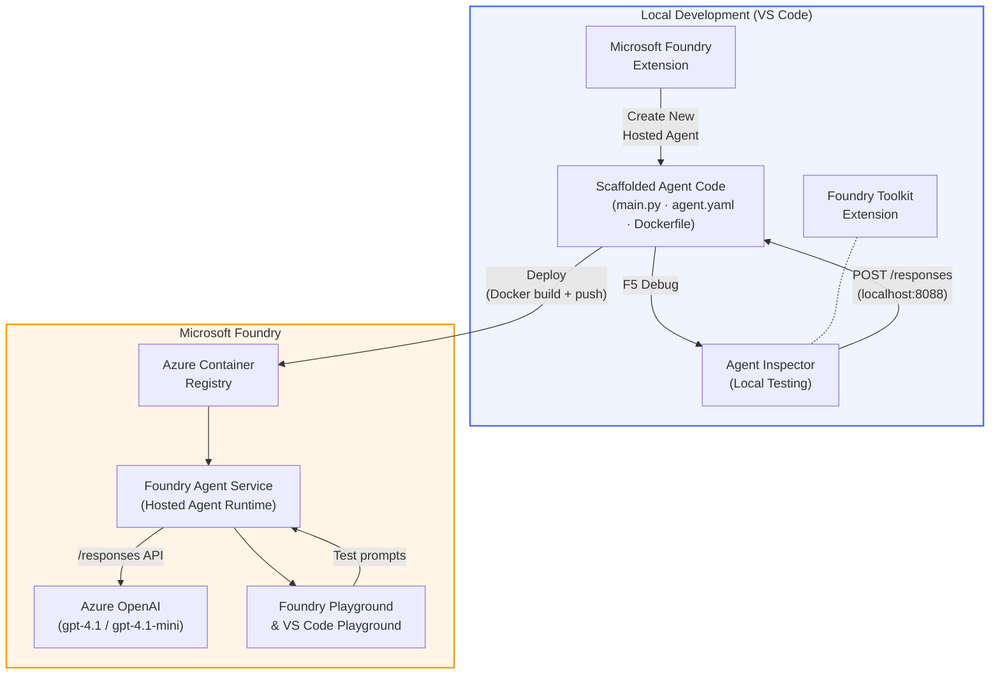

# Foundry Toolkit + Foundry Hosted Agents ورکشاپ

[](https://www.python.org/)
[](https://github.com/microsoft/agents)
[](https://learn.microsoft.com/azure/foundry/agents/concepts/hosted-agents)
[](https://ai.azure.com/)
[](https://learn.microsoft.com/azure/ai-services/openai/)
[](https://learn.microsoft.com/cli/azure/install-azure-cli)
[](https://learn.microsoft.com/azure/developer/azure-developer-cli/install-azd)
[](https://www.docker.com/)
[](https://marketplace.visualstudio.com/items?itemName=ms-windows-ai-studio.windows-ai-studio)
[](../../LICENSE)

Build, test, and deploy AI agents to **Microsoft Foundry Agent Service** as **Hosted Agents** - entirely from VS Code using the **Microsoft Foundry extension** and **Foundry Toolkit**.

> **Hosted Agents اس وقت پریویو میں ہیں۔** معاون خطے محدود ہیں - دیکھیں [خطوں کی دستیابی](https://learn.microsoft.com/azure/foundry/agents/concepts/hosted-agents#region-availability).

> ہر لیب کے اندر `agent/` فولڈر **خودکار طور پر اسکافولڈ کیا جاتا ہے** by the Foundry extension - آپ پھر کوڈ کو حسبِ ضرورت بناتے ہیں، مقامی طور پر ٹیسٹ کرتے ہیں، اور تعینات کرتے ہیں.

### 🌐 متعدد زبانوں کی حمایت

#### GitHub Action کے ذریعے معاون (خودکار اور ہمیشہ تازہ ترین)

<!-- CO-OP TRANSLATOR LANGUAGES TABLE START -->
[عربی](../ar/README.md) | [بنگالی](../bn/README.md) | [بلغاریائی](../bg/README.md) | [برمی (میانمار)](../my/README.md) | [چینی (سادہ)](../zh-CN/README.md) | [چینی (روایتی، ہانگ کانگ)](../zh-HK/README.md) | [چینی (روایتی، میکاؤ)](../zh-MO/README.md) | [چینی (روایتی، تائیوان)](../zh-TW/README.md) | [کروشین](../hr/README.md) | [چیک](../cs/README.md) | [ڈینش](../da/README.md) | [ڈچ](../nl/README.md) | [ایسٹونین](../et/README.md) | [فنش](../fi/README.md) | [فرانسیسی](../fr/README.md) | [جرمن](../de/README.md) | [یونانی](../el/README.md) | [عبری](../he/README.md) | [ہندی](../hi/README.md) | [ہنگیرین](../hu/README.md) | [انڈونیشیائی](../id/README.md) | [اطالوی](../it/README.md) | [جاپانی](../ja/README.md) | [کنڑ](../kn/README.md) | [کھمیری](../km/README.md) | [کوریائی](../ko/README.md) | [لتھوانیائی](../lt/README.md) | [ملے / Malay](../ms/README.md) | [مالایالم](../ml/README.md) | [مراٹھی](../mr/README.md) | [نیپالی](../ne/README.md) | [نائجیریائی پِجِن](../pcm/README.md) | [نارویژی](../no/README.md) | [فارسی (Farsi)](../fa/README.md) | [پولش](../pl/README.md) | [پرتگالی (برازیل)](../pt-BR/README.md) | [پرتگالی (پرتگال)](../pt-PT/README.md) | [پنجابی (گرمکھی)](../pa/README.md) | [رومانیائی](../ro/README.md) | [روسی](../ru/README.md) | [سربیائی (سائریلیک)](../sr/README.md) | [سلوواک](../sk/README.md) | [سلووینیا](../sl/README.md) | [ہسپانوی](../es/README.md) | [سواحلی](../sw/README.md) | [سویڈش](../sv/README.md) | [ٹاگالوگ (فلپائنی)](../tl/README.md) | [تمل](../ta/README.md) | [تیلگو](../te/README.md) | [تھائی](../th/README.md) | [ترکی](../tr/README.md) | [یوکرینی](../uk/README.md) | [اردو](./README.md) | [ویتنامی](../vi/README.md)

> **کیا آپ مقامی طور پر کلون کرنا پسند کریں گے؟**
>
> اس ریپوزٹری میں 50+ زبانوں کے تراجم شامل ہیں جو ڈاؤن لوڈ سائز کو نمایاں طور پر بڑھا دیتے ہیں۔ بغیر تراجم کے کلون کرنے کے لیے sparse checkout استعمال کریں:
>
> **Bash / macOS / Linux:**
> ```bash
> git clone --filter=blob:none --sparse https://github.com/microsoft-foundry/Foundry_Toolkit_for_VSCode_Lab.git
> cd Foundry_Toolkit_for_VSCode_Lab
> git sparse-checkout set --no-cone '/*' '!translations' '!translated_images'
> ```
>
> **CMD (Windows):**
> ```cmd
> git clone --filter=blob:none --sparse https://github.com/microsoft-foundry/Foundry_Toolkit_for_VSCode_Lab.git
> cd Foundry_Toolkit_for_VSCode_Lab
> git sparse-checkout set --no-cone "/*" "!translations" "!translated_images"
> ```
>
> یہ آپ کو کورس مکمل کرنے کے لیے ہر وہ چیز فراہم کرتا ہے جس کی آپ کو ضرورت ہے، اور ڈاؤن لوڈ بہت تیز ہو جاتا ہے۔
<!-- CO-OP TRANSLATOR LANGUAGES TABLE END -->

---

## آرکیٹیکچر



**Flow:** Foundry extension scaffolds the agent → you customize code & instructions → test locally with Agent Inspector → deploy to Foundry (Docker image pushed to ACR) → verify in Playground.

---

## آپ جو بنائیں گے

| لیب | تفصیل | حیثیت |
|-----|-------------|--------|
| **Lab 01 - Single Agent** | **"Explain Like I'm an Executive" Agent** بنائیں، اسے مقامی طور پر ٹیسٹ کریں، اور Foundry پر تعینات کریں | ✅ دستیاب |
| **Lab 02 - Multi-Agent Workflow** | **"Resume → Job Fit Evaluator"** بنائیں - 4 ایجنٹس مل کر ریزیومے کی مطابقت کا اسکور نکالتے ہیں اور ایک لرننگ روڈ میپ تیار کرتے ہیں | ✅ دستیاب |

---

## ایگزیکٹو ایجنٹ سے ملو

اس ورکشاپ میں آپ **"Explain Like I'm an Executive" Agent** بنائیں گے — ایک AI ایجنٹ جو پیچیدہ تکنیکی اصطلاحات لے کر انہیں پرسکون، بورڈ روم کے لیے موزوں خلاصوں میں تبدیل کر دیتا ہے۔ کیونکہ سچ بتائیں تو، C-suite میں سے کوئی بھی "thread pool exhaustion caused by synchronous calls introduced in v3.2." کے بارے میں سننا نہیں چاہتا۔

میں نے یہ ایجنٹ کئی ایسے واقعات کے بعد بنایا جب میری خوبصورتی سے تیار کی گئی پوسٹ مارٹم پر جواب ملا: *"تو... ویب سائٹ ڈاؤن ہے یا نہیں؟"*

### یہ کیسے کام کرتا ہے

آپ اسے ایک تکنیکی اپ ڈیٹ فراہم کرتے ہیں۔ یہ ایک ایگزیکٹو خلاصہ لوٹاتا ہے - تین نکات، کوئی اصطلاحات نہیں، کوئی اسٹیک ٹریس نہیں، کوئی وجودی تشویش نہیں۔ صرف **کیا ہوا**, **کاروباری اثر**, اور **اگلا قدم**۔

### عملی مظاہرہ

**آپ کہتے ہیں:**
> "The API latency increased due to thread pool exhaustion caused by synchronous calls introduced in v3.2."

**ایجنٹ جواب دیتا ہے:**

> **ایگزیکٹو خلاصہ:**
> - **کیا ہوا:** تازہ ترین ریلیز کے بعد، سسٹم سُست ہو گیا۔
> - **کاروباری اثر:** کچھ صارفین نے سروس استعمال کرتے وقت تاخیر کا سامنا کیا۔
> - **اگلا قدم:** تبدیلی کو واپس کر دیا گیا ہے اور دوبارہ تعیناتی سے پہلے ایک حل تیار کیا جا رہا ہے۔

### یہ ایجنٹ کیوں؟

یہ ایک بہت سادہ، واحد مقصد کا ایجنٹ ہے — ہوسٹڈ ایجنٹ ورک فلو کو شروع سے آخر تک سیکھنے کے لیے بہترین، بغیر پیچیدہ ٹول چینز میں پھنسے۔ اور ایمانداری سے؟ ہر انجینئرنگ ٹیم کو ان میں سے ایک کی ضرورت ہو سکتی ہے۔

---

## ورکشاپ کا ڈھانچہ

```
📂 Foundry_Toolkit_for_VSCode_Lab/
├── 📄 README.md                      ← You are here
└── 📂 workshop/
    ├── 📂 lab01-single-agent/        ← Full lab: docs + agent code
    │   ├── README.md                 ← Hands-on lab instructions
    │   ├── 📂 docs/                  ← Step-by-step tutorial modules
    │   │   ├── 00-prerequisites.md
    │   │   ├── 01-setup.md
    │   │   ├── 02-create-hosted-agent.md
    │   │   ├── 03-configure-and-code.md
    │   │   ├── 04-test-locally.md
    │   │   ├── 05-deploy-to-foundry.md
    │   │   ├── 06-verify-in-playground.md
    │   │   ├── 07-summary.md
    │   │   └── 08-troubleshooting.md
    │   └── 📂 agent/                 ← Reference solution (auto-scaffolded by Foundry extension)
    │       ├── agent.yaml
    │       ├── Dockerfile
    │       ├── main.py
    │       └── requirements.txt
    └── 📂 lab02-multi-agent/         ← Resume → Job Fit Evaluator
        ├── README.md                 ← Hands-on lab instructions (end-to-end)
        ├── 📂 docs/                  ← Step-by-step tutorial modules
        │   ├── 00-prerequisites.md
        │   ├── 01-understand-multi-agent.md
        │   ├── 02-scaffold-multi-agent.md
        │   ├── 03-configure-agents.md
        │   ├── 04-orchestration-patterns.md
        │   ├── 05-test-locally.md
        │   ├── 06-deploy-to-foundry.md
        │   ├── 07-verify-in-playground.md
        │   └── 08-troubleshooting.md
        └── 📂 PersonalCareerCopilot/ ← Reference solution (multi-agent workflow)
            ├── agent.yaml
            ├── Dockerfile
            ├── main.py
            └── requirements.txt
```

> **نوٹ:** ہر لیب کے اندر `agent/` فولڈر وہی ہے جو **Microsoft Foundry extension** پیدا کرتا ہے جب آپ Command Palette سے `Microsoft Foundry: Create a New Hosted Agent` چلاتے ہیں۔ پھر فائلوں کو آپ کے ایجنٹ کی ہدایات، ٹولز، اور کنفیگریشن کے ساتھ حسبِ ضرورت بنایا جاتا ہے۔ لیب 01 آپ کو اس کو شروع سے دوبارہ بنانے کے مراحل سے گزرنے کی رہنمائی کرتا ہے۔

---

## شروعات کریں

### 1. ریپوزٹری کلون کریں

```bash
git clone https://github.com/microsoft-foundry/Foundry_Toolkit_for_VSCode_Lab.git
cd Foundry_Toolkit_for_VSCode_Lab
```

### 2. Python ورچوئل ماحول قائم کریں

```bash
python -m venv venv
```

اسے فعال کریں:

- **Windows (PowerShell):**
  ```powershell
  .\venv\Scripts\Activate.ps1
  ```
- **macOS / Linux:**
  ```bash
  source venv/bin/activate
  ```

### 3. انحصاریات انسٹال کریں

```bash
pip install -r workshop/lab01-single-agent/agent/requirements.txt
```

### 4. ماحولیاتی متغیرات ترتیب دیں

ایجنٹ فولڈر کے اندر مثال `.env` فائل کو کاپی کریں اور اپنی اقدار بھریں:

```bash
cp workshop/lab01-single-agent/agent/.env.example workshop/lab01-single-agent/agent/.env
```

`workshop/lab01-single-agent/agent/.env` میں ترمیم کریں:

```env
AZURE_AI_PROJECT_ENDPOINT=https://<your-account>.services.ai.azure.com/api/projects/<your-project>
AZURE_AI_MODEL_DEPLOYMENT_NAME=<your-model-deployment-name>
```

### 5. ورکشاپ لیبز کی پیروی کریں

ہر لیب خود مختار ہے اور اپنے ماڈیولز رکھتی ہے۔ بنیادی باتیں سیکھنے کے لیے **Lab 01** سے شروع کریں، پھر ملٹی ایجنٹ ورک فلو کے لیے **Lab 02** پر جائیں۔

#### Lab 01 - Single Agent ([مکمل ہدایات](workshop/lab01-single-agent/README.md))

| # | ماڈیول | لنک |
|---|--------|------|
| 1 | ضروریات پڑھیں | [00-prerequisites.md](workshop/lab01-single-agent/docs/00-prerequisites.md) |
| 2 | Foundry Toolkit اور Foundry extension انسٹال کریں | [01-setup.md](workshop/lab01-single-agent/docs/01-setup.md) |
| 3 | ایک Foundry پروجیکٹ بنائیں | [01-setup.md](workshop/lab01-single-agent/docs/01-setup.md) |
| 4 | ایک hosted agent بنائیں | [02-create-hosted-agent.md](workshop/lab01-single-agent/docs/02-create-hosted-agent.md) |
| 5 | ہدایات اور ماحول کو کنفیگر کریں | [03-configure-and-code.md](workshop/lab01-single-agent/docs/03-configure-and-code.md) |
| 6 | مقامی طور پر ٹیسٹ کریں | [04-test-locally.md](workshop/lab01-single-agent/docs/04-test-locally.md) |
| 7 | Foundry پر تعینات کریں | [05-deploy-to-foundry.md](workshop/lab01-single-agent/docs/05-deploy-to-foundry.md) |
| 8 | Playground میں تصدیق کریں | [06-verify-in-playground.md](workshop/lab01-single-agent/docs/06-verify-in-playground.md) |
| 9 | مسئلے حل کریں | [08-troubleshooting.md](workshop/lab01-single-agent/docs/08-troubleshooting.md) |

#### Lab 02 - Multi-Agent Workflow ([مکمل ہدایات](workshop/lab02-multi-agent/README.md))

| # | ماڈیول | لنک |
|---|--------|------|
| 1 | ضروریات (لیب 02) | [00-prerequisites.md](workshop/lab02-multi-agent/docs/00-prerequisites.md) |
| 2 | ملٹی ایجنٹ آرکیٹیکچر سمجھیں | [01-understand-multi-agent.md](workshop/lab02-multi-agent/docs/01-understand-multi-agent.md) |
| 3 | ملٹی ایجنٹ پروجیکٹ اسکافولڈ کریں | [02-scaffold-multi-agent.md](workshop/lab02-multi-agent/docs/02-scaffold-multi-agent.md) |
| 4 | ایجنٹس اور ماحول کو کنفیگر کریں | [03-configure-agents.md](workshop/lab02-multi-agent/docs/03-configure-agents.md) |
| 5 | آرکیسٹریشن پیٹرنز | [04-orchestration-patterns.md](workshop/lab02-multi-agent/docs/04-orchestration-patterns.md) |
| 6 | مقامی طور پر ٹیسٹ کریں (ملٹی ایجنٹ) | [05-test-locally.md](workshop/lab02-multi-agent/docs/05-test-locally.md) |
| 7 | Foundry پر تعینات کریں | [06-deploy-to-foundry.md](workshop/lab02-multi-agent/docs/06-deploy-to-foundry.md) |
| 8 | Playground میں تصدیق کریں | [07-verify-in-playground.md](workshop/lab02-multi-agent/docs/07-verify-in-playground.md) |
| 9 | مسئلے حل کریں (ملٹی ایجنٹ) | [08-troubleshooting.md](workshop/lab02-multi-agent/docs/08-troubleshooting.md) |

---

## مینٹینر

<table>
<tr>
    <td align="center"><a href="https://github.com/ShivamGoyal03">
        <br />
        <sub><b>Shivam Goyal</b></sub>
    </a><br />
    </td>
</tr>
</table>

---

## درکار اجازتیں (مختصر حوالہ)

| منظر نامہ | مطلوبہ کردار |
|----------|---------------|
| نیا Foundry پروجیکٹ بنائیں | Foundry ریسورس پر **Azure AI Owner** |
| موجودہ پروجیکٹ میں تعینات کریں (نئے ریسورسز) | سبسکرپشن پر **Azure AI Owner** + **Contributor** |
| مکمل طور پر ترتیب دیے گئے پروجیکٹ میں تعینات کریں | اکاؤنٹ پر **Reader** + پروجیکٹ پر **Azure AI User** |

> **اہم:** Azure `Owner` اور `Contributor` رولز میں صرف *مینجمنٹ* کی اجازتیں شامل ہیں، *ڈیولپمنٹ* (data action) کی اجازتیں شامل نہیں ہیں۔ ایجنٹس بنانے اور تعینات کرنے کے لیے آپ کو **Azure AI User** یا **Azure AI Owner** کی ضرورت ہے۔

---

## حوالہ جات

- [فوری آغاز: اپنا پہلا ہوسٹڈ ایجنٹ تعینات کریں (VS Code)](https://learn.microsoft.com/azure/foundry/agents/quickstarts/quickstart-hosted-agent)
- [ہوسٹڈ ایجنٹس کیا ہیں؟](https://learn.microsoft.com/azure/foundry/agents/concepts/hosted-agents)
- [VS Code میں ہوسٹڈ ایجنٹ ورک فلو بنائیں](https://learn.microsoft.com/azure/foundry/agents/how-to/vs-code-agents-workflow-pro-code)
- [ایک ہوسٹڈ ایجنٹ تعینات کریں](https://learn.microsoft.com/azure/foundry/agents/how-to/deploy-hosted-agent)
- [Microsoft Foundry کے لیے RBAC](https://learn.microsoft.com/azure/foundry/concepts/rbac-foundry)
- [آرکیٹیکچر ریویو ایجنٹ کا نمونہ](https://github.com/Azure-Samples/agent-architecture-review-sample) - MCP ٹولز، Excalidraw ڈایاگرامز، اور دوہری تعیناتی کے ساتھ حقیقی دنیا کا ہوسٹڈ ایجنٹ

---


## لائسنس

[MIT](../../LICENSE)

---

<!-- CO-OP TRANSLATOR DISCLAIMER START -->
**ڈس کلیمر**:
یہ دستاویز AI ترجمہ سروس [Co-op Translator](https://github.com/Azure/co-op-translator) کے ذریعے ترجمہ کی گئی ہے۔ جبکہ ہم درستگی کے لیے کوشاں ہیں، براہ کرم اس بات سے آگاہ رہیں کہ خودکار ترجمے میں غلطیاں یا عدم درستیاں ہو سکتی ہیں۔ اصل دستاویز اپنے مادری زبان میں مستند ماخذ سمجھی جائے گی۔ حساس معلومات کے لیے پیشہ ور انسانی ترجمہ کی سفارش کی جاتی ہے۔ اس ترجمے کے استعمال سے پیدا ہونے والی کسی بھی غلط فہمی یا غلط تشریح کی ذمہ داری ہم قبول نہیں کرتے۔
<!-- CO-OP TRANSLATOR DISCLAIMER END -->
