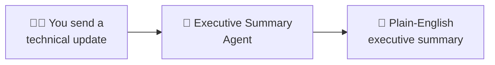

# ماڈیول 0 - تعارف

⏱️ ~10 منٹ

> [!WARNING]
> **پریویو اور حدود:** [Hosted Agents](https://learn.microsoft.com/azure/foundry/agents/concepts/hosted-agents) اس وقت **عوامی پریویو** میں ہیں - پروڈکشن ورک لوڈز کے لیے تجویز نہیں کیے جاتے۔ درج ذیل باتوں سے آگاہ رہیں:
> - **محدود سپورٹ والے علاقے** - وسائل بنانے سے پہلے [علاقائی دستیابی](https://learn.microsoft.com/azure/foundry/agents/concepts/hosted-agents#region-availability) چیک کریں۔ اگر آپ غیر معاون علاقے کا انتخاب کرتے ہیں تو تعیناتی ناکام ہوگی۔
> - `agent-framework-foundry-hosting` پیکیج پری ریلیز ہے - APIs ورژنز کے درمیان بدل سکتے ہیں۔
> - اسکیل حدود: Hosted agents 0–5 نقول کی حمایت کرتے ہیں (اسکيل-ٹو-زیرو سمیت)۔
> - اس ورکشاپ میں دکھائی گئی کچھ خصوصیات GA کی طرف بڑھتے ہوئے بدل سکتی ہیں۔

## آپ کیا بنائیں گے

اس ورکشاپ میں، آپ ایک **"Explain Like I'm an Executive"** ایجنٹ بنائیں گے - ایک Hosted AI ایجنٹ جو پیچیدہ تکنیکی اپ ڈیٹس لے کر سیدھی سادھی انگریزی ایگزیکٹو سمریز میں دوبارہ لکھتا ہے۔

**یہ ایجنٹ استعمال کرتا ہے:**
- **Microsoft Agent Framework** - ایجنٹ کے منطق اور ساخت کے لیے
- **Foundry Toolkit for VS Code** - سکافولڈ کرنے، مقامی طور پر ٹیسٹ کرنے، اور تعینات کرنے کے لیے
- **ایک AI ماڈل** (مثلاً `gpt-4.1-mini/gpt-5-mini`) - خلاصے بنانے کے لیے

اس لیب کے آخر تک، آپ کے پاس ایک کام کرنے والا ایجنٹ ہوگا جسے آپ Agent Inspector کے ذریعے مقامی طور پر ٹیسٹ کر سکتے ہیں، اور اختیاری طور پر کلاؤڈ پر تعینات کر سکتے ہیں۔

---

## Hosted agents کیا ہیں؟

**Hosted agent** ایک AI ایجنٹ ہے جو Microsoft Foundry میں ایک مینیجڈ سروس کے طور پر چلتا ہے۔ اپنے انفراسٹرکچر کا انتظام کرنے کے بجائے، آپ اپنا ایجنٹ کوڈ ایک کنٹینر میں پیک کرتے ہیں اور Foundry اس کی اسکیلنگ، ہوسٹنگ، اور اسے ایک معیاری HTTP اینڈپوائنٹ کے ذریعے ظاہر کرنے کا انتظام کرتا ہے۔

| تصور | مطلب کیا ہے |
|---------|--------------|
| **ایجنٹ** | آپ کا Python کوڈ جو صارف کا پیغام وصول کرتا ہے، ایک AI ماڈل کو کال کرتا ہے، اور ایک ساخت شدہ جواب لوٹاتا ہے |
| **Hosted** | Foundry آپ کا کنٹینر آپ کے لیے چلاتا ہے - کوئی VM، کوئی Kubernetes، کوئی انفراسٹرکچر مینیجمنٹ نہیں |
| **جوابات کا پروٹوکول** | ایک معیاری HTTP API (`POST /responses`) جسے کوئی بھی کلائنٹ آپ کے ایجنٹ سے بات چیت کے لیے کال کر سکتا ہے |
| **Agent Inspector** | ایک مقامی ٹیسٹنگ UI (Foundry Toolkit میں شامل) جو آپ کو تعیناتی سے پہلے اپنے ایجنٹ سے بات چیت کرنے دیتا ہے |

اس ورکشاپ میں، آپ صفر سے لے کر مکمل hosted agent تک جائیں گے - یا اگر چاہیں تو مقامی ٹیسٹنگ پر ہی رک سکتے ہیں۔

---

## اپنا راستہ منتخب کریں

> ⚠️ **جاری رکھنے سے پہلے ایک راستہ منتخب کریں۔** آپ کا انتخاب طے کرے گا کہ کون سے ٹول نصب کرنے ہیں اور کون سے ماڈیولز لاگو ہوں گے۔ اگر آپ کے پاس سبسکرپشن ہے تو آپ بعد میں Path B سے Path A پر منتقل ہو سکتے ہیں۔

<strong>🅰️ راستہ A - Azure کلاؤڈ (Azure سبسکرپشن کی ضرورت)</strong>

| | تفصیلات |
|---|---|
| **یہ کس کے لیے ہے؟** | آپ کے پاس ایک فعال Azure سبسکرپشن ہے اور آپ Foundry وسائل بنا سکتے ہیں |
| **ماڈل** | Foundry کے ذریعے Azure OpenAI (مثلاً `gpt-4.1-mini/gpt-5-mini`) |
| **شامل ماڈیولز** | تمام ماڈیولز (00–07) |
| **کلاؤڈ پر تعینات کریں؟** | ✅ جی ہاں - مکمل اختتام سے اختتام تعیناتی |

<strong>🅱️ راستہ B - لوکل / مفت سطح (Azure سبسکرپشن کی ضرورت نہیں)</strong>

| | تفصیلات |
|---|---|
| **یہ کس کے لیے ہے؟** | MVPs، طلباء، یا ہر کوئی جس کے پاس Azure تک رسائی نہیں ہے |
| **ماڈل** | **Foundry Local** (مفت، آپ کے کمپیوٹر پر چلتا ہے) |
| **شامل ماڈیولز** | ماڈیولز 00–04 (تعیناتی اور کلاؤڈ کی تصدیق چھوڑ دیں) |
| **کلاؤڈ پر تعینات کریں؟** | ❌ نہیں - صرف Agent Inspector کے ذریعے مقامی ٹیسٹنگ |

---

## تمام راستے: ضروری ٹولز

نیچے دیے گئے ہر ٹول کو انسٹال کریں۔ انسٹالیشن کے بعد، چیک کمانڈ چلا کر اس کی فعالیت کی تصدیق کریں۔

| # | ٹول | ورژن | انسٹال کریں | تصدیق کریں (متوقع نتیجہ) |
|---|------|---------|---------|---------------------------|
| 1 | **Visual Studio Code** | تازہ ترین | [code.visualstudio.com](https://code.visualstudio.com/) | بغیر کسی خرابی کے کھل جاتا ہے |
| 2 | **Python** | 3.12 یا اس سے زیادہ | [python.org/downloads](https://www.python.org/downloads/) | `python --version` $\rightarrow$ `Python 3.12.x` |
| 3 | **Foundry Toolkit for VS Code** | تازہ ترین | Extension ID: `ms-windows-ai-studio.windows-ai-studio` | Foundry آئیکن ایکٹیویٹی بار میں |
| 4 | **Python extension for VS Code** | تازہ ترین | Extension ID: `ms-python.python` | ایکسٹینشن پینل میں نصب شدہ |

> [!TIP]
> **انسٹالیشن کے ماہر مشورے:**
> - **Python PATH (Windows):** Python انسٹالر کی پہلی اسکرین پر ہمیشہ **"Add Python to PATH"** کو چیک کریں۔ اس کے بغیر، `python` آپ کے ٹرمینل میں پہچانا نہیں جائے گا۔
> - **متعدد Python ورژنز:** اگر آپ کے پاس Python 3.10 اور 3.12 دونوں نصب ہیں، تو اپنے ورچوئل انوائرنمنٹ کے لیے صحیح ورژن استعمال کرنے کے لیے `python3.12 -m venv .venv` استعمال کریں۔
> - **Docker WSL 2 (Windows):** Docker Desktop کی تنصیب کے دوران، یقینی بنائیں کہ **WSL 2 backend** منتخب ہے۔ Hyper-V کے ساتھ Docker سست ہوتا ہے اور Foundry container builds میں مسائل پیدا کر سکتا ہے۔
> - **Docker شروع نہیں ہو رہا؟** Docker Desktop شروع کرنے کے بعد 30–60 سیکنڈ انتظار کریں۔ اگر `docker info` چلانے پر "Cannot connect to the Docker daemon" نظر آتا ہے، تو Docker ابھی شروع ہو رہا ہے۔
> - **VS Code extesions لوڈ نہیں ہو رہے؟** ایکسٹینشنز انسٹال کرنے کے بعد، ونڈو کو دوبارہ لوڈ کریں: `Ctrl+Shift+P` → `Developer: Reload Window`۔

> **Windows صارفین:** Python انسٹال کرتے وقت **"Add Python to PATH"** کو چیک کریں۔

**اگلا:** [01 - سیٹ اپ →](01-setup.md)

---

<!-- CO-OP TRANSLATOR DISCLAIMER START -->
**ڈس کلیمر**:
یہ دستاویز AI ترجمہ سروس [Co-op Translator](https://github.com/Azure/co-op-translator) کے ذریعے ترجمہ کی گئی ہے۔ جبکہ ہم درستگی کے لیے کوشاں ہیں، براہ کرم اس بات سے آگاہ رہیں کہ خودکار ترجمے میں غلطیاں یا عدم درستیاں ہو سکتی ہیں۔ اصل دستاویز اپنے مادری زبان میں مستند ماخذ سمجھی جائے گی۔ حساس معلومات کے لیے پیشہ ور انسانی ترجمہ کی سفارش کی جاتی ہے۔ اس ترجمے کے استعمال سے پیدا ہونے والی کسی بھی غلط فہمی یا غلط تشریح کی ذمہ داری ہم قبول نہیں کرتے۔
<!-- CO-OP TRANSLATOR DISCLAIMER END -->