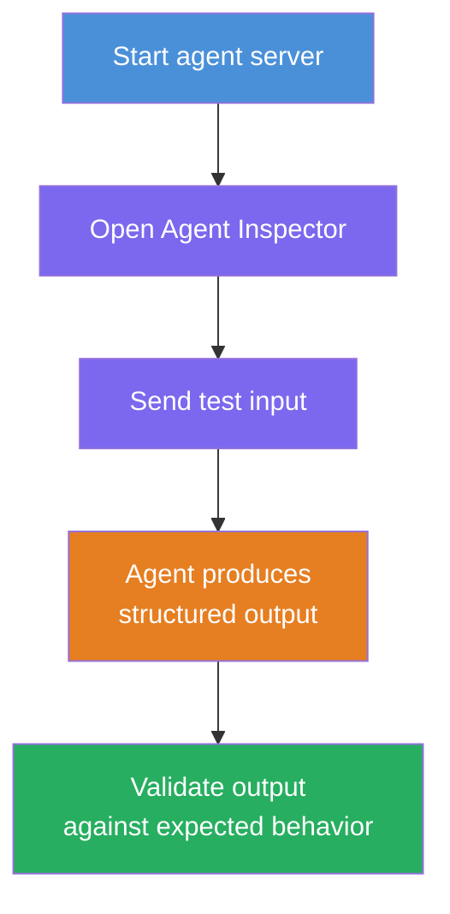
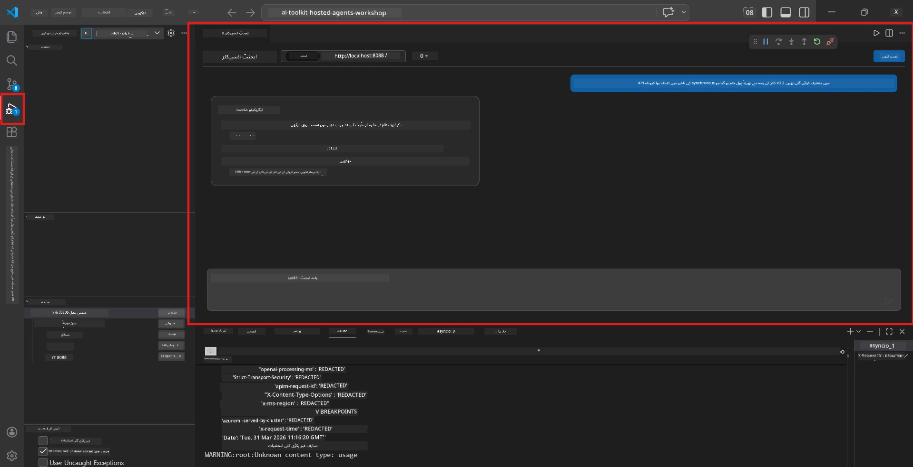
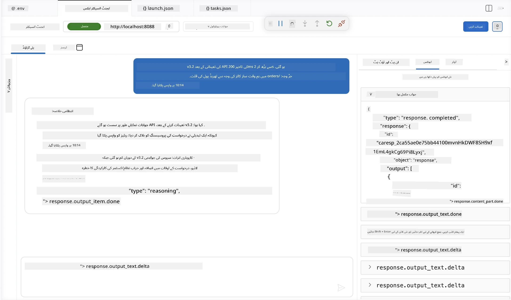

# ماڈیول 4 - مقامی طور پر ٹیسٹ کریں

⏱️ ~10 منٹ

اس ماڈیول میں، آپ اپنا ایجنٹ مقامی طور پر چلائیں گے اور تصدیق کریں گے کہ یہ صحیح طریقے سے کام کرتا ہے **خوشگوار راستے کے فنکشنل ٹیسٹ** استعمال کرتے ہوئے۔ آپ ایجنٹ انسپیکٹر (بصری UI) یا براہ راست HTTP کالز استعمال کریں گے تاکہ تصدیق کی جا سکے کہ ایجنٹ منظم، درست جوابات تیار کرتا ہے۔

### مقامی ٹیسٹنگ کا بہاؤ



---

## آپشن 1: F5 دبائیں - ایجنٹ انسپیکٹر کے ساتھ ڈیبگ کریں (تجویز کردہ)

### ڈیبگر شروع کریں

1. VS Code میں **executive-summary-agent/** فولڈر براہ راست کھولیں (`File → Open Folder`)۔
2. **Run and Debug** پینل کھولیں (`Ctrl+Shift+D`)۔
3. ڈراپ ڈاؤن سے **Debug Local Agent HTTP Server** منتخب کریں۔
4. **F5** دبائیں (یا ▶ Start Debugging پر کلک کریں)۔

> ⚠️ **اہم: اپنا Python Interpreter منتخب کریں**
> اگر آپ کو "ModuleNotFoundError" ملتا ہے یا ڈیبگر شروع نہیں ہوتا، تو آپ کو VS Code کو بتانا ہوگا کہ آپ کا virtual environment استعمال کرے:
  > 1. دبائیں `Ctrl+Shift+P` $\rightarrow$ ٹائپ کریں **Python: Select Interpreter**۔
  > 2. اس interpreter کو منتخب کریں جو آپ کے پروجیکٹ کے `.venv` فولڈر میں موجود ہے (مثلاً، Windows پر `.\.venv\Scripts\python.exe`)۔
  > 3. ڈیبگ سیشن کو دوبارہ شروع کریں۔
> اگر اب بھی ایررز آ رہے ہیں، تو اپنے `tasks.json` فائل کو دستی طور پر درج ذیل طریقے سے اپ ڈیٹ کریں:
  > 1. `.vscode/tasks.json` فائل پر جائیں
  > 2. اس ٹاسک پر جائیں جس پر لیبل لگا ہو: `Run Agent HTTP Server`
  > 3. کمانڈ ویلیو کو درج ذیل انداز میں اپڈیٹ کریں:
  >    - **Windows:** `"value": "${workspaceFolder}/.venv/Scripts/python.exe",`
  >    - **macOS/Linux:** `"value": "${workspaceFolder}/.venv/bin/python",`

### کیا ہوتا ہے

1. HTTP سرور `http://localhost:8088/responses` پر شروع ہو جاتا ہے۔
2. **Agent Inspector** پینل خودکار طور پر کھل جاتا ہے - ٹیسٹنگ کے لیے ایک بصری چیٹ انٹرفیس۔
3. `main.py` میں بریک پوائنٹس فعال ہوتے ہیں۔

ٹرمینل پر دیکھیں:
```
Starting executive summary hosted agent
Executive agent server running on http://localhost:8088
```

> **اگر Agent Inspector نہیں کھلتا:** دبائیں `Ctrl+Shift+P` → **Foundry Toolkit: Open Agent Inspector**۔



> *اسکرین شاٹ ممکنہ طور پر پرانے 'AI TOOLKIT' برانڈنگ کو دکھا سکتا ہے جو ایک سابقہ توسیع ورژن سے ہے۔*

---

## آپشن 2: ٹرمینل کے ذریعے ٹیسٹ (متبادل)

ایک ٹرمینل میں ایجنٹ شروع کریں، دوسرے سے درخواستیں بھیجیں:

```bash
# Terminal 1: Start agent
cd executive-summary-agent/
source .venv/bin/activate
python main.py
```

```bash
# Terminal 2: Send test (curl)
curl -sS -X POST http://localhost:8088/responses \
  -H "Content-Type: application/json" \
  -d '{"input": "The API latency increased due to thread pool exhaustion caused by sync calls in v3.2.", "stream": false}'
```

---

## منظرنامہ ٹیسٹس: خوشحال-راستہ فنکشنل تصدیق

نیچے دیے گئے **تینوں** منظرنامے چلائیں۔ یہ تصدیق کرتے ہیں کہ آپ کا ایجنٹ حقیقی ان پٹس کے لیے درست، منظم آؤٹ پٹ تیار کرتا ہے۔



### منظرنامہ 1: آئی ٹی واقعہ - API کی تاخیر میں اضافہ

**ان پٹ:**
```
The API latency increased from 200ms to 2s after deploying v3.2.
Root cause: thread pool starvation from synchronous calls in /orders.
Rolled back at 10:14.
```

**متوقع رویہ:**
- ✅ "Executive Summary" ڈھانچے کی پیروی کرتا ہے (کیا ہوا / کاروباری اثر / اگلا قدم)
- ✅ کوئی تکنیکی اصطلاحات نہیں (جیسے "thread pool"، "/orders"، "v3.2" نہیں)
- ✅ واضح طور پر کاروباری اثر بتاتا ہے (مثلاً، صارفین کو تاخیر کا سامنا)
- ✅ ایک اگلا قدم شامل کرتا ہے (مثلاً، درستگی کی تنصیب، نگرانی کا انتظام)

---

### منظرنامہ 2: ڈیٹا پائپ لائن - ETL ناکامی

**ان پٹ:**
```
The nightly ETL job failed because the upstream schema changed. APAC dashboards show missing data.
```

**متوقع رویہ:**
- ✅ ڈیٹا ریفریش ناکامی کو آسان زبان میں خلاصہ کرتا ہے
- ✅ APAC ڈیش بورڈ کے اثر کا ذکر کرتا ہے
- ✅ ایک اصلاحی اگلا قدم شامل کرتا ہے
- ✅ "ETL"، "schema"، یا دیگر تکنیکی اصطلاحات کا ذکر نہیں کرتا

---

### منظرنامہ 3: سیکیورٹی - افشا شدہ اسناد

**ان پٹ:**
```
Static analysis flagged a hardcoded secret in the repository.
The secret may have been exposed in commit history.
```

**متوقع رویہ:**
- ✅ ایک اسناد/سیکیورٹی مسئلہ کو انتظامی زبان میں بیان کرتا ہے
- ✅ ممکنہ خطرے (غیر مجاز رسائی) کی نشاندہی کرتا ہے
- ✅ اصلاحی اقدام بتاتا ہے (اسناد کی تبدیلی، آڈٹ)
- ✅ "static analysis"، "commit history"، یا "hardcoded" جیسی اصطلاحات شامل نہیں کرتا

---

## تصدیقی معیار

ہر منظرنامے کے لیے، چیک کریں:

| # | معیار | پاس کی شرط |
|---|-------|------------|
| 1 | **ڈھانچہ** | جواب "Executive Summary" فارمیٹ استعمال کرتا ہے جس میں تینوں نکات شامل ہوں |
| 2 | **سادہ زبان** | کوئی تکنیکی اصطلاحات نہیں جو ایک ایگزیکٹو نہ سمجھے |
| 3 | **درستی** | خلاصہ ان پٹ کی عکاسی کرتا ہے - کوئی جعلی تفصیلات نہیں |
| 4 | **مختصرت** | جواب 100 الفاظ سے کم ہو |
| 5 | **اگلا قدم** | ایک واضح عمل یا تخفیف بیان کی گئی ہو |

---

## ڈیبگنگ تجاویز

| مسئلہ | حل |
|--------|-----|
| ایجنٹ شروع نہیں ہوتا | `.env` کی ویلیوز چیک کریں، تصدیق کریں کہ venv فعال ہے، `pip install -r requirements.txt` چلائیں |
| خالی یا عمومی جواب | `main.py` میں ہدایات کا جائزہ لیں - یقینی بنائیں کہ آؤٹ پٹ فارمیٹ واضح ہے |
| جواب میں اصطلاحات شامل ہیں | ہدایات میں "تکنیکی اصطلاحات ہٹائیں" کے قواعد مضبوط کریں |
| Agent Inspector نہیں کھلتا | `Ctrl+Shift+P` → **Foundry Toolkit: Open Agent Inspector** |
| ماڈل کی غلطیاں ٹرمینل میں | تصدیق کریں کہ `AZURE_AI_MODEL_DEPLOYMENT_NAME` بالکل میل کھاتا ہے (حروف کی حساسیت سمیت) |

---

### ✅ چیک پوائنٹ

- [ ] ایجنٹ بغیر کسی ایرر کے مقامی طور پر شروع ہوتا ہے
- [ ] ایجنٹ انسپیکٹر کھلتا ہے اور چیٹ انٹرفیس دکھاتا ہے (اگر F5 استعمال کر رہے ہیں)
- [ ] **منظرنامہ 1** (آئی ٹی واقعہ) - منظم شدہ Executive Summary، کوئی اصطلاحات نہیں
- [ ] **منظرنامہ 2** (ڈیٹا پائپ لائن) - متعلقہ خلاصہ اور کاروباری اثر
- [ ] **منظرنامہ 3** (سیکیورٹی الرٹ) - مناسب خطرے کی اطلاع
- [ ] تمام جوابات متعین آؤٹ پٹ ڈھانچے کی پیروی کرتے ہیں

> **اپنے جوابات محفوظ کریں** (کاپی کریں یا اسکرین شاٹ لیں) - آپ انہیں ماڈیول 06 میں کلاؤڈ نتائج سے موازنہ کریں گے۔

---

**پچھلا:** [03 - Configure & Code](03-configure-and-code.md) · **اگلا:** [05 - Deploy to Foundry →](05-deploy-to-foundry.md)

---

<!-- CO-OP TRANSLATOR DISCLAIMER START -->
**ڈس کلیمر**:
یہ دستاویز AI ترجمہ سروس [Co-op Translator](https://github.com/Azure/co-op-translator) کے ذریعے ترجمہ کی گئی ہے۔ جبکہ ہم درستگی کے لیے کوشاں ہیں، براہ کرم اس بات سے آگاہ رہیں کہ خودکار ترجمے میں غلطیاں یا عدم درستیاں ہو سکتی ہیں۔ اصل دستاویز اپنے مادری زبان میں مستند ماخذ سمجھی جائے گی۔ حساس معلومات کے لیے پیشہ ور انسانی ترجمہ کی سفارش کی جاتی ہے۔ اس ترجمے کے استعمال سے پیدا ہونے والی کسی بھی غلط فہمی یا غلط تشریح کی ذمہ داری ہم قبول نہیں کرتے۔
<!-- CO-OP TRANSLATOR DISCLAIMER END -->