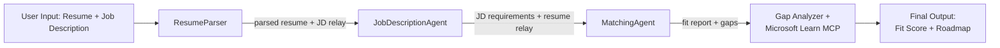

# PersonalCareerCopilot - سی وی → ملازمت کی مناسبت کا جائزہ

ایک ورک فلو-فرسٹ ملٹی ایجنٹ ایپ جو جائزہ لیتی ہے کہ سی وی کس حد تک ملازمت کی تفصیل سے میل کھاتا ہے، پھر وقف شدہ سیکھنے کا روڈ میپ تیار کرتا ہے تاکہ خالی جگہوں کو پورا کیا جا سکے۔

---

## ایجنٹس

| ایجنٹ | کردار | اوزار |
|-------|------|-------|
| **ResumeParser** | سی وی کے متن سے ساختہ مہارتیں، تجربہ، سرٹیفیکیشنز نکالتا ہے | - |
| **JobDescriptionAgent** | جاب ڈسکرپشن سے مطلوبہ/ترجیحی مہارتیں، تجربہ، سرٹیفیکیشنز نکالتا ہے | - |
| **MatchingAgent** | پروفائل اور ضروریات کا موازنہ کرتا ہے → فٹ اسکور (0-100) + مماثل/غیر موجود مہارتیں | - |
| **GapAnalyzer** | Microsoft Learn وسائل کے ساتھ ایک ذاتی سیکھنے کا روڈ میپ بناتا ہے | `search_microsoft_learn_for_plan` (MCP) |

## ورک فلو



---

## جلد آغاز

### 1. ماحول کی ترتیب دیں

یہ فولڈر ورک فلو-بیسڈ لیب 02 کے اسکیفولڈ کے لیے حوالہ جاتی نفاذ ہے۔ اس کا `main.py` موجودہ پرامپٹ بلاکس کے ساتھ ساتھ چار ایجنٹس کو ایک ساتھ جوڑنے کے لیے `WorkflowBuilder` کا استعمال کرتا ہے۔

```powershell
cd workshop\lab02-multi-agent\PersonalCareerCopilot
python -m venv .venv
.\.venv\Scripts\Activate.ps1          # Windows PowerShell
# source .venv/bin/activate            # macOS / Linux
pip install -r requirements.txt
```

### 2. اسناد ترتیب دیں

اس فولڈر میں ایک `.env` فائل بنائیں:

```powershell
copy .env .env.bak 2>$null; echo $null > .env
```

`.env` ایڈیٹ کریں:

```env
FOUNDRY_PROJECT_ENDPOINT=https://<your-account>.services.ai.azure.com/api/projects/<your-project>
AZURE_AI_MODEL_DEPLOYMENT_NAME=gpt-4.1-mini
```

| ویلیو | کہاں ملے گی |
|-------|------------------|
| `FOUNDRY_PROJECT_ENDPOINT` | Foundry Toolkit سائیڈبار → اپنے پروجیکٹ پر رائٹ کلک کریں → **Copy Project Endpoint** |
| `AZURE_AI_MODEL_DEPLOYMENT_NAME` | Foundry سائیڈبار → پروجیکٹ کو بڑھائیں → **Models + endpoints** → ڈیپلائمنٹ کا نام |

### 3. لوکل طور پر چلائیں

```powershell
python -m debugpy --listen 127.0.0.1:5679 main.py --port 8088
```

یا VS Code کا ٹاسک استعمال کریں: `Ctrl+Shift+P` → **Tasks: Run Task** → **Run Agent HTTP Server**۔

F5 ڈیبگنگ کے لیے، **Debug Local Agent HTTP Server** استعمال کریں۔

### 4. ایجنٹ انسپیکٹر سے ٹیسٹ کریں

ایجنٹ انسپیکٹر کھولیں: `Ctrl+Shift+P` → **Foundry Toolkit: Open Agent Inspector**۔

یہ ٹیسٹ پرامپٹ پیسٹ کریں:

```
Resume:
Jane Doe
Senior Software Engineer with 5 years of experience in Python, Django, and AWS.
Built microservices handling 10K+ requests/second. Led a team of 4 developers.
Certifications: AWS Solutions Architect Associate.
Education: B.S. Computer Science, State University.

Job Description:
Senior Cloud Engineer at Contoso Ltd.
Required: Python, Azure, Kubernetes, Terraform, CI/CD pipelines.
Preferred: Go, monitoring (Prometheus/Grafana), cost optimization.
Experience: 5+ years in cloud infrastructure.
Certifications: Azure Solutions Architect Expert preferred.
```

**متوقع:** فٹ اسکور (0-100)، مماثل/غیر موجود مہارتیں، اور Microsoft Learn URLs کے ساتھ ذاتی سیکھنے کا روڈ میپ۔

### 5. Foundry میں تعینات کریں

`Ctrl+Shift+P` → **Foundry Toolkit: Deploy Hosted Agent** → اپنے پروجیکٹ کو منتخب کریں → تصدیق کریں۔

---

## پروجیکٹ کی ساخت

```
PersonalCareerCopilot/
├── .env                ← Your credentials (git-ignored)
├── agent.yaml          ← Hosted agent definition (name, resources, env vars)
├── Dockerfile          ← Container image for Foundry deployment
├── main.py             ← 4-agent workflow (instructions, MCP tool, WorkflowBuilder)
└── requirements.txt    ← Python dependencies
```

## کلیدی فائلیں

### `agent.yaml`

Foundry Agent Service کے لیے ہوسٹڈ ایجنٹ کی تعریف کرتا ہے:
- `kind: hosted` - ایک منیجڈ کنٹینر کے طور پر چلتا ہے
- `protocols` - `responses` پروٹوکول کو `version: 2.0.0` کے ساتھ استعمال کرتا ہے، جو `/responses` HTTP اینڈ پوائنٹ کو ظاہر کرتا ہے
- `environment_variables` - `AZURE_AI_MODEL_DEPLOYMENT_NAME` یہاں اعلان کیا جاتا ہے؛ `FOUNDRY_PROJECT_ENDPOINT` تعیناتی کے وقت خود بخود انجیکٹ ہو جاتا ہے

### `main.py`

شامل ہے:
- **ایجنٹ ہدایات** - ہر ایجنٹ کے لیے چار `*_INSTRUCTIONS` مستقلات
- **MCP ٹول** - `search_microsoft_learn_for_plan()` Streamable HTTP کے ذریعے `https://learn.microsoft.com/api/mcp` کو کال کرتا ہے
- **ایجنٹ تخلیق** - چار `Agent()` + `AgentExecutor()` مثالیں جو ایک `FoundryChatClient` شیئر کرتی ہیں
- **ورک فلو گراف** - `WorkflowBuilder` ایجنٹس کو متوالی پائپ لائن کے طور پر جوڑتا ہے: ResumeParser → JD Agent → MatchingAgent → GapAnalyzer
- **سرور کا آغاز** - `ResponsesHostServer` پورٹ 8088 پر چلتا ہے

### `requirements.txt`

| پیکیج | مقصد |
|---------|----------|
| `agent-framework-foundry` | کور رن ٹائم: `Agent`، `AgentExecutor`، `WorkflowBuilder`، `@tool`، `FoundryChatClient` |
| `agent-framework-foundry-hosting` | `ResponsesHostServer` + Foundry ہوسٹنگ انٹیگریشن |
| `mcp<2,>=1.24.0` | GapAnalyzer کے لیے MCP کلائنٹ (`streamable_http_client`) |
| `debugpy` | Python ڈیبگنگ (VS Code میں F5) |

---

## مسائل کا حل

| مسئلہ | حل |
|-------|-----|
| `KeyError: 'FOUNDRY_PROJECT_ENDPOINT'` یا `KeyError: 'AZURE_AI_MODEL_DEPLOYMENT_NAME'` | ایک `.env` بنائیں جس میں دونوں `FOUNDRY_PROJECT_ENDPOINT` اور `AZURE_AI_MODEL_DEPLOYMENT_NAME` سیٹ ہوں |
| `ModuleNotFoundError: No module named 'agent_framework'` | venv کو فعال کریں اور `pip install -r requirements.txt` چلائیں |
| آؤٹ پٹ میں Microsoft Learn URLs نہیں ہیں | `https://learn.microsoft.com/api/mcp` کے لیے انٹرنیٹ کنیکٹیویٹی چیک کریں |
| صرف 1 گیپ کارڈ (کٹا ہوا) | تصدیق کریں کہ `GAP_ANALYZER_INSTRUCTIONS` میں `CRITICAL:` بلاک شامل ہے |
| پورٹ 8088 استعمال میں ہے | دیگر سرورز روکیں: `netstat -ano \| findstr :8088` |

تفصیلی مسائل کے حل کے لیے، دیکھیں [Module 8 - Troubleshooting](../docs/08-troubleshooting.md)۔

---

**مکمل راہنمائی:** [Lab 02 Docs](../docs/README.md) · **واپس جائیں:** [Lab 02 README](../README.md) · [ورکشاپ ہوم](../../../README.md)

---

<!-- CO-OP TRANSLATOR DISCLAIMER START -->
**ڈس کلیمر**:
یہ دستاویز AI ترجمہ سروس [Co-op Translator](https://github.com/Azure/co-op-translator) کے ذریعے ترجمہ کی گئی ہے۔ جبکہ ہم درستگی کے لیے کوشاں ہیں، براہ کرم اس بات سے آگاہ رہیں کہ خودکار ترجمے میں غلطیاں یا عدم درستیاں ہو سکتی ہیں۔ اصل دستاویز اپنے مادری زبان میں مستند ماخذ سمجھی جائے گی۔ حساس معلومات کے لیے پیشہ ور انسانی ترجمہ کی سفارش کی جاتی ہے۔ اس ترجمے کے استعمال سے پیدا ہونے والی کسی بھی غلط فہمی یا غلط تشریح کی ذمہ داری ہم قبول نہیں کرتے۔
<!-- CO-OP TRANSLATOR DISCLAIMER END -->