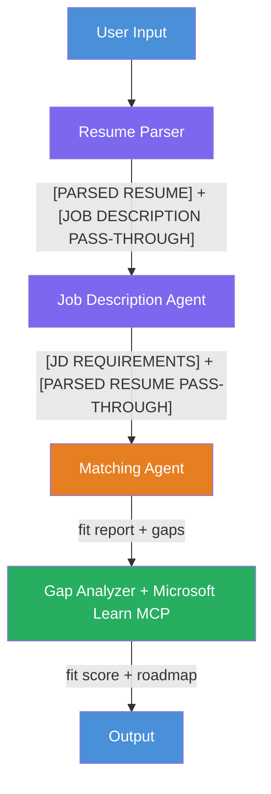

# لیب ۰۲ - کثیر ایجنٹ ورک فلو: ریزیومے → جاب فٹ ایویلیوایٹر

## جائزہ

اس عملی لیب میں، آپ VS کوڈ میں Foundry Toolkit استعمال کرتے ہوئے ایک **ورک فلو-فرسٹ کثیر ایجنٹ ایپ** بنائیں گے اور اسے Microsoft Foundry Agent Service پر تعینات کریں گے۔

**جو آپ بنائیں گے:** ایک ریزیومے → جاب فٹ ایویلیوایٹر جو ریزیومے اور جاب کی تفصیل کو پارس کرتا ہے، میچ کو اسکور کرتا ہے، اور Microsoft Learn وسائل استعمال کرتے ہوئے ایک ذاتی نوعیت کا لرننگ روڈ میپ تیار کرتا ہے۔

---

## فن تعمیر

**یہ کیسے کام کرتا ہے:**
1. صارف ریزیومے اور جاب کی تفصیل چسپاں کرتا ہے۔
2. **ResumeParser** ریزیومے کو پارس کرتا ہے اور JD کو ایک `[JOB DESCRIPTION PASS-THROUGH]` سیکشن میں بالکل ویسا ہی کاپی کرتا ہے۔
3. **JD Agent** پاس تھرو سے منظم شدہ ضروریات نکالتا ہے، پھر `[PARSED RESUME]` کو آگے `[PARSED RESUME PASS-THROUGH]` کے طور پر بھیجتا ہے۔
4. **MatchingAgent** `[PARSED RESUME PASS-THROUGH]` کا موازنہ `[JD REQUIREMENTS]` سے کرتا ہے اور فٹ اسکور تیار کرتا ہے۔
5. **GapAnalyzer** خلا کو ایک عملی روڈ میپ میں تبدیل کرتا ہے اور MCP کے ذریعے حقیقی Microsoft Learn لنکس حاصل کرتا ہے۔

---

## پیشگی تقاضے

پہلے لیب ۰۱ مکمل کریں:

- [لیب ۰۱ - سنگل ایجنٹ](../lab01-single-agent/README.md)

---

## حصہ ۱: ماڈیولز کو ترتیب سے پڑھیں

مکمل لرننگ راستہ دیکھیں:

- [لیب ۲ دستاویزات - پیشگی تقاضے](docs/00-prerequisites.md)
- [لیب ۲ دستاویزات - مکمل لرننگ راستہ](docs/README.md)
- [PersonalCareerCopilot چلانے کا رہنما](PersonalCareerCopilot/README.md)

---

## حصہ ۲: ورک فلو تیار کریں اور جانچ کریں

1. Foundry Toolkit وزرڈ استعمال کرتے ہوئے ورک فلو پر مبنی پروجیکٹ کا خاکہ تیار کریں۔
2. پرامپٹ بلاکس اور ورک فلو گراف کو `PersonalCareerCopilot/main.py` سے اپنی ورک اسپیس میں کاپی کریں۔
3. ایجنٹ انسپیکٹر کے ساتھ مقامی طور پر چلائیں اور چاروں ایجنٹس کے علاوہ MCP ٹول کی تصدیق کریں۔
4. جب مقامی جانچ کامیاب ہو جائے تو ہوسٹڈ ایجنٹ کو فاؤنڈری پر تعینات کریں۔

---

## آرکیسٹریشن پیٹرنز

لیب ۰۲ ایک **تسلسلی پائپ لائن** استعمال کرتی ہے: ہر ایجنٹ کا آؤٹ پٹ اگلے کو دیتا ہے، اور ورک فلو آخری ایجنٹ کے جواب کو واپس کرتا ہے۔ دو پیٹرنز اس کام کو بناتے ہیں:

- **تسلسلی چین** - `WorkflowBuilder` سے ResumeParser → JD Agent → MatchingAgent → GapAnalyzer کو جوڑتا ہے جس میں ہر قدم پر ایک `add_edge()` کال ہوتی ہے
- **مواد ریلے** - کیونکہ ہر ایجنٹ صرف اپنے براہ راست پچھلے والے کے آؤٹ پٹ کو دیکھتا ہے، ResumeParser اور JD Agent نیچے والے ایجنٹس کو درکار ڈیٹا کو لیبل والے پاس تھرو سیکشنز میں کاپی کرتے ہیں

دستاویزات یہ بھی بتاتی ہیں کہ لیب فین آؤٹ/فین ان کیوں استعمال نہیں کرتی، اور گراف کو دوسرے ایجنٹ کے ساتھ کیسے بڑھایا جائے۔

ملاحظہ کریں [docs/04-orchestration-patterns.md](docs/04-orchestration-patterns.md)۔

---

**پچھلا:** [لیب ۰۱ - سنگل ایجنٹ](../lab01-single-agent/README.md) · **واپس جائیں:** [ورکشاپ ہوم](../../README.md)

---

<!-- CO-OP TRANSLATOR DISCLAIMER START -->
**ڈس کلیمر**:
یہ دستاویز AI ترجمہ سروس [Co-op Translator](https://github.com/Azure/co-op-translator) کے ذریعے ترجمہ کی گئی ہے۔ جبکہ ہم درستگی کے لیے کوشاں ہیں، براہ کرم اس بات سے آگاہ رہیں کہ خودکار ترجمے میں غلطیاں یا عدم درستیاں ہو سکتی ہیں۔ اصل دستاویز اپنے مادری زبان میں مستند ماخذ سمجھی جائے گی۔ حساس معلومات کے لیے پیشہ ور انسانی ترجمہ کی سفارش کی جاتی ہے۔ اس ترجمے کے استعمال سے پیدا ہونے والی کسی بھی غلط فہمی یا غلط تشریح کی ذمہ داری ہم قبول نہیں کرتے۔
<!-- CO-OP TRANSLATOR DISCLAIMER END -->