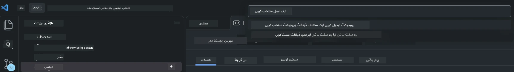

# ماڈیول 0 - تعارف

⏱️ ~10 منٹ

> [!WARNING]
> **پریویو اور حدود:** [Hosted Agents](https://learn.microsoft.com/azure/foundry/agents/concepts/hosted-agents) فی الحال **عوامی پریویو** میں ہیں - پروڈکشن ورک لوڈز کے لیے سفارش نہیں کی جاتی۔ اس ورکشاپ میں دکھائی گئی کچھ خصوصیات سروس کے GA کی طرف بڑھتے ہوئے تبدیل ہو سکتی ہیں۔

## آپ کیا بنائیں گے

اس لیب میں، آپ لیب 01 کی سنگل ایجنٹ مہارتوں کو بڑھاتے ہوئے ایک **کثیر ایجنٹ ورک فلو** بنائیں گے - ریزیومے → جاب فٹ ایولیویٹر۔

آپ ایک **ریزیومے** اور ایک **جاب ڈسکرپشن** چسپاں کرتے ہیں۔ چار ماہر ایجنٹ ان پٹ کو متواتر پروسیس کرتے ہیں، پھر یہ واپس کرتے ہیں:
- فٹ اسکور (0–100 ایک اسکورنگ بریک ڈاؤن کے ساتھ)
- مہارت اور سرٹیفیکیشن کی کمی کی فہرست
- ہر کمی کے لئے مائیکروسافٹ لرن کے حقیقی لنکس کے ساتھ ایک شخصی سیکھنے کا روڈ میپ

**ورک فلو استعمال کرتا ہے:**
- **Microsoft Agent Framework** - `WorkflowBuilder` برائے متواتر پائپ لائن آرکسٹریشن
- **Foundry Toolkit for VS Code** - اسکیفولڈ، مقامی طور پر ٹیسٹ کریں، تعینات کریں
- **ایک AI ماڈل** (مثلاً `gpt-4.1-mini`) - چاروں ایجنٹس استعمال کرتے ہیں
- **Microsoft Learn MCP سرور** - ہر مہارت کی کمی کے لئے حقیقی سیکھنے کے وسائل کے لنکس فراہم کرتا ہے

---

## اپنا راستہ منتخب کریں

> ⚠️ **اسی راستے کو جاری رکھیں جو آپ نے لیب 01 میں استعمال کیا تھا۔**

<details open>
<summary><strong>🅰️ راستہ A - Azure کلاؤڈ (Azure سبسکرپشن ضروری)</strong></summary>

| | تفصیلات |
|---|---|
| **یہ کس کے لیے ہے؟** | آپ نے Azure سبسکرپشن استعمال کرتے ہوئے لیب 01 مکمل کی ہے |
| **ماڈل** | Foundry کے ذریعے Azure OpenAI (مثلاً `gpt-4.1-mini`) |
| **شامل ماڈیولز** | تمام ماڈیولز (00–09) |
| **کلاؤڈ پر تعینات کریں؟** | ✅ جی ہاں - مکمل اینڈ ٹو اینڈ تعیناتی |

</details>

<details open>
<summary><strong>🅱️ راستہ B - Foundry لوکل (Azure سبسکرپشن کی ضرورت نہیں)</strong></summary>

| | تفصیلات |
|---|---|
| **یہ کس کے لیے ہے؟** | آپ نے Foundry لوکل استعمال کرتے ہوئے لیب 01 مکمل کی ہے |
| **ماڈل** | Foundry لوکل (مفت، آپ کے مشین پر چلتا ہے) |
| **شامل ماڈیولز** | ماڈیولز 00–05 (06–07 چھوڑیں - تعیناتی اور کلاؤڈ ویریفائی) |
| **کلاؤڈ پر تعینات کریں؟** | ❌ نہیں - صرف لوکل ٹیسٹنگ ایجنٹ انسپکٹر کے ذریعہ |

</details>

---

## لیب 01 چیک

لیب 02 براہ راست لیب 01 پر تعمیر ہے۔ یہاں شروع کرنے سے پہلے لیب 01 مکمل کریں۔

کیا آپ نے ابھی تک لیب 01 نہیں کی؟ یہاں سے شروع کریں: [Lab 01 - Introduction](../../lab01-single-agent/docs/00-prerequisites.md)

<details open>
<summary><strong>🅰️ راستہ A - Azure کلاؤڈ</strong></summary>

```powershell
az account show --query "{name:name, id:id}" --output table
```

اگر یہ ناکام ہو، تو `az login` چلائیں۔ پھر VS Code میں تصدیق کریں:

1. `Ctrl+Shift+P` → **Foundry Toolkit** ٹائپ کریں → کمانڈز ظاہر ہوں۔
2. **Foundry Toolkit** آئیکن دبائیں → آپ کا پروجیکٹ اور تعینات ماڈل **کامیاب** دکھائیں۔



> **RBAC:** آپ نے لیب 01 میں **Foundry User** اسائن کیا تھا۔ اگر دوبارہ اسائن کرنا ہو تو دیکھیے [Lab 01, Module 1](../../lab01-single-agent/docs/01-setup.md#deploy-a-model--assign-rbac)۔ یہ کردار پہلے **Azure AI User** کہلاتا تھا - وہی اجازتیں ہیں۔

</details>

<details open>
<summary><strong>🅱️ راستہ B - Foundry لوکل</strong></summary>

```powershell
Invoke-WebRequest -Uri "http://localhost:5273/v1/health" -UseBasicParsing | Select-Object StatusCode
```

توقع ہے: `StatusCode: 200`۔ اگر نہیں، تو Foundry Toolkit سائڈبار سے Foundry لوکل دوبارہ شروع کریں۔

> تمام انفرنس آپ کے مشین پر چلتی ہے۔ واحد آؤٹ باؤنڈ کال MCP ٹول کو ہے جو `https://learn.microsoft.com/api/mcp` کو کال کرتا ہے۔

</details>

---

## لیب 02 میں کیا نیا ہے

| | لیب 01 | لیب 02 |
|--|--------|--------|
| ایجنٹس | 1 | 4 (WorkflowBuilder کے ساتھ سلسلہ وار) |
| اسکیفولڈ ٹیمپلیٹ | بنیادی - ایجنٹ فریم ورک | ورک فلو - ایجنٹ فریم ورک |
| نیا پیکیج | - | `mcp` |
| آرکسٹریشن | سنگل مکالماتی ایجنٹ | متواتر پائپ لائن (WorkflowBuilder) |
| نیا ٹول | - | `search_microsoft_learn_for_plan` (MCP) |

---

**اگلا:** [01 - آرکیٹیکچر کو سمجھیں →](01-understand-multi-agent.md)

---

<!-- CO-OP TRANSLATOR DISCLAIMER START -->
**ڈس کلیمر**:
یہ دستاویز AI ترجمہ سروس [Co-op Translator](https://github.com/Azure/co-op-translator) کے ذریعے ترجمہ کی گئی ہے۔ جبکہ ہم درستگی کے لیے کوشاں ہیں، براہ کرم اس بات سے آگاہ رہیں کہ خودکار ترجمے میں غلطیاں یا عدم درستیاں ہو سکتی ہیں۔ اصل دستاویز اپنے مادری زبان میں مستند ماخذ سمجھی جائے گی۔ حساس معلومات کے لیے پیشہ ور انسانی ترجمہ کی سفارش کی جاتی ہے۔ اس ترجمے کے استعمال سے پیدا ہونے والی کسی بھی غلط فہمی یا غلط تشریح کی ذمہ داری ہم قبول نہیں کرتے۔
<!-- CO-OP TRANSLATOR DISCLAIMER END -->