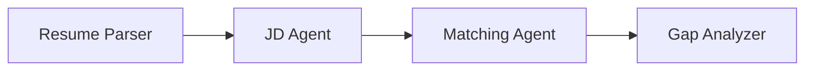
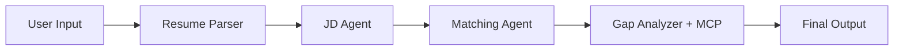

# ماڈیول 4 - آرکسٹریشن پیٹرنز  

⏱️ ~10 منٹ  

اس ماڈیول میں، آپ Resume Job Fit Evaluator میں استعمال ہونے والے آرکسٹریشن پیٹرنز کو دریافت کرتے ہیں اور سیکھتے ہیں کہ ورک فلو گراف کو کیسے پڑھیں، ترمیم کریں، اور بڑھائیں۔ ان پیٹرنز کو سمجھنا ڈیٹا فلو کے مسائل کو ڈی بگ کرنے اور اپنے [کئی ایجنٹ کے ورک فلو](https://learn.microsoft.com/agent-framework/workflows/) بنانے کے لیے ضروری ہے۔  

---  

## پیٹرن 1: تسلسل کی زنجیر  

ورک فلو میں بنیادی پیٹرن ایک **تسلسل کی زنجیر** ہے - ہر ایجنٹ کا آؤٹ پٹ براہِ راست اگلے میں داخل ہوتا ہے۔  


  
کوڈ میں، ہر `add_edge()` کال زنجیر میں ایک قدم پیدا کرتی ہے:  

```python
.add_edge(resume_executor, jd_executor)       # ResumeParser output → JD Agent
.add_edge(jd_executor, matching_executor)     # JD Agent output → MatchingAgent
.add_edge(matching_executor, gap_executor)    # MatchingAgent output → GapAnalyzer
```
  
> **سیریل کیوں، نہ کہ فین آؤٹ/فین ان؟** `WorkflowBuilder` آنے والے اجزاء کے لیے **یا-سیمانٹکس** استعمال کرتا ہے: ایک ڈاؤنسٹریم ایگزیکیوٹر فوراً آگے بڑھتا ہے جب **کوئی بھی** پیشرو مکمل ہو جائے۔ اگر `matching_executor` کے دو آنے والے اجزاء ہوتے (دونوں `resume_executor` اور `jd_executor` سے)، تو یہ دو بار متحرک ہوتا - ایک بار جب ResumeParser ختم ہو اور دوسرا جب JD Agent ختم ہو - جس کی وجہ سے GapAnalyzer بھی دو بار چلتا اور آؤٹ پٹ دو بار دکھائی دیتی۔ سیریل پائپ لائن اس مسئلے کو مکمل طور پر ٹال دیتی ہے۔

## پیٹرن ۲: مواد کی ریلی

چونکہ `context_mode="last_agent"` کا مطلب ہے کہ ہر ایگزیکیوٹر صرف اپنے **براہ راست پیشرو کے آؤٹ پٹ** کو دیکھتا ہے، اس لیے سیریل چین میں ایجنٹس کو واضح طور پر وہ ڈیٹا آگے پاس کرنا ہوتا ہے جس کی ڈاؤن اسٹریم ایجنٹس کو ضرورت ہوتی ہے۔

اس ورک فلو میں:
- **ResumeParser** JD کو لفظ بہ لفظ `[JOB DESCRIPTION PASS-THROUGH]` میں کاپی کرتا ہے (تاکہ JD Agent اسے تلاش کر سکے)۔
- **JD Agent** `[PARSED RESUME]` کو لفظ بہ لفظ `[PARSED RESUME PASS-THROUGH]` میں کاپی کرتا ہے (تاکہ MatchingAgent دونوں پروفائلز کا موازنہ کر سکے)۔

```
ResumeParser output
└─ [PARSED RESUME]               ← extracted by JD Agent
└─ [JOB DESCRIPTION PASS-THROUGH] ← extracted by JD Agent

JD Agent output
└─ [JD REQUIREMENTS]             ← extracted by MatchingAgent
└─ [PARSED RESUME PASS-THROUGH]  ← extracted by MatchingAgent
```

ہر ریلی سیکشن کو **لفظ بہ لفظ** کاپی کرنا ضروری ہے - اسے سمری یا پیرا فریز کرنا نیچے والے ایجنٹ کو خراب کر دیتا ہے جو اس پر انحصار کرتا ہے۔

---

## مکمل گراف

سیریل چین اور مواد کی ریلی پیٹرنز کو ملا کر مکمل ورک فلو تیار کیا جاتا ہے:



ایجنٹ انسپیکٹر یہ ہی گراف ڈھانچہ دکھاتا ہے جب ایجنٹ مقامی طور پر چل رہا ہو۔ اسکرین شاٹس کے لیے [Module 5 - Test Locally](05-test-locally.md) ملاحظہ کریں۔

---

## WorkflowBuilder کوڈ پڑھنا

ورک فلو گراف `main()` فنکشن میں بنایا جاتا ہے [`PersonalCareerCopilot/main.py`](../../../../../workshop/lab02-multi-agent/PersonalCareerCopilot/main.py) میں۔ تین `add_edge()` کالز سیریل پائپ لائن کو تعمیر کرتی ہیں:

| # | ایج | اثر |
|---|------|--------|
| 1 | `resume_executor → jd_executor` | JD Agent کو `[PARSED RESUME]` + `[JOB DESCRIPTION PASS-THROUGH]` ملتے ہیں |
| 2 | `jd_executor → matching_executor` | MatchingAgent کو `[JD REQUIREMENTS]` + `[PARSED RESUME PASS-THROUGH]` ملتے ہیں |
| 3 | `matching_executor → gap_executor` | GapAnalyzer کو fit رپورٹ + gap لسٹ ملتی ہے |

---

## گراف میں ترمیم کرنا

### نیا ایجنٹ شامل کرنا

پانچواں ایجنٹ (مثلاً GapAnalyzer کے بعد **InterviewPrepAgent**) شامل کرنے کے لیے:

1. ایک `INTERVIEW_PREP_INSTRUCTIONS` کانسٹنٹ تعریف کریں۔
2. `Agent` + `AgentExecutor` آبجیکٹس بنائیں (موجودہ چار کے نمونے کی طرح)۔
3. `.add_edge(gap_executor, interview_exec)` کو `WorkflowBuilder` میں شامل کریں۔
4. `output_executors=[interview_exec]` کو اپ ڈیٹ کریں۔

> **اہم:** `start_executor` واحد ایجنٹ ہے جو خام یوزر ان پٹ وصول کرتا ہے۔ باقی تمام ایجنٹس اپنے اپ اسٹریم ایج سے آؤٹ پٹ حاصل کرتے ہیں۔

---

## عام گراف کی غلطیاں

| غلطی | علامت | حل |
|---------|---------|-----|
| `output_executors` کے لیے ایج غائب ہے | ایجنٹ چلتا ہے مگر آؤٹ پٹ خالی ہے | یقینی بنائیں کہ `start_executor` سے ہر ایجنٹ تک `output_executors` میں راستہ موجود ہو |
| گھماؤ دار انحصار (سرکلر ڈیپنڈنسی) | لامتناہی لوپ یا ٹائم آؤٹ | چیک کریں کہ کوئی ایجنٹ اپ اسٹریم ایجنٹ کو دوبارہ فیڈ نہ کرے |
| `output_executors` میں ایجنٹ کے لیے کوئی آنے والا ایج نہیں | آؤٹ پٹ خالی ہے | کم از کم ایک `add_edge(source, that_agent)` شامل کریں |
| فین-ان کے بغیر متعدد `output_executors` | آؤٹ پٹ میں صرف ایک ایجنٹ کا جواب ہوتا ہے | ایک واحد آؤٹ پٹ ایجنٹ استعمال کریں جو سب کو مجموعہ کرے، یا متعدد آؤٹ پٹ قبول کریں |
| `start_executor` غائب ہے | بلڈ ٹائم پر `ValueError` | ہمیشہ `start_executor` کو `WorkflowBuilder()` میں مخصوص کریں |

---

## گراف کی ڈی بگنگ

### ایجنٹ انسپیکٹر کا استعمال

1. F5 کے ساتھ ایجنٹ کو مقامی طور پر شروع کریں۔
2. ایجنٹ انسپیکٹر کھولیں (`Ctrl+Shift+P` → **Foundry Toolkit: Open Agent Inspector**)۔
3. ایک ٹیسٹ پیغام بھیجیں۔
4. انسپیکٹر کے ردعمل پینل میں **اسٹریمنگ آؤٹ پٹ** دیکھیں - یہ ہر ایجنٹ کی شمولیت کو سیریل میں ظاہر کرتا ہے۔


### لاگنگ کا استعمال

ڈیٹا فلو کا پتہ لگانے کے لیے `main.py` میں لاگنگ شامل کریں:

```python
import logging
logger = logging.getLogger("resume-job-fit")

# In main(), after building the workflow:
logger.info("Workflow graph built with edges: RP→JD, JD→MA, MA→GA")
```

سرور لاگز ایجنٹ کے عمل کے آرڈر اور MCP ٹول کالز دکھاتے ہیں:

```
INFO:agent_framework:Executing agent: ResumeParser
INFO:agent_framework:Executing agent: JobDescriptionAgent
INFO:agent_framework:Executing agent: MatchingAgent
INFO:agent_framework:Executing agent: GapAnalyzer
INFO:agent_framework:Tool call: search_microsoft_learn_for_plan(skill="Kubernetes")
POST https://learn.microsoft.com/api/mcp → 200
INFO:agent_framework:Tool call: search_microsoft_learn_for_plan(skill="Terraform")
POST https://learn.microsoft.com/api/mcp → 200
```

---

### چیک پوائنٹ

- [ ] آپ ورک فلو میں دونوں آرکیسٹریشن پیٹرنز کی نشاندہی کر سکتے ہیں: سیریل چین اور مواد کی ریلی
- [ ] آپ سمجھتے ہیں کہ `context_mode="last_agent"` کے لیے ایجنٹس کے درمیان واضح ڈیٹا ریلی کیوں ضروری ہے
- [ ] آپ `WorkflowBuilder` کوڈ پڑھ سکتے ہیں اور ہر `add_edge()` کال کو بصری گراف سے ملا سکتے ہیں
- [ ] آپ جانتے ہیں کہ پائپ لائن کے آخر میں نیا ایجنٹ کیسے شامل کرنا ہے
- [ ] آپ عام گراف کی غلطیوں اور ان کی علامات کی نشاندہی کر سکتے ہیں

---

**پچھلا:** [03 - Configure Agents & Environment](03-configure-agents.md) · **اگلا:** [05 - Test Locally →](05-test-locally.md)

---

<!-- CO-OP TRANSLATOR DISCLAIMER START -->
**ڈس کلیمر**:
یہ دستاویز AI ترجمہ سروس [Co-op Translator](https://github.com/Azure/co-op-translator) کے ذریعے ترجمہ کی گئی ہے۔ جبکہ ہم درستگی کے لیے کوشاں ہیں، براہ کرم اس بات سے آگاہ رہیں کہ خودکار ترجمے میں غلطیاں یا عدم درستیاں ہو سکتی ہیں۔ اصل دستاویز اپنے مادری زبان میں مستند ماخذ سمجھی جائے گی۔ حساس معلومات کے لیے پیشہ ور انسانی ترجمہ کی سفارش کی جاتی ہے۔ اس ترجمے کے استعمال سے پیدا ہونے والی کسی بھی غلط فہمی یا غلط تشریح کی ذمہ داری ہم قبول نہیں کرتے۔
<!-- CO-OP TRANSLATOR DISCLAIMER END -->