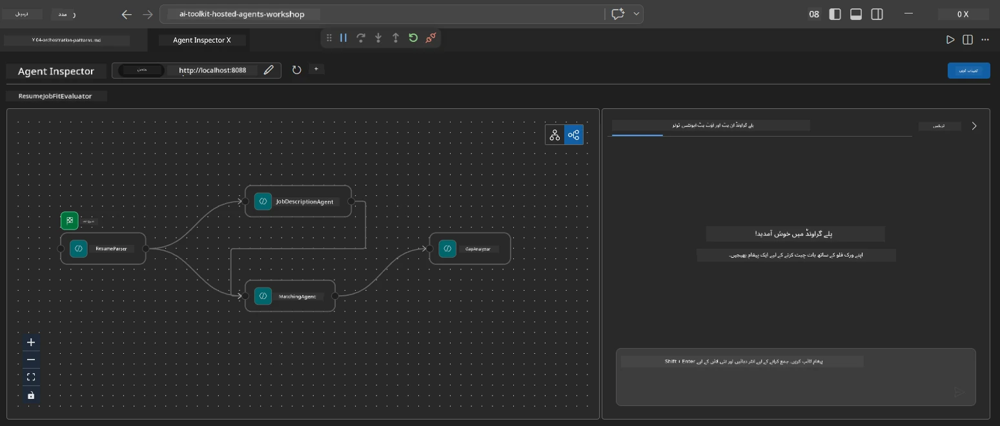
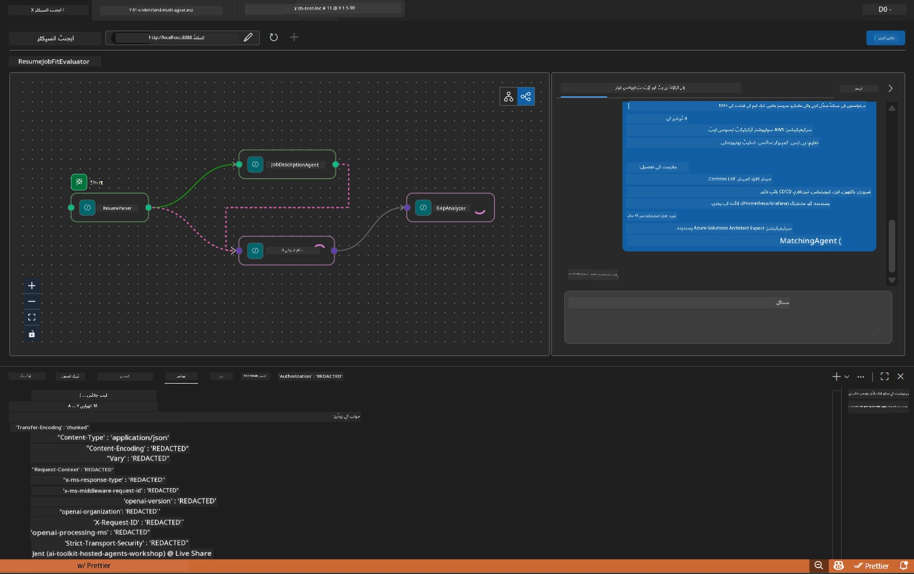
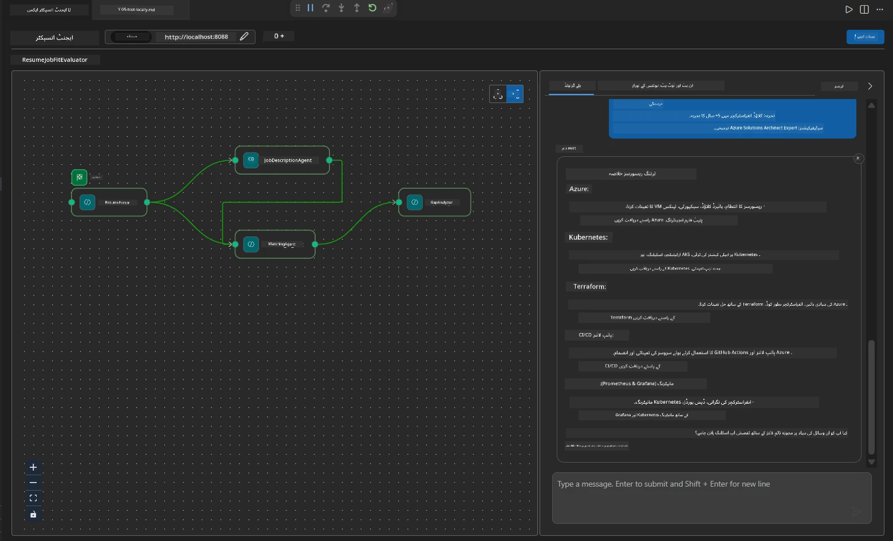

# ماڈیول 5 - مقامی طور پر جانچ کریں

⏱️ ~15 منٹ

اس ماڈیول میں، آپ ملٹی ایجنٹ ورک فلو کو مقامی طور پر چلائیں گے، اسے ایجنٹ انسپکٹر کے ساتھ ٹیسٹ کریں گے، اور تعیناتی سے پہلے یہ تصدیق کریں گے کہ چاروں ایجنٹ اور MCP ٹول صحیح طریقے سے کام کر رہے ہیں۔

---

## مرحلہ 1: ایجنٹ سرور شروع کریں

### آپشن A: VS کوڈ ٹاسک استعمال کرتے ہوئے (مشورہ دیا گیا)

1. `workshop/lab02-multi-agent/PersonalCareerCopilot/` کو اپنے VS کوڈ فولڈر کے طور پر کھولیں۔
2. دبائیں `Ctrl+Shift+P` → ٹائپ کریں **Tasks: Run Task** → منتخب کریں **Run Agent HTTP Server**۔
3. ٹاسک سرور کو پورٹ `5679` پر debugpy کے ساتھ اور ایجنٹ کو پورٹ `8088` پر شروع کرتا ہے۔
4. آؤٹ پٹ کا انتظار کریں جب تک کہ اسٹارٹ اپ پیغام نظر آئے، اس کے بعد سرور کا اپنا تیار ہونے کا پیغام (درمیان میں دیگر لاگ لائنز بھی آ سکتی ہیں):

```
INFO:resume-job-fit:Starting Resume -> Job Fit Evaluator HTTP server...
...
INFO:hypercorn.error:Running on http://0.0.0.0:8088 (CTRL + C to quit)
```

### آپشن B: F5 (ڈیبگ موڈ) استعمال کرنا

1. دبائیں `F5` → منتخب کریں **Debug Local Agent HTTP Server**۔
2. سرور مکمل بریک پوائنٹ سپورٹ کے ساتھ شروع ہوتا ہے - MCP ردعمل یا ایجنٹ آؤٹ پٹ کا معائنہ کرنے میں مفید۔

---

## مرحلہ 2: ایجنٹ انسپکٹر کھولیں

1. دبائیں `Ctrl+Shift+P` → ٹائپ کریں **Foundry Toolkit: Open Agent Inspector**۔
2. ایجنٹ انسپکٹر ایک VS کوڈ پینل کے طور پر کھلتا ہے جو `http://localhost:8088` سے منسلک ہوتا ہے۔
3. آپ کو ایجنٹ انٹرفیس تیار نظر آنا چاہیے تاکہ پیغامات قبول کر سکے۔



> **اگر ایجنٹ انسپکٹر نہیں کھلتا:** یقینی بنائیں کہ سرور مکمل طور پر شروع ہو چکا ہے (آپ کو `Running on http://0.0.0.0:8088` لاگ نظر آنا چاہیے)۔ اگر پورٹ 5679 مصروف ہو تو دیکھیں [Module 8 - Troubleshooting](08-troubleshooting.md)۔

---

## مرحلہ 2ب: (اختیاری) ورک فلو ویژوئلائزر کھولیں

فاؤنڈری ٹول کٹ میں ایک حقیقی وقت کا **Workflow Visualizer** شامل ہے جو دکھاتا ہے کہ ایجنٹ کیسی طرح گراف کی عملدرآمد کے دوران ایک دوسرے کے ساتھ تعامل کرتے ہیں۔ یہ خاص طور پر ملٹی ایجنٹ ڈی بگنگ کے لیے مفید ہے۔

1. دبائیں `Ctrl+Shift+P` → ٹائپ کریں **Foundry Toolkit: Open Visualizer for Hosted Agents**۔
2. ایک نیا VS کوڈ ٹیب کھلتا ہے جو لائیو ایکزیکیوشن گراف دکھاتا ہے۔
3. جب آپ ایجنٹ انسپکٹر میں پیغامات بھیجتے ہیں، تو ویژوئلائزر خود بخود اپ ڈیٹ ہوتا ہے - سبز نوڈز مکمل شدہ ایجنٹس کی نشاندہی کرتے ہیں، اور متحرک ایجز ان کے درمیان ڈیٹا کے بہاؤ کو ظاہر کرتے ہیں۔

> **پورٹ تصادم:** اگر ویژوئلائزر پورٹ پہلے سے استعمال میں ہے تو اسے VS کوڈ سیٹنگز → **Extensions** → **Microsoft Foundry Configuration** → **Hosted Agents: Visualizer Port** میں تبدیل کریں۔

---

## مرحلہ 3: سموک ٹیسٹس چلائیں

ان دو ٹیسٹس کو ترتیب سے چلائیں۔ ہر ایک ٹیسٹ ورک فلو کا مزید حصہ جانچتا ہے۔

### ٹیسٹ 1: بنیادی ریزیومے + جاب کی تفصیل

درج ذیل کو ایجنٹ انسپکٹر میں پیسٹ کریں:

```
Resume:
Jane Doe
Senior Software Engineer with 5 years of experience in Python, Django, and AWS.
Built microservices handling 10K+ requests/second. Led a team of 4 developers.
Certifications: AWS Solutions Architect Associate.
Education: B.S. Computer Science, State University.

Job Description:
Senior Cloud Engineer at Contoso Ltd.
Required: Python, Azure, Kubernetes, Terraform, CI/CD pipelines.
Preferred: Go, monitoring (Prometheus/Grafana), cost optimization.
Experience: 5+ years in cloud infrastructure.
Certifications: Azure Solutions Architect Expert preferred.
```

**متوقع آؤٹ پٹ کا ڈھانچہ:**

جواب میں چاروں ایجنٹس کا آؤٹ پٹ ترتیب سے شامل ہونا چاہیے:

1. **Resume Parser آؤٹ پٹ** - دو لیبل شدہ سیکشنز: `[PARSED RESUME]` (درخواست دہندہ کی پروفائل گروپ شدہ مہارتوں کے ساتھ) اور `[JOB DESCRIPTION PASS-THROUGH]` (جوابی جاب تفصیل کا متن جو JD ایجنٹ کو دیتا ہے)
2. **JD Agent آؤٹ پٹ** - ساختہ تقاضے جس میں ضروری اور ترجیحی مہارتیں الگ کی گئی ہیں
3. **Matching Agent آؤٹ پٹ** - فٹ اسکور (0-100) کے ساتھ تفصیل، مماثل مہارتیں، غائب مہارتیں، خلا
4. **Gap Analyzer آؤٹ پٹ** - ہر غائب مہارت کے لیے علیحدہ خلاء کارڈز، ہر ایک میں Microsoft Learn یو آر ایل شامل ہیں





### ٹیسٹ 1 میں کیا جانچنا ہے

| چیک کریں | متوقع | پاس؟ |
|-------|----------|-------|
| جواب میں فٹ اسکور موجود ہے | 0-100 کے درمیان نمبر اور تفصیل | |
| مماثل مہارتیں فہرست میں ہیں | Python، CI/CD (جزوی)، وغیرہ | |
| غائب مہارتیں فہرست میں ہیں | Azure، Kubernetes، Terraform، وغیرہ | |
| ہر غائب مہارت کے لئے خلاء کارڈز موجود ہیں | ہر مہارت کے لیے ایک کارڈ | |
| Microsoft Learn یو آر ایل موجود ہیں | حقیقی `learn.microsoft.com` لنکس | |
| جواب میں کوئی غلطی کے پیغامات نہیں | صاف اور ساختہ آؤٹ پٹ | |

### ٹیسٹ 2: ایج کیس - ہائی فٹ امیدوار

ایسا ریزیومے پیسٹ کریں جو قریب سے JD سے میل کھاتا ہو تاکہ یہ تصدیق ہو سکے کہ GapAnalyzer ہائی فٹ حالات کو سنبھالتا ہے:

```
Resume:
Alex Chen
Senior Cloud Engineer with 7 years of experience.
Skills: Python, Azure (AKS, Functions, DevOps), Kubernetes, Terraform, CI/CD (GitHub Actions, Azure Pipelines), Go, Prometheus, Grafana, cost optimization.
Certifications: Azure Solutions Architect Expert, Azure DevOps Engineer Expert.
Led infrastructure migration to Azure for 3 enterprise clients.
Education: M.S. Computer Science, Tech University.

Job Description:
Senior Cloud Engineer at Contoso Ltd.
Required: Python, Azure, Kubernetes, Terraform, CI/CD pipelines.
Preferred: Go, monitoring (Prometheus/Grafana), cost optimization.
Experience: 5+ years in cloud infrastructure.
Certifications: Azure Solutions Architect Expert preferred.
```

**متوقع رویہ:**
- فٹ اسکور **80+** ہونا چاہیے (زیادہ تر مہارتیں میل کھاتی ہیں)
- خلاء کارڈز بنیادیں سیکھنے کی بجائے پالش/انٹرویو کی تیاری پر توجہ مرکوز کریں
- GapAnalyzer کی ہدایات کہتی ہیں: "اگر فٹ >= 80، تو پالش/انٹرویو کی تیاری پر توجہ دیں"

---

## مرحلہ 4: اپنا ڈیٹا استعمال کر کے ٹیسٹ کریں (اختیاری)

اپنا ریزیومے اور حقیقی جاب کی تفصیل چسپاں کرکے کوشش کریں۔ اس سے درج ذیل کی تصدیق ہوتی ہے:

- ایجنٹس مختلف ریزیومے فارمیٹس کو سنبھالتے ہیں (کرونولوجیکل، فنکشنل، ہائبرڈ)
- JD ایجنٹ مختلف JD انداز (بلٹ پوائنٹس، پیراگراف، ساختہ) کو سنبھالتا ہے
- MCP ٹول حقیقی مہارتوں کے لیے متعلقہ وسائل واپس کرتا ہے
- خلاء کارڈز آپ کے مخصوص پس منظر کے مطابق ذاتی نوعیت کے ہوتے ہیں

> **رازداری - راستہ A (Foundry کلاؤڈ):** ریزیومے اور JD متن آپ کی Azure OpenAI تعیناتی پر تجزیہ کے لیے بھیجا جاتا ہے۔ یہ ورکشاپ انفراسٹرکچر کی طرف سے لاگ یا محفوظ نہیں کیا جاتا۔ اگر چاہیں تو فرضی نام استعمال کریں (مثلاً، "Jane Doe")۔
>
> **رازداری - راستہ B (Foundry لوکل):** چاروں ایجنٹ انفرنس مکمل طور پر آپ کے ڈیوائس پر چلتے ہیں۔ آپ کا ریزیومے اور جاب تفصیل کا متن **کبھی بھی آپ کی مشین سے باہر نہیں جاتا**۔ واحد آؤٹ باؤنڈ کال MCP ٹول کی طرف سے ہو رہا ہوتا ہے جو `https://learn.microsoft.com/api/mcp` سے وسائل لاتا ہے؛ اس استفسار میں صرف مہارت کا نام ہوتا ہے، آپ کا ذاتی ڈیٹا نہیں۔

---

### چیک پوائنٹ

- [ ] سرور کامیابی سے پورٹ `8088` پر شروع ہوا (لاگ میں `Running on http://0.0.0.0:8088` دکھا)
- [ ] ایجنٹ انسپکٹر کھلا اور ایجنٹ سے منسلک ہوا
- [ ] ٹیسٹ 1: مکمل جواب فٹ اسکور، مماثل/غائب مہارتیں، خلاء کارڈز، اور Microsoft Learn یو آر ایل کے ساتھ
- [ ] ٹیسٹ 2: ہائی فٹ امیدوار کو 80+ اسکور ملتا ہے جس میں پالش پر مبنی سفارشات شامل ہیں
- [ ] تمام خلاء کارڈز موجود ہیں (ہر غائب مہارت کے لیے ایک، کوئی کٹاؤ نہیں)
- [ ] سرور ٹرمینل میں کوئی غلطیاں یا اسٹیک ٹریس نہیں

---

**پچھلا:** [04 - آرکیسٹراشن پیٹرنز](04-orchestration-patterns.md) · **اگلا:** [06 - فاؤنڈری پر تعینات کرنا →](06-deploy-to-foundry.md)

---

<!-- CO-OP TRANSLATOR DISCLAIMER START -->
**ڈس کلیمر**:
یہ دستاویز AI ترجمہ سروس [Co-op Translator](https://github.com/Azure/co-op-translator) کے ذریعے ترجمہ کی گئی ہے۔ جبکہ ہم درستگی کے لیے کوشاں ہیں، براہ کرم اس بات سے آگاہ رہیں کہ خودکار ترجمے میں غلطیاں یا عدم درستیاں ہو سکتی ہیں۔ اصل دستاویز اپنے مادری زبان میں مستند ماخذ سمجھی جائے گی۔ حساس معلومات کے لیے پیشہ ور انسانی ترجمہ کی سفارش کی جاتی ہے۔ اس ترجمے کے استعمال سے پیدا ہونے والی کسی بھی غلط فہمی یا غلط تشریح کی ذمہ داری ہم قبول نہیں کرتے۔
<!-- CO-OP TRANSLATOR DISCLAIMER END -->