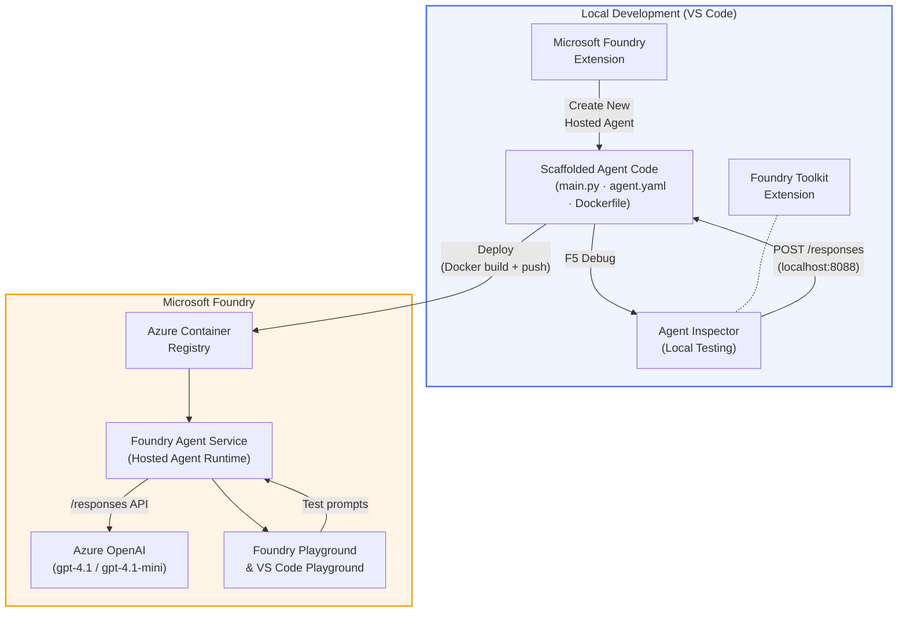

# Hội thảo Foundry Toolkit + Foundry Hosted Agents

[](https://www.python.org/)
[](https://github.com/microsoft/agents)
[](https://learn.microsoft.com/azure/foundry/agents/concepts/hosted-agents)
[](https://ai.azure.com/)
[](https://learn.microsoft.com/azure/ai-services/openai/)
[](https://learn.microsoft.com/cli/azure/install-azure-cli)
[](https://learn.microsoft.com/azure/developer/azure-developer-cli/install-azd)
[](https://www.docker.com/)
[](https://marketplace.visualstudio.com/items?itemName=ms-windows-ai-studio.windows-ai-studio)
[](../../LICENSE)

Xây dựng, kiểm tra, và triển khai các agent AI lên **Microsoft Foundry Agent Service** dưới dạng **Hosted Agents** - hoàn toàn từ VS Code bằng **Microsoft Foundry extension** và **Foundry Toolkit**.

> **Hosted Agents hiện đang ở chế độ xem trước.** Các vùng được hỗ trợ bị giới hạn - xem [tính sẵn có theo khu vực](https://learn.microsoft.com/azure/foundry/agents/concepts/hosted-agents#region-availability).

> Thư mục `agent/` bên trong mỗi lab được **tạo tự động** bởi tiện ích mở rộng Foundry - sau đó bạn tùy chỉnh mã, kiểm tra cục bộ, và triển khai.

### 🌐 Hỗ trợ đa ngôn ngữ

#### Hỗ trợ qua GitHub Action (Tự động & Luôn được cập nhật)

<!-- CO-OP TRANSLATOR LANGUAGES TABLE START -->
[Arabic](../ar/README.md) | [Bengali](../bn/README.md) | [Bulgarian](../bg/README.md) | [Burmese (Myanmar)](../my/README.md) | [Chinese (Simplified)](../zh-CN/README.md) | [Chinese (Traditional, Hong Kong)](../zh-HK/README.md) | [Chinese (Traditional, Macau)](../zh-MO/README.md) | [Chinese (Traditional, Taiwan)](../zh-TW/README.md) | [Croatian](../hr/README.md) | [Czech](../cs/README.md) | [Danish](../da/README.md) | [Dutch](../nl/README.md) | [Estonian](../et/README.md) | [Finnish](../fi/README.md) | [French](../fr/README.md) | [German](../de/README.md) | [Greek](../el/README.md) | [Hebrew](../he/README.md) | [Hindi](../hi/README.md) | [Hungarian](../hu/README.md) | [Indonesian](../id/README.md) | [Italian](../it/README.md) | [Japanese](../ja/README.md) | [Kannada](../kn/README.md) | [Khmer](../km/README.md) | [Korean](../ko/README.md) | [Lithuanian](../lt/README.md) | [Malay](../ms/README.md) | [Malayalam](../ml/README.md) | [Marathi](../mr/README.md) | [Nepali](../ne/README.md) | [Nigerian Pidgin](../pcm/README.md) | [Norwegian](../no/README.md) | [Persian (Farsi)](../fa/README.md) | [Polish](../pl/README.md) | [Portuguese (Brazil)](../pt-BR/README.md) | [Portuguese (Portugal)](../pt-PT/README.md) | [Punjabi (Gurmukhi)](../pa/README.md) | [Romanian](../ro/README.md) | [Russian](../ru/README.md) | [Serbian (Cyrillic)](../sr/README.md) | [Slovak](../sk/README.md) | [Slovenian](../sl/README.md) | [Spanish](../es/README.md) | [Swahili](../sw/README.md) | [Swedish](../sv/README.md) | [Tagalog (Filipino)](../tl/README.md) | [Tamil](../ta/README.md) | [Telugu](../te/README.md) | [Thai](../th/README.md) | [Turkish](../tr/README.md) | [Ukrainian](../uk/README.md) | [Urdu](../ur/README.md) | [Vietnamese](./README.md)

> **Muốn clone về máy cục bộ?**
>
> Kho lưu trữ này bao gồm hơn 50 bản dịch, làm tăng đáng kể dung lượng tải về. Để clone mà không có bản dịch, sử dụng sparse checkout:
>
> **Bash / macOS / Linux:**
> ```bash
> git clone --filter=blob:none --sparse https://github.com/microsoft-foundry/Foundry_Toolkit_for_VSCode_Lab.git
> cd Foundry_Toolkit_for_VSCode_Lab
> git sparse-checkout set --no-cone '/*' '!translations' '!translated_images'
> ```
>
> **CMD (Windows):**
> ```cmd
> git clone --filter=blob:none --sparse https://github.com/microsoft-foundry/Foundry_Toolkit_for_VSCode_Lab.git
> cd Foundry_Toolkit_for_VSCode_Lab
> git sparse-checkout set --no-cone "/*" "!translations" "!translated_images"
> ```
>
> Điều này cung cấp cho bạn mọi thứ cần thiết để hoàn thành khoá học với thời gian tải xuống nhanh hơn nhiều.
<!-- CO-OP TRANSLATOR LANGUAGES TABLE END -->

---

## Kiến trúc



**Flow:** Tiện ích mở rộng Foundry tạo khung cho agent → bạn tùy chỉnh mã & hướng dẫn → kiểm tra cục bộ bằng Agent Inspector → triển khai lên Foundry (Docker image được đẩy tới ACR) → xác minh trong Playground.

---

## Những gì bạn sẽ xây dựng

| Lab | Mô tả | Trạng thái |
|-----|-------------|--------|
| **Lab 01 - Single Agent** | Xây dựng Agent **"Explain Like I'm an Executive"**, kiểm tra cục bộ, và triển khai lên Foundry | ✅ Có sẵn |
| **Lab 02 - Multi-Agent Workflow** | Xây dựng **"Resume → Job Fit Evaluator"** - 4 agents phối hợp để chấm điểm độ phù hợp CV và tạo lộ trình học tập | ✅ Có sẵn |

---

## Gặp gỡ Agent dành cho Giám đốc điều hành

Trong hội thảo này bạn sẽ xây dựng Agent **"Explain Like I'm an Executive"** - một agent AI nhận các biệt ngữ kỹ thuật rắc rối và chuyển thành các bản tóm tắt bình tĩnh, sẵn sàng trình bày trong phòng họp. Thành thật mà nói, chẳng ai ở cấp C-suite muốn nghe về "thread pool exhaustion caused by synchronous calls introduced in v3.2."

Tôi đã xây dựng agent này sau quá nhiều sự cố mà bài post-mortem tôi soạn kỹ lưỡng chỉ nhận được phản hồi: *"Vậy... website có đang sập hay không?"*

### Cách hoạt động

Bạn đưa cho nó một bản cập nhật kỹ thuật. Nó trả về một bản tóm tắt cho lãnh đạo - ba gạch đầu dòng, không biệt ngữ, không stack trace, không gây hoảng loạn. Chỉ **việc đã xảy ra**, **tác động đến doanh nghiệp**, và **bước tiếp theo**.

### Xem nó hoạt động

**Bạn nói:**
> "Độ trễ API tăng do thread pool bị cạn kiệt do các cuộc gọi đồng bộ được giới thiệu trong v3.2."

**Agent trả lời:**

> **Tóm tắt dành cho lãnh đạo:**
> - **Việc đã xảy ra:** Sau bản phát hành gần nhất, hệ thống chậm lại.
> - **Tác động đến doanh nghiệp:** Một số người dùng gặp chậm trễ khi sử dụng dịch vụ.
> - **Bước tiếp theo:** Thay đổi đã được hoàn tác và một bản sửa lỗi đang được chuẩn bị trước khi triển khai lại.

### Tại sao chọn agent này?

Đây là một agent cực kỳ đơn giản, phục vụ mục đích duy nhất - hoàn hảo để học quy trình làm việc của hosted agent từ đầu đến cuối mà không bị vướng vào chuỗi công cụ phức tạp. Và thật lòng? Mỗi nhóm kỹ thuật đều có thể dùng một cái như thế.

---

## Cấu trúc hội thảo

```
📂 Foundry_Toolkit_for_VSCode_Lab/
├── 📄 README.md                      ← You are here
└── 📂 workshop/
    ├── 📂 lab01-single-agent/        ← Full lab: docs + agent code
    │   ├── README.md                 ← Hands-on lab instructions
    │   ├── 📂 docs/                  ← Step-by-step tutorial modules
    │   │   ├── 00-prerequisites.md
    │   │   ├── 01-setup.md
    │   │   ├── 02-create-hosted-agent.md
    │   │   ├── 03-configure-and-code.md
    │   │   ├── 04-test-locally.md
    │   │   ├── 05-deploy-to-foundry.md
    │   │   ├── 06-verify-in-playground.md
    │   │   ├── 07-summary.md
    │   │   └── 08-troubleshooting.md
    │   └── 📂 agent/                 ← Reference solution (auto-scaffolded by Foundry extension)
    │       ├── agent.yaml
    │       ├── Dockerfile
    │       ├── main.py
    │       └── requirements.txt
    └── 📂 lab02-multi-agent/         ← Resume → Job Fit Evaluator
        ├── README.md                 ← Hands-on lab instructions (end-to-end)
        ├── 📂 docs/                  ← Step-by-step tutorial modules
        │   ├── 00-prerequisites.md
        │   ├── 01-understand-multi-agent.md
        │   ├── 02-scaffold-multi-agent.md
        │   ├── 03-configure-agents.md
        │   ├── 04-orchestration-patterns.md
        │   ├── 05-test-locally.md
        │   ├── 06-deploy-to-foundry.md
        │   ├── 07-verify-in-playground.md
        │   └── 08-troubleshooting.md
        └── 📂 PersonalCareerCopilot/ ← Reference solution (multi-agent workflow)
            ├── agent.yaml
            ├── Dockerfile
            ├── main.py
            └── requirements.txt
```

> **Lưu ý:** Thư mục `agent/` bên trong mỗi lab là thứ mà **Microsoft Foundry extension** tạo ra khi bạn chạy `Microsoft Foundry: Create a New Hosted Agent` từ Command Palette. Các tệp sau đó được tùy chỉnh với hướng dẫn, công cụ, và cấu hình của agent bạn. Lab 01 sẽ hướng dẫn bạn tái tạo điều này từ đầu.

---

## Bắt đầu

### 1. Sao chép (clone) kho lưu trữ

```bash
git clone https://github.com/microsoft-foundry/Foundry_Toolkit_for_VSCode_Lab.git
cd Foundry_Toolkit_for_VSCode_Lab
```

### 2. Thiết lập môi trường ảo Python

```bash
python -m venv venv
```

Kích hoạt nó:

- **Windows (PowerShell):**
  ```powershell
  .\venv\Scripts\Activate.ps1
  ```
- **macOS / Linux:**
  ```bash
  source venv/bin/activate
  ```

### 3. Cài đặt các phụ thuộc

```bash
pip install -r workshop/lab01-single-agent/agent/requirements.txt
```

### 4. Cấu hình biến môi trường

Sao chép tệp ví dụ `.env` vào trong thư mục agent và điền các giá trị của bạn:

```bash
cp workshop/lab01-single-agent/agent/.env.example workshop/lab01-single-agent/agent/.env
```

Chỉnh sửa `workshop/lab01-single-agent/agent/.env`:

```env
AZURE_AI_PROJECT_ENDPOINT=https://<your-account>.services.ai.azure.com/api/projects/<your-project>
AZURE_AI_MODEL_DEPLOYMENT_NAME=<your-model-deployment-name>
```

### 5. Thực hiện theo các lab của hội thảo

Mỗi lab độc lập với các mô-đun riêng. Bắt đầu với **Lab 01** để học các nguyên tắc cơ bản, sau đó chuyển sang **Lab 02** cho các quy trình làm việc đa-agent.

#### Lab 01 - Single Agent ([hướng dẫn đầy đủ](workshop/lab01-single-agent/README.md))

| # | Mô-đun | Liên kết |
|---|--------|------|
| 1 | Đọc các yêu cầu tiên quyết | [00-prerequisites.md](workshop/lab01-single-agent/docs/00-prerequisites.md) |
| 2 | Cài đặt Foundry Toolkit & tiện ích mở rộng Foundry | [01-setup.md](workshop/lab01-single-agent/docs/01-setup.md) |
| 3 | Tạo một dự án Foundry | [01-setup.md](workshop/lab01-single-agent/docs/01-setup.md) |
| 4 | Tạo một hosted agent | [02-create-hosted-agent.md](workshop/lab01-single-agent/docs/02-create-hosted-agent.md) |
| 5 | Cấu hình hướng dẫn & môi trường | [03-configure-and-code.md](workshop/lab01-single-agent/docs/03-configure-and-code.md) |
| 6 | Kiểm tra cục bộ | [04-test-locally.md](workshop/lab01-single-agent/docs/04-test-locally.md) |
| 7 | Triển khai lên Foundry | [05-deploy-to-foundry.md](workshop/lab01-single-agent/docs/05-deploy-to-foundry.md) |
| 8 | Xác minh trong playground | [06-verify-in-playground.md](workshop/lab01-single-agent/docs/06-verify-in-playground.md) |
| 9 | Khắc phục sự cố | [08-troubleshooting.md](workshop/lab01-single-agent/docs/08-troubleshooting.md) |

#### Lab 02 - Multi-Agent Workflow ([hướng dẫn đầy đủ](workshop/lab02-multi-agent/README.md))

| # | Mô-đun | Liên kết |
|---|--------|------|
| 1 | Yêu cầu tiên quyết (Lab 02) | [00-prerequisites.md](workshop/lab02-multi-agent/docs/00-prerequisites.md) |
| 2 | Hiểu kiến trúc đa-agent | [01-understand-multi-agent.md](workshop/lab02-multi-agent/docs/01-understand-multi-agent.md) |
| 3 | Khởi tạo dự án đa-agent | [02-scaffold-multi-agent.md](workshop/lab02-multi-agent/docs/02-scaffold-multi-agent.md) |
| 4 | Cấu hình agents & môi trường | [03-configure-agents.md](workshop/lab02-multi-agent/docs/03-configure-agents.md) |
| 5 | Các mẫu điều phối | [04-orchestration-patterns.md](workshop/lab02-multi-agent/docs/04-orchestration-patterns.md) |
| 6 | Kiểm tra cục bộ (đa-agent) | [05-test-locally.md](workshop/lab02-multi-agent/docs/05-test-locally.md) |
| 7 | Triển khai lên Foundry | [06-deploy-to-foundry.md](workshop/lab02-multi-agent/docs/06-deploy-to-foundry.md) |
| 8 | Xác minh trong playground | [07-verify-in-playground.md](workshop/lab02-multi-agent/docs/07-verify-in-playground.md) |
| 9 | Khắc phục sự cố (đa-agent) | [08-troubleshooting.md](workshop/lab02-multi-agent/docs/08-troubleshooting.md) |

---

## Người duy trì

<table>
<tr>
    <td align="center"><a href="https://github.com/ShivamGoyal03">
        <br />
        <sub><b>Shivam Goyal</b></sub>
    </a><br />
    </td>
</tr>
</table>

---

## Quyền cần thiết (tham khảo nhanh)

| Tình huống | Vai trò yêu cầu |
|----------|---------------|
| Tạo dự án Foundry mới | **Azure AI Owner** trên tài nguyên Foundry |
| Triển khai tới dự án hiện có (tài nguyên mới) | **Azure AI Owner** + **Contributor** trên subscription |
| Triển khai tới dự án đã cấu hình đầy đủ | **Reader** trên tài khoản + **Azure AI User** trên dự án |

> **Quan trọng:** Vai trò Azure `Owner` và `Contributor` chỉ bao gồm *quản lý* quyền, không phải *phát triển* (quyền hành động dữ liệu). Bạn cần **Azure AI User** hoặc **Azure AI Owner** để xây dựng và triển khai agents.

---

## Tài liệu tham khảo

- [Bắt đầu nhanh: Triển khai agent được lưu trữ đầu tiên của bạn (VS Code)](https://learn.microsoft.com/azure/foundry/agents/quickstarts/quickstart-hosted-agent)
- [Agent được lưu trữ là gì?](https://learn.microsoft.com/azure/foundry/agents/concepts/hosted-agents)
- [Tạo luồng công việc cho agent được lưu trữ trong VS Code](https://learn.microsoft.com/azure/foundry/agents/how-to/vs-code-agents-workflow-pro-code)
- [Triển khai một agent được lưu trữ](https://learn.microsoft.com/azure/foundry/agents/how-to/deploy-hosted-agent)
- [RBAC cho Microsoft Foundry](https://learn.microsoft.com/azure/foundry/concepts/rbac-foundry)
- [Mẫu Agent Đánh giá Kiến trúc](https://github.com/Azure-Samples/agent-architecture-review-sample) - Agent được lưu trữ thực tế với công cụ MCP, sơ đồ Excalidraw, và triển khai kép

---


## Giấy phép

[MIT](../../LICENSE)

---

<!-- CO-OP TRANSLATOR DISCLAIMER START -->
**Tuyên bố miễn trừ trách nhiệm**:
Tài liệu này đã được dịch bằng dịch vụ dịch thuật AI [Co-op Translator](https://github.com/Azure/co-op-translator). Mặc dù chúng tôi cố gắng đảm bảo độ chính xác, xin lưu ý rằng bản dịch tự động có thể chứa lỗi hoặc sai sót. Tài liệu gốc bằng ngôn ngữ gốc nên được coi là nguồn tin chính thức. Đối với thông tin quan trọng, nên sử dụng dịch vụ dịch thuật chuyên nghiệp bởi con người. Chúng tôi không chịu trách nhiệm về bất kỳ hiểu lầm hoặc giải thích sai nào phát sinh từ việc sử dụng bản dịch này.
<!-- CO-OP TRANSLATOR DISCLAIMER END -->
