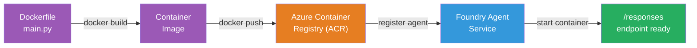

# Module 5 - Triển khai tới Dịch vụ Agent Foundry

⏱️ ~10 phút

> ⚠️ **Người dùng Path B:** Module này yêu cầu một đăng ký Foundry. Nếu bạn đang sử dụng Foundry Local, hãy chuyển đến [Module 07 - Tóm tắt](07-summary.md). Bạn đã hoàn thành thành công quy trình phát triển cục bộ!

Trong module này, bạn sẽ triển khai agent đã được kiểm thử cục bộ của mình lên Microsoft Foundry dưới dạng **Hosted Agent**. Việc triển khai sẽ xây dựng một image container, đẩy nó lên Azure Container Registry và khởi động agent trong cơ sở hạ tầng được quản lý của Foundry.

### Quy trình triển khai

---

## Kiểm tra điều kiện tiên quyết

Trước khi triển khai, xác minh:

- [ ] Agent vượt qua cả 3 kịch bản cục bộ từ [Module 04](04-test-locally.md)
- [ ] Bạn có vai trò **Azure AI User** ở cấp dự án ([Module 01, Gán RBAC](01-setup.md#triển-khai-mô-hình-gán-rbac))
- [ ] Bạn đã đăng nhập vào Azure trong VS Code (biểu tượng Tài khoản hiển thị tên của bạn)

---

## Bước 1: Bắt đầu triển khai

### Tùy chọn A: Triển khai từ Agent Inspector (khuyến nghị)

Nếu Agent Inspector đang mở (từ quá trình kiểm thử):
1. Nhấp nút **Deploy** ở góc trên bên phải (biểu tượng đám mây ↑).

### Tùy chọn B: Triển khai từ Command Palette

1. Nhấn `Ctrl+Shift+P` → **Foundry Toolkit: Deploy Hosted Agent**.

---

## Bước 2: Cấu hình triển khai

Trình hướng dẫn sẽ yêu cầu:

| Trường | Lựa chọn |
|--------|-----------|
| **Subscription** | Your Azure Subscription |
| **Target project** | Dự án Foundry của bạn (ví dụ, `workshop-agents`) |

Nhấp **next** để cấu hình agent của bạn.

| Trường | Lựa chọn |
|--------|-----------|
| **Deployment Method** | Container |
| **Container registry** | **Default ACR** (Microsoft Foundry tạo và quản lý một registry cho bạn) |
| **Deploy to** | New Agent (name, `executive-summary-agent`) |

Nhấp **next** để xem lại và triển khai agent của bạn.

| Trường | Lựa chọn |
|--------|-----------|
| **CPU and memory** | **0.25 lõi CPU, 0.5 Gi bộ nhớ** (đủ cho workshop) |

---

## Bước 3: Triển khai và theo dõi

1. Nhấp **Deploy**.
2. Theo dõi bảng **Output** (chọn **Microsoft Foundry** từ menu thả xuống).
3. Việc triển khai sẽ chạy qua các giai đoạn sau:
   - **Docker build** - xây dựng container từ Dockerfile của bạn
   - **Docker push** - đẩy image lên ACR (1–3 phút khi triển khai lần đầu)
   - **Agent registration** - tạo hosted agent trong Foundry
   - **Container start** - khởi động với managed identity do hệ thống quản lý

4. Khi hoàn tất, một thông báo sẽ xuất hiện:
   > **my-agent đã được triển khai thành công.** `View logs` `Run agent`

5. Nhấp **Run agent** để mở Agent Playground.

### Giá trị trạng thái triển khai

| Trạng thái | Ý nghĩa |
|--------|---------|
| **Running** | Container sẵn sàng, agent phản hồi |
| **Pending** | Container đang khởi động - chờ 30–60 giây |
| **Failed** | Kiểm tra nhật ký (xem khắc phục sự cố bên dưới) |

---

## Các lỗi triển khai phổ biến

| Lỗi | Nguyên nhân gốc | Khắc phục |
|-------|-----------|-----|
| `agents/write` permission denied | Thiếu vai trò **Azure AI User** ở cấp dự án | [Module 01, Gán RBAC](01-setup.md#triển-khai-mô-hình-gán-rbac) |
| Docker not running | Docker Desktop chưa được khởi chạy | Khởi động Docker Desktop → xác minh `docker info` |
| ACR authorization | Managed identity không thể kéo image | Xem [Module 08 - Khắc phục sự cố](08-troubleshooting.md) |

---

### ✅ Điểm kiểm tra

- [ ] Triển khai hoàn tất mà không có lỗi
- [ ] Agent xuất hiện dưới **Hosted Agents (Preview)** trong thanh bên Foundry
- [ ] Trạng thái container hiển thị **Đang chạy**
- [ ] Tab Agent Playground được mở và hiển thị chi tiết agent và URL endpoint

---

**Trước:** [04 - Kiểm thử cục bộ](04-test-locally.md) · **Tiếp theo:** [06 - Xác minh trong Playground →](06-verify-in-playground.md)

---

<!-- CO-OP TRANSLATOR DISCLAIMER START -->
**Tuyên bố miễn trừ trách nhiệm**:
Tài liệu này đã được dịch bằng dịch vụ dịch thuật AI [Co-op Translator](https://github.com/Azure/co-op-translator). Mặc dù chúng tôi cố gắng đảm bảo độ chính xác, xin lưu ý rằng bản dịch tự động có thể chứa lỗi hoặc sai sót. Tài liệu gốc bằng ngôn ngữ gốc nên được coi là nguồn tin chính thức. Đối với thông tin quan trọng, nên sử dụng dịch vụ dịch thuật chuyên nghiệp bởi con người. Chúng tôi không chịu trách nhiệm về bất kỳ hiểu lầm hoặc giải thích sai nào phát sinh từ việc sử dụng bản dịch này.
<!-- CO-OP TRANSLATOR DISCLAIMER END -->
