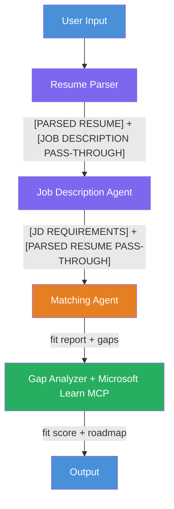

# 实验 02 - 多代理工作流：简历 → 职位匹配评估器

## 概述

在本动手实验中，您将使用 VS Code 中的 Foundry Toolkit 构建一个<strong>以工作流为先的多代理应用</strong>，并将其部署到 Microsoft Foundry 代理服务。

**您将构建的内容：** 一个简历 → 职位匹配评估器，解析简历和职位描述，评分匹配度，并使用 Microsoft Learn 资源生成个性化学习路线图。

---

## 架构

**工作原理：**
1. 用户粘贴简历和职位描述。
2. **ResumeParser** 解析简历并将职位描述逐字复制到 `[JOB DESCRIPTION PASS-THROUGH]` 部分。
3. **JD Agent** 从传递内容中提取结构化需求，然后将 `[PARSED RESUME]` 以 `[PARSED RESUME PASS-THROUGH]` 形式转发。
4. **MatchingAgent** 比较 `[PARSED RESUME PASS-THROUGH]` 与 `[JD REQUIREMENTS]` 并生成匹配评分。
5. **GapAnalyzer** 将差距转化为可执行路线图，并通过 MCP 获取真实的 Microsoft Learn 链接。

---

## 先决条件

请先完成实验 01：

- [实验 01 - 单代理](../lab01-single-agent/README.md)

---

## 第 1 部分：按顺序阅读模块

查看完整学习路径：

- [实验 2 文档 - 先决条件](docs/00-prerequisites.md)
- [实验 2 文档 - 完整学习路径](docs/README.md)
- [PersonalCareerCopilot 运行指南](PersonalCareerCopilot/README.md)

---

## 第 2 部分：构建和测试工作流

1. 使用 Foundry Toolkit 向导搭建基于工作流的项目。
2. 将 `PersonalCareerCopilot/main.py` 中的提示块和工作流图复制到您的工作区。
3. 使用 Agent Inspector 本地运行并验证四个代理及 MCP 工具。
4. 本地测试通过后，将托管代理部署到 Foundry。

---

## 编排模式

实验 02 使用了<strong>顺序管道</strong>：每个代理的输出作为下一个代理的输入，工作流返回最后一个代理的响应。两个模式支持此工作：

- <strong>顺序链</strong> - `WorkflowBuilder` 将 ResumeParser → JD Agent → MatchingAgent → GapAnalyzer 以每步一个 `add_edge()` 调用串联
- <strong>内容传递</strong> - 由于每个代理只看到它的直接前驱输出，ResumeParser 和 JD Agent 把下游代理需要的数据复制到标记的传递部分

文档还解释了为什么不使用扇出/扇入，以及如何通过另一个代理扩展图。

详情见 [docs/04-orchestration-patterns.md](docs/04-orchestration-patterns.md)。

---

**上一节：** [实验 01 - 单代理](../lab01-single-agent/README.md) · **返回：** [工作坊首页](../../README.md)

---

<!-- CO-OP TRANSLATOR DISCLAIMER START -->
**免责声明**：
本文件由 AI 翻译服务 [Co-op Translator](https://github.com/Azure/co-op-translator) 翻译完成。尽管我们力求准确，但请注意，自动翻译可能包含错误或不准确之处。原始语言版文件应视为权威来源。对于重要信息，建议使用专业人工翻译。我们对因使用本翻译而产生的任何误解或误释不承担责任。
<!-- CO-OP TRANSLATOR DISCLAIMER END -->