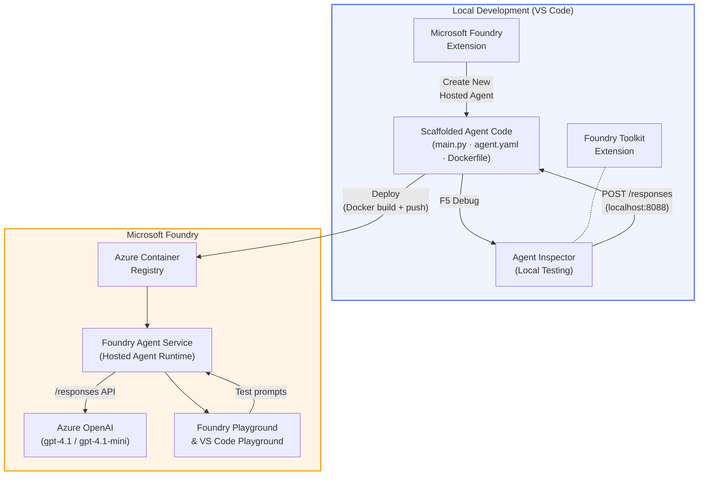

# Foundry 工具包 + Foundry 託管代理 工作坊

[](https://www.python.org/)
[](https://github.com/microsoft/agents)
[](https://learn.microsoft.com/azure/foundry/agents/concepts/hosted-agents)
[](https://ai.azure.com/)
[](https://learn.microsoft.com/azure/ai-services/openai/)
[](https://learn.microsoft.com/cli/azure/install-azure-cli)
[](https://learn.microsoft.com/azure/developer/azure-developer-cli/install-azd)
[](https://www.docker.com/)
[](https://marketplace.visualstudio.com/items?itemName=ms-windows-ai-studio.windows-ai-studio)
[](../../LICENSE)

從 VS Code 完全使用 **Microsoft Foundry 延伸套件** 和 **Foundry 工具包** 建構、測試並部署 AI 代理到 **Microsoft Foundry Agent Service** 作為 <strong>託管代理</strong>。

> **Hosted Agents 目前為預覽版。** 支援的地區有限 - 請參閱 [地區可用性](https://learn.microsoft.com/azure/foundry/agents/concepts/hosted-agents#region-availability).

> 每個實驗室內的 `agent/` 資料夾會由 Foundry 延伸套件 **自動 scaffold** - 你可以自訂程式碼、在本地測試，並部署。

### 🌐 多語言支援

#### Supported via GitHub Action (Automated & Always Up-to-Date)

<!-- CO-OP TRANSLATOR LANGUAGES TABLE START -->
[Arabic](../ar/README.md) | [Bengali](../bn/README.md) | [Bulgarian](../bg/README.md) | [Burmese (Myanmar)](../my/README.md) | [Chinese (Simplified)](../zh-CN/README.md) | [Chinese (Traditional, Hong Kong)](./README.md) | [Chinese (Traditional, Macau)](../zh-MO/README.md) | [Chinese (Traditional, Taiwan)](../zh-TW/README.md) | [Croatian](../hr/README.md) | [Czech](../cs/README.md) | [Danish](../da/README.md) | [Dutch](../nl/README.md) | [Estonian](../et/README.md) | [Finnish](../fi/README.md) | [French](../fr/README.md) | [German](../de/README.md) | [Greek](../el/README.md) | [Hebrew](../he/README.md) | [Hindi](../hi/README.md) | [Hungarian](../hu/README.md) | [Indonesian](../id/README.md) | [Italian](../it/README.md) | [Japanese](../ja/README.md) | [Kannada](../kn/README.md) | [Khmer](../km/README.md) | [Korean](../ko/README.md) | [Lithuanian](../lt/README.md) | [Malay](../ms/README.md) | [Malayalam](../ml/README.md) | [Marathi](../mr/README.md) | [Nepali](../ne/README.md) | [Nigerian Pidgin](../pcm/README.md) | [Norwegian](../no/README.md) | [Persian (Farsi)](../fa/README.md) | [Polish](../pl/README.md) | [Portuguese (Brazil)](../pt-BR/README.md) | [Portuguese (Portugal)](../pt-PT/README.md) | [Punjabi (Gurmukhi)](../pa/README.md) | [Romanian](../ro/README.md) | [Russian](../ru/README.md) | [Serbian (Cyrillic)](../sr/README.md) | [Slovak](../sk/README.md) | [Slovenian](../sl/README.md) | [Spanish](../es/README.md) | [Swahili](../sw/README.md) | [Swedish](../sv/README.md) | [Tagalog (Filipino)](../tl/README.md) | [Tamil](../ta/README.md) | [Telugu](../te/README.md) | [Thai](../th/README.md) | [Turkish](../tr/README.md) | [Ukrainian](../uk/README.md) | [Urdu](../ur/README.md) | [Vietnamese](../vi/README.md)

> **想要本地複製嗎？**
>
> 此儲存庫包含超過 50 種語言的翻譯，會顯著增加下載大小。若要在不包含翻譯的情況下複製，請使用 sparse checkout：
>
> **Bash / macOS / Linux:**
> ```bash
> git clone --filter=blob:none --sparse https://github.com/microsoft-foundry/Foundry_Toolkit_for_VSCode_Lab.git
> cd Foundry_Toolkit_for_VSCode_Lab
> git sparse-checkout set --no-cone '/*' '!translations' '!translated_images'
> ```
>
> **CMD (Windows):**
> ```cmd
> git clone --filter=blob:none --sparse https://github.com/microsoft-foundry/Foundry_Toolkit_for_VSCode_Lab.git
> cd Foundry_Toolkit_for_VSCode_Lab
> git sparse-checkout set --no-cone "/*" "!translations" "!translated_images"
> ```
>
> 這樣可以讓你獲得完成課程所需的一切，且下載速度更快。
<!-- CO-OP TRANSLATOR LANGUAGES TABLE END -->

---

## 架構



**流程：** Foundry 延伸套件 scaffold 代理 → 你自訂程式碼與指示 → 使用 Agent Inspector 在本地測試 → 部署到 Foundry（Docker 映像推送到 ACR）→ 在 Playground 驗證。

---

## 你將建立的項目

| Lab | 描述 | 狀態 |
|-----|-------------|--------|
| **Lab 01 - Single Agent** | 構建 **「像向執行長解釋」代理**，在本地測試，並部署到 Foundry | ✅ 可用 |
| **Lab 02 - Multi-Agent Workflow** | 構建 **「履歷 → 職位適配評估器」** - 4 個代理協作評分履歷適配度並生成學習路線圖 | ✅ 可用 |

---

## 認識執行長代理

在本工作坊中，你將建立 **「像向執行長解釋」代理** — 一個把棘手技術行話轉換成冷靜、適合董事會的摘要的 AI 代理。說實話，C 級高管沒有人想聽到 "thread pool exhaustion caused by synchronous calls introduced in v3.2."

我是在太多次我精心撰寫的事後檢討換來這樣的回應之後建立了這個代理：*"所以……網站到底有沒有掛？"*

### 它的運作方式

你給它一個技術更新。它會回傳一則執行摘要——三個要點，沒有行話、沒有堆疊追蹤，也不會引發莫名的恐慌。只有 <strong>發生了什麼事</strong>、<strong>對業務的影響</strong>，以及 <strong>下一步</strong>。

### 實際示範

**你說：**
> "API 延遲增加，原因是 v3.2 引入的同步呼叫導致執行緒池耗盡。"

**代理回覆：**

> **執行摘要：**
> - **發生了什麼事：** 在最新版本發佈後，系統變慢。
> - **對業務的影響：** 部分使用者在使用服務時遇到延遲。
> - **下一步：** 變更已被回滾，並在重新部署前準備修復。

### 為什麼選擇這個代理？

它是一個超簡單、單一目的的代理——非常適合學習託管代理的端到端工作流程，而不會被複雜的工具鏈綁住。說實話？每個工程團隊都可以用得到這樣一個代理。

---

## 工作坊架構

```
📂 Foundry_Toolkit_for_VSCode_Lab/
├── 📄 README.md                      ← You are here
└── 📂 workshop/
    ├── 📂 lab01-single-agent/        ← Full lab: docs + agent code
    │   ├── README.md                 ← Hands-on lab instructions
    │   ├── 📂 docs/                  ← Step-by-step tutorial modules
    │   │   ├── 00-prerequisites.md
    │   │   ├── 01-setup.md
    │   │   ├── 02-create-hosted-agent.md
    │   │   ├── 03-configure-and-code.md
    │   │   ├── 04-test-locally.md
    │   │   ├── 05-deploy-to-foundry.md
    │   │   ├── 06-verify-in-playground.md
    │   │   ├── 07-summary.md
    │   │   └── 08-troubleshooting.md
    │   └── 📂 agent/                 ← Reference solution (auto-scaffolded by Foundry extension)
    │       ├── agent.yaml
    │       ├── Dockerfile
    │       ├── main.py
    │       └── requirements.txt
    └── 📂 lab02-multi-agent/         ← Resume → Job Fit Evaluator
        ├── README.md                 ← Hands-on lab instructions (end-to-end)
        ├── 📂 docs/                  ← Step-by-step tutorial modules
        │   ├── 00-prerequisites.md
        │   ├── 01-understand-multi-agent.md
        │   ├── 02-scaffold-multi-agent.md
        │   ├── 03-configure-agents.md
        │   ├── 04-orchestration-patterns.md
        │   ├── 05-test-locally.md
        │   ├── 06-deploy-to-foundry.md
        │   ├── 07-verify-in-playground.md
        │   └── 08-troubleshooting.md
        └── 📂 PersonalCareerCopilot/ ← Reference solution (multi-agent workflow)
            ├── agent.yaml
            ├── Dockerfile
            ├── main.py
            └── requirements.txt
```

> **注意：** The `agent/` folder inside each lab is what the **Microsoft Foundry extension** generates when you run `Microsoft Foundry: Create a New Hosted Agent` from the Command Palette. The files are then customized with your agent's instructions, tools, and configuration. Lab 01 walks you through recreating this from scratch.

---

## 開始使用

### 1. Clone the repository

```bash
git clone https://github.com/microsoft-foundry/Foundry_Toolkit_for_VSCode_Lab.git
cd Foundry_Toolkit_for_VSCode_Lab
```

### 2. 設定 Python 虛擬環境

```bash
python -m venv venv
```

Activate it:

- **Windows (PowerShell):**
  ```powershell
  .\venv\Scripts\Activate.ps1
  ```
- **macOS / Linux:**
  ```bash
  source venv/bin/activate
  ```

### 3. 安裝相依套件

```bash
pip install -r workshop/lab01-single-agent/agent/requirements.txt
```

### 4. 設定環境變數

Copy the example `.env` file inside the agent folder and fill in your values:

```bash
cp workshop/lab01-single-agent/agent/.env.example workshop/lab01-single-agent/agent/.env
```

Edit `workshop/lab01-single-agent/agent/.env`:

```env
AZURE_AI_PROJECT_ENDPOINT=https://<your-account>.services.ai.azure.com/api/projects/<your-project>
AZURE_AI_MODEL_DEPLOYMENT_NAME=<your-model-deployment-name>
```

### 5. 按照工作坊實驗室操作

Each lab is self-contained with its own modules. Start with **Lab 01** to learn the fundamentals, then move on to **Lab 02** for multi-agent workflows.

#### Lab 01 - 單一代理 ([full instructions](workshop/lab01-single-agent/README.md))

| # | 模組 | 連結 |
|---|--------|------|
| 1 | 閱讀先決條件 | [00-prerequisites.md](workshop/lab01-single-agent/docs/00-prerequisites.md) |
| 2 | 安裝 Foundry Toolkit & Foundry extension | [01-setup.md](workshop/lab01-single-agent/docs/01-setup.md) |
| 3 | 建立 Foundry 專案 | [01-setup.md](workshop/lab01-single-agent/docs/01-setup.md) |
| 4 | 建立託管代理 | [02-create-hosted-agent.md](workshop/lab01-single-agent/docs/02-create-hosted-agent.md) |
| 5 | 配置指示與環境 | [03-configure-and-code.md](workshop/lab01-single-agent/docs/03-configure-and-code.md) |
| 6 | 本地測試 | [04-test-locally.md](workshop/lab01-single-agent/docs/04-test-locally.md) |
| 7 | 部署到 Foundry | [05-deploy-to-foundry.md](workshop/lab01-single-agent/docs/05-deploy-to-foundry.md) |
| 8 | 在 playground 中驗證 | [06-verify-in-playground.md](workshop/lab01-single-agent/docs/06-verify-in-playground.md) |
| 9 | 疑難排解 | [08-troubleshooting.md](workshop/lab01-single-agent/docs/08-troubleshooting.md) |

#### Lab 02 - 多代理工作流程 ([full instructions](workshop/lab02-multi-agent/README.md))

| # | 模組 | 連結 |
|---|--------|------|
| 1 | 先決條件 (Lab 02) | [00-prerequisites.md](workshop/lab02-multi-agent/docs/00-prerequisites.md) |
| 2 | 了解多代理架構 | [01-understand-multi-agent.md](workshop/lab02-multi-agent/docs/01-understand-multi-agent.md) |
| 3 | 搭建多代理專案 | [02-scaffold-multi-agent.md](workshop/lab02-multi-agent/docs/02-scaffold-multi-agent.md) |
| 4 | 配置代理與環境 | [03-configure-agents.md](workshop/lab02-multi-agent/docs/03-configure-agents.md) |
| 5 | 編排模式 | [04-orchestration-patterns.md](workshop/lab02-multi-agent/docs/04-orchestration-patterns.md) |
| 6 | 本地測試 (多代理) | [05-test-locally.md](workshop/lab02-multi-agent/docs/05-test-locally.md) |
| 7 | 部署到 Foundry | [06-deploy-to-foundry.md](workshop/lab02-multi-agent/docs/06-deploy-to-foundry.md) |
| 8 | 在 playground 中驗證 | [07-verify-in-playground.md](workshop/lab02-multi-agent/docs/07-verify-in-playground.md) |
| 9 | 疑難排解 (多代理) | [08-troubleshooting.md](workshop/lab02-multi-agent/docs/08-troubleshooting.md) |

---

## 維護者

<table>
<tr>
    <td align="center"><a href="https://github.com/ShivamGoyal03">
        <br />
        <sub><b>Shivam Goyal</b></sub>
    </a><br />
    </td>
</tr>
</table>

---

## 所需權限（快速參考）

| 情境 | 所需角色 |
|----------|---------------|
| 建立新的 Foundry 專案 | **Azure AI Owner** 於 Foundry 資源上 |
| 部署到現有專案（建立新資源） | **Azure AI Owner** + **Contributor** 在訂閱上 |
| 部署到已完整配置的專案 | **Reader** 於帳戶上 + **Azure AI User** 於專案上 |

> **重要:** Azure `Owner` 與 `Contributor` 角色只包含 <em>管理</em> 權限，而非 <em>開發</em> (資料操作) 權限。您需要 **Azure AI User** 或 **Azure AI Owner** 才能建立並部署代理。

---

## 參考資料

- [快速入門: 部署您的第一個託管代理 (VS Code)](https://learn.microsoft.com/azure/foundry/agents/quickstarts/quickstart-hosted-agent)
- [什麼是託管代理?](https://learn.microsoft.com/azure/foundry/agents/concepts/hosted-agents)
- [在 VS Code 中建立託管代理工作流程](https://learn.microsoft.com/azure/foundry/agents/how-to/vs-code-agents-workflow-pro-code)
- [部署託管代理](https://learn.microsoft.com/azure/foundry/agents/how-to/deploy-hosted-agent)
- [Microsoft Foundry 的 RBAC](https://learn.microsoft.com/azure/foundry/concepts/rbac-foundry)
- [架構審查代理範例](https://github.com/Azure-Samples/agent-architecture-review-sample) - 實際案例的託管代理, 包含 MCP 工具, Excalidraw 圖表, 以及雙重部署

---


## 授權

[MIT](../../LICENSE)

---

<!-- CO-OP TRANSLATOR DISCLAIMER START -->
**免責聲明**：
本文件由 AI 翻譯服務 [Co-op Translator](https://github.com/Azure/co-op-translator) 翻譯而成。雖然我們致力於確保準確性，但請注意，機器自動翻譯可能包含錯誤或不準確之處。原始文件的母語版本應被視為權威來源。對於重要資訊，建議進行專業人工翻譯。我們不對因使用本翻譯而產生的任何誤解或誤釋承擔責任。
<!-- CO-OP TRANSLATOR DISCLAIMER END -->
