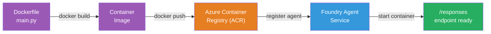
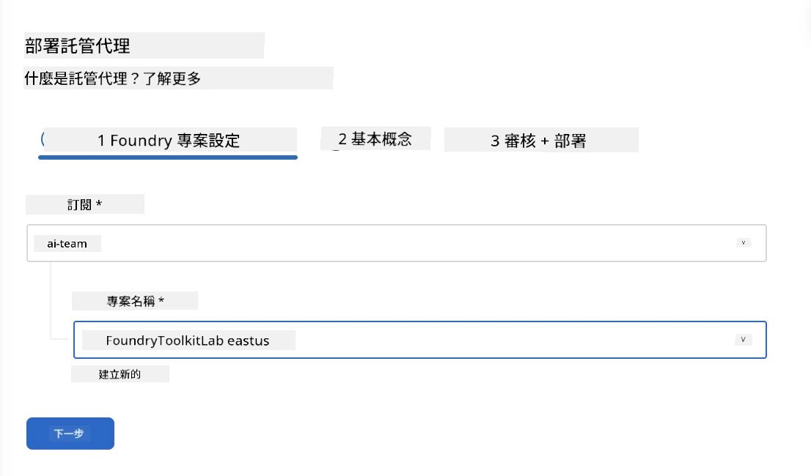
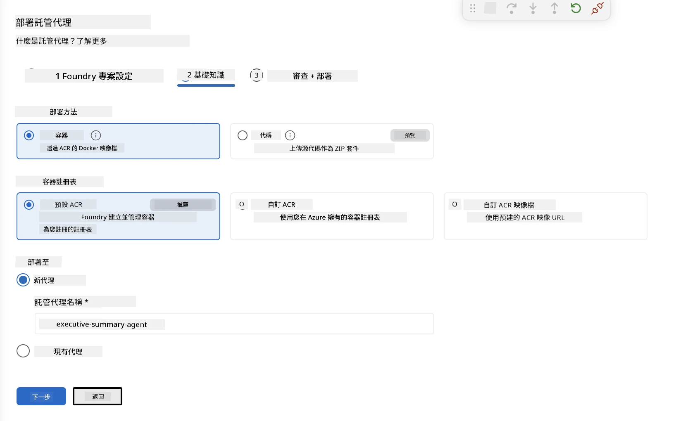
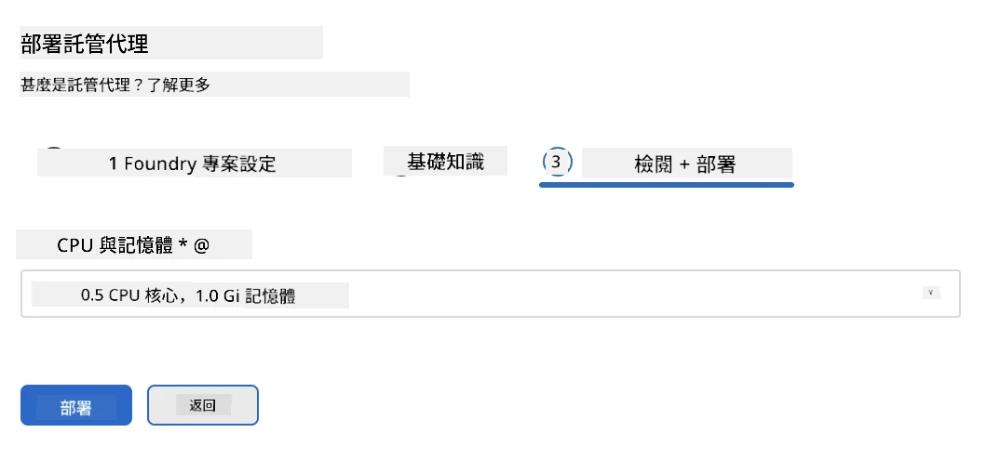
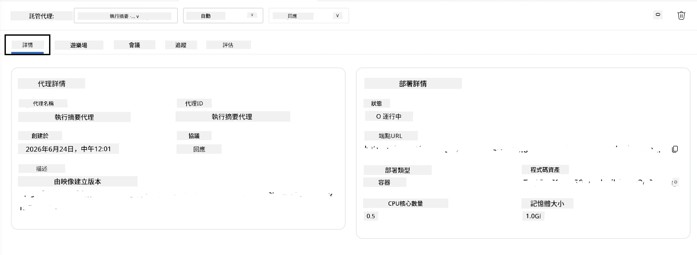

# 模組 5 - 部署到 Foundry Agent 服務

⏱️ 約 10 分鐘

> ⚠️ **路徑 B 用戶：** 本模組需要 Foundry 訂閱。如果您使用的是 Foundry Local，請跳至 [模組 07 - 摘要](07-summary.md)。您已成功完成本地開發工作流程！

在本模組中，您將本地測試的代理部署到 Microsoft Foundry 作為 <strong>託管代理</strong>。部署過程會建立容器映像，推送至 Azure Container Registry，並在 Foundry 的託管基礎架構中啟動代理。

### 部署流水線

---

## 先決條件檢查

在部署之前，請確認：

- [ ] 代理通過所有 3 個本地情景自 [Module 04](04-test-locally.md)
- [ ] 您於項目層級擁有 **Azure AI 使用者** 角色 ([Module 01, 指派 RBAC](01-setup.md#deploy-a-model--assign-rbac))
- [ ] 你已在 VS Code 中登入 Azure（帳戶圖示顯示你的名字）

---

## 步驟 1：開始部署

### 選項 A：從 Agent Inspector 部署（推薦）

如果 Agent Inspector 已開啟（從測試開始）：
1. 點擊右上角的 **Deploy** 按鈕（雲端圖示 ↑）。

### 選項 B：從命令面板部署

1. 按 `Ctrl+Shift+P` → **Foundry Toolkit: Deploy Hosted Agent**。

---

## 步驟 2：配置部署

精靈會提示你：

| 提示 | 選擇 |
|--------|-----------|
| <strong>訂閱</strong> | 您的 Azure 訂閱 |
| <strong>目標專案</strong> | 您的 Foundry 專案 (例如 `workshop-agents`) |

點擊 <strong>下一步</strong> 以設定您的代理程式。

| 提示 | 選擇 |
|--------|-----------|
| <strong>部署方式</strong> | 容器 |
| <strong>容器註冊中心</strong> | **預設 ACR** (Microsoft Foundry 會為您建立並管理一個) |
| <strong>部署至</strong> | 新代理程式 (名稱，`executive-summary-agent`) |

點擊 <strong>下一步</strong> 以檢閱並部署您的代理程式。

| 提示 | 選擇 |
|--------|-----------|
| **CPU 及記憶體** | **0.5 CPU 核心，1.0 Gi 記憶體**（預設值－足夠用於工作坊） |

---

## 第3步：部署及監察

1. 按 **Deploy**。
2. 觀看 **Output** 面板（從下拉選單選擇 **Microsoft Foundry**）。
3. 部署會經歷以下階段：
   - **Docker build** - 從你的 Dockerfile 建構容器
   - **Docker push** - 推送映像至 ACR（首次部署約需 1–3 分鐘）
   - **Agent registration** - 在 Foundry 創建託管代理
   - **Container start** - 以系統管理身份啟動

4. 完成時會出現通知：
   > **executive-summary-agent 已成功部署。** `View logs` `Run agent`

5. 按 **Run agent** 開啟 Agent Playground。

### 部署狀態值

| 狀態 | 意義 |
|--------|---------|
| **Running** | 容器準備就緒，代理運作中 |
| **Pending** | 容器啟動中 - 請等待 30–60 秒 |
| **Failed** | 檢查日誌（見以下故障排除） |

---

## 常見部署錯誤

| 錯誤 | 根本原因 | 解決方法 |
|-------|-----------|-----|
| `agents/write` 權限被拒 | 項目層級缺少 **Azure AI User** 角色 | [模組 01，指定 RBAC](01-setup.md#deploy-a-model--assign-rbac) |
| Docker 未運行 | Docker Desktop 未啟動 | 啟動 Docker Desktop → 驗證 `docker info` |
| ACR 授權 | 管理身分無法拉取映像檔 | 請參閱 [Module 08 - 故障排除](08-troubleshooting.md) |

---

### ✅ 核對清單

- [ ] 部署完成且無錯誤
- [ ] 點擊 Foundry Toolkit 側邊欄中專案下的 <strong>代理程式</strong>，在 <strong>託管代理程式</strong> 分頁出現代理程式
- [ ] 容器狀態顯示為 <strong>運行中</strong>
- [ ] 開啟代理程式遊樂場分頁，顯示代理程式詳細資料及端點 URL

---

**上一頁：** [04 - 本地測試](04-test-locally.md) · **下一頁：** [06 - 在遊樂場驗證 →](06-verify-in-playground.md)

---

<!-- CO-OP TRANSLATOR DISCLAIMER START -->
**免責聲明**：
本文件由 AI 翻譯服務 [Co-op Translator](https://github.com/Azure/co-op-translator) 翻譯而成。雖然我們致力於確保準確性，但請注意，機器自動翻譯可能包含錯誤或不準確之處。原始文件的母語版本應被視為權威來源。對於重要資訊，建議進行專業人工翻譯。我們不對因使用本翻譯而產生的任何誤解或誤釋承擔責任。
<!-- CO-OP TRANSLATOR DISCLAIMER END -->