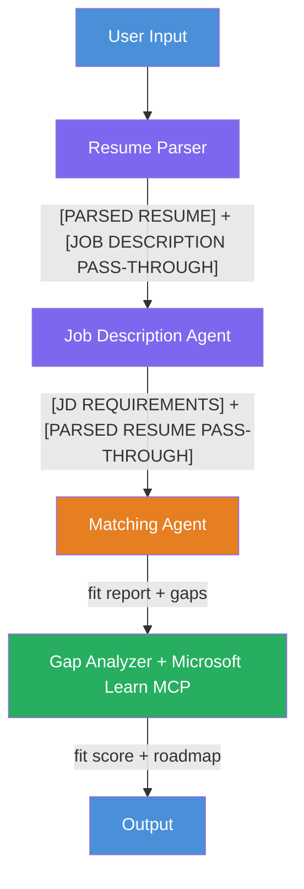

# 實驗室 02 - 多代理工作流程：履歷 → 職務適配評估器

## 概述

在這個實作實驗中，您將使用 VS Code 中的 Foundry Toolkit 建立一個<strong>以工作流程為先的多代理應用程式</strong>，並將其部署到 Microsoft Foundry Agent Service。

**您將構建的內容：** 一個履歷 → 職務適配評估器，能解析履歷和職務描述，評分匹配度，並使用 Microsoft Learn 資源生成個人化學習路線圖。

---

## 架構

**運作方式：**
1. 使用者貼上履歷和職務描述。
2. **ResumeParser** 解析履歷並將職務描述逐字複製到一個 `[JOB DESCRIPTION PASS-THROUGH]` 區段。
3. **JD Agent** 從傳遞內容中擷取結構化需求，然後將 `[PARSED RESUME]` 轉發成 `[PARSED RESUME PASS-THROUGH]`。
4. **MatchingAgent** 比較 `[PARSED RESUME PASS-THROUGH]` 與 `[JD REQUIREMENTS]` 並產生適配分數。
5. **GapAnalyzer** 將差距轉為實用路線圖，並透過 MCP 擷取 Microsoft Learn 的實際連結。

---

## 前置條件

請先完成實驗室 01：

- [實驗室 01 - 單一代理](../lab01-single-agent/README.md)

---

## 第一部分：依序閱讀模組

請參考完整學習路線：

- [實驗室 2 文件 - 前置條件](docs/00-prerequisites.md)
- [實驗室 2 文件 - 完整學習路線](docs/README.md)
- [PersonalCareerCopilot 使用指南](PersonalCareerCopilot/README.md)

---

## 第二部分：建立並測試工作流程

1. 使用 Foundry Toolkit 精靈建立基於工作流程的專案架構。
2. 從 `PersonalCareerCopilot/main.py` 複製提示區塊和工作流程圖至您的工作區。
3. 使用 Agent Inspector 在本機執行並驗證四個代理及 MCP 工具。
4. 本機測試通過後，將託管代理部署到 Foundry。

---

## 編排模式

實驗室 02 採用<strong>序列管線</strong>：每個代理的輸出作為下一個代理的輸入，工作流程回傳最後一個代理的回應。有兩種模式讓此流程運作：

- <strong>序列鏈</strong> - `WorkflowBuilder` 將 ResumeParser → JD Agent → MatchingAgent → GapAnalyzer 以每步一個 `add_edge()` 呼叫串起來
- <strong>內容中繼</strong> - 因為每個代理只能看到其直接前任代理的輸出，ResumeParser 和 JD Agent 將下游代理所需資料複製到有標籤的傳遞區段

文件中也解釋為何實驗不使用扇出/扇入，及如何用另一個代理擴充圖形。

請參考 [docs/04-orchestration-patterns.md](docs/04-orchestration-patterns.md)。

---

**上一步：** [實驗室 01 - 單一代理](../lab01-single-agent/README.md) · **返回：** [工作坊首頁](../../README.md)

---

<!-- CO-OP TRANSLATOR DISCLAIMER START -->
**免責聲明**：
本文件由 AI 翻譯服務 [Co-op Translator](https://github.com/Azure/co-op-translator) 翻譯而成。雖然我們致力於確保準確性，但請注意，機器自動翻譯可能包含錯誤或不準確之處。原始文件的母語版本應被視為權威來源。對於重要資訊，建議進行專業人工翻譯。我們不對因使用本翻譯而產生的任何誤解或誤釋承擔責任。
<!-- CO-OP TRANSLATOR DISCLAIMER END -->