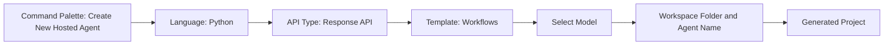
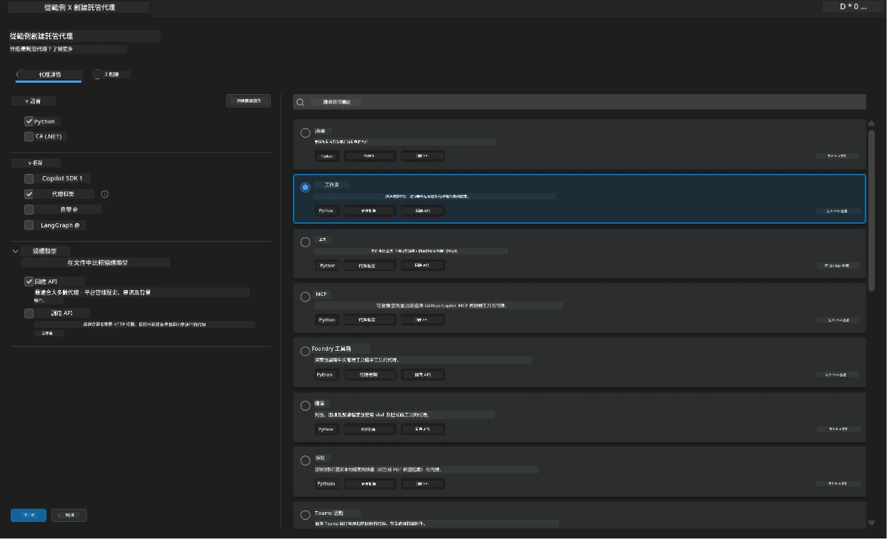
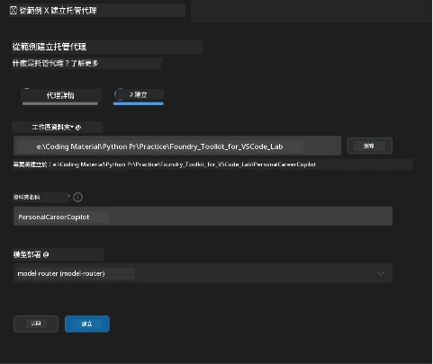

# 模組 2 - 組建多智能體專案骨架

⏱️ 約 5 分鐘

在本模組中，你將使用 [Foundry Toolkit for VS Code](https://aka.ms/foundrytk) 來<strong>搭建一個多智能體專案骨架</strong>。精靈會生成 `agent.yaml`、`main.py`、`Dockerfile`、`requirements.txt`、`.env` 以及 VS Code 偵錯配置，讓你可以專注於第 3 模組中的 4 智能體工作流程銜接。

> <strong>關鍵概念：</strong>骨架是一個帶有一個智能體的可工作的示範程式碼。你會在第 3 模組用 `WorkflowBuilder` 圖取代範例邏輯。你不需要從零開始撰寫樣板程式碼。

> **參考實作：** [`PersonalCareerCopilot/`](../../../../../workshop/lab02-multi-agent/PersonalCareerCopilot) 是一個完整可用的範例。可以用來與你的工作進度做比較。

### 骨架精靈流程



---

## 步驟 1：開啟「建立託管智能體」精靈

1. 按下 `Ctrl+Shift+P` 打開<strong>指令面板</strong>。
2. 輸入：**Foundry Toolkit: Create new Hosted Agent** 並選取它。
3. 精靈會在<strong>智能體詳細資料</strong>分頁開啟。

> <strong>替代方式：</strong>點擊活動列中的 **Foundry Toolkit** 圖示 → 點擊 <strong>託管智能體</strong> 旁的 **+** 圖示 → <strong>建立新的託管智能體</strong>。

---

## 步驟 2：選擇設定



1. 在左側導航與選項區域選擇以下項目：

| 選單 | 選擇 | 備註 |
|--------|-----------|-------|
| <strong>語言</strong> | Python | 也支援 C# (.NET) |
| <strong>框架</strong> | Agent Framework | 提供 `Agent`、`AgentExecutor`、`WorkflowBuilder` |
| **API 類型** | Response API | `POST /responses` - 平台管理歷史紀錄，支援串流 |
| <strong>範本</strong> | <strong>工作流程</strong> | 依序經過多個智能體處理請求 |

2. 選擇好後，按 <strong>下一步</strong>



3. 在下一個視窗，選擇以下項目：

| 選單 | 選擇 | 備註 |
|--------|-----------|-------|
| <strong>工作區資料夾</strong> | 瀏覽至目標資料夾 | 例如本倉庫中的 `workshop/lab02-multi-agent/` |
| <strong>智能體名稱</strong> | `PersonalCareerCopilot` | 這會成為專案資料夾名稱 |
| <strong>模型部署</strong> | 選擇你已部署模型 | 例如第 01 課的 `gpt-4.1-mini` |

4. 按 <strong>建立</strong> 生成骨架專案。VS Code 會建立檔案並開啟資料夾。

> **提示：** [`gpt-4.1-mini`](https://learn.microsoft.com/azure/foundry/foundry-models/concepts/models-sold-directly-by-azure#gpt-41-series) 在多智能體開發中，以速度與質量兼具而著稱。

---

## 步驟 3：檢查生成的專案

骨架生成完成後，請在檔案瀏覽器中確認以下檔案 (`Ctrl+Shift+E`)：

```
📂 <your-agent-name>/
├── .azdignore          ← Files excluded from Azure Developer CLI deployments
├── .dockerignore       ← Files excluded from Docker builds
├── .env                ← Environment variables (placeholders - fill in Module 3)
├── .vscode/
│   ├── launch.json     ← Debug config (F5 → run + Agent Inspector)
│   └── tasks.json      ← VS Code task definitions
├── agent.yaml          ← Agent definition (kind: hosted, protocol: responses)
├── Dockerfile          ← Container config for deployment
├── main.py             ← Stub agent entry point (replace with WorkflowBuilder in Module 3)
└── requirements.txt    ← Python dependencies
```

> **重要：** 請直接在 VS Code 中開啟此骨架資料夾，這樣 `.vscode/launch.json` 與 `tasks.json` 才能正確套用於 F5 偵錯。

### 重要檔案說明

| 檔案 | 作用 |
|------|---------|
| `agent.yaml` | 宣告 `kind: hosted`，映射環境變數，定義 `/responses` 協定 |
| `main.py` | 範例骨架：一個 `FoundryChatClient` → `Agent` → `ResponsesHostServer`。你會在第 3 模組替換為 4 個智能體 + `WorkflowBuilder` |
| `Dockerfile` | `python:3.12-slim`，安裝 `requirements.txt`，暴露 8088 埠口，運行 `python main.py` |
| `requirements.txt` | `agent-framework-foundry`、`agent-framework-foundry-hosting`、`mcp<2,>=1.24.0`、`debugpy` |

> **參考：** 完整生成內容，請見 [`PersonalCareerCopilot/agent.yaml`](../../../../../workshop/lab02-multi-agent/PersonalCareerCopilot/agent.yaml) 與 [`PersonalCareerCopilot/requirements.txt`](../../../../../workshop/lab02-multi-agent/PersonalCareerCopilot/requirements.txt)。

---

### ✅ 檢查點

- [ ] 已完成骨架精靈 - 專案新資料夾在檔案瀏覽器可見
- [ ] 預期檔案皆存在：`agent.yaml`、`main.py`、`Dockerfile`、`requirements.txt`、`.env`
- [ ] `agent.yaml` 顯示 `kind: hosted` 與 `protocol: responses`
- [ ] `main.py` 匯入 `Agent`、`FoundryChatClient`、`ResponsesHostServer`
- [ ] 骨架資料夾已開啟為 VS Code 工作區根目錄
- [ ] 了解 `main.py` 是範例骨架 - `WorkflowBuilder` 將在第 3 模組加入

---

**上一步：** [01 - 瞭解多智能體架構](01-understand-multi-agent.md) · **下一步：** [03 - 配置智能體與環境 →](03-configure-agents.md)

---

<!-- CO-OP TRANSLATOR DISCLAIMER START -->
**免責聲明**：
本文件由 AI 翻譯服務 [Co-op Translator](https://github.com/Azure/co-op-translator) 翻譯而成。雖然我們致力於確保準確性，但請注意，機器自動翻譯可能包含錯誤或不準確之處。原始文件的母語版本應被視為權威來源。對於重要資訊，建議進行專業人工翻譯。我們不對因使用本翻譯而產生的任何誤解或誤釋承擔責任。
<!-- CO-OP TRANSLATOR DISCLAIMER END -->