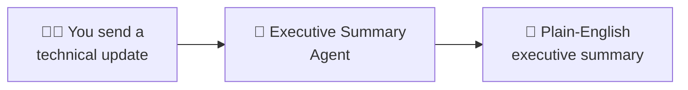

# 模組 0 - 介紹

⏱️ 約 10 分鐘

> [!WARNING]
> **預覽與限制：** [託管代理](https://learn.microsoft.com/azure/foundry/agents/concepts/hosted-agents) 目前處於 <strong>公開預覽</strong> 階段——不建議用於生產工作負載。請注意以下事項：
> - <strong>支援的區域有限</strong> ——在創建資源前請檢查 [區域可用性](https://learn.microsoft.com/azure/foundry/agents/concepts/hosted-agents#region-availability)。如果選擇不支持的區域，部署將失敗。
> - `agent-framework-foundry-hosting` 套件為預發布版——API 版本間可能會有所變動。
> - 規模限制：託管代理支援 0 到 5 個副本（包括縮減至零）。
> - 本研討會中展示的某些功能可能會隨服務進入一般可用（GA）階段而變動。

## 您將建立的內容

在本研討會中，您將建立一個 **「像和我講高層解說一樣」** 的代理——一個託管的 AI 代理，能將複雜的技術更新重新改寫成簡明的英文高管摘要。

**該代理使用：**
- **Microsoft 代理框架**——用於代理邏輯與結構
- **Foundry Toolkit for VS Code**——用於建立腳手架、本地測試及部署
- **AI 模型** (例如 `gpt-4.1-mini/gpt-5-mini`) - 用於生成摘要

在本實驗結束時，您將擁有一個可在本地透過 Agent Inspector 測試的運作代理，並可選擇部署到雲端。

---

## 甚麼是託管代理？

<strong>託管代理</strong> 是在 Microsoft Foundry 以託管服務方式運行的 AI 代理。您不需要管理自己的基礎設施，只需將代理程式碼封裝在容器中，由 Foundry 負責擴展、託管，並透過標準 HTTP 端點對外提供服務。

| 概念 | 意涵 |
|---------|--------------|
| <strong>代理</strong> | 您的 Python 程式碼，接收用戶訊息，調用 AI 模型，並回傳結構化回應 |
| <strong>託管</strong> | Foundry 代為執行您的容器 - 無需虛擬機器、Kubernetes，無需管理基礎設施 |
| <strong>回應協議</strong> | 一個標準 HTTP API (`POST /responses`)，任何用戶端皆可調用以與您的代理互動 |
| **Agent Inspector** | 一個本地測試介面（內建於 Foundry Toolkit），讓您於部署前與代理對話 |

在本工作坊中，您將從零開始建立一個完整的託管代理 — 若喜歡，也可以只進行本地測試就停止。

---

## 選擇您的路徑

> ⚠️ **請先選擇一條路徑再繼續。** 您的選擇決定要安裝哪些工具以及使用哪些模組。如後續獲得訂閱，您可從路徑 B → 路徑 A 轉換。

<strong>🅰️ 路徑 A - Azure 雲端 (需 Azure 訂閱)</strong>

| | 詳情 |
|---|---|
| **適用對象？** | 擁有有效 Azure 訂閱且可建立 Foundry 資源 |
| <strong>模型</strong> | 透過 Foundry 的 Azure OpenAI (例如 `gpt-4.1-mini/gpt-5-mini`) |
| <strong>涵蓋模組</strong> | 所有模組（00–07） |
| **是否部署至雲端？** | ✅ 是 - 完整端到端部署 |

<strong>🅱️ 路徑 B - 本地 / 免費方案 (無須 Azure 訂閱)</strong>

| | 詳情 |
|---|---|
| **適用對象？** | MVP、學生或任何無法使用 Azure 的人 |
| <strong>模型</strong> | **Foundry 本地版** (免費，在您機器上運行) |
| <strong>涵蓋模組</strong> | 模組 00–04（跳過部署及雲端驗證） |
| **是否部署至雲端？** | ❌ 否 — 僅可透過 Agent Inspector 本地測試 |

---

## 所有路徑：必備工具

安裝以下每個工具。安裝完成後，執行驗證指令以確認可正常運作。

| # | 工具 | 版本 | 安裝 | 驗證（預期輸出） |
|---|------|---------|---------|---------------------------|
| 1 | **Visual Studio Code** | 最新版 | [code.visualstudio.com](https://code.visualstudio.com/) | 無錯誤開啟 |
| 2 | **Python** | 3.12 或以上 | [python.org/downloads](https://www.python.org/downloads/) | `python --version` $\rightarrow$ `Python 3.12.x` |
| 3 | **Foundry Toolkit for VS Code** | 最新版 | 擴充 ID：`ms-windows-ai-studio.windows-ai-studio` | Activity Bar 顯示 Foundry 圖示 |
| 4 | **Python extension for VS Code** | 最新版 | 擴充 ID：`ms-python.python` | 擴充面板已安裝 |

> [!TIP]
> **安裝小技巧：**
> - **Python PATH (Windows)：** 在 Python 安裝程式的第一個畫面，務必勾選 **「Add Python to PATH」**。否則，終端機將無法識別 `python`。
> - **多版本 Python：** 若同時安裝 Python 3.10 與 3.12，請使用 `python3.12 -m venv .venv` 確保虛擬環境使用正確版本。
> - **Windows Docker WSL 2：** 安裝 Docker Desktop 時請選擇 **WSL 2 後端**。使用 Hyper-V 會較慢，也可能導致 Foundry 容器建置出問題。
> - **Docker 無法啟動？** 啟動 Docker Desktop 後請等待 30–60 秒。執行 `docker info`，若出現「Cannot connect to the Docker daemon」，表示 Docker 還在初始化。
> - **VS Code 擴充無法載入？** 安裝後請重新載入視窗：`Ctrl+Shift+P` → `Developer: Reload Window`。

> **Windows 使用者：** 請在安裝 Python 時勾選 **「Add Python to PATH」**。

**下一步：** [01 - 設定 →](01-setup.md)

---

<!-- CO-OP TRANSLATOR DISCLAIMER START -->
**免責聲明**：
本文件使用 AI 翻譯服務 [Co-op Translator](https://github.com/Azure/co-op-translator) 進行翻譯。雖然我們力求準確，但請注意，自動翻譯可能包含錯誤或不準確之處。原始文件的母語版本應被視為權威來源。對於重要資訊，建議尋求專業人工翻譯。我們不對因使用本翻譯而引起的任何誤解或曲解承擔責任。
<!-- CO-OP TRANSLATOR DISCLAIMER END -->