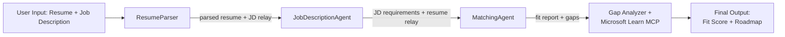

# PersonalCareerCopilot - 履歷表 → 職位符合度評估器

一個以工作流程為先的多代理應用程式，用於評估履歷表與職位描述的匹配程度，然後生成個人化的學習路線圖以彌補差距。

---

## 代理

| 代理 | 角色 | 工具 |
|-------|------|-------|
| **ResumeParser** | 從履歷文本中提取結構化的技能、經驗、證書 | - |
| **JobDescriptionAgent** | 從職位描述中提取必備/偏好技能、經驗、證書 | - |
| **MatchingAgent** | 比較履歷與需求 → 符合度分數 (0-100) + 匹配/缺失技能 | - |
| **GapAnalyzer** | 建立個人化學習路線圖並提供 Microsoft Learn 資源 | `search_microsoft_learn_for_plan` (MCP) |

## 工作流程



---

## 快速開始

### 1. 設定環境

此資料夾為基於工作流程的實驗室 02 範例實作。其 `main.py` 使用既有提示區塊加上 `WorkflowBuilder` 以串聯四個代理。

```powershell
cd workshop\lab02-multi-agent\PersonalCareerCopilot
python -m venv .venv
.\.venv\Scripts\Activate.ps1          # Windows PowerShell
# source .venv/bin/activate            # macOS / Linux
pip install -r requirements.txt
```

### 2. 配置憑證

在此資料夾中建立一個 `.env` 檔案：

```powershell
copy .env .env.bak 2>$null; echo $null > .env
```

編輯 `.env`：

```env
FOUNDRY_PROJECT_ENDPOINT=https://<your-account>.services.ai.azure.com/api/projects/<your-project>
AZURE_AI_MODEL_DEPLOYMENT_NAME=gpt-4.1-mini
```

| 值 | 取得位置 |
|-------|------------------|
| `FOUNDRY_PROJECT_ENDPOINT` | Foundry 工具箱側欄 → 對專案點擊右鍵 → <strong>複製專案端點</strong> |
| `AZURE_AI_MODEL_DEPLOYMENT_NAME` | Foundry 側欄 → 展開專案 → **模型 + 端點** → 部署名稱 |

### 3. 本地執行

```powershell
python -m debugpy --listen 127.0.0.1:5679 main.py --port 8088
```

或使用 VS Code 任務：`Ctrl+Shift+P` → **Tasks: Run Task** → **啟動代理 HTTP 服務**。

若使用 F5 偵錯，請使用 **偵錯本地代理 HTTP 服務**。

### 4. 使用 Agent Inspector 測試

開啟 Agent Inspector：`Ctrl+Shift+P` → **Foundry 工具箱：開啟 Agent Inspector**。

貼上此測試提示：

```
Resume:
Jane Doe
Senior Software Engineer with 5 years of experience in Python, Django, and AWS.
Built microservices handling 10K+ requests/second. Led a team of 4 developers.
Certifications: AWS Solutions Architect Associate.
Education: B.S. Computer Science, State University.

Job Description:
Senior Cloud Engineer at Contoso Ltd.
Required: Python, Azure, Kubernetes, Terraform, CI/CD pipelines.
Preferred: Go, monitoring (Prometheus/Grafana), cost optimization.
Experience: 5+ years in cloud infrastructure.
Certifications: Azure Solutions Architect Expert preferred.
```

**預期結果：** 符合度分數 (0-100)、匹配/缺失技能，以及含 Microsoft Learn 網址的個人化學習路線圖。

### 5. 部署至 Foundry

`Ctrl+Shift+P` → **Foundry 工具箱：部署託管代理** → 選擇專案 → 確認。

---

## 專案結構

```
PersonalCareerCopilot/
├── .env                ← Your credentials (git-ignored)
├── agent.yaml          ← Hosted agent definition (name, resources, env vars)
├── Dockerfile          ← Container image for Foundry deployment
├── main.py             ← 4-agent workflow (instructions, MCP tool, WorkflowBuilder)
└── requirements.txt    ← Python dependencies
```

## 主要檔案

### `agent.yaml`

定義 Foundry 代理服務的託管代理：
- `kind: hosted` - 以受管容器形式運行
- `protocols` - 使用 `responses` 協議與 `version: 2.0.0`，暴露 `/responses` HTTP 端點
- `environment_variables` - 在此宣告 `AZURE_AI_MODEL_DEPLOYMENT_NAME`；`FOUNDRY_PROJECT_ENDPOINT` 會在部署時自動注入

### `main.py`

包含：
- <strong>代理指令</strong> - 四個 `*_INSTRUCTIONS` 常數，分別對應四個代理
- **MCP 工具** - `search_microsoft_learn_for_plan()` 以串流 HTTP 調用 `https://learn.microsoft.com/api/mcp`
- <strong>代理建立</strong> - 四個 `Agent()` 與 `AgentExecutor()` 實例共用一個 `FoundryChatClient`
- <strong>工作流程圖</strong> - `WorkflowBuilder` 將代理依序串接：ResumeParser → JD Agent → MatchingAgent → GapAnalyzer
- <strong>伺服器啟動</strong> - `ResponsesHostServer` 在 8088 埠運行

### `requirements.txt`

| 套件 | 目的 |
|---------|----------|
| `agent-framework-foundry` | 核心執行時：`Agent`、`AgentExecutor`、`WorkflowBuilder`、`@tool`、`FoundryChatClient` |
| `agent-framework-foundry-hosting` | `ResponsesHostServer` 與 Foundry 託管整合 |
| `mcp<2,>=1.24.0` | GapAnalyzer 的 MCP 用戶端 (`streamable_http_client`) |
| `debugpy` | Python 偵錯 (VS Code 中 F5) |

---

## 疑難排解

| 問題 | 解決方式 |
|-------|-----|
| `KeyError: 'FOUNDRY_PROJECT_ENDPOINT'` 或 `KeyError: 'AZURE_AI_MODEL_DEPLOYMENT_NAME'` | 建立 `.env` 且同時設置 `FOUNDRY_PROJECT_ENDPOINT` 和 `AZURE_AI_MODEL_DEPLOYMENT_NAME` |
| `ModuleNotFoundError: No module named 'agent_framework'` | 啟用 venv 並執行 `pip install -r requirements.txt` |
| 輸出中無 Microsoft Learn 網址 | 檢查網路連線至 `https://learn.microsoft.com/api/mcp` |
| 只顯示 1 張 gap 卡片 (截斷) | 確認 `GAP_ANALYZER_INSTRUCTIONS` 包含 `CRITICAL:` 區塊 |
| 8088 埠被占用 | 停用其他伺服器：`netstat -ano \| findstr :8088` |

詳細疑難排解，請參考 [Module 8 - Troubleshooting](../docs/08-troubleshooting.md)。

---

**完整操作步驟：** [Lab 02 文件](../docs/README.md) · **返回：** [Lab 02 自述檔](../README.md) · [工作坊首頁](../../../README.md)

---

<!-- CO-OP TRANSLATOR DISCLAIMER START -->
**免責聲明**：
本文件使用 AI 翻譯服務 [Co-op Translator](https://github.com/Azure/co-op-translator) 進行翻譯。雖然我們力求準確，但請注意，自動翻譯可能包含錯誤或不準確之處。原始文件的母語版本應被視為權威來源。對於重要資訊，建議尋求專業人工翻譯。我們不對因使用本翻譯而引起的任何誤解或曲解承擔責任。
<!-- CO-OP TRANSLATOR DISCLAIMER END -->