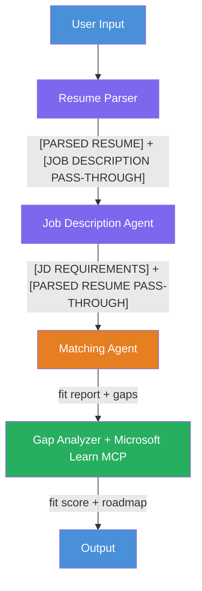

# 實驗室 02 - 多代理工作流程：履歷 → 工作適配評估器

## 概觀

在這個實作實驗中，您將使用 VS Code 中的 Foundry Toolkit 建立一個 <strong>工作流程優先的多代理應用程式</strong>，並部署到 Microsoft Foundry Agent Service。

**您將建立的內容：** 一個履歷 → 工作適配評估器，能解析履歷與工作描述，評分匹配度，並使用 Microsoft Learn 資源產生個人化學習路線圖。

---

## 架構

**運作方式：**
1. 使用者貼上履歷與工作描述。
2. **ResumeParser** 解析履歷並將工作描述逐字複製到 `[JOB DESCRIPTION PASS-THROUGH]` 區段。
3. **JD Agent** 從傳遞過來的資料中擷取結構化需求，再將 `[PARSED RESUME]` 以 `[PARSED RESUME PASS-THROUGH]` 形式轉發。
4. **MatchingAgent** 比對 `[PARSED RESUME PASS-THROUGH]` 與 `[JD REQUIREMENTS]` 並產生適配分數。
5. **GapAnalyzer** 將差距轉換成實用路線圖，並透過 MCP 抓取 Microsoft Learn 的實際連結。

---

## 先決條件

請先完成實驗室 01：

- [實驗室 01 - 單一代理](../lab01-single-agent/README.md)

---

## 第一部分：按順序閱讀模組

查看完整學習路徑：

- [實驗室 2 文件 - 先決條件](docs/00-prerequisites.md)
- [實驗室 2 文件 - 完整學習路徑](docs/README.md)
- [PersonalCareerCopilot 運行指南](PersonalCareerCopilot/README.md)

---

## 第二部分：建立並測試工作流程

1. 使用 Foundry Toolkit 精靈搭建以工作流程為基礎的專案。
2. 從 `PersonalCareerCopilot/main.py` 複製提示區塊和工作流程圖到您的工作區。
3. 使用 Agent Inspector 在本機運行，並驗證所有四個代理及 MCP 工具。
4. 當本機測試通過後，部署托管代理到 Foundry。

---

## 編排模式

實驗室 02 使用 <strong>序列管線</strong>：每個代理的輸出作為下一個代理的輸入，工作流程回傳最後一個代理的回覆。有兩個模式促成此運作：

- <strong>序列鏈</strong> - `WorkflowBuilder` 接連 ResumeParser → JD Agent → MatchingAgent → GapAnalyzer，每步驟只呼叫一次 `add_edge()`
- <strong>內容轉發</strong> - 因為每個代理只看到直接前驅的輸出，ResumeParser 和 JD Agent 將下游代理所需的資料複製到標記的傳遞區段

文件也說明為何本實驗室不使用放射/匯聚模式，以及如何新增另一個代理擴展圖形。

請參考 [docs/04-orchestration-patterns.md](docs/04-orchestration-patterns.md)。

---

**上一篇：** [實驗室 01 - 單一代理](../lab01-single-agent/README.md) · **回到：** [工作坊首頁](../../README.md)

---

<!-- CO-OP TRANSLATOR DISCLAIMER START -->
**免責聲明**：
本文件使用 AI 翻譯服務 [Co-op Translator](https://github.com/Azure/co-op-translator) 進行翻譯。雖然我們力求準確，但請注意，自動翻譯可能包含錯誤或不準確之處。原始文件的母語版本應被視為權威來源。對於重要資訊，建議尋求專業人工翻譯。我們不對因使用本翻譯而引起的任何誤解或曲解承擔責任。
<!-- CO-OP TRANSLATOR DISCLAIMER END -->