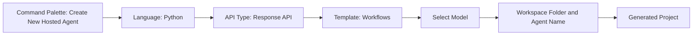
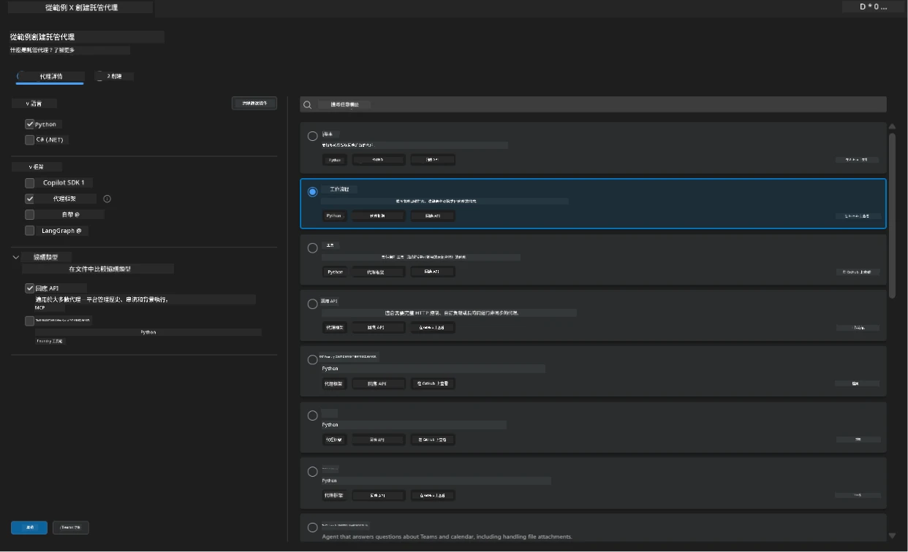
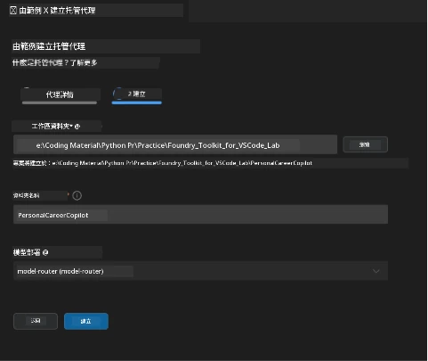

# 模組 2 - 建立多代理專案骨架

⏱️ ~5 分鐘

在本模組中，您將使用 [Foundry Toolkit for VS Code](https://aka.ms/foundrytk) 來 <strong>建立一個多代理專案的腳手架</strong>。精靈會生成 `agent.yaml`、`main.py`、`Dockerfile`、`requirements.txt`、`.env` 和 VS Code 除錯配置，讓您可以專注於第 3 模組中 4 代理的工作流程接線。

> **關鍵概念：** 腳手架是一個包含一個代理的工作範例。您會在第 3 模組中以 `WorkflowBuilder` 圖取代佔位邏輯。您不需要從零開始撰寫樣板程式碼。

> **參考實作：** [`PersonalCareerCopilot/`](../../../../../workshop/lab02-multi-agent/PersonalCareerCopilot) 是一個完整的工作範例。您可以用它來隨時比對自己的工作成果。

### 腳手架精靈流程



---

## 步驟 1：開啟建立託管代理精靈

1. 按下 `Ctrl+Shift+P` 打開 <strong>命令面板</strong>。
2. 輸入：**Foundry Toolkit: Create new Hosted Agent** 並選擇它。
3. 精靈會開啟到 <strong>代理詳情</strong> 頁籤。

> **替代方法：** 點擊活動列中的 **Foundry Toolkit** 圖示 → 點擊 **Hosted Agents** 旁的 **+** 圖示 → **Create New Hosted Agent**。

---

## 步驟 2：選擇設定



1. 在左側導航/選項區域選擇以下內容：

| 選單 | 選擇 | 備註 |
|--------|-----------|-------|
| <strong>語言</strong> | Python | 也支援 C# (.NET) |
| <strong>框架</strong> | Agent Framework | 提供 `Agent`、`AgentExecutor`、`WorkflowBuilder` |
| **API 類型** | Response API | `POST /responses` - 平台管理歷史紀錄，支援串流 |
| <strong>範本</strong> | **Workflows** | 讓多個代理依序處理請求 |

2. 選好後，點擊 <strong>下一步</strong>



3. 在下一個視窗中，選擇以下內容：

| 選單 | 選擇 | 備註 |
|--------|-----------|-------|
| <strong>工作區資料夾</strong> | 瀏覽至目標資料夾 | 例如本倉庫中的 `workshop/lab02-multi-agent/` |
| <strong>代理名稱</strong> | `PersonalCareerCopilot` | 這將成為專案資料夾名稱 |
| <strong>模型部署</strong> | 選擇您部署的模型 | 例如實驗室 01 的 `gpt-4.1-mini` |

4. 點擊 <strong>建立</strong> 以建立專案腳手架。VS Code 會生成檔案並開啟資料夾。

> **提示：** [`gpt-4.1-mini`](https://learn.microsoft.com/azure/foundry/foundry-models/concepts/models-sold-directly-by-azure#gpt-41-series) 在多代理開發中平衡了速度與品質。

---

## 步驟 3：檢視生成的專案

腳手架建立完成後，確認檔案總管中看到這些檔案 (`Ctrl+Shift+E`)：

```
📂 <your-agent-name>/
├── .azdignore          ← Files excluded from Azure Developer CLI deployments
├── .dockerignore       ← Files excluded from Docker builds
├── .env                ← Environment variables (placeholders - fill in Module 3)
├── .vscode/
│   ├── launch.json     ← Debug config (F5 → run + Agent Inspector)
│   └── tasks.json      ← VS Code task definitions
├── agent.yaml          ← Agent definition (kind: hosted, protocol: responses)
├── Dockerfile          ← Container config for deployment
├── main.py             ← Stub agent entry point (replace with WorkflowBuilder in Module 3)
└── requirements.txt    ← Python dependencies
```

> **重要：** 請直接在 VS Code 中開啟此腳手架資料夾，以確保 `.vscode/launch.json` 和 `tasks.json` 能正確套用，方便使用 F5 除錯。

### 主要檔案說明

| 檔案 | 作用 |
|------|---------|
| `agent.yaml` | 宣告 `kind: hosted`，映射環境變數，定義 `/responses` 協定 |
| `main.py` | 範例：一個 `FoundryChatClient` → `Agent` → `ResponsesHostServer`。您會在第 3 模組以 4 代理加上 `WorkflowBuilder` 取代它 |
| `Dockerfile` | `python:3.12-slim`，安裝 `requirements.txt`，開放 8088 埠口，執行 `python main.py` |
| `requirements.txt` | `agent-framework-foundry`、`agent-framework-foundry-hosting`、`mcp<2,>=1.24.0`、`debugpy` |

> **參考：** 請參閱 [`PersonalCareerCopilot/agent.yaml`](../../../../../workshop/lab02-multi-agent/PersonalCareerCopilot/agent.yaml) 和 [`PersonalCareerCopilot/requirements.txt`](../../../../../workshop/lab02-multi-agent/PersonalCareerCopilot/requirements.txt) 了解完整生成內容。

---

### ✅ 檢核點

- [ ] 腳手架精靈完成 - 新專案資料夾可在檔案總管中看到
- [ ] 所有預期檔案齊全：`agent.yaml`、`main.py`、`Dockerfile`、`requirements.txt`、`.env`
- [ ] `agent.yaml` 顯示 `kind: hosted` 和 `protocol: responses`
- [ ] `main.py` 匯入 `Agent`、`FoundryChatClient`、`ResponsesHostServer`
- [ ] 以 VS Code 工作區根目錄開啟腳手架資料夾
- [ ] 您了解 `main.py` 是範例 - 第 3 模組會新增 `WorkflowBuilder`

---

**上一節：** [01 - 了解多代理架構](01-understand-multi-agent.md) · **下一節：** [03 - 配置代理及環境 →](03-configure-agents.md)

---

<!-- CO-OP TRANSLATOR DISCLAIMER START -->
**免責聲明**：
本文件使用 AI 翻譯服務 [Co-op Translator](https://github.com/Azure/co-op-translator) 進行翻譯。雖然我們力求準確，但請注意，自動翻譯可能包含錯誤或不準確之處。原始文件的母語版本應被視為權威來源。對於重要資訊，建議尋求專業人工翻譯。我們不對因使用本翻譯而引起的任何誤解或曲解承擔責任。
<!-- CO-OP TRANSLATOR DISCLAIMER END -->