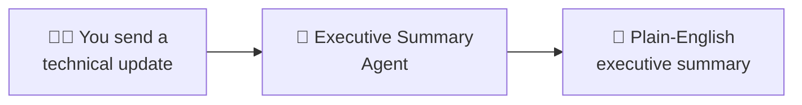

# 模組 0 - 介紹

⏱️ 約 10 分鐘

> [!WARNING]
> **預覽與限制：** [託管代理](https://learn.microsoft.com/azure/foundry/agents/concepts/hosted-agents) 目前處於 <strong>公開預覽</strong> 階段，不建議用於生產工作負載。請注意以下事項：
> - <strong>支援的地區有限</strong> — 在建立資源之前請先檢查 [地區可用性](https://learn.microsoft.com/azure/foundry/agents/concepts/hosted-agents#region-availability)。若選擇不支援的地區，部署將會失敗。
> - `agent-framework-foundry-hosting` 套件為預發布版本 — API 可能會在不同版本間變動。
> - 規模限制：託管代理支援 0–5 個複本（包括縮放到零）。
> - 本工作坊展示的部分功能可能會隨著服務邁向正式版而變更。

## 你將建立的東西

在本工作坊中，你將建立一個 **「以執行長口吻說明」** 代理 — 一個託管的 AI 代理，能將複雜的技術更新改寫成簡明易懂的執行長摘要。

**該代理使用：**
- **Microsoft Agent Framework** — 用於代理的邏輯與結構
- **Foundry Toolkit for VS Code** — 用於建立架構、本地測試與部署
- **一個 AI 模型** (例如 `gpt-4.1-mini/gpt-5-mini`) - 用於生成摘要

在本實驗結束時，您將擁有一個可運作的代理，您可以透過代理檢查器在本地進行測試，並可選擇部署到雲端。

---

## 什麼是託管代理？

<strong>託管代理</strong> 是一種在 Microsoft Foundry 中作為管理服務運行的 AI 代理。您不需自行管理基礎設施，而是將代理程式碼打包到容器中，由 Foundry 負責擴展、託管，並透過標準 HTTP 端點公開。

| 概念 | 含義 |
|---------|--------------|
| <strong>代理</strong> | 您的 Python 程式碼，接收使用者訊息，呼叫 AI 模型，並回傳結構化的回應 |
| <strong>託管</strong> | Foundry 幫您運行容器 - 無需虛擬機、無需 Kubernetes、無需管理基礎設施 |
| <strong>回應協定</strong> | 任何用戶端皆可呼叫的標準 HTTP API (`POST /responses`)，用來與您的代理互動 |
| <strong>代理檢視器</strong> | 本地測試 UI（整合在 Foundry Toolkit 中），讓您在部署前和代理對話 |

在這個工作坊中，您將從零開始建立一個完全托管的代理——或者如果您願意，可以停在本地測試階段。

---

## 選擇您的路徑

> ⚠️ **在繼續之前請選擇一條路徑。** 您的選擇將決定需要安裝的工具以及適用的模組。如果您獲得訂閱，可以稍後從路徑B → 路徑A切換。

<strong>🅰️ 路徑 A - Azure 雲端（需要 Azure 訂閱）</strong>

| | 詳細資訊 |
|---|---|
| **這份文件適合誰？** | 您有一個有效的 Azure 訂閱，並能夠建立 Foundry 資源 |
| <strong>模型</strong> | 透過 Foundry 的 Azure OpenAI (例如 `gpt-4.1-mini/gpt-5-mini`) |
| <strong>涵蓋模組</strong> | 所有模組 (00–07) |
| **部署到雲端？** | ✅ 是 - 完整端對端部署 |

<strong>🅱️ 路徑 B - 本地 / 免費方案（不需要 Azure 訂閱）</strong>

| | 詳細資訊 |
|---|---|
| **這適合誰？** | MVP、學生或任何沒有 Azure 存取權的人 |
| <strong>模型</strong> | **Foundry Local**（免費，在您的機器上運行） |
| <strong>涵蓋模組</strong> | 模組 00–04（跳過部署與雲端驗證） |
| **部署到雲端？** | ❌ 不—僅透過 Agent Inspector 進行本機測試 |

---

## 所有路徑：必要工具

安裝以下每個工具。安裝完成後，透過執行檢查指令確認其是否運作正常。

| # | 工具 | 版本 | 安裝 | 驗證（預期輸出） |
|---|------|---------|---------|---------------------------|
| 1 | **Visual Studio Code** | 最新版 | [code.visualstudio.com](https://code.visualstudio.com/) | 開啟時無錯誤 |
| 2 | **Python** | 3.12 或以上 | [python.org/downloads](https://www.python.org/downloads/) | `python --version` $\rightarrow$ `Python 3.12.x` |
| 3 | **VS Code 的 Foundry 工具包** | 最新 | 擴充套件 ID：`ms-windows-ai-studio.windows-ai-studio` | 活動列中的 Foundry 圖示 |
| 4 | **VS Code 的 Python 擴充套件** | 最新 | 擴充套件 ID：`ms-python.python` | 已安裝於擴充套件面板 |

> [!TIP]
> **安裝專家提示：**
> - **Python 路徑 (Windows):** 在 Python 安裝程式的第一個畫面務必勾選 **「將 Python 加入 PATH」**。若未勾選，終端機將無法識別 `python`。
> - **多個 Python 版本：** 如果電腦同時安裝 Python 3.10 和 3.12，請使用 `python3.12 -m venv .venv` 以確保虛擬環境使用正確的版本。
> - **Docker WSL 2 (Windows)：** 安裝 Docker Desktop 時，請確認選擇 **WSL 2 後端**。使用 Hyper-V 的 Docker 速度較慢，且可能導致 Foundry 容器建置出問題。
> - **Docker 無法啟動？** 啟動 Docker Desktop 後，請等待 30–60 秒。執行 `docker info` - 如果看到「無法連接到 Docker daemon」訊息，表示 Docker 正在初始化中。
> - **VS Code 擴充功能無法載入？** 安裝擴充功能後，重新載入視窗：`Ctrl+Shift+P` → `Developer: Reload Window`。

> **Windows 使用者：** 安裝 Python 時請勾選 **「將 Python 加入 PATH」**。

**接下來：** [01 - 安裝設定 →](01-setup.md)

---

<!-- CO-OP TRANSLATOR DISCLAIMER START -->
**免責聲明**：
此文件已使用 AI 翻譯服務 [Co-op Translator](https://github.com/Azure/co-op-translator) 進行翻譯。雖然我們努力追求準確性，但請注意自動翻譯可能包含錯誤或不準確之處。原始文件的母語版本應視為權威來源。對於關鍵資訊，建議採用專業人工翻譯。我們不對因使用此翻譯所產生的任何誤解或誤譯承擔責任。
<!-- CO-OP TRANSLATOR DISCLAIMER END -->