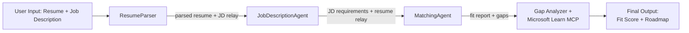

# PersonalCareerCopilot - 履歷 → 職務匹配評估器

一個以工作流程為優先的多代理應用程式，用於評估履歷與職務描述的匹配度，並生成個人化的學習路線圖以彌補差距。

---

## 代理人

| 代理人 | 角色 | 工具 |
|-------|------|-------|
| **ResumeParser** | 從履歷文字提取結構化技能、經驗、證照 | - |
| **JobDescriptionAgent** | 從職務描述提取必需/偏好技能、經驗、證照 | - |
| **MatchingAgent** | 比較個人檔案與職務需求 → 匹配分數 (0-100) + 匹配/缺失技能 | - |
| **GapAnalyzer** | 使用 Microsoft Learn 資源建立個人化學習路線圖 | `search_microsoft_learn_for_plan` (MCP) |

## 工作流程



---

## 快速開始

### 1. 設定環境

此資料夾為以工作流程為基礎的 Lab 02 骨架參考實作。它的 `main.py` 使用現有的提示區塊加上 `WorkflowBuilder` 將四個代理人串接起來。

```powershell
cd workshop\lab02-multi-agent\PersonalCareerCopilot
python -m venv .venv
.\.venv\Scripts\Activate.ps1          # Windows PowerShell
# source .venv/bin/activate            # macOS / Linux
pip install -r requirements.txt
```

### 2. 配置認證

在此資料夾建立一個 `.env` 檔案：

```powershell
copy .env .env.bak 2>$null; echo $null > .env
```

編輯 `.env`：

```env
FOUNDRY_PROJECT_ENDPOINT=https://<your-account>.services.ai.azure.com/api/projects/<your-project>
AZURE_AI_MODEL_DEPLOYMENT_NAME=gpt-4.1-mini
```

| 值 | 取得位置 |
|-------|------------------|
| `FOUNDRY_PROJECT_ENDPOINT` | Foundry Toolkit 側邊欄 → 右鍵點選專案 → <strong>複製專案端點</strong> |
| `AZURE_AI_MODEL_DEPLOYMENT_NAME` | Foundry 側邊欄 → 展開專案 → **模型 + 端點** → 部署名稱 |

### 3. 本機執行

```powershell
python -m debugpy --listen 127.0.0.1:5679 main.py --port 8088
```

或使用 VS Code 工作：`Ctrl+Shift+P` → **任務：執行任務** → **執行代理人 HTTP 伺服器**。

F5 除錯時，使用 **除錯本地代理人 HTTP 伺服器**。

### 4. 使用 Agent Inspector 測試

開啟 Agent Inspector：`Ctrl+Shift+P` → **Foundry Toolkit：開啟 Agent Inspector**。

貼上此測試提示：

```
Resume:
Jane Doe
Senior Software Engineer with 5 years of experience in Python, Django, and AWS.
Built microservices handling 10K+ requests/second. Led a team of 4 developers.
Certifications: AWS Solutions Architect Associate.
Education: B.S. Computer Science, State University.

Job Description:
Senior Cloud Engineer at Contoso Ltd.
Required: Python, Azure, Kubernetes, Terraform, CI/CD pipelines.
Preferred: Go, monitoring (Prometheus/Grafana), cost optimization.
Experience: 5+ years in cloud infrastructure.
Certifications: Azure Solutions Architect Expert preferred.
```

**預期結果：** 一個匹配分數 (0-100)、匹配/缺失技能，及附有 Microsoft Learn 網址的個人化學習路線圖。

### 5. 部署到 Foundry

`Ctrl+Shift+P` → **Foundry Toolkit：部署托管代理人** → 選擇您的專案 → 確認。

---

## 專案結構

```
PersonalCareerCopilot/
├── .env                ← Your credentials (git-ignored)
├── agent.yaml          ← Hosted agent definition (name, resources, env vars)
├── Dockerfile          ← Container image for Foundry deployment
├── main.py             ← 4-agent workflow (instructions, MCP tool, WorkflowBuilder)
└── requirements.txt    ← Python dependencies
```

## 主要檔案

### `agent.yaml`

定義 Foundry Agent Service 的托管代理人：
- `kind: hosted` - 以受管理容器方式執行
- `protocols` - 使用 `responses` 協定與 `version: 2.0.0`，暴露 `/responses` HTTP 端點
- `environment_variables` - 在此宣告 `AZURE_AI_MODEL_DEPLOYMENT_NAME`； `FOUNDRY_PROJECT_ENDPOINT` 在部署時自動注入

### `main.py`

包含：
- <strong>代理人指令</strong> - 四個 `*_INSTRUCTIONS` 常數，每個代理人一個
- **MCP 工具** - `search_microsoft_learn_for_plan()` 通過 Streamable HTTP 呼叫 `https://learn.microsoft.com/api/mcp`
- <strong>代理人建立</strong> - 四個 `Agent()` + `AgentExecutor()` 實例，共用一個 `FoundryChatClient`
- <strong>工作流程圖</strong> - `WorkflowBuilder` 將代理串接為順序管線：ResumeParser → JD Agent → MatchingAgent → GapAnalyzer
- <strong>伺服器啟動</strong> - `ResponsesHostServer` 運行於 8088 埠口

### `requirements.txt`

| 套件 | 用途 |
|---------|----------|
| `agent-framework-foundry` | 核心執行時：`Agent`、`AgentExecutor`、`WorkflowBuilder`、`@tool`、`FoundryChatClient` |
| `agent-framework-foundry-hosting` | `ResponsesHostServer` + Foundry 托管整合 |
| `mcp<2,>=1.24.0` | GapAnalyzer 的 MCP 用戶端 (`streamable_http_client`) |
| `debugpy` | Python 除錯 (VS Code 中按 F5) |

---

## 疑難排解

| 問題 | 解決方法 |
|-------|-----|
| `KeyError: 'FOUNDRY_PROJECT_ENDPOINT'` 或 `KeyError: 'AZURE_AI_MODEL_DEPLOYMENT_NAME'` | 創建 `.env`，同時設定 `FOUNDRY_PROJECT_ENDPOINT` 和 `AZURE_AI_MODEL_DEPLOYMENT_NAME` |
| `ModuleNotFoundError: No module named 'agent_framework'` | 啟動 venv 並執行 `pip install -r requirements.txt` |
| 輸出中沒有 Microsoft Learn 連結 | 檢查與 `https://learn.microsoft.com/api/mcp` 的網路連線 |
| 僅有 1 張空白卡片 (已截斷) | 驗證 `GAP_ANALYZER_INSTRUCTIONS` 是否包含 `CRITICAL:` 模組 |
| 8088 埠口被占用 | 停止其他伺服器：`netstat -ano \| findstr :8088` |

詳細的疑難排解，請參閱 [Module 8 - Troubleshooting](../docs/08-troubleshooting.md)。

---

**完整操作指南：** [Lab 02 Docs](../docs/README.md) · **回到：** [Lab 02 README](../README.md) · [Workshop Home](../../../README.md)

---

<!-- CO-OP TRANSLATOR DISCLAIMER START -->
**免責聲明**：
此文件已使用 AI 翻譯服務 [Co-op Translator](https://github.com/Azure/co-op-translator) 進行翻譯。雖然我們努力追求準確性，但請注意自動翻譯可能包含錯誤或不準確之處。原始文件的母語版本應視為權威來源。對於關鍵資訊，建議採用專業人工翻譯。我們不對因使用此翻譯所產生的任何誤解或誤譯承擔責任。
<!-- CO-OP TRANSLATOR DISCLAIMER END -->