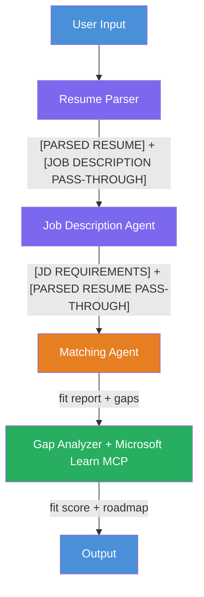

# 實驗室 02 - 多代理工作流程：履歷 → 工作匹配評估器

## 概覽

在此動手實驗中，你將使用 VS Code 中的 Foundry Toolkit 建立一個<strong>以工作流程為首的多代理應用程式</strong>，並將其部署至 Microsoft Foundry Agent 服務。

**你將建立的東西：** 一個履歷 → 工作匹配評估器，可以解析履歷與職務說明，評分匹配度，並使用 Microsoft Learn 資源產生個人化的學習路線圖。

---

## 架構

**運作方式：**
1. 使用者貼上履歷和職務說明。
2. **ResumeParser** 解析履歷，並將職務說明逐字複製到 `[JOB DESCRIPTION PASS-THROUGH]` 區塊。
3. **JD Agent** 從轉送的內容中擷取結構化需求，然後將 `[PARSED RESUME]` 作為 `[PARSED RESUME PASS-THROUGH]` 傳遞出去。
4. **MatchingAgent** 對 `[PARSED RESUME PASS-THROUGH]` 與 `[JD REQUIREMENTS]` 進行比對並產生匹配分數。
5. **GapAnalyzer** 將差距轉化為可行的路線圖，並透過 MCP 取得真實的 Microsoft Learn 連結。

---

## 預備知識

請先完成實驗室 01：

- [實驗室 01 - 單代理](../lab01-single-agent/README.md)

---

## 第 1 部分：依序閱讀模組

查看完整學習路徑：

- [實驗室 2 文件 - 預備知識](docs/00-prerequisites.md)
- [實驗室 2 文件 - 完整學習路徑](docs/README.md)
- [PersonalCareerCopilot 執行指南](PersonalCareerCopilot/README.md)

---

## 第 2 部分：建置並測試工作流程

1. 使用 Foundry Toolkit 精靈架構基於工作流程的專案。
2. 從 `PersonalCareerCopilot/main.py` 複製提示區塊與工作流程圖到你的工作區。
3. 以 Agent Inspector 在本機執行並驗證四個代理及 MCP 工具。
4. 在本機測試通過後，將託管代理部署到 Foundry。

---

## 編排模式

實驗室 02 使用<strong>序列管線</strong>：每個代理的輸出都會作為下一個代理的輸入，且工作流程會回傳最後一個代理的回應。有兩個模式讓此運作有效：

- <strong>序列鏈</strong> - `WorkflowBuilder` 將 ResumeParser → JD Agent → MatchingAgent → GapAnalyzer 串接，且每一步都只呼叫一次 `add_edge()`
- <strong>內容轉送</strong> - 因為每個代理只看到直接前任的輸出，ResumeParser 與 JD Agent 將下游代理需要的資料複製到標記的轉送區段

文件也說明了為什麼此實驗室不使用多工/多合模式，以及如何以另一個代理擴充圖形結構。

請參閱 [docs/04-orchestration-patterns.md](docs/04-orchestration-patterns.md)。

---

**先前章節：** [實驗室 01 - 單代理](../lab01-single-agent/README.md) · **回到：** [工作坊首頁](../../README.md)

---

<!-- CO-OP TRANSLATOR DISCLAIMER START -->
**免責聲明**：
此文件已使用 AI 翻譯服務 [Co-op Translator](https://github.com/Azure/co-op-translator) 進行翻譯。雖然我們努力追求準確性，但請注意自動翻譯可能包含錯誤或不準確之處。原始文件的母語版本應視為權威來源。對於關鍵資訊，建議採用專業人工翻譯。我們不對因使用此翻譯所產生的任何誤解或誤譯承擔責任。
<!-- CO-OP TRANSLATOR DISCLAIMER END -->